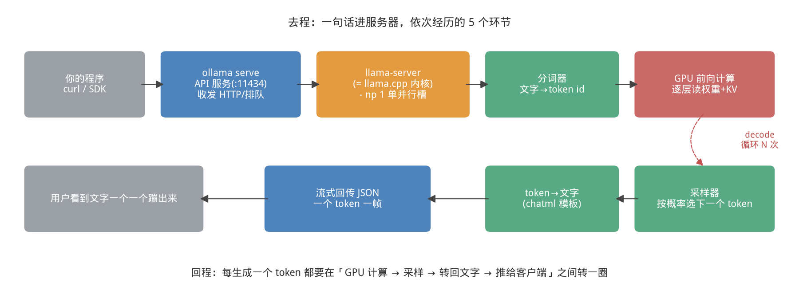
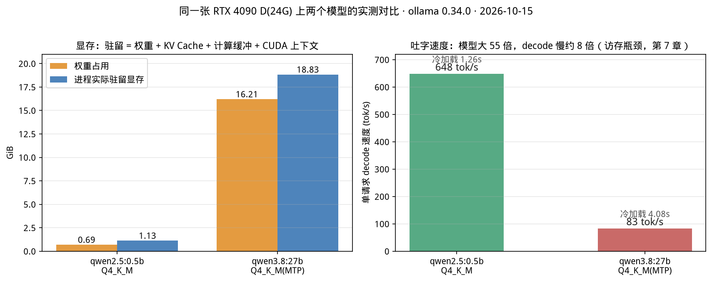
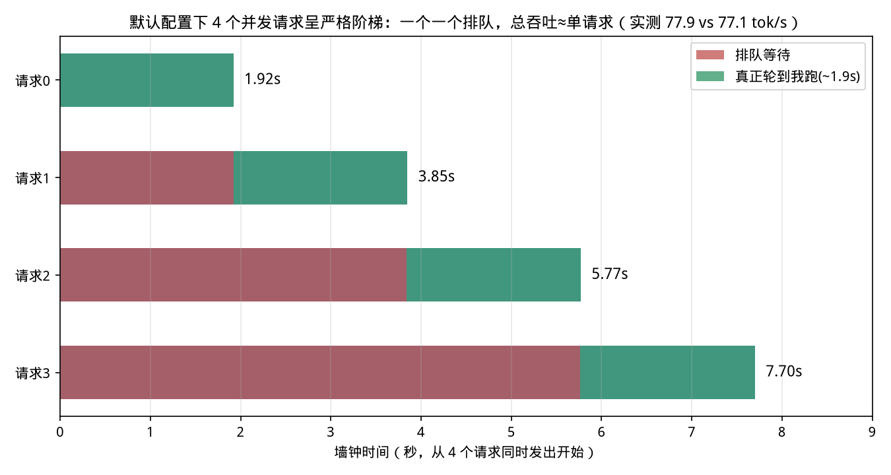

# 第 1 章｜破冰：一小时跑起第一个推理服务（Day 1）

> **这章讲什么**：不啃论文、不配环境，直接让一个大模型在你自己的机器上开口说话，然后拆给你看——"一句话进去，到字一个一个蹦出来"，这中间服务器到底干了哪几件事。
>
> **为什么重要**：今天你要建立全书最重要的一次"体感"。后面 59 天学的所有高深技术——PagedAttention、Continuous Batching、PD 分离——本质上都在解决你今天亲眼看到的两个现象：**冷启动要等**、**人一多就排队**。
>
> **学完能干什么**：独立安装 ollama、用命令行和 HTTP 两种方式调用模型、读懂 API 返回的每一个计数字段、算出一个模型占了多少显存、发现"多并发时它在装死"的证据。
>
> **真实工作里对应什么活**：这就是推理工程师入职第一天干的事——"先把服务拉起来，发个请求看看通不通，顺手看一眼显存和延迟"。只不过生产上那玩意儿叫 vLLM/TensorRT-LLM，不叫 ollama。
>
> **本章所有数字**均为 2026-10-15 在 **RTX 4090 D（24G）+ i9-14900K + ollama 0.34.0** 上实测，原始记录与复现脚本见 [code/ch01/RESULTS.md](../code/ch01/RESULTS.md)。你的机器数字会不同，量级和规律会一样。

---

> **前置知识路标**：本章假设你**只会装软件和敲命令行**——会下载安装包、会打开终端就行，不需要会 Python、不需要 GPU、不需要懂 Transformer。本章用到的显存算术只是"GB 相加减"，第 4 章才会正式给公式；看不懂的名词（prefill/decode/并发）先记下来，分别在第 3、5 章展开。

## 1.1 为什么用 ollama 破冰，而且只用一天

【类比：学开车先开自动挡，而不是先拆变速箱】

大模型推理的"变速箱"是 llama.cpp / vLLM 这些引擎，直接上手你会被编译依赖、CUDA 版本、权重格式按在地上摩擦。ollama 做的事就是把变速箱焊死、给你一辆自动挡车：一条命令装好，一条命令拉模型，一个回车开始聊天。

但正因为它把一切都"焊死"了，**你在它里面学不到 Infra 内核**——它替你做的每一个默认决定，都恰好是面试要考你的东西。所以本书对它的定位非常明确：

> **Day 1 用它建立体感，Day 20 起我们回到它的内核 llama.cpp 去扎马步，Day 31 起上真正的生产武器 vLLM。给 ollama 的时间预算：一天，多一分钟都不给。**

【坑：三个最常见的幻觉】

1. "ollama 是个推理引擎"——**不是**。本章 1.6 节我会给你看进程证据：它实际干活的二进制叫 `llama-server`，就是开源项目 llama.cpp 的官方服务程序。ollama 自己是 Go 语言写的一层"壳"：负责下载模型、包依赖、起进程、发 HTTP。
2. "我用 ollama 跑过并发，挺好的"——默认配置下它**一次只服务一个请求**，1.7 节有实测铁证。
3. "ollama 上快，说明模型快"——速度取决于**模型 + 量化 + 硬件 + 引擎**四件套，同一个模型换个引擎速度能差几倍。

---

## 1.2 十分钟跑起来：安装、拉模型、第一次对话

**安装（Linux；macOS/Windows 去官网下安装包，体验完全一样）**：

```bash
# 官方一键脚本（需要 sudo；离线/无 sudo 的用户态装法见 code/ch01 备注）
curl -fsSL https://ollama.com/install.sh | sh

# 验证：服务端会以 systemd 常驻 11434 端口
ollama --version          # 本书实测：ollama version is 0.34.0
curl http://localhost:11434/api/version   # {"version":"0.34.0"}
```

**拉一个小模型，开始聊天**：

```bash
ollama pull qwen2.5:0.5b        # Q4_K_M 量化，整包只有约 710 MiB
ollama run qwen2.5:0.5b "用一句话解释什么是大模型推理。"
```

实测回答（temperature=0）：

> 大模型推理是一种基于深度学习和大规模数据训练的智能系统，能够理解和处理复杂、多变的自然语言和图像数据……

先别嫌它答得像百科全书复读机，**重点是：710 MiB 的文件、一秒出字、没有配任何环境**。这就是 ollama 的全部魔法——而我们接下来要把魔法拆穿。

**模型选多大？** 第一天别贪大。按你的显存对照选：

| 你的显存 | 推荐破冰模型（Q4 量化） | 文件大小 | 本书实测 decode |
|---|---|---|---|
| 核显 / 无显卡也能玩 | qwen2.5:0.5b | ~710 MiB | CPU 也能跑，GPU 上 648 tok/s |
| 8 GB | qwen2.5:7b | ~4.7 GB | 数十 tok/s（第 10 章详测） |
| 24 GB | qwen2.5:14b / 27b-q4 | 9–17 GB | 14B 流畅；27B 实测 83 tok/s |

【自检：在继续之前，你应该已经能回答】模型文件下载到哪了？（Linux 默认 `/usr/share/ollama/.ollama/models` 或自定义 `OLLAMA_MODELS`，本机实测在 `/data/ollama/models`；`ollama list` 能看已下载的模型。）

---

## 1.3 一句话进去，服务器做了哪几件事

当你敲下回车，到文字一个一个蹦出来，服务器内部发生的事情，画成图是这样的（本章自绘，配套第 3、6 章会逐步深入每个框）：



**从这张图里你能看到什么**：

1. **去程只有一次，回程要转 N 圈**。你的 prompt 只被"阅读理解"**一次**（这一步叫 **prefill**，预填充）；之后模型每生成一个词，都要在"GPU 算一步 → 采样选一个词 → 转回文字 → 推给你"之间转一圈，转一圈出一个 token（每一圈叫一步 **decode**，解码）。回答 200 个词，就是 200 圈。
2. **真正算模型的是一个独立进程**。`ollama serve` 只是 API 门脸，它会为每个加载的模型拉起一个独立的 `llama-server` 子进程干活（1.6 节给证据）。
3. **文字和模型之间隔着一层"分词器"**。模型只认识整数 id，不认识汉字。"你好世界"进去先被切成 token id 序列，出来的 id 再拼回字符串。token 是什么、怎么切，是第 6 章的内容。

【类比：餐厅】你（请求）到餐厅门口，前台（ollama serve）接待下单，后厨（llama-server）做菜。点菜只点一次（prefill），但菜是一道一道上的（decode 一圈上一道），你也是吃到一道就能先动筷子，不用等满汉全席上齐——这就是**流式输出（streaming）**。

### 用 HTTP 再看一遍（工程视角）

ollama 同时提供两种 API，工程上必用第二种：

```bash
# ① ollama 原生接口，返回里自带全套计时字段（调试神器）
curl -s http://localhost:11434/api/generate -d '{
  "model": "qwen2.5:0.5b", "prompt": "你好", "stream": false}'

# ② OpenAI 兼容接口——生产世界的"普通话"，vLLM/SGLang/各家云全是这个接口
curl -s http://localhost:11434/v1/chat/completions -H 'Content-Type: application/json' -d '{
  "model": "qwen2.5:0.5b",
  "messages": [{"role":"user","content":"1+1=? 只回答数字"}]}'
# 实测返回：{"content":"1+1=2"}
```

> 记住 `/v1/chat/completions` 这个路径。60 天后你调的所有推理服务，不管背后是什么引擎，长的几乎都是这个样子。

---

## 1.4 把一次请求拆成计时表：第一次见到 prefill 和 decode

ollama 的 `/api/generate` 最良心的一点：**响应 JSON 自带纳秒级计时**。跑一下 [code/ch01/01_ollama_timing.py](../code/ch01/01_ollama_timing.py)，你会得到这样一张表（0.5B 模型，prompt 37 个 token，回答 43 个 token，实测）：

| 字段 | 含义（用人话说） | 实测值 |
|---|---|---|
| `total_duration` | 你发请求到收完答案的总耗时 | 0.089 s |
| `load_duration` | 把权重从磁盘搬进显存的时间 | 0.001 s（已在显存）/ **冷启动 1.263 s** |
| `prompt_eval_count/duration` | **prefill**：读 prompt 的 token 数和耗时 | 37 tok / 0.003 s ≈ **13,093 tok/s** |
| `eval_count/duration` | **decode**：逐字生成的 token 数和耗时 | 43 tok / 0.068 s ≈ **633 tok/s** |

**先建立两个数量级感觉，数字本身不用背：**

- prefill 是**万级 tok/s**，decode 是**百级 tok/s**——读 prompt 比写字快两个数量级。
- 用人话说：**prefill 像考试读卷子，可以一目十行并行处理；decode 像手写答案，写一个字才能想下一个字，天然只能串行。**

【坑：这两个阶段的性格截然相反，是整个推理优化的起点】
prefill 一次要算一大堆矩阵乘法，**吃算力（计算密集）**；decode 每步只进一个 token，却要把整个模型的权重从显存里读一遍，**吃显存带宽（访存密集）**。为什么 FlashAttention 存在、为什么量化有效、为什么 KV Cache 是显存杀手——全部从这条分叉长出来。第 3 章我们用算术强度公式把它算死，这里你只要先记住那张餐厅图：**点一次菜，上 N 道菜**。

### 冷启动：第一次为什么慢半拍

先 `ollama stop qwen2.5:0.5b` 把模型请出显存，再发请求，实测：

| 模型（量化后文件） | 冷加载 load_duration | 权重常驻时的显存 |
|---|---|---|
| 0.5B Q4（710 MiB） | **1.26 s** | 1.13 GiB |
| 27B Q4（17.4 GB） | **4.08 s** | 18.83 GiB |

【案例：生产里的"首问投诉"】真实线上事故：某内部问答平台早高峰第一个用户投诉"点开要等 10 秒"，后面的人都正常。排查发现夜间服务缩容把副本缩到 0，第一个请求要现场从磁盘加载 40GB 的 fp16 权重。解法：定时**预热**——每隔几分钟发一个保活请求，让模型常驻显存（ollama 默认就会驻留 5 分钟，`keep_alive` 参数可调）。这套"常驻 vs 冷加载"的取舍，第 23 章讲容量规划还会再见。

---

## 1.5 显存视角：模型文件 710 MiB，为什么占了 1155 MiB

新手最容易问的问题：我模型就 0.69 GiB，`nvidia-smi` 怎么显示吃了 1.13 GiB？同一张 4090 D 上两个模型实测对比如下：



**从这张图里你能看到什么**：

1. **进程驻留显存 = 权重 + KV Cache + 计算时的临时 buffer + CUDA 上下文（约 300–600 MiB 固定税）**。0.5B 的额外开销 0.44 GiB、27B 的额外开销约 2.6 GiB（27B 默认开了 32k 上下文，KV Cache 大）。
2. **模型参数大 55 倍（0.49B → 27B），decode 速度从 648 掉到 83 tok/s，慢约 8 倍**。因为 decode 每生成一个词都要把全部权重从显存读一遍——权重越大，每步搬运的数据越多。这就是"decode 是访存瓶颈"最直观的证据，第 7 章给你算显存带宽理论上限。
3. 跑 0.5B 时 GPU 利用率只有约 **61%**、整卡功耗 93–129 W（4090 TDP 425W）；跑 27B 时利用率 **98%**。**小模型把一张旗舰卡喂不饱**——这也是为什么服务端要靠 batching 把多个请求凑在一起喂 GPU（第 14 章）。

【自检】用 24G 的卡跑 17.4GB 的 27B 权重，为什么还能剩 5GB 多？这 5GB 留给了谁？（答：KV Cache、激活 buffer、CUDA 上下文。请记住这个数字感，第 15 章多卡并行、附录 B 显存估算都靠它。）

---

## 1.6 进程级证据：ollama 到底是不是"自己的引擎"

口说无凭。在模型生成一段长文本的瞬间，抓进程树和启动参数（`ps -ef` + 读 `/proc/<pid>/cmdline`），实测拿到：

```
ollama serve（Go 写的 API/模型管理服务，常驻）
└── /usr/local/lib/ollama/llama-server   ← 真正干活的推理进程
        --model .../blobs/sha256-c5396e06...   # GGUF 权重 blob
        -c 32768            # 上下文长度 32k
        -np 1                # ★并行槽=1：本章下一节的主角
        --cache-type-k q8_0 --cache-type-v q8_0   # KV Cache 默认 int8 量化
        --flash-attn on      # 默认开启 FlashAttention
        -b 1024 -ub 1024     # 逻辑/物理批大小
        --no-jinja --chat-template chatml          # 强制 chatml 对话模板
        --context-shift --keep 4                  # 超上下文时滑动窗口，保留前4个token
```

**这就是 ollama 的真相**：它打包的推理内核是 llama.cpp 官方的 `llama-server`，自己只做三件事——**藏编译依赖、建模型仓库、给标准 API**。这没什么丢人的，恰恰是极好的工程产品。但这件事决定了：

1. 想调引擎行为，本质是在调 llama.cpp 的参数（第 11、12 章我们直接读它的 C++ 源码）；
2. ollama 为了"开箱即用"，替你做了一堆默认决定。上面每一个参数都是一个"它替你选的、但面试会问你为什么"的决定：

| 它替你做的默认决定 | 好处 | 代价/坑（后面章节展开） |
|---|---|---|
| `-np 1` 单并行槽 | 单用户显存占用最省 | 多请求严格排队，没有真正并发（1.7 实测） |
| KV Cache 用 q8_0 | 长上下文省一半 KV 显存 | 有轻微精度损失，极敏感任务需手动关掉 |
| 强制 chatml 模板、`--no-jinja` | 适配 Qwen 系列 | 换模型家族时对话格式可能错，表现为"模型突然变笨/不跟指令" |
| `--context-shift --keep 4` | 超上下文不报错，挤掉最旧的 | 长文对话**悄悄丢前文**而不报警，是最难排查的坑之一 |
| 默认 32k 上下文 | 大多数场景够用 | 上下文开越大，预留 KV 显存越多，能开的并发槽越少 |

【坑："模型怎么变笨了"八成是模板的锅】社区里大量"ollama 上某模型不如官网聪明"的反馈，最后查出来都是 chat template 和采样参数（temperature/top_p）的默认值与模型官方推荐不符。记住：**模型权重决定智商上限，模板和采样决定你能发挥出多少**。

---

## 1.7 本章高潮实验：4 个人同时提问，会发生什么

跑 [code/ch01/03_concurrency.py](../code/ch01/03_concurrency.py)：向 27B 模型同时发 1 个和 4 个一模一样的请求（每个生成 150 token），实测：



| 场景 | 整批墙钟 | 4 个请求各自完成时刻 | 按墙钟算的聚合吞吐 |
|---|---|---|---|
| 同时发 1 个 | 1.95 s | 1.94 s | 77.1 tok/s |
| 同时发 4 个 | 7.70 s | **1.92 / 3.85 / 5.77 / 7.70 s** | **77.9 tok/s** |

**从这张图里你能看到什么（这是全书最重要的一张早期图，请盯 30 秒）：**

1. 完成时刻是一个**完美的阶梯**，每级间隔约 1.92 秒，恰好等于一个请求跑完的时间——**4 个请求被严格排队，一个一个串行执行**。铁证就是 `-np 1`。
2. 4 个请求一起跑，聚合吞吐 77.9 tok/s，和单请求 77.1 tok/s **几乎一模一样**。并发带来的吞吐增益 ≈ **0**。
3. 但诡异的是，每个请求返回的 `eval` 速度字段都显示 ~83 tok/s，"看起来没变慢"？**因为那个字段只统计'轮到我跑之后'的速度，不含排队**。第 4 个用户实际等了 7.7 秒才拿到完整回答，其中 5.8 秒在排队。

> 【类比】这就像奶茶店只有一个店员：一次做一杯。4 个人一起下单，店员没变慢（出杯速度还是 83 杯/秒的手速），但第 4 个客人就是要等 4 倍时间。多请几个店员一起做（多请求同时占用 GPU），就是后面 Continuous Batching 要干的事。

**这件事定义了我们 60 天的主战场**：真实生产里，用户不会一个一个来。推理 Infra 工程师的全部工作，用一句话说，就是——

> **在显存装得下、SLO 守得住的前提下，让这张"人多了就排队"的崩塌曲线，尽量往右推。**

具体怎么推？把多个请求在 GPU 上**真正拼批一起算**（Continuous Batching，第 14 章）、让 KV Cache 别产生碎片（PagedAttention，第 13 章）、多卡分担（第 15 章）、小模型替大模型打草稿（第 20 章）。今天你只需要亲眼看见这堵墙，**并记住撞墙的感觉**。

【坑：别在 ollama 上做并发压测然后得出"大模型不行"的结论】2026 年的 ollama 已支持设置并行槽（环境变量/参数调整后 llama-server 会以 `-np >1` 启动，底层 llama.cpp 也有连续批处理能力），但它的设计目标仍是**本地单用户**：显存预留策略保守、没有分布式、调度器极简。压并发是第 16、19 章用 vLLM 干的事。

---

## 1.8 收尾：今天你脑子里应该装进的三句话

1. **推理 = 一次 prefill（读题，吃算力）+ N 次 decode（写答案，吃显存带宽），流式一个 token 一个 token 往外蹦。**
2. **显存驻留 = 权重 + KV Cache + 临时 buffer + CUDA 上下文；decode 速度大体反比于权重量级，因为每步都要把权重读一遍。**
3. **ollama 是 llama.cpp（llama-server）的产品级封装，默认单槽串行；它是今天最好的老师，但不是生产武器。**

【配图建议：本章三张图均为实测数据图/自绘示意图，已入 `images/figures/ch01/`。如需补一张 ollama 官网模型库或 GitHub 页的真实截图，建议自己浏览器截图后存入 `images/real/ch01/` 并在 CREDITS.md 登记来源（官网 logo 为商标，不要热链）。】

---

### 【落地视角】
这是你整条本地推理链路的第一天：`ollama pull` 拉模型、`ollama run` 起交互、`ollama serve` 起服务，三个命令背后是"模型分发—进程调度—端口服务"三件事（ch18 会把它们逐一拆开）。真实工作里对应的动作是：新人入职第一天在自己的机器上跑通一个能调用的推理端点——后面 24 章的所有实验（压测、profile、A/B）都要站在这个能跑起来的服务上。

### 【化学家视角】
Ollama 像**预制试剂平台**：模型是配好的标准品，pull 下来就能做实验，你不必先自己合成（搭推理栈）。但和用标准品做实验一样——你得知道它的"成分表"（默认量化档、默认上下文长度、默认采样参数），否则实验结果（回答质量）出了偏差你解释不了（第 18 章的"变笨"四根因就是这本成分表）。

### 【应急方案】
模型拉不下来：先查磁盘与网络，换 Ollama 镜像源或用 `OLLAMA_MODELS` 指到大盘；服务起不来：`ollama list` 确认模型在不在、端口 11434 是否被占；跑起来极慢：确认不是 CPU-only（看任务管理器 GPU 占用）以及模型量化档是不是太大——**先证明"能跑"，再谈"跑得快"**（第 3 章才开始算快慢）。

---

## 动手任务（不做等于没学）

**任务 A：跑通"破冰三连"（预计 30 分钟）**

1. 安装 ollama，`ollama pull qwen2.5:0.5b`，命令行完成一次对话；
2. 运行 `python3 code/ch01/01_ollama_timing.py`，把你机器上的四个计时字段抄下来；
3. 用 curl 调一次 `/v1/chat/completions`，确认 OpenAI 兼容端点可用。

**任务 B：冷启动与显存账（预计 20 分钟）**

1. 运行 `python3 code/ch01/02_cold_start.py`，记录冷加载秒数；
2. 模型加载后另开终端跑 `watch -n 0.5 nvidia-smi`，肉眼确认显存驻留数字；
3. 用 `/api/ps` 的 `size` 与 `size_vram` 验证：你的模型是不是**全部层都在显存**（两者相等）。

**任务 C（选做但强烈建议）：亲眼看见排队墙（预计 30 分钟）**

有 12G+ 显存就 pull 一个 14B/27B 的 Q4 模型，改 `code/ch01/03_concurrency.py` 里的 MODEL 名字，跑 1 vs 4 并发；显存小就用 0.5B 把 `num_predict` 调到 600 也能看出阶梯。

**验收标准（能答上来才算过）**：

- [ ] 能默写出请求全链路的 5 个环节，并指出 prefill 和 decode 分别在哪；
- [ ] 能解释 `load / prompt_eval / eval` 三个时长分别对应什么；
- [ ] 能用自己的数字说明"权重 0.69 GiB 为什么显存占了 1.13 GiB"；
- [ ] 能拿出并发阶梯的数据，说出"为什么聚合吞吐没涨"以及"锅在哪个启动参数"。

## 自检三问

1. 为什么 prefill 吞吐能到万级 tok/s，而 decode 只有几百？这两个阶段分别在饿什么资源？（答不上来：重读 1.4，预告：第 3 章）
2. 同一个请求，用户感知的"快"对应哪个指标，"顺"对应哪个指标？（提示：第一口要等多久 vs 之后每口隔多久——第 5 章 TTFT/TPOT 正式命名）
3. 如果老板让你用一台机器同时服务 50 个内部用户聊天，你会继续用默认配置的 ollama 吗？你怀疑要改哪里？（带着这个问题进第 2 章看行业，再一路走到第 14 章）

> **下一章（Day 2）**：跳出技术，抬头看路——AI Infra 到底是个什么行业、谁在招人、开多少钱、JD 上的黑话分别对应本书哪一章。技术决定你能不能干，行业认知决定你往哪走、简历往哪投。

## 面试话术（3 条）

**话术 1（我会什么）**："我从零搭过本地推理链路：Ollama 拉模型、跑通交互与 OpenAI 兼容端点、做过 4 路并发的极限小实验，理解模型分发/进程调度/默认参数注入三件事——这是我后面系统学推理 Infra 的起点，后续我沿着 Roofline、KV Cache、调度器一条线补到了服务化。"

**话术 2（追问 Ollama 是什么）**："它是模型分发器 + 进程调度器 + 参数注入器的组合：`ollama pull` 管 GGUF 分发，`ollama serve` 起常驻服务监听 11434，进程按请求拉起或复用。注意它默认注入 Q4 量化、num_ctx 2048 等参数——所以'同模型不同工具有时回答不一样'，参数口径要显式核对（第 18 章拆过这个坑）。"

**话术 3（边界）**："Ollama 适合开发与轻量本地场景；要压测到崩溃点、做 A/B 或生产服务，我会换 vLLM/SGLang——接口层都保持 OpenAI 兼容，客户端不用改。选型的判断是按场景走决策树，不是按工具名气。"

