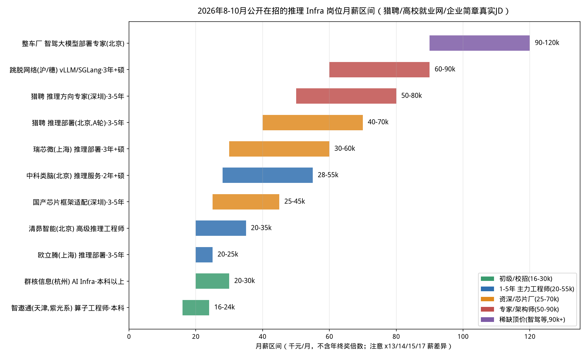
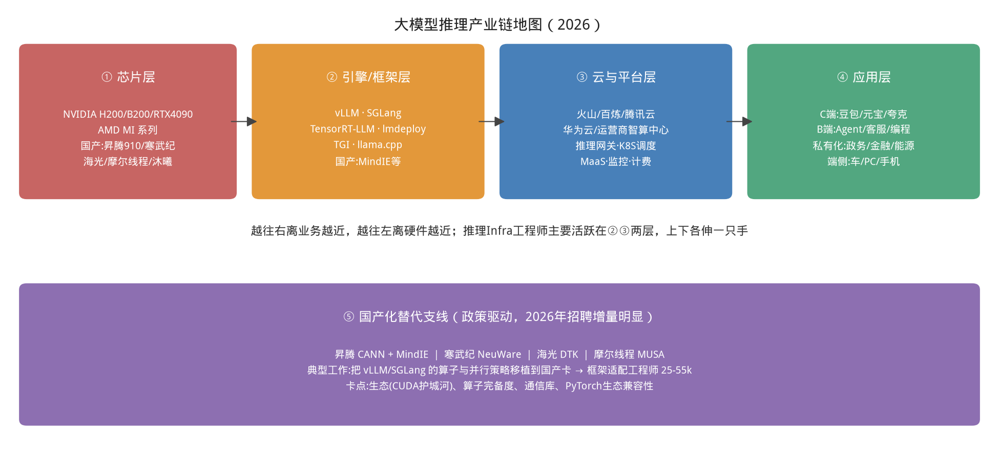

# 第 2 章｜行业认知与岗位地图（Day 2）

> **这章讲什么**：暂时离开技术，抬头看路。AI Infra 到底是个什么行当、训练和推理两条赛道差在哪、2026 年谁在招人开多少钱、JD 上一堆黑话到底要你会什么、这条产业链长什么样、你未来三年能走到哪。
>
> **为什么重要**：技术决定你"能不能干"，行业认知决定你"往哪走、简历往哪投、60 天该重点砸哪"。同样是熬夜，有人 60 天后投错了方向，有人照着 JD 反推学习清单——差距在今天就拉开了。
>
> **学完能干什么**：看懂任何一条推理 Infra JD 的每一句话，把它翻译成本书章节；算出一个 offer 的年现金包；说清产业链上每一层谁在赚钱、国产化替代的机会在哪；给自己的职业路径定个位。
>
> **真实工作里对应什么活**：资深工程师面试前做"岗位逆向"、团队 leader 做技术选型与 HC 申请、求职者做 offer 对比——都是这一章的动作。
>
> **数据说明**：本章薪资全部来自 2026 年 8–10 月的公开招聘信息（猎聘、高校就业网、企业校招简章），来源清单附在章末。招聘信息有时效性，数字是**量级锚点，不是承诺**；你读到时可能又涨了，请按 2.6 节的方法自己复查。

---

## 2.1 AI Infra 到底在干什么：一句话与两条赛道

**一句话定义：AI Infra（人工智能基础设施）就是让模型跑得更快、更省、更稳的那一整套软硬件系统。**

用人话说：算法研究员负责"把模型造出来"，Infra 工程师负责"让这个模型在真实流量下好好活着"。模型本身是发动机，Infra 是底盘、变速箱、变速箱油、4S 店保养体系和高速公路。

这个行当分两条赛道，性格差别极大：

| 维度 | 训练 Infra | 推理 Infra（本书方向） |
|---|---|---|
| 干什么 | 把模型从随机参数训出来、训得快 | 把训好的模型对外服务、又快又省又稳 |
| 核心阶段 | forward + **backward**（要存梯度、要反向传播） | **prefill + decode**（只前向，无反向） |
| 负载形态 | 离线大 batch、任务排队、跑数天 | 在线、请求长短不一（1 个字到 100 万字）、7×24 小时 |
| 第一 KPI | 训练吞吐、MFU（硬件算力利用率）、训练时长 | TTFT/TPOT、P99 延迟、单 token 成本、成功率 |
| 硬件规模 | 万卡集群、InfiniBand 全互联是标配 | 单卡到几百卡都有，更强调弹性与利用率 |
| 典型雇主 | 头部大模型公司、云大厂，数量少而集中 | **几乎所有用 AI 的公司都要**：模型公司、云厂、芯片厂、央企、车厂、SaaS |
| 入门门槛 | 分布式系统 + CUDA + 算法三者都要深，坑位少 | 同样的知识面，但允许"先懂系统与服务、再逐步深 kernel"，坑位多而分散 |

### 为什么推理 Infra 是当下最适合算法工程师切进去的方向

1. **你的存量技能直接复用**。你已经知道 Transformer、attention、KV Cache 的概念、写过 PyTorch——这些在训练 Infra 那里只是入场券的零头，在推理方向却是理解调度和量化的地基。第 3–6 章就是帮你把这些"算法知识"翻译成"系统语言"。
2. **不要求你第一天就会写 CUDA kernel**。翻遍下面的真实 JD 你会发现：入门岗的高频要求是"用过/改过 vLLM、会定位瓶颈、懂 KV Cache 和批处理"，kernel 优化（CUDA/Triton/CUTLASS）通常是**加分项或高级岗要求**。本书的策略是：先成为"会用 profile 工具指挥 kernel 的人"，再决定要不要成为"亲手写 kernel 的人"。
3. **坑位多、团队散、需求刚**。第 1 章你看到的 27B 模型，一张 4090 就能跑；但一个日调用百万次的业务，每个月的 GPU 账单是六位数起步。**推理是每一家 AI 公司每天醒来都在烧的钱，降本 10% 就是纯利润**，所以从大模型公司到央企到车厂都在招。
4. **成果可量化、可自证、可包装**。"吞吐提升 2.3 倍、P99 延迟降 40%、单卡成本降 35%"——这种战绩写在简历上是硬通货，而且你在家用一张 4090 就能跑出同样口径的数据（项目二、项目三干的就是这事）。清昴智能的 JD 甚至直接写明："有 Kernel 优化 20%+ 战绩""量化的国产芯片性能优化战绩（相对 baseline 提升 30%+）"——**他们要的不是你懂多少名词，是你拿得出对比数字**。
5. **系统经验是资产，不是包袱**。第 23 章会升华这一点：PagedAttention 是虚拟内存的翻版，Continuous Batching 是连接池/翻台，弹性伸缩是老 SRE 技能。后台开发转过来的人，在"服务化、可观测、容量规划"这半本书上有天然优势。

【自检】如果一家公司只有 3 个人天天训模型、没有线上业务，它需要推理工程师吗？（答：基本不需要。找雇主先找"有真实线上推理流量"的公司——这是判断岗位含金量的第一筛子。）

---

## 2.2 谁在招人、开多少钱：2026 年真实 JD 与薪资

先学会读招聘信息的"黑话数字"：**30-60k·15薪** = 月薪 3 万到 6 万、一年发 15 个月，年现金包 **45–90 万**（税前，不含期权）。用 [code/ch02/salary_calc.py](../code/ch02/salary_calc.py) 可以自己换算。

### 2.2.1 任务锚点的四家公司（均已核实到 2026 年原始页面）

| 公司 | 岗位 | 地点 | 薪资 | 门槛 | 这家公司的看点 |
|---|---|---|---|---|---|
| 智遨通（天津，紫光系） | 算子工程师 | 天津（成都/海口也有） | **16–24k** | 本科，招 6 人 | JD 原文要"算子库开发、编译优化、把 PyTorch/vLLM 适配到自研芯片"——典型的**国产芯片适配入口岗**，适合预算有限、想先入行的人 |
| 群核信息（KTransformers 母公司） | AI Infra 工程师 | 杭州 | **20k 以上** | 本科及以上，招 5 人 | 知名 CPU-GPU 异构推理框架 **KTransformers/KVCache.AI 就出自这家**，能接触开源引擎本体（第 18、22 章会讲到它） |
| 智象未来（合肥） | AI Infra 算法工程师 | 合肥/北京 | 面议（同司算法岗标 20k+） | 本科及以上 | JD 原文："熟悉 CUDA 与 GPU 性能分析工具；熟悉模型量化、**KV Cache 优化、动态批处理**；熟悉容器化"——几乎是本书目录的缩写 |
| 清昴智能（北京） | 高级推理工程师 | 北京 | **20–35k×14（年约 28–49 万）** | 校招"星耀计划"上不封顶 | 做 **Agent Infra（AaaS）**，JD 技术密度是这批公司里最高的之一（2.3 节拿它当教材拆） |

### 2.2.2 社招大盘：一张图看清自己的价格带

下图是 2026 年 10 月猎聘在招岗位的月薪区间实采样（同一家公司不同级别跨度很大，图中取代表性 JD）：



**从这张图里你能看到什么**：

1. **价格带分五层，和年限强相关，但更和"你能不能解决具体问题"相关**：初级/校招 16–30k；1–5 年主力 20–55k；资深/芯片厂 25–70k；专家/架构师 50–90k；智驾等稀缺方向能开到 90–120k。
2. **硕士是社招中高端岗的高频门槛，但本科不是死路**：图中瑞芯微 30–60k×15、跳脱网络 60–90k×17 都写"3 年以上硕士"，但专家档不少岗位写"本科"。对转行的你，破局点是**作品集 + 可验证的性能战绩**，而不是再去读个学位。
3. **"·N 薪"才是拉开差距的暗手**：60–90k×17 意味着年现金 **102–153 万**，比同样月薪但 ×12 的岗位多 40%。谈 offer 时只谈月薪不谈薪数是新手错误。
4. **国产芯片适配和端侧/智驾是两个溢价支线**：国产框架适配 25–45k（深圳），央企模型适配与算子优化 40–55k×13；车厂智驾大模型部署专家开到 90–120k——因为同时懂推理和端侧约束的人极少。

部分原始 JD 抽样（均可在章末来源列表复核）：

| 岗位/公司 | 地点·门槛 | 薪资 |
|---|---|---|
| 大模型推理部署工程师（欧立腾，外包/咨询） | 上海浦东·3-5 年本科 | 20–25k×13 |
| 大模型推理部署工程师（瑞芯微，上市芯片厂） | 上海·3 年+硕士 | 30–60k×15 |
| 大模型推理部署工程师（A 轮知名公司） | 北京·3-5 年本科 | 40–70k×15 |
| AI Infra 推理方向（技术专家/首席架构师） | 深圳·3-5 年 | 50–80k |
| 推理部署工程师（vLLM/SGLang，跳脱网络） | 沪/穗·3 年+硕士 | 60–90k×17 |
| AI Infra 大模型推理服务（集群部署，中科类脑） | 北京·2 年+硕士 | 28–55k |
| 国央企·大模型部署与推理加速 | 北京西城·3-8 年硕士 | 29–40k×14 |
| 大模型部署与推理加速（某大型云/大数据公司） | 北京西城·3-5 年硕士 | 35–55k×18 |
| 智驾大模型部署与推理优化（整车厂） | 北京 | 90–120k |

### 2.2.3 校招与头部锚点

- **2027 届校招大盘预测**（牛客讨论汇总，仅作量级参考）：大模型/Agent 方向"白菜价"约 30k×15（年约 45 万），SP 档总包约 70 万，SSP 算法岗 41–42k×17 + 20–30 万奖金（年约 90–101 万）。注意高的两档是**算法/大模型核心岗**，不是 Agent 应用开发。
- **DeepSeek**（杭州）：服务端开发（大模型研究中台/线上核心服务）30–60k×16，学历经验不限——"线上核心服务"就是推理 Infra 的坑位。
- **海外锚点**：NVIDIA "AI Inference Performance" 工程师，美国 L4 基本薪资 18.4 万–28.75 万美元、L5 为 22.4 万–35.65 万美元（另含股权）。换算感受一下推理性能方向在全球市场的定价。

【坑：看薪资的三个常见误判】① 只看月薪不乘薪数；② 把"薪资面议"当没诚意——智象未来这类公司往往要靠面试定级，作品集就是议价筹码；③ 拿一线大厂 SSP 的新闻当自己的底线价，忽略了地域（合肥/天津的生活成本和杭州/北京完全不同）和门槛（顶会论文/核心实习）。

---

## 2.3 JD 黑话逐句翻译：每一句对应本书哪一章

下面这张表是本章**求职价值最高的一张表**，左栏全是从清昴智能、智象未来、智遨通、猎聘 JD 原文里摘的高频词。以后看到任何 JD，把它往这张表上对，就知道对方要什么、自己差什么。

| JD 黑话（原文常见写法） | 用人话翻译 | 对应章节 |
|---|---|---|
| 熟悉 prefill/decode 两阶段差异 | 知道读题和写字是两种负载，优化手段不同 | 第 3 章 |
| KV Cache 优化 / KV Cache 量化 | 管好那个"记住前文"的显存大户，或给它降精度省显存 | 第 4、13、10 章 |
| 动态批处理 / Continuous Batching | 请求不用凑齐一波，谁完谁走、新人插队，把 GPU 喂饱 | 第 14、17 章 |
| PagedAttention / 分页式 KV 管理 | 像操作系统管虚拟内存一样管 KV 显存，消除碎片 | 第 13、17 章 |
| Chunked Prefill | 长 prompt 切成小块，插队和 decode 一起调度，别让一个长请求堵死全队 | 第 14 章 |
| PD 分离（Prefill-Decode 分离） | 读题和写字用两拨机器，各自配最适合的硬件 | 第 21 章 |
| 并行推理 / TP / PP / EP / 多卡张量并行 | 一个模型切到多张卡/多台机上跑 | 第 15 章 |
| 模型量化（GPTQ/AWQ/SmoothQuant/FP8/W8A8） | 把权重从 16 位压到 8 位/4 位，省显存和带宽，还不能变笨 | 第 10 章 |
| 投机解码 / 投机采样（Speculative Decoding/MTP/EAGLE） | 小模型先打草稿、大模型批量批改，一次出多个字 | 第 20、22 章 |
| 前缀缓存 / Prefix Cache / RadixAttention | 大家 system prompt 相同的部分只算一次、反复复用 | 第 16 章 |
| MoE 推理 / 专家并行 / 异构调度 | 稀疏模型每次只激活一部分专家，专家放 GPU/内存/SSD 怎么调度 | 第 21、22 章 |
| 高性能算子 / 算子融合 / Kernel 优化 / CUDA / Triton / CUTLASS | 手写或融合 GPU 小程序，把关键算压榨到硬件极限（高级岗/加分项） | 第 7–8 章打底，进阶靠项目三 |
| 会用 Nsight Systems/Compute（nsys/ncu）做性能分析 | 出了性能问题能上 profiler 取证，而不是拍脑袋 | 第 8、24 章 |
| 弹性扩缩容 / 推理副本调度 / 优先级抢占 | 流量大了自动加机器、小了自动缩；重要请求插队 | 第 23 章 |
| OpenAI 兼容 API / SSE 流式 / 推理网关 | 做一个所有客户端都能直接对接的服务门脸 | 第 1、23 章 |
| P99 尾延迟 / SLO / 过载保护 / 防止雪崩 | 保证 99% 的请求足够快；流量打爆时排队超时和 OOM 不能连锁崩盘 | 第 5、23 章 |
| 超长上下文 / 多模态推理 | 100 万字 prompt 的首字延迟问题；图文/视频模型的额外显存与算子 | 第 21 章 |
| Day-0 模型支持 | 新模型发布当天就能上线：拆结构、补算子、配并行和量化 | 第 18、22 章综合能力 |
| 国产芯片适配（昇腾 CANN/MindIE、寒武纪、海光、MUSA） | 把 vLLM/SGLang 的算子和并行移植到非 NVIDIA 卡 | 第 8、18 章 + 2.4 节支线 |
| 有开源贡献（给 vLLM/SGLang 提过非平凡 PR）优先 | 看代码不怵、能和社区对话——这是中级升高级的硬门槛 | 第 13–18 章全程练 |

【案例：把一条完整 JD 翻译成人话】清昴智能"高级推理工程师"原文要求："能阅读 SGLang（首选）/vLLM/TensorRT-LLM/lmdeploy 源码，独立提交非平凡功能/性能改动；熟悉推理全链路（Attention/KV Cache/量化/投机采样/MoE）及调度问题（Continuous Batching/Chunked Prefill/PD 分离）；有 Kernel 优化 20%+ 战绩，熟练使用 Nsight；了解 FP8 生产部署、H100/H200/国产芯片、跨硬件统一抽象。"

翻译：**"我们要一个读完本书第 13–22 章、并且真的动过手的人**：能改引擎源码而不是只会启动命令；每个核心技术名词你都要能讲清原理和收益；给一个优化任务你能量化出 20%；会用 profiler 拿证据；知道最新硬件和量化怎么落地。"——你看，60 天的地图就是照着这种 JD 反推出来的。

---

## 2.4 产业链地图：钱和机会在哪四层



**从这张图里你能看到什么**：

1. **四层一条链**：①芯片（NVIDIA/AMD/昇腾/寒武纪……）→ ②引擎框架（vLLM/SGLang/TensorRT-LLM/lmdeploy/llama.cpp……）→ ③云与平台（火山引擎、阿里百炼、腾讯云、华为云、运营商智算中心，以及网关、K8S 调度、MaaS、监控计费）→ ④应用（豆包/元宝/夸克这类 C 端，Agent/客服/编程这类 B 端，政务金融私有化，车/PC/手机端侧）。**Infra 工程师主要站在②③两层，但必须向上懂业务指标、向下懂硬件约束。**
2. **国产化替代是一条独立的高需求支线**。政策驱动下，央企、政务、金融项目大量要求昇腾/寒武纪/海光方案，对应工作就是"把 vLLM/SGLang 适配到国产卡"：新紫光前沿院（智遨通的关联平台）校招 JD 原文就写"将 vLLM、SGLang、Megatron 适配到自研芯片"；深圳的芯片框架适配岗 25–45k。**卡点也很诚实**：CUDA 生态护城河、算子完备度、集合通信库（对标 NCCL 的 HCCL 等）、与 PyTorch 生态的兼容度。走这条支线，第 8 章的硬件基础和第 18 章的引擎抽象层要格外扎实。
3. **越往下游，业务话术越重要；越往上游，硬件与 kernel 话术越重要。** 求职时按你的性格选：喜欢和数字/硬件死磕→偏①②；喜欢和业务/SLO/成本打交道→偏②③。

【自检】群核信息在产业链哪一层？（②引擎层，KTransformers 是它的开源名片）。运营商新建的智算中心在招你去管 K8S 上的推理副本，是哪一层？（③平台层）。

---

## 2.5 三种典型落地面貌：同一个头衔，三种完全不同的活

"推理工程师"在三类公司干的事情差异大到像三个职业。投简历前务必分清：

### 面貌一：大厂/模型公司的 C 端推理平台

- **场景**：豆包、元宝、夸克这类千万级日活产品，背后是 H200/H100 集群，7×24 小时顶着洪峰流量。
- **核心矛盾**：**成本与 SLO 的双人舞**。日调用量以亿计，单 token 成本降 10% 一年就是几千万；同时 P99 首字延迟必须压住，否则用户立刻流失。
- **你会干什么**：vLLM/SGLang 深度二开、PD 分离与 KV 跨节点传输、前缀缓存、混部调度、压测到崩溃点再做容量规划（本书项目三的形态）。清昴 JD 里"日均百万级请求的压测与调优""PD 分离部署架构或 KV Cache 分布式缓存"就是这类活。
- **特点**：分工细、数据多、要求深；成长快但个人只负责大系统的一小块。

### 面貌二：行业私有化部署（央企/政务/金融/能源）

- **场景**：某银行的内部知识库、某政务大厅的审批助手、能源集团的生产问答。数据不出内网，机房里是 8 卡小集群甚至一台一体机，国产卡比例高。
- **核心矛盾**：**可控、安全、合规 > 极致性能**。断网安装、模型可审计、故障现场能救火，比多 20% 吞吐重要。
- **你会干什么**：昇腾 CANN/MindIE 或 llama.cpp 离线部署、模型选型与量化（项目一的形态）、私有化交付、和驻场运维扯皮。
- **数字参考**：国央企推理加速岗 29–40k×14（北京，3–8 年硕士），国产模型适配与算子优化 40–55k×13。**特点**：节奏稳、出差多、国产化技能溢价、对"全栈独立交付"能力要求高——非常适合本书"一个人打通全链路"的训练方式。

### 面貌三：端侧与边缘（车、PC、手机、IoT）

- **场景**：车机里的语音助手（车规芯片，功耗和功能安全卡死）、RTX 4060 笔记本本地跑模型、手机端 NPU。
- **核心矛盾**：**显存/内存极限、功耗预算、延迟的确定性**。"平均延迟"在这里不够用，要的是"每一帧都不能抖"。
- **你会干什么**：INT4/更激进的量化、llama.cpp/MLC-LLM 端侧引擎、NPU 算子适配、把 7B 塞进 8GB。猎聘端侧座舱岗 25–35k×15（浦东，4 年+），整车厂智驾部署专家 90–120k。
- **特点**：坑少但单价高、复合门槛（推理 + 嵌入式 + 芯片）；适合从硬件/嵌入式背景转来的人。

【类比】面貌一是**中央厨房**：规模、流水线、成本核算到每一粒米；面貌二是**包场酒席**：客人规矩多、要什么都得自己上、出了事你是唯一的救火队；面貌三是**野战口粮**：每克重量都要抠，难吃点没关系但必须稳、必须快。

---

## 2.6 职业路径：为什么"懂系统 + 懂模型"的人更抗周期

**典型上升通道（3–8 年视角）**：

```
推理/部署工程师（会部署、会压测、会排障）
   └─ 性能专家（能改引擎、能量化收益、懂 CUDA 与通信）
        └─ 推理引擎负责人（管 vLLM/SGLang 二开与技术选型）
             └─ 推理平台架构师（集群、调度、成本、SLO、混部全负责）
```

支线也很宽：往芯片侧走（国产卡框架适配/厂商 SA）、往端侧走（车/手机推理）、往平台与 SRE 走（MaaS 平台、容量与稳定性）、往开源社区走（committer 本身就是硬背书）。

**为什么说这条路径抗周期**：

1. **你是卖铲子的人**。模型架构三年换了五茬（BERT→GPT→MoE→多模态→Agent），但"让模型在便宜硬件上又快又稳地服务"这个需求只会越来越大。模型会过时，prefill/decode、显存层次、调度与排队这些系统原理不会。
2. **复合壁垒高**。纯算法的竞争者是全世界的应届生和论文；纯后台不懂 attention 和 KV Cache 接不上手；**"懂模型的系统工程师"正好卡在两个群体的交集**，这就是你的护城河。
3. **价值可直接换算成钱**。你的每一次优化都对应账单上的数字，这在降本周期里是最安全的岗位类型之一。
4. 2026 年的新闻里，大模型研究员三年收入翻 6 倍、也有明星研究员流动引发关注——算法明星的价格波动剧烈；而推理 Infra 的需求随**调用量**增长，调用量是整个行业最确定的趋势。

【坑：两个自我定位误区】① "我必须先成为 CUDA 大神才配投"——错，JD 里会部署、会调度、会 profile 的坑位远多于纯 kernel 坑位，本书的顺序就是按真实能力需求排的；② "我先攒着，等学完 60 天再看机会"——错，**今天就去刷 JD、加招聘群、约 informational interview**，市场反馈本身就是最好的教材，第 25 章还会带你做简历和模拟面试。

---

## 动手任务（不做等于没学）

**任务 A：JD 逆向工程（40 分钟，本章核心作业）**

1. 打开猎聘/ Boss / 牛客，搜索"大模型推理""推理引擎""AI Infra"，各挑 1 条：①模型公司或大厂；②国产芯片/央企；③端侧或车厂，共 3 条；
2. 用 2.3 的表逐句标注：每条要求对应本书哪一章；不会的词记下来，60 天后回来再看；
3. 把 3 条 JD 的要求归成三类：**已会 / 本书会教 / 需要额外补**（比如某些要求特定行业知识），做成一张 gap 分析表。

**验收标准**：

- [ ] 能指着任意一条 JD 说出"这家属于产业链哪层、三种面貌哪种、核心 KPI 是什么"；
- [ ] 3 条 JD 里至少 80% 的技术黑话能在 2.3 的表里找到对应章节。

**任务 B：算清你的目标价（10 分钟）**

运行 `python3 code/ch02/salary_calc.py`，把任务 A 里 3 个岗位的月薪×薪数换算成年现金包，结合城市生活成本，写下你 60 天后的"保底/目标/冲刺"三个数字。

**任务 C（选做）：投递环境侦察**

注册一个招聘平台小号，订阅"推理"关键词，观察一周：每天新增多少岗位、哪些公司反复出现、哪些技术词出现频率最高。第 25 章写简历时你会感谢现在的自己。

## 自检三问

1. 训练 Infra 和推理 Infra 在负载、KPI、雇主分布上各有什么不同？为什么后者更适合从算法岗切入？
2. "30-60k·15薪"年现金包是多少？这类岗位 JD 里出现 vLLM、Continuous Batching、PD 分离、nsys，分别对应本书哪几章？
3. 央企私有化、大厂 C 端平台、车厂端侧，三种岗位你最想去哪种？它最看重的三个能力是什么？——把答案写在你的学习计划首页，60 天后回看。

> **下一章（Day 3–5）**：进入硬核地基。我们要回答整个推理优化的"第一性问题"：为什么推理有 prefill 和 decode 两个阶段？凭什么说一个是算力瓶颈、一个是访存瓶颈？你将第一次用算术强度公式把"感觉"算成"数字"。

---

## 资料来源（2026-10-15 检索，薪资具时效性，请自行复查）

1. 猎聘《大模型推理部署工程师》在招列表：https://m.liepin.com/zpdmxtlbsgcsq35q/
2. 猎聘《AI 推理引擎》招聘专场：https://www.liepin.com/s/aizlsvtecm4eq/pn1/
3. 清昴智能 2026 秋季校园招聘（中国石油大学就业网转载）：https://career.cup.edu.cn/campus/view/id/460198
4. 智遨通（天津）算子工程师（南开大学就业网）：https://career.nankai.edu.cn/correcruit/content/id/118522.html
5. 群核信息 AI Infra 工程师（中国科学技术大学就业网）：http://www.job.ustc.edu.cn/Internship/list.aspx?itemid=324100
6. 智象未来 AI Infra 算法工程师（中国科学技术大学就业网）：http://www.job.ustc.edu.cn/Jobinformation/list.aspx?itemid=324613
7. AI 芯片推理框架适配工程师（昇腾/寒武纪/海光等，猎聘）：https://www.liepin.com/a/80039721.shtml
8. 2027 届校招薪资讨论（牛客）：https://m.nowcoder.com/discuss/1677858
9. DeepSeek 招聘信息（猎聘公司页）：https://m.liepin.com/company-jobs/21147967/
10. NVIDIA Senior SWE – AI Inference Performance（Built In）：https://builtindublin.ie/job/senior-software-engineer-ai-inference-performance/10873386
11. 新紫光集团前沿技术研究院校招（vLLM/SGLang/Megatron 国产芯片适配）：https://brightchip.jobs.feishu.cn/428482/position/list
12. 央企模型适配与算子优化工程师（猎聘）：https://www.liepin.com/a/78206779.shtml
