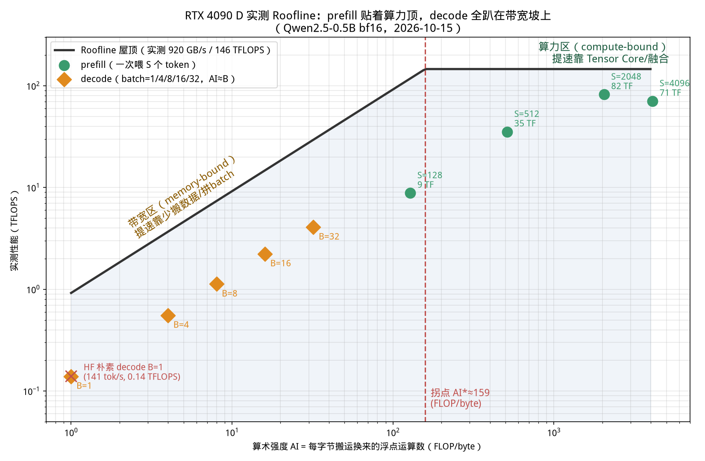
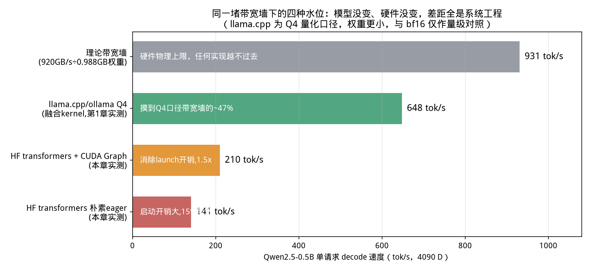
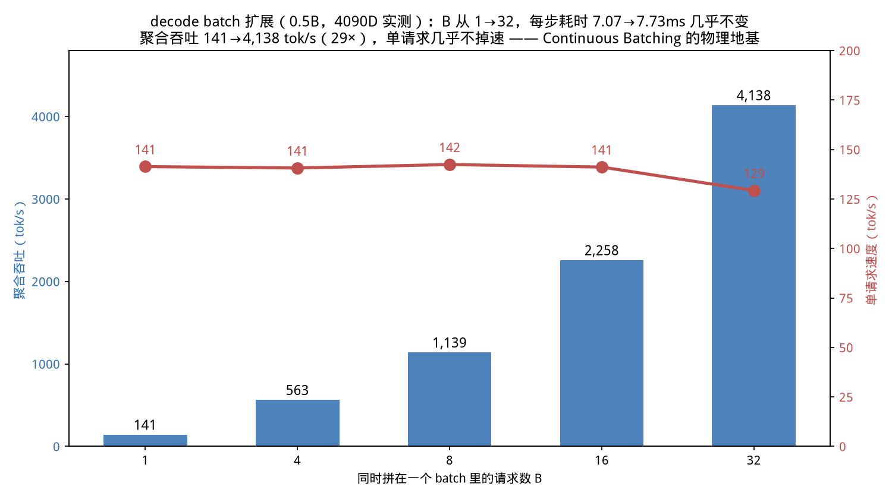

# 第 3 章｜训练 vs 推理：prefill 与 decode 是两个世界（Day 3–5）

> **这章讲什么**：回答整个推理优化的"第一性问题"——为什么推理要分 prefill 和 decode 两个阶段？凭什么说一个吃算力、一个吃显存带宽？我们用一页公式把"感觉"算成数字，再在你的 4090 上亲手量出证据。
>
> **为什么重要**：**这是全书最硬核的一块地基**。后面 40 天你学的每一个技术——量化、FlashAttention、PagedAttention、Continuous Batching、张量并行、投机解码、PD 分离——全部是从这一章的那张 Roofline 图上长出来的。你可以忘掉任何一章的细节，但不能忘掉"decode 趴在带宽坡上、prefill 贴着算力顶"这张画面。
>
> **学完能干什么**：拿到任意一张 GPU 规格表和任意一个模型，30 秒内估算出它 decode 的理论 tok/s 上限；看到一个优化手段能立刻判断它在搬哪堵墙；读懂 ncu 报告里的"算力利用率"和"带宽利用率"为什么永远是一对跷跷板。
>
> **真实工作里对应什么活**：性能调优的第一性动作永远是"定位瓶颈在算力还是带宽"。面试时被问"decode 为什么慢"，80% 的候选人只会背"自回归"，能张嘴就给你算出算术强度的人直接进入下一轮。
>
> **本章数字**全部为 2026-10-15 在 **RTX 4090 D + Qwen2.5-0.5B（bf16）** 上实测，脚本与原始数据见 [code/ch03/](../code/ch03/RESULTS.md)。

---

> **前置知识路标**：需要第 1 章的"餐厅图"（备菜/上菜两阶段的体感）和最基础的乘除法；本章会第一次出现**算术强度公式**，跟着代数走即可（每一步代入都写全了）。会 Python 更好但不是必须——实测脚本在 [code/ch03/](../code/ch03/)，不写代码也能读懂结果表。前置体感没有？回去跑一遍 1.4 节再回来。

```bash
# 本章两个实测脚本（在仓库根目录执行；需 GPU，模型会自动从 HuggingFace 拉取）
python3 code/ch03/01_prefill_decode_probe.py      # prefill/decode 分阶段计时探测
python3 code/ch03/02_roofline_microbench.py       # 算术强度与 Roofline 微基准
# 结果落盘在 code/ch03/*.json；不跑也可以，直接读 code/ch03/RESULTS.md 的表
```

## 3.1 先想清楚：训练和推理，差的不只是一个反向传播

新手常以为"推理 = 训练去掉 backward"。这话对了一半，但工程上两者是**两种生意**：

| 对比项 | 训练 | 推理（本书主角） |
|---|---|---|
| 计算内容 | forward + backward + 优化器更新 | **只有 forward** |
| 每 token 计算量 | 约 **6N** FLOPs（前向 2N + 反向 4N，N=参数量） | 约 **2N** FLOPs |
| 要不要存中间结果 | 要，存激活等反向用，显存压力巨大 | 不要，算完即弃（但要存 KV Cache） |
| 请求形态 | 离线、自己决定 batch，一条任务跑几小时几天 | **在线**，用户随时来、prompt 从 1 个字到 100 万字 |
| 追求什么 | **吞吐**：总 FLOPs 固定，越快跑完越省钱 | **延迟 + 吞吐 + 成本的三角平衡**：用户正盯着屏幕等 |
| batch 大小 | 动辄几千几万 token，把 GPU 彻底喂饱 | 单请求时 batch=1，小得可怜（见本章实测） |
| 约束条件 | 断点续训、并行策略、收敛性 | TTFT/TPOT、P99、并发数、成功率、显存碎片 |

用人话说：**训练是夜班工厂批量生产——货车一整车一整车地拉原料，只关心今晚能出多少货；推理是白天的奶茶店——客人一个一个进店、点单长短不一，你既要出杯快、又要队伍不炸、还不能让原料烂在店里。**

这个差异导致了一个反直觉的结论：**训练从第一天起就是"算力-bound"的大 batch 世界；而推理里最常见、最难伺候的 decode 阶段，是"访存-bound"的小 batch 世界。** 训练 Infra 的那套经验（堆大卡、InfiniBand、万卡集群）只能覆盖推理的一半，另一半是全新的战场。

【自检】训练一个 7B 模型每 token 大约多少 FLOPs？推理生成一个 token 呢？（6N vs 2N，差 3 倍——但这只是故事的开头。）

---

## 3.2 把第 1 章的餐厅图算成数字：两个阶段各自在搬什么

回忆第 1 章：prompt 只被读一遍（**prefill**），之后每生成一个 token 转一圈（**decode**）。现在我们把这两圈的"工作量"算出来。

设模型参数量为 $N$（单位：个），一个 decode step 只处理 **1 个新 token**。Transformer 前向的主要计算是线性层（矩阵乘），经验上：

$$
\text{FLOPs}_{\text{每 token}} \approx 2N
$$

大白话：每个参数对每个 token 大约做一次乘法 + 一次加法（权重 × 激活，再加起来），所以是 2 次浮点运算。0.5B 模型生成一个 token ≈ $2 \times 0.494\times10^9 \approx 0.99\times10^9$ FLOPs ≈ **1 GFLOPs**。

现在问：为了这 1 GFLOPs 的计算，GPU 要从显存里搬多少数据？batch=1、bf16（每参数 2 字节）时，每个 decode step 都要把**整个模型的权重读一遍**（第 $l$ 层的计算需要第 $l$ 层权重，而每个 token 都要经过全部层）：

$$
\text{Bytes}_{\text{decode, }b=1} \approx 2N \ \text{字节（权重）} \quad\Rightarrow\quad
\text{AI}_{\text{decode}} = \frac{2N\ \text{FLOPs}}{2N\ \text{字节}} \approx \mathbf{1\ FLOP/byte}
$$

**算术强度（Arithmetic Intensity, AI）= 每搬 1 字节数据能做多少次浮点运算**。decode batch=1 的 AI 约等于 **1**——搬一箱子弹药，只打出一枪。

那 prefill 呢？一次喂入 $S$ 个 token，计算量变成 $2N\cdot S$，但**权重仍然只读一遍**（同一批矩阵乘服务 S 个 token，权重复用 S 次）：

$$
\text{AI}_{\text{prefill}} = \frac{2N\cdot S}{2N} \approx \mathbf{S\ FLOP/byte}
$$

S=2048 时 AI ≈ **2048**——搬一箱子弹药，打出两千枪。这就是"读题快、写字慢"的数学根源：**不是 decode 的算子差，而是它的算术强度低了三个数量级。**

> 补充一笔严谨性：decode 每步还要读 KV Cache（越长读得越多）、写新的 K/V；prefill 还有 attention 的 $O(S^2)$ 项。对 0.5B、S=2048 这个量级它们占比不大（KV 读取约为权重的十几个百分点），不改变结论。KV 随序列变长而变大的账，第 4 章细算。

---

## 3.3 Roofline：一张图看懂"算力墙"和"带宽墙"

GPU 的性能不是想跑多快跑多快，它头顶有**两堵墙**：

$$
P_{\text{可达}} = \min\big(\ \underbrace{\pi}_{\text{算力峰值}},\ \underbrace{\beta \times \text{AI}}_{\text{带宽} \times \text{算术强度}}\ \big)
$$

- $\pi$：芯片每秒能做的浮点运算上限（FLOPS），由 Tensor Core/CUDA Core 数量决定；
- $\beta$：显存带宽上限（bytes/s），由显存颗粒和位宽决定；
- AI 很低时，性能 = β×AI，**斜着的"带宽墙"**：你算力再强也没用，数据供不上；
- AI 很高时，性能 = π，**水平的"算力墙"**：数据管够，算子算不过来；
- 两堵墙的交点叫**拐点**：$\text{AI}^* = \pi/\beta$。

【类比：做饭】算力是厨师的手速，带宽是从仓库往灶台运菜的传送带。做一道满汉全席（AI 高），厨师手速决定出餐速度；只热一杯牛奶（AI=1），厨师 99% 的时间站在灶台等传送带把那一盒牛奶送来。**你不能靠"换个手更快的厨师"解决等传送带的问题。**

### 亲手量出这张 4090 D 的两堵墙

不查参数表、不信广告，用 [code/ch03/02_roofline_microbench.py](../code/ch03/02_roofline_microbench.py) 自己量（大矩阵乘量算力，大张量 copy 量带宽），实测：

| 墙 | 实测值 | 怎么量的 |
|---|---|---|
| 算力墙 π（bf16 Tensor Core，dense） | **146 TFLOPS** | 12288³ 的 bf16 矩阵乘，2MNK 计时 |
| 带宽墙 β（大张量 copy） | **920 GB/s** | 4 GB 张量 copy（读 1 份+写 1 份），多次平均 |
| 拐点 AI* | **≈159 FLOP/byte** | 146×10¹² ÷ 920×10⁹ |

【坑：把 FP32 指标当成 FP16 算力，是新手第一大坑】RTX 4090/4090D 规格表里那个常被引用的 **82.6 TFLOPS 是 FP32（CUDA Core）指标**；大模型推理用 bf16/fp16，走的是 Tensor Core，4090 D dense 峰值实测 146 TFLOPS（稀疏翻倍）。面试时张口就把 82.6 当 FP16，会被直接判定"没跑过卡"。查规格一定看清精度档位（FP32 / FP16-BF16 / FP8 / INT8 各有一个数）。

把 3.2 的两个 AI 值和实测点画到屋顶上：



**从这张图里你能看到什么（盯一分钟）**：

1. **prefill 的绿点全在图的右半边（AI=128~4096），S=2048 时实测 82 TFLOPS，已经撞上算力墙的腰**——prefill 是计算密集型，吃满 Tensor Core 是它的使命。
2. **decode 的橙点全在图的左半边（AI=1~32），全部趴在带宽斜墙上**。哪怕 B=32，AI≈32 仍远低于拐点 159——算力对 decode 来说是严重过剩资源，这也是第 1 章 0.5B 单请求 GPU 利用率只有 61%、算力视角近乎"空转"的原因。
3. 两群点之间横着一个数量级以上的鸿沟。**"prefill 和 decode 是两个世界"不是修辞，是这张图上的物理距离。**

---

## 3.4 prefill 实测：长 prompt 是怎么把 Tensor Core 喂饱的

[code/ch03/01_prefill_decode_probe.py](../code/ch03/01_prefill_decode_probe.py) A 组，让模型一次前向处理不同长度的输入：

| 输入长度 S | 前向耗时 | 均摊每 token | achieved 算力 |
|---|---|---|---|
| 128 | 14.33 ms | 0.112 ms | 8.8 TFLOPS（峰值 6%） |
| 512 | 14.31 ms | 0.028 ms | 35.3 TFLOPS（24%） |
| **2048** | **24.63 ms** | **0.012 ms** | **82.2 TFLOPS（56%）** |
| 4096 | 57.27 ms | 0.014 ms | 70.7 TFLOPS（48%） |

读法：

1. **S 从 128 涨到 2048，总耗时只涨了 70%，算力利用却从 6% 飙到 56%**。因为矩阵变大后，权重被充分复用，Tensor Core 这种"大兵团"才摆得开。S=2048 时均摊 **0.012 ms/token，即约 8.3 万 tok/s**——对比第 1 章 decode 的 648 tok/s，差出 128 倍。
2. **S=128 为什么只有 6%？** 小矩阵乘撑不满 114 个 SM 的调度，加上几十个 kernel 的固定启动开销摊在很短的时间里。注意它 AI=128 虽小于拐点 159，理论上在带宽区，但 8.8 TFLOPS 离带宽墙（0.92×128≈118 TFLOPS）也差得远——这叫**除了算力和带宽，还有第三类损耗：调度/启动开销**。小模型 + 短序列尤其明显。
3. S=4096 算力回落到 48%，是 attention 的 $O(S^2)$ 占比上升 + KV 变大所致——这正是 FlashAttention 要解决的问题（3.7 节预告）。

**对工程的直接含义**：prefill 的优化方向是"让矩阵更大、让 kernel 更硬"——所以长 prompt 在推理系统里不是纯负担，它反而是 GPU 利用率的朋友；第 14 章的 **Chunked Prefill** 就是故意把长 prompt 切块、塞进 decode 的空闲算力槽里。

---

## 3.5 decode 实测：同一堵墙下的四种水位

这是本章最能改变直觉的一组实验。同一个 0.5B 模型、同一张 4090 D，单请求 decode 速度：



| 实现方式 | tok/s | 解释 |
|---|---|---|
| 理论带宽墙（bf16，920 GB/s ÷ 0.988 GB 权重） | **931** | 物理上限：每步至少要把 0.988 GB 权重搬一遍，约 1.07 ms，任何软件都越不过去 |
| llama.cpp / ollama（Q4，第 1 章实测） | **648** | 融合 kernel + 高效 GEMV；且 Q4 量化把权重砍到约 0.69 GiB，等于把墙抬高 |
| HF transformers + CUDA Graph（本章实测） | **210** | 同样的 kernel，只是把几百次 kernel launch 录制成一次回放，1.5× |
| HF transformers 朴素 eager（本章实测） | **141** | 每步几百个小 kernel 各自启动，有效带宽只用了 140 GB/s（15%） |

**从这张阶梯图里你要拿走三个认知**：

1. **decode 的速度首先是被带宽定义的，不是被算力定义的。** 算一下理论墙：920 GB/s ÷ 0.988 GB ≈ 931 tok/s。再快的实现也不可能超过它。你在第 1 章看到的 648 tok/s、83 tok/s，本质上都能用"权重字节 ÷ 带宽"在 30 秒内估出量级。
2. **离墙有多远，决定了优化空间有多大。** 朴素实现 141，墙在 931——这意味着不动模型、不动硬件，纯系统优化有 **6.6 倍**空间可挖。vLLM/llama.cpp 工程师的大量日常就是在爬这面坡：融合小 kernel（把 RMSNorm+Linear、SiPU+Linear 等焊一起，少启动、少往返显存）、CUDA Graph（消除 launch）、专用 GEMV/GQA kernel。
3. **CUDA Graph 值多少钱，实测说了算：1.5×。** 它不减少任何一个浮点运算、不省一个字节，只是把"发射几百个小 kernel"这件事提前录好、一步回放。这是"decode 的损耗常常不在数学而在调度"的直接证据。

【类比】decode 一步像送一趟快递：货（权重）是固定一整车，真正的运输时间（带宽搬运）之外，还花在 500 个小区门口分别登记、开门、排队（kernel launch 与小算子访存）上。CUDA Graph 是提前办好全城通行证；算子融合是把 500 个包裹打包成 50 个；量化是直接把货物减重 4 倍。

【坑：为什么我用更大的模型时，"理论墙"估得特别准？】模型越大，固定调度开销占比越小，实现越接近带宽墙。第 1 章 27B Q4：权重 17.4 GB（Q4，约 4.3 bit/参数），17.4 GB ÷ 1008 GB/s ≈ 17.3 ms/步 → 理论约 58 tok/s，实测 79–83 tok/s 比理论还高一点——因为它开了 **MTP（多 token 预测，第 20、22 章细讲）**，一步产出不止一个 token。**你看，一个反常的实测数字，反而当场逼出了一个新技术名词，这就是性能分析的乐趣。**

---

## 3.6 本章最重要的实测：把 batch 拼起来，decode 原地起飞 29 倍

如果 decode 注定搬整份权重，那让一份权重同时服务多个请求呢？[code/ch03/01_prefill_decode_probe.py](../code/ch03/01_prefill_decode_probe.py) D 组，把 B 个请求的 decode 拼在一个 batch：



| batch B | 每步耗时 | 单请求速度 | 聚合吞吐 |
|---|---|---|---|
| 1 | 7.07 ms | 141 tok/s | 141 tok/s |
| 4 | 7.11 ms | 141 tok/s | 563 tok/s |
| 8 | 7.02 ms | 142 tok/s | 1,139 tok/s |
| 16 | 7.08 ms | 141 tok/s | 2,258 tok/s |
| 32 | 7.73 ms | 129 tok/s | **4,138 tok/s** |

**B 从 1 涨到 32，每步耗时几乎不变（+9%），聚合吞吐涨了 29.4 倍，而每个请求自己几乎没掉速。**

用人话说：**那一整车权重本来就要送，车上装 1 个包裹还是 32 个包裹，油钱（带宽搬运）几乎一样。** 从算术强度看，batch=B 的 decode：

$$
\text{FLOPs}=2N\cdot B,\qquad \text{Bytes}\approx 2N\ \Rightarrow\ \text{AI}\approx B
$$

拼 batch 就是把 decode 的点沿着 Roofline 斜墙**向右上方推**：AI 从 1 推到 32，离拐点 159 还有距离，所以还没到收益递减区——这也是 Roofline 图上 B=1/4/8/16/32 那串橙点的含义。

现在请你回头看第 1 章 ollama 的 4 并发阶梯（严格排队、聚合吞吐零增长），再看这张图（拼批后 29 倍）——**两个世界的对比就是整个推理引擎行业存在的理由**。生产引擎最核心的调度工作，就是在显存允许的前提下，尽可能把更多进行中的请求拼进同一个 decode batch，同时保证每个请求的 TPOT 不超 SLO。这件事在工程上的名字你已经在第 2 章 JD 表里见过了：**Continuous Batching（第 14 章）**；而让大 batch 不被显存碎片卡死的技术叫 **PagedAttention（第 13 章）**。

B=32 时单请求从 141 掉到 129，是 KV 读取和激活变大的早期信号——batch 不是越大越好，**最优 batch 由显存容量、KV 增长、TPOT 红线三者共同决定**，这正是第 5、14、23 章反复算的账。

> **【业界数据对照卡片】你的 ×29.4 和 vLLM 论文的 24×/2–4×，为什么都对**
>
> | 口径 | 数字 | 测的是什么 | 来源 |
> |---|---|---|---|
> | 本章实测（4090D，0.5B，同引擎手动拼批） | ×**29.4**（141→4,138 tok/s），步时仅 +9% | **单点物理上界**：纯 kernel 侧、batch 拼大能赚多少 | code/ch03 D 组 |
> | vLLM 官方基准（ShareGPT 真实分布） | 比 HuggingFace Transformers **14–24×**、比 TGI **2.2–3.5×** | **整套系统换 naive 基线** | vLLM 官方 benchmark |
> | vLLM SOSP'23 论文（同行评审口径） | 同延迟下比 FasterTransformer/Orca **2–4×**，KV 浪费从 **60–80% 压到 <4%** | **系统对系统的硬核对比** | PagedAttention, SOSP 2023 |
>
> 三个数字不冲突：倍数取决于**基线是谁**（naive HF 服务是公认弱基线）和**改了几层**（我们只动 batch，论文动了调度+分页+连续批处理）。面试引用倍数必须带基线和场景，否则会被人一句话问倒。
> 来源：vLLM 论文 "Efficient Memory Management for Large Language Model Serving with PagedAttention"（SOSP 2023）及官方基准页，2026-10-16 检索。

---

## 3.7 全书技术地图：每一项优化，都在搬这两堵墙

把本章学到的"瓶颈定位法"反过来用——**看到任何推理优化名词，先问：它是在减字节、提算术强度、还是减调度损耗？** 这张表是你后 40 天的导航图：

| 技术 | 它在 Roofline 上干了什么 | 主要受益阶段 | 章节 |
|---|---|---|---|
| **量化**（INT8/INT4/FP8，GPTQ/AWQ） | 权重（和 KV）字节数直接减半到减 75%，分母变小、带宽墙抬高 | decode | 第 10 章 |
| **KV Cache 量化 / 驱逐 / 压缩** | 减少每步要读的 KV 字节，长上下文尤其明显 | decode | 第 10、21 章 |
| **GQA / MQA**（分组/多查询注意力） | K/V 头数砍到 1/8 甚至 1/1，KV 字节同比例下降 | decode | 第 4 章 |
| **FlashAttention** | 重排 attention 计算顺序，大幅减少 HBM 往返读写（不减 FLOPs，减字节） | prefill 为主，decode 也受益 | 附录 F/第 7 章 |
| **Continuous Batching** | AI 从 1 推到 B，沿带宽墙向右上爬 | decode | 第 14 章 |
| **Chunked Prefill** | 把高 AI 的 prefill 切块填进 decode 的算力空隙 | 两阶段混合 | 第 14 章 |
| **PagedAttention** | 不直接提速；消除 KV 显存碎片，让更大 batch/更长上下文成为可能 | decode（间接） | 第 13 章 |
| **张量并行 TP** | 权重字节摊到多卡，多堵带宽墙并行搬；代价是 all-reduce 通信税 | decode/大模型 | 第 15 章 |
| **投机解码 / MTP / EAGLE** | 一步验证 k 个候选 token，等效每步产出多个 token、AI 提升 | decode | 第 20 章 |
| **PD 分离** | prefill 队和 decode 队分开部署，分别配"算力型/带宽型"硬件与 batch 策略 | 系统级 | 第 21 章 |
| **CUDA Graph / 算子融合** | 消除 launch 与中间张量往返，爬向带宽墙 | decode | 第 11、14 章 |
| **CPU/NVMe offload、分层 KV** | 显存放不下时用更便宜更慢的介质，用钱和延迟换容量 | decode/长上下文 | 第 12、21 章 |

【自检】遮住右两列，只看技术名，你能不能自己说出"它减字节还是提 AI、帮 prefill 还是 decode"？说不全没关系——学完对应章节回到这张表自测，这是最好的复习。

【坑：优化之前先证明瓶颈，否则全是玄学】真实事故：某团队给一个 decode 服务花两周手写融合 kernel 提速 5%，后来 ncu 一看该服务 80% 时间在等 PCIe 上的 CPU offload——**墙在传输，不在算子**。本章教你的 Roofline 心法，落到工作里就是一句纪律：**没有 profile 证据，不做优化；优化之后，数字必须回填到同一条曲线上。** 第 8、24 章带你用 nsys/ncu 完成这个闭环。

---

## 3.8 收尾：把本章浓缩成可以面试默写的五句话

1. 推理只有 forward，每 token 约 2N FLOPs；prefill 一次处理 S 个 token，AI≈S（算力-bound）；decode 每步 1 个 token 却要读全部权重，AI≈1（带宽-bound）。
2. Roofline：性能 = min(峰值算力, 带宽×AI)；4090 D 实测两堵墙是 **146 TFLOPS（bf16）/ 920 GB/s**，拐点 AI≈**159**。
3. 实测 prefill S=2048 跑到 82 TFLOPS；decode batch=1 只有 141 tok/s、有效带宽 15%——加 CUDA Graph 到 210，llama.cpp 融合 kernel + Q4 到 648，理论墙 931。
4. decode 拼 batch：B=32 时步时仅 +9%、聚合吞吐 ×29——Continuous Batching 的物理地基；最优 batch 由显存、KV、TPOT 共同卡死。
5. 一切推理优化都可归类为"减字节 / 提算术强度 / 减调度损耗"；动手优化前先用 profile 指认瓶颈。

---

### 【落地视角】
本章给你全书唯一的"总坐标系"：**Roofline 判断瓶颈在哪、算术强度解释为什么、prefill/decode 两阶段解释差在哪**。之后每一项优化——chunked prefill、前缀缓存、投机解码、PD 分离——你都要能回答"它搬的是算力墙还是带宽墙"（3.7 节的技术地图）。实操上，接到任何"推理慢"的求助，第一反应是画出它落在 Roofline 哪一侧，再谈动作。

### 【化学家视角】
prefill 像**批量投料一次性反应**（吞吐 bound，瓶颈在反应器总处理量）；decode 像**逐滴滴定并逐步读数**（延迟 bound，瓶颈在每次加样的传递速度）。Roofline 就是反应器选型图：搅拌快还是换热快决定放大瓶颈——同一个装置，换个操作方式（换阶段），瓶颈就换边。这解释了为什么"一个模型、两种优化策略"。

### 【应急方案】
Roofline 实测落点和理论对不上：按三查——① 计时口径（有没有包含数据搬运与冷启动，ch06 教的 warmup）；② 精度口径（bf16 峰值别拿 FP32 代）；③ 批大小（M=1 的落点本来就该趴在带宽墙根，见 ch07 实测 0.7%）。三查后仍差一个量级：怀疑算子碎片化或量化误差，进 ch07 的 profile 流程，**不要跳过取证直接改参数**。

---

## 动手任务（不做等于没学）

**任务 A：量出你自己卡的两堵墙（30 分钟）**

1. `conda activate` 到有 torch 的环境，运行 `python code/ch03/02_roofline_microbench.py`；
2. 记录你的 bf16 算力峰值与 copy 带宽，算出拐点 AI*（没有 N 卡就租一张云端 T4/4090 按小时跑，成本几块钱）；
3. 查官方规格表核对：注意区分 FP32 与 FP16/BF16 两档数字，把两者都记下来。

**验收**：能不看脚本默算"我这张卡的拐点是多少"。

**任务 B：复现 prefill/decode 两群点（40 分钟）**

1. `python code/ch03/01_prefill_decode_probe.py`（模型可换成你感兴趣的 1.5B/7B，注意显存）；
2. 对照 Roofline 图，确认你的 prefill 点在右、decode 点在左；
3. 把 B 改成 64（显存够的话），观察单请求速度从哪里开始明显下滑——找到你这张卡+这个模型的收益拐点。

**任务 C：纸面推导（15 分钟，面试同款题）**

不运行代码，估算并写出过程：
1. 7B 模型 bf16，权重多少 GB？在 4090 D（920 GB/s 实测带宽）上 decode 理论上限约多少 tok/s？（参考：约 14 GB → ≈66 tok/s）
2. 如果把它 INT4 量化（权重按 4 bit 算），理论上限变成多少？（≈260 tok/s）
3. 为什么实际部署中很难摸到理论墙？至少说出三个损耗来源。

## 自检三问

1. 用算术强度解释：为什么"换算力更强的卡"对单请求 decode 的帮助往往不如"换带宽更高的卡"或"量化"？
2. prefill S=128 时算力利用率只有 6%，它是被带宽卡住的吗？如果不是，损耗来自哪里？怎么验证？
3. 老板说"给服务换张贵一倍的旗舰卡，decode 应该快一倍"，你怎么用本章的数据和图表跟他解释/反驳？

> **下一章（Day 6–7）**：我们把镜头从"每秒的速度"拉到"显存放得下吗"——逐 token 追踪 KV Cache 的写入、读取与释放，亲手算清 7B 模型在 batch=1、seq=2048 下 KV Cache 到底吃掉多少显存，以及为什么它才是长上下文和高并发的真正显存杀手。

## 面试话术（3 条）

**话术 1（prefill vs decode，90 秒）**："一句话：prefill 算力 bound、decode 显存带宽 bound。prefill 一次性并行算几千个 token，算术强度高，落 Roofline 计算侧；decode 每步只出一个 token，权重要整个搬一遍，算术强度约等于 1，落带宽侧——我实测过 M=1 的 GEMM 只跑到 bf16 峰值的 0.7%（4090D 口径）。所以优化分两路：prefill 拼大 batch 喂算力，decode 抠带宽（量化/投机解码都是抠带宽）。边界：batch 大时 decode 也会滑向计算侧，batch=1 碎片化时 prefill 也跑不满——所以要以实测落点为准，不背结论。"

**话术 2（算术强度）**："算术强度 = FLOPs/字节，我记的表达式是 bh/(b+h)（矩阵乘口径）：b 和 h 都大时接近 h，可以喂满算力；有一维是 1 时强度低，喂不满。Roofline 的拐点就是它等于'峰值算力 ÷ 带宽'的位置——我的实测拐点约 159（4090D bf16），与另一章从内存层次算的 153 互证。判断任何优化的归属，先算它的算术强度落在哪侧。"

**话术 3（为什么两个阶段必须分开优化）** "因为瓶颈不同、指标不同、手段互斥：prefill 关乎 TTFT（长 prompt 堵门，解法是 chunked prefill 切块），decode 关乎 TPOT（batch 扩展，解法是 continuous batching 与 KV 管理）。把两者混在一个口径里调优，会出现'吞吐涨了但 p99 崩了'的假进步——这也是 PD 分离把两者拆到不同 GPU 的根本动机。"

