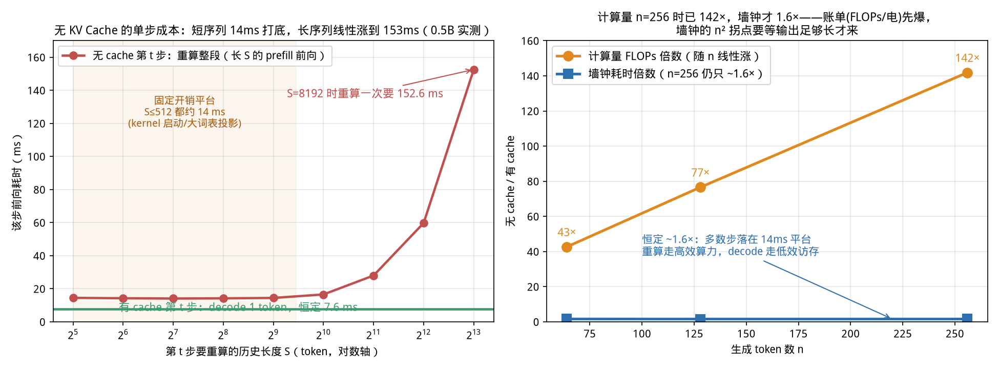
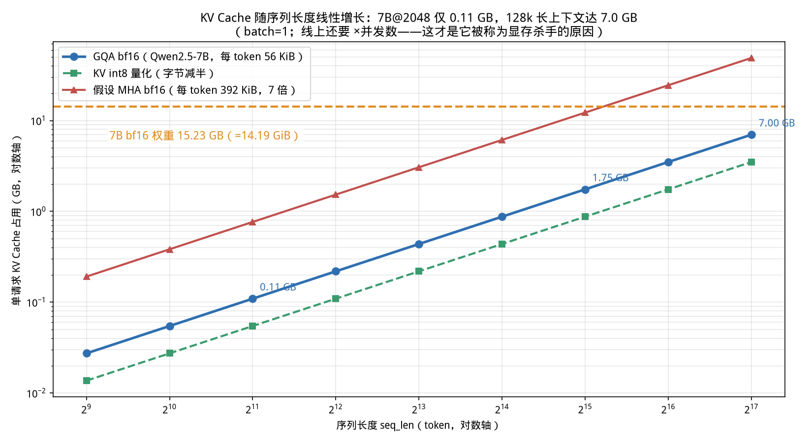
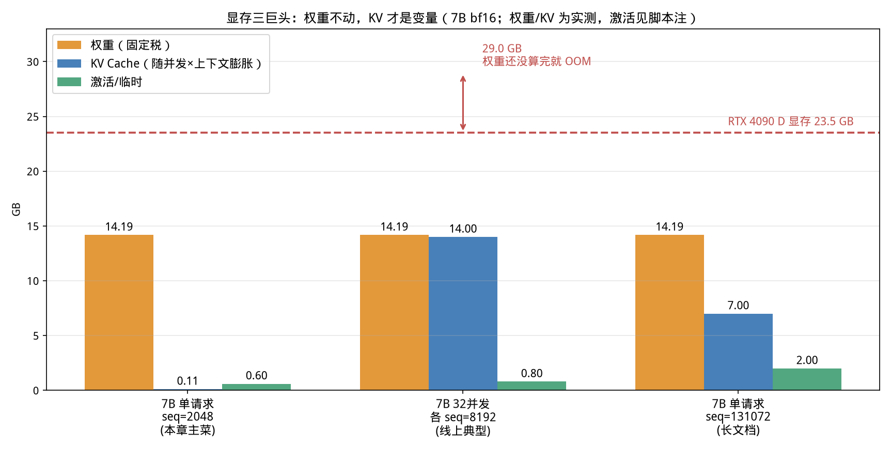

# 第 4 章 一个 token 的诞生与 KV Cache 全生命周期（Day 6–7）

> 本章你将亲手回答三个问题：模型是怎么一个字一个字"挤"出回答的？为什么不存 KV Cache
> 计算量会炸成 O(n²)？一个 7B 模型、上下文 2048、单并发，KV Cache 到底吃多少显存——
> 这个数字我们不用"大约"，直接在你 4090 D 上量出来：**0.11 GiB**。

## 0. 大白话开场

**这章讲什么？** 把第 1 章那个黑盒请求从"模型内部"再走一遍：一个 token 进模型、过 28/32
层 Transformer、变成下一个 token 的完整物理过程；以及这个过程中诞生的推理引擎第一主角——
KV Cache。我们会跟踪它的一辈子：**prefill 时出生写入、decode 时每步读取并追加、请求结束
整体释放**，并把它在各种场景下的显存占用全部算准、量准。

**为什么重要？** 前三章你已经知道：decode 是访存-bound、batch 越大越赚。但所有服务化引擎
（vLLM、TensorRT-LLM、SGLang）里最难写、面试最爱问、线上 OOM 最常见的那部分代码，既不是
算子也不是量化，而是 **KV Cache 的显存管理**：预分配多大、放在哪、谁和谁共享、请求结束怎么
回收、碎片怎么收拾。不理解 KV 的物理形状和生命周期，第 13 章的 PagedAttention 你只会背名词。

**学完能干什么？** ① 给你任意模型 config + 上下文长度 + 并发数，10 秒内心算出 KV 显存，
判断一张卡能不能开起来；② 讲清楚 KV Cache 省了什么、不省什么（包括一个大多数教程讲错的
反直觉实测：没它时计算量 142×，墙钟却只慢 1.6×）；③ 看懂 GQA/MQA 在架构层面动了哪根杠杆；
④ 为第 5 章"并发为什么崩"和第 13 章 mini-vLLM 打好全部地基。

**对应什么工作？** 推理引擎开发岗的必考题："算一下 7B/13B 在 80G 卡上、32k 上下文能支撑
多少并发"——考的就是这一章的公式加三巨头预算；部署岗调 `--gpu-memory-utilization`、
`--max-num-seqs` 时每一个参数背后都是它。

---

## 1. 一台"token 打印机"：自回归解码的五步循环

用人话说，大模型生成回答的过程和"文字接龙"一模一样：给定上文，猜下一个词，把它接到上文
末尾，再猜下一个，循环到吐出结束符或达到长度上限。这个"用自己上一步的输出当下一步输入"
的机制叫**自回归（autoregression）**。

【类比】接龙游戏："今天天气"→模型说"真"→接上变成"今天天气真"→再说"不错"→……每一轮
模型都要看完整句话，但每轮只新说一个字。LLM 的"字"就是 token。

工程上每一轮（称为一次 **decode step**）固定五步：

1. **分词**：把当前文本切成 token id 序列（第 1 步一次性完成，之后每轮只追加 1 个 id）；
2. **前向**：token id 过嵌入层 + 全部 Transformer 层，最后一层每个位置输出一个
   vocab 大小（Qwen2.5 是 152064）的 logits 向量；
3. **取最后一位**：我们只关心"最后一个位置"对下一个 token 的打分；
4. **采样**：argmax（贪心）或温度+top-p 采样，从 logits 选出 1 个新 token id；
5. **追加**：把新 id 接到序列尾部，回到第 2 步。

第一轮特殊：输入是你的整段 prompt（比如 300 个 token），要一次性把它们全过一遍模型，这一轮
叫 **prefill（预填充）**；之后每轮只有 1 个新 token 的阶段叫 **decode（解码）**。第 3 章
你已经实测过两者的天壤之别：prefill 是算力-bound 的大矩阵（0.5B 在 S=2048 时约 12 μs/token），
decode 是访存-bound 的"读全部权重换一个 token"（约 7.6 ms/token，慢了 600 倍）。

【配图建议】循环图：外圈五边形箭头（tokenize→forward→logits→sample→append），第一步
prefill 用粗箭头标注"一次性处理 S 个 token"，后续细箭头标注"每次 1 个，循环 n 次"。

记住这个不对称：**一次 prefill + n 次 decode**。它是理解本章和第 5 章一切现象的总开关。

## 2. 注意力 30 秒回顾：K 和 V 为什么"存了就能用"

注意力的公式（忘了就背这一行）：

$$\text{Attention}(Q,K,V)=\text{softmax}\!\left(\frac{QK^{\top}}{\sqrt{d_h}}\right)V$$

大白话：每个 token 拿出三个向量——**Q（查询，我想找什么）、K（钥匙/标签，我是什么）、
V（数值，我真正携带的内容）**；每个 token 用自己的 Q 和所有 token 的 K 算相关度，softmax
归一化成权重，再对所有 V 加权求和，就是它看完上下文后的新表示。

关键观察只有一句：**当第 t 个新 token 到来时，前 t−1 个老 token 的 K、V 一个字都不会变。**
它们的 K/V 只由它们自己的输入决定，跟后面来谁无关。新 token 只是多提供一个 K、一个 V 去
更新档案，并用自己的 Q 去查一遍全部档案。

【类比】开卷考试：K/V 是全班同学早就贴在墙上的课堂笔记。新来的同学（新 token）不需要让
所有人重写笔记，他只需要：把自己的笔记贴上墙（追加 K/V），再通读一遍墙（读全部 K/V）。

那么——如果不存笔记，每来一个新人都让全班把所有笔记重抄一遍呢？这就是没有 KV Cache 的
世界。

## 3. 没有 KV Cache：O(n²) 的原地重算（附一个反直觉实测）

不缓存 K/V 时，生成第 t 个 token 的前向必须把位置 1..t 的全部 token 重新喂进模型，
重新算它们的嵌入、重新算每一层的 K/Q/V、重新算注意力。累计处理的 token 数是：

$$1+2+\\cdots+n = \frac{n(n+1)}{2}=O(n^2)$$

而有 KV Cache 时，prefill 算一次 S 个，之后每步只算 1 个新 token，总量 $S+n=O(n)$。

**这个账算得对，但它对应的是计算量（FLOPs），不是墙钟时间。** 我们在 4090 D 上用 0.5B
做了逐 token 实测（`code/ch04/02_with_without_cache.py`，prompt=32，每步只做一次 forward、
CUDA 同步计时），结果值得你停下来看十秒：

| 生成 n 个 token | 有 cache 处理量 | 无 cache 处理量 | 墙钟倍数 | 计算量倍数 |
|---:|---:|---:|---:|---:|
| 64  | 96 token | 4,096 token | 1.61× | 42.7× |
| 128 | 160 token | 12,256 token | 1.57× | 76.6× |
| 256 | 288 token | 40,864 token | 1.59× | **141.9×** |


*从这张图你能看到什么：**左图**是无 cache 单步成本的实测形状——历史长度 S≤512 时恒定约
14 ms（kernel 启动开销、大词表 lm_head 投影这些"固定过路费"主导，重算 32 个和 512 个
几乎一样贵），S 越过 1024 后才进入线性区，重算 8192 个 token 一步要 152.6 ms；绿线是有
cache 的 decode，永远 7.6 ms。**右图**是最反直觉的部分：计算量倍数随 n 线性冲到 142×，
墙钟倍数却趴着不动 ~1.6×。*

【坑】"没有 KV Cache 会慢 n 倍"——面试再这么答会被追问到穿帮。正确的说法分两层：

- **计算量/电费/云账单层面**：铁证如山，n=256 就是 142×，倍数约等于 n/2。数据中心按 FLOPs
  烧电、按 GPU·秒收费，这部分浪费一分钱省不掉；
- **墙钟层面**：倍数取决于两段路径的效率差。重算走的是 prefill（算力-bound，大矩阵高效，
  S=8192 时约 18.6 μs/token），有 cache 走的是 decode（访存-bound，7.6 ms/步）。短输出时
  大量步长落在左图的 14 ms 固定平台区，所以墙钟只差 1.6×；但随着输出变长、模型变大、
  并发变多，重算成本的线性项（左图红线右半段）和每请求激活放大会迅速接管，n² 的墙钟拐点
  一定到来。生产服务从来不敢赌这个拐点。

【类比】抄笔记 vs 读笔记：没缓存时每写一个字都让全班重抄全书，抄书（prefill）本来就比
一个字一个字憋（decode）麻利，所以短时间看好像只慢一点；但纸张（显存）和墨水（电）已经
浪费了上百倍，而且字越多越崩。

## 4. KV Cache 的全生命周期：出生、读写、死亡

KV Cache 不是一个玄学黑盒，它就是一块**形状固定、按位置写入的显存缓冲区**。以 transformers
4.56 的官方实现 `StaticCache` 为例，我把它的源码（`cache_utils.StaticLayer.lazy_initialization`）
摊开，每层缓存的分配就两行：

```python
self.keys   = torch.zeros((batch_size, num_kv_heads, max_cache_len, head_dim), ...)
self.values = torch.zeros((batch_size, num_kv_heads, max_cache_len, head_dim), ...)
```

也就是说，每一层为 K 和 V 各准备一个 `(B, n_kv, S, d)` 的零张量，L 层共 2L 个。整个生命
周期分三阶段：

**阶段一：prefill 写入（出生即写满前 S 行）。** prompt 的 S 个 token 一次前向，注意力
计算时顺手把每层每个位置的 K、V 写进缓存的第 0..S−1 行。一次写入，之后只读。本次实测中
0.5B 在 prefill 后，官方缓存第 0 层 K 张量形状就是 `(1, 2, 2048, 64)`。

**阶段二：decode 读取 + 追加（每步一行）。** 第 t 步：新 token 算出自己的 K/V，写入第
t−1 行（追加）；它的 Q 与缓存里第 0..t−1 行全部 K 算权重、对全部 V 求和（读取）。注意
每步**读的总量随 t 增长，但新增写永远只有 1 行**——这正是 decode 访存模式的形状：读权重
是大头，读 KV 的量小且随上下文线性增长。

**阶段三：请求结束释放（整块回收）。** 请求完成后，这 2L 个张量（或 vLLM 里对应的 KV
block）整块归还显存池。真实引擎不会 malloc/free 折腾，而是预分配一个大 KV 池、按块借还
——这就是第 13 章 PagedAttention 的全部动机，先记住"**池化、按块、可复用**"三个词。

| 生命周期 | 何时 | 对 KV 缓存的动作 | 一次处理 token 数 |
|---|---|---|---:|
| prefill | 请求开始，1 次 | 分配 + 写入前 S 行 | S（一次全部） |
| decode | 每个生成 token，n 次 | 追加 1 行 + 读取全部已有行 | 1 |
| 释放 | 请求结束 | 整块归还 KV 池 | — |

## 5. 显存账：7B 一个请求，KV 到底吃多少

公式现在可以自己推了。每个 token、每一层要存 K 和 V 两个向量；GQA 下每层只有 n_kv 个 KV
头，每头维度 d；bf16 每元素 2 字节；B 个请求、S 个长度，线性相乘：

$$\boxed{\text{KV 字节}=2\,(K,V)\times L\times n_{kv}\times d\times S\times B\times 2\text{ 字节}}$$

大白话：**2 个向量 × 层数 × KV头数 × 头宽 × 序列长 × 批大小 × 每元素字节**。没有任何
隐藏项，就这七个数。MHA 模型把 n_kv 换成注意力头数 n_h 即可。

代入 Qwen2.5-7B-Instruct（官方 config：L=28，注意力头=28，**KV 头=4**，d=128）：

$$2 \times 28 \times 4 \times 128 \times 2 = 57{,}344\text{ 字节/token}=56\text{ KiB/token}$$

于是 **batch=1、seq=2048：56 KiB × 2048 = 112 MiB ≈ 0.11 GiB**。

这不是纸面数字。我们在 4090 D 上用 transformers 官方缓存的**精确布局**真实分配了这些张量
并量显存（`01_kv_accounting.py`；权重无需下载，StaticCache 只依赖 config）。同时在完整
加载的 0.5B 上做了交叉验证：公式值 0.0234 GiB，官方 `StaticCache` forward 后真实 KV 张量
求和 0.0234 GiB，**偏差 +0.00%**。公式与实现逐字节一致，你可以放心拿它面试口算。

### 7B KV 显存速查表（bf16，全部为真实 GPU 分配实测）

| 场景 | KV 占用 | 占 24G 卡 | 直觉 |
|---|---:|---:|---|
| B=1, S=2048 | **0.11 GiB** | 0.5% | 本章主菜，几乎免费 |
| B=1, S=32768（官方最大上下文） | 1.75 GiB | 7.4% | 长文开始有感 |
| B=1, S=131072（128k 扩展） | 7.00 GiB | 29.8% | 单请求吃掉 1/3 张卡 |
| B=8, S=8192 | 3.50 GiB | 14.9% | 小并发中等上下文 |
| B=32, S=8192 | **14.0 GiB** | 59.6% | KV 已和权重同量级 |
| B=32, S=32768 | 需要 56 GiB | **直接 OOM** | 两张 4090 都不够 |
| B=1, S=32768，KV 改 int8 | 0.875 GiB | 3.7% | 量化直接砍半 |


*从这张图你能看到什么：横轴序列长度、纵轴 KV 占用都取对数，所以线性增长画成直线。蓝线是
7B 真实的 GQA（56 KiB/token）：2048 时 0.11 GB 贴着地面，128k 时 7 GB；绿色虚线是 KV
int8 量化，整体砍半；红色三角是"假如它用 MHA"（392 KiB/token），是蓝线的 7 倍，在 32k
处就越过权重线。橙色虚线是 7B 权重 15.23 GB（=14.19 GiB，官方 safetensors 索引精确值：
15,231,233,024 字节）。**单请求的 KV 很长时间都压不过权重，但别忘了线上要 ×并发数。***

**面试口算口诀（7B 级 GQA，bf16）**：一个 token 大约 56 KiB；**1 万 token 约 0.55 GiB；
100 万 token 约 55 GiB**。估算并发能力时，用"KV 池容量 ÷ 每 token 56 KiB ÷ 平均上下文
长度"即可（第 5、13 章会反复用）。

【坑】**GB 和 GiB 别混**。厂商说"24 GB 显存"是十进制口径，系统里实际 23.5 GiB；权重
文件 15.23 GB（硬盘字节数）= 14.19 GiB（显存占用）。本章一律用 GiB 算账。面试时可以主动
点破这个口径差，比把数字背串了强得多。

## 6. 显存三巨头：权重、KV、激活

推理时一张卡的显存被三家分掉：

| 巨头 | 大小由谁决定 | 7B 典型量级 | 性质 |
|---|---|---:|---|
| **权重** | 参数量 × 每参数字节（量化章节改这个） | bf16 14.19 GiB | **固定税**：模型一加载就锁死，与并发/上下文无关 |
| **KV Cache** | L·n_kv·d × 上下文 × 并发 × 字节 | 0.11～56 GiB | **变量**：服务化时唯一随业务量膨胀的巨头 |
| **激活/临时** | 当前 batch×seq 的中间张量、logits、注意力工作区 | 0.6～2 GiB | **过路费**：prefill 临时峰值，算完即放 |

激活的实测很有意思：0.5B 在 B=1、S=2048 的一次真实 prefill 中，峰值 = 权重 0.920 + KV
0.023 + 激活 **0.600** GiB。这 0.6 GiB 的大头不是 Transformer 层，而是最后的 lm_head
logits：vocab≈152k × 2048 × 2 字节 ≈ 0.58 GiB。也就是说**这项开销几乎只跟词表大小和
prefill 长度有关，7B 在同条件下也是同量级**（7B 词表与 0.5B 几乎相同）。


*从这张图你能看到什么：三种业务形态下的同一张 24G 卡。左：单请求 2048 上下文，权重
14.19 一家独大，KV 0.11 可以忽略，总占用 14.9 GiB 绰绰有余；中：32 并发各 8192 上下文
（线上聊天机器人的典型画像），KV 涨到 14.0 GiB，与权重平起平坐，合计 29 GiB——**权重
都加载不完就 OOM 了**，要扩并发只能靠 KV 量化、GQA、分页调度或上更大的卡；右：单请求
128k 长文档，KV 7 GiB，长 prefill 激活按工程经验取 2 GiB（SDPA 下注意力工作区随长度
增长），总占用贴着红线，4090 跑 7B@128k 必须量化权重或 KV 才有活路。*

【坑】新手常以为"显存不够=模型太大"。在**单请求短上下文**时确实如此（权重主导）；一旦
进入服务化或长上下文场景，撑爆你的几乎总是 **KV**。这就是为什么推理引擎一半的复杂度都
在伺候 KV，而量化权重只是开胃菜。

## 7. GQA / MQA：让每个 token 的"小抄"变薄

公式里唯一能被架构师拿刀砍的因子是 n_kv（KV 头数），这就引出三种注意力设计：

| 设计 | KV 头数 | 7B 假设下每 token KV | 代表模型 |
|---|---:|---:|---|
| **MHA**（多头，传统） | = Q 头数 = 28 | 392 KiB（基准 7×） | GPT-3、LLaMA-1 |
| **GQA**（分组查询） | 4 个 KV 头，每组 7 个 Q 头共享 | **56 KiB** | LLaMA-2/3、Qwen2/2.5/3、Mistral |
| **MQA**（多查询，极端） | 1 个，所有 Q 头共享 | 14 KiB | PaLM、Gemini 初代 |

大白话：MHA 是每个 Q 头配一个专属资料员；GQA 是 7 个 Q 头共用一个资料员（小抄薄 7 倍，
质量损失实测很小，性价比之王，2024 年以后的主流模型全员 GQA）；MQA 是全班共用一个资料员
（最省，但多个头抢一份 K/V 容易"信息瓶颈"，质量与训练稳定性吃亏，现在多被 GQA 取代）。

注意 GQA 省的是**显存和 KV 读取带宽**（decode 正好缺带宽，所以它直接提 decode 速度），
Q 头和权重计算量一个没少。代价是：极少数任务上质量微降、对 KV 量化的数值误差更敏感
（第 16 章实测）。另外 DeepSeek-V2/V3 走了更激进的路线 **MLA**（低秩压缩 KV，每 token
只存几 KiB 的潜向量），效果好但实现复杂，留到第 22 章前沿专题拆解。

【类比】还是开卷考试：MHA 是每门课一本笔记（28 本墙都贴满）；GQA 是 7 门相近的课共用
一本（4 本，查的时候多问一句"你是哪门课的"）；MQA 是全班所有课只留一本万能笔记。

## 8. 工程收束：KV 池就是推理引擎的"内存管理单元"

把本章接回前三章，服务化引擎的显存预算公式浮出水面：

$$\text{可用于 KV 的显存}=\text{卡总显存}-\text{权重}-\text{激活预留}-\text{框架开销}$$

vLLM 启动时让你设 `--gpu-memory-utilization 0.9`，就是先用这个式子算出 KV 池大小，再按
固定大小切成几千个 block：每个进来的请求按需领 block 存自己的 KV，prefill/decode 动态
申领、结束立即归还给别的请求复用。**并发上限不是拍脑袋的数字，而是"KV 池能装下多少个
活跃请求的当前上下文"**（第 5 章你会看到越过这条线时延迟和成功率如何崩塌；第 13 章
mini-vLLM 会亲手实现这个分配器）。

回扣第 1 章：ollama 默认单槽串行（4 并发完成时刻 1.92/3.85/5.77/7.70 s 的阶梯），本质
也是 KV 管理策略的选择——单槽意味着每个时刻只为一个请求维护 KV，实现最简单、最稳，但
4090 的算力在 decode 时被白白闲置。Continuous Batching + KV block 池就是来解锁这份
闲置的。

本章技术坐标：GQA/MQA（架构层，模型出厂已定）→ KV int8/fp8 量化（第 16 章，运行时再
砍一半）→ PagedAttention/分页池（第 13 章，管理不掉一块显存）→ MLA（第 22 章，前沿
架构换赛道）。四把刀砍的是同一块显存。

---

## 本章【坑】清单

1. **"没 KV Cache 慢 n 倍"是错的简化**：慢的是计算量（n/2 倍），墙钟倍数看路径效率；
   要会用本章 142× vs 1.6× 的实测把两层讲清楚。
2. **GB/GiB 混用**：15.23 GB 权重 = 14.19 GiB 显存；24G 卡可用 23.5 GiB。
3. **KV 不是算得慢，是占地方**：它不直接增加 FLOPs（甚至省 FLOPs），它的代价是显存与
   decode 时多读的带宽；OOM 才是它杀人的方式。
4. **GQA 不是免费**：省 KV 不省权重算力，且对 KV 量化更敏感；MQA 已基本被 GQA 淘汰，
   别把 MQA 当"更先进的 GQA"吹。
5. **StaticCache vs DynamicCache**：4.56 的 StaticCache 是 lazy 分配（构造时显存放 0，
   第一次 forward 才真分配），排查显存别在构造后量；DynamicCache 边 decode 边增长，
   生产引擎用 block 池，两者都不是真实引擎最终形态。

## 动手任务

**任务 A（必做，15 分钟）：复现 0.11 GiB 与 0.00% 偏差。**
停掉 ollama 释放显存，运行 `python code/ch04/01_kv_accounting.py`。
**验收**：① 屏幕打出 7B 每 token 56 KiB、B=1/S=2048 KV=0.110 GiB；② 0.5B 的公式值与
官方 StaticCache 实测偏差为 +0.00%；③ B=32/S=32768 案例如预期触发 OOM 打印。用
`nvidia-smi` 在 StaticCache 分配的瞬间（可在脚本里加 `input()` 暂停）肉眼确认显存增量。

**任务 B（必做，20 分钟）：复现 142× 与 1.6×，并向自己解释。**
运行 `python code/ch04/02_with_without_cache.py`，再运行 `python make_figures.py`。
**验收**：① 拿到 42.7/76.6/141.9× 计算量倍数与 ~1.6× 墙钟倍数（允许 ±10% 机差）；
② 不看课文，用"prefill 算力-bound / decode 访存-bound + 14ms 固定平台"三个要点向同事
讲清楚为什么两者差这么多；③ 把生成长度改到 1024 跑一次（约几分钟），观察墙钟倍数是否
开始抬头，并解释趋势。

**任务 C（纸面，10 分钟）：面试同款口算。**
Llama-3-8B：L=32，Q 头=32，KV 头=8，head_dim=128，bf16。请心算：① 每 token KV 多少
KiB？② 单请求 128k 上下文 KV 多少 GiB？③ 一张 80 GB H100（可用按 78 GiB、权重 16 GiB、
激活预留 4 GiB 计）跑 32 并发、人均 32k 上下文，KV 池够不够？差多少？④ 如果 KV 换 int8
呢？
**验收**：① 64 KiB；② 8 GiB；③ 需 64 GiB，池剩 58 GiB，**不够，差 6 GiB**；
④ int8 后 32 GiB，够，还能再放约 26 个同类并发。能在 3 分钟内算出并说出"这就是
`--max-num-seqs` 的物理含义"即过关。

## 自检三问

1. 不看公式，对着一个模型 config 口述 KV 显存七个因子，并说明 GQA 改的是其中哪一个、
   为什么还能顺便加速 decode。
2. KV Cache 在 prefill、decode、请求结束三个时刻分别被做了什么操作？为什么 vLLM 不直接
   malloc/free 而要搞 block 池？
3. 单请求 2048 上下文时 KV 只占 0.5%，为什么所有推理引擎还要为它写一半的代码？用
"权重是固定税、KV 是变量"结合本章三个业务场景的数据回答。

---

下一章（Day 8–9）我们离开单请求世界，进入服务化的真正战场：**四大性能指标（首 token
延迟、每 token 延迟、吞吐、成功率）与并发崩塌曲线**——当 KV 池被填满、连续 batching 从
救命药变成毒药时，系统是怎么一步步从 100% 成功率掉到 46% 的。
