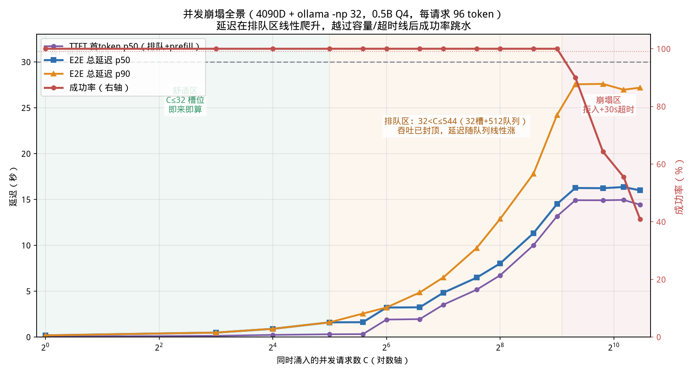
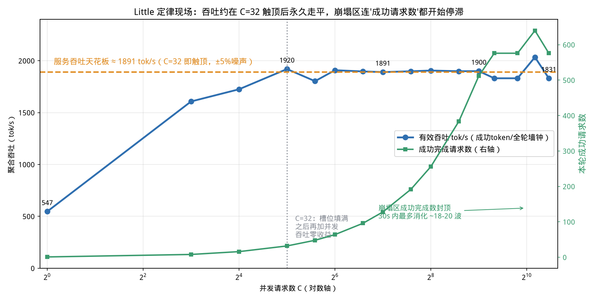
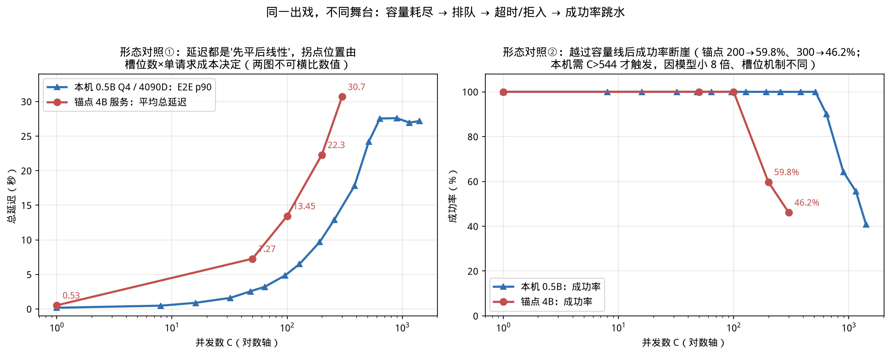

# 第 5 章 四大性能指标与并发崩塌曲线（Day 8–9）

> 前四章的世界里都只有"一个用户"。这一章把灯打开，让 1400 个用户同时敲门，你会亲眼看到
> 一条所有推理服务在压力下都会走的曲线：延迟从 0.18 秒爬到 27 秒，成功率从 100% 掉到
> **40.9%**——以及更重要的，这条曲线在 100% 成功的时候就已经发出了警报。

> **前置知识路标**：需要第 3 章（两阶段的瓶颈差异）和第 4 章（KV 是显存大头）——本章的"崩塌"就是这两件事在并发下的总爆发。会用百分位数（p99 = 99% 的请求都不慢于某值）即可；压测脚本与原始记录在 [code/ch05/](../code/ch05/)，可以不写只读。

## 0. 大白话开场

**这章讲什么？** 推理服务的"性能"不是一个数，而是四个互相打架的指标：**TTFT**（首个
字等多久）、**TPOT**（之后每个字蹦多快）、**吞吐**（单位时间总共吐出多少字）、**成功率**
（多大比例的请求在超时前完整返回）。我们会在 4090 D 上搭一个 32 并行槽的真实服务
（ollama / 底层 llama.cpp continuous batching），然后像压测工程师一样，从 1 个并发一路
压到 1408 个，把四个指标随并发的变化全部量出来。

**为什么重要？** 算法同学评估模型只看效果；Infra 岗位的日常是回答另外一类问题："这台
机器到底能扛多少并发？""用户说卡，是首字慢还是吐字慢？""为什么监控看 GPU 已经跑满、
用户却还在骂娘？""超时设多少、队列设多长、什么时候该直接拒绝而不是让用户干等？"这些
问题的答案全部藏在本章的曲线里。**并发崩塌不是事故现场才出现的现象，它是一条可以提前
计算、精确设防的曲线**——会读这条曲线，是推理部署工程师和"能把模型跑起来的人"的分界线。

**学完能干什么？** ① 用四个指标 + 分位数口径描述任何一个推理服务，不和别人鸡同鸭讲；
② 看懂压测曲线的三个区（舒适区/排队区/崩塌区），指出拐点对应的物理原因（槽位数、队列
深度、超时）；③ 用 Little 定律做容量规划：给定 SLA，反推一台机器允许的最大并发与该买
多少张卡；④ 自己写一个流式压测脚本（本章代码零三方依赖，标准库即可）。

**对应什么工作？** 性能调优岗的面试题几乎是本章原题："TTFT 和 ITL 分别受什么影响？
怎么各自优化？""为什么你们服务并发一上来成功率就掉？""说一下怎么做容量评估。"第 2 章
JD 黑话表里的"高并发推理优化、SLA、QPS、压测"指的就是这里。

---

## 1. 四大指标：先把"性能"这个词拆成四把尺

一个流式聊天请求的时间线长这样（括号里是本章 4090D、单并发、0.5B 的实测值）：

```
客户端发起 ──排队等待──► [prefill] ──► 第1个token ──decode每步1token──► 最后1个token
 t0                    TTFT(33ms)                    每步 TPOT(1.5ms)          E2E(176ms)
```

| 指标 | 定义 | 用户感知 | 主要被什么拖慢 |
|---|---|---|---|
| **TTFT** Time To First Token | 发起到收到第一个 token | "转圈多久才开始说话" | 排队时间 + prefill（算力-bound） |
| **TPOT** Time Per Output Token（也称 ITL） | 生成阶段平均每 token 间隔 | "说话流不流畅、卡不卡" | decode 批大小、权重/KV 访存 |
| **E2E 延迟** | 发起到收完最后一个 token | "这次回答总共等多久" | TTFT + TPOT×输出长度 |
| **吞吐** | 聚合 token/s（或 QPS/RPM） | 用户无感，老板有感 | GPU 算力/带宽被填满的程度 |
| **成功率**（第 5 把尺，常被并列） | 超时前完整返回的请求占比 | "动不动就报错/转圈到死" | 队列深度、超时设置、容量 |

【类比】餐厅：**TTFT** 是落座到第一道菜上桌的时间（含等位+厨房做头菜），**TPOT** 是之后
每道菜的间隔，**E2E** 是整顿饭时长，**吞吐**是这家店一晚上总共能上多少道菜，**成功率**
是有多少桌没被"客满请回/等太久自己走了"赶走。

三个口径上的坑，面试和工作中必踩：

1. **说延迟必须带分位数**。p50（中位数）描述"大多数人"，p90/p99 描述"倒霉的人"。崩塌
   区里你会看到 TTFT 的 p90 远大于 p50（C=48 时 0.31s vs 1.84s）——均值会把"有人等了
   18 秒"这件事平均没。SLA 几乎都写在分位数上（如"p99 TTFT < 1s"）。
2. **吞吐有真假两种**。只统计成功请求的吞吐在崩塌区会虚高（本章实测能虚到 2052，超过
   1900 的硬件天花板——因为失败请求浪费的时间没算分母）。生产上要看 **Goodput（有效
   吞吐）**：成功完成的 token 数 ÷ 全部压测墙钟。【坑】拿"成功请求平均速度"去做容量
   规划，系统在超载时会比你以为的更脆。
3. **TTFT 和 TPOT 的优化方向不完全一致**。要降 TTFT 就削 prefill 排队（Chunked Prefill、
   限流、减 prompt 长度）；要降 TPOT 就提高 decode 效率（量化、GQA、投机解码）。用户说
   "卡"，先问清是"出字慢"还是"开始得慢"，两码事。

## 2. 请求在服务里的一生：槽位、队列、拒入

服务端的结构用人话说就是"有 N 个工位的银行 + 一条等候队列"：

- **槽位（slot / batch 槽）**：同一时刻真正在 GPU 上被算的请求。本章 ollama 用
  `-np 32` 开 32 个槽，底层 llama.cpp 把 32 个请求组成 batch 一起前向（continuous
  batching 的雏形；第 13 章在 vLLM 里看完整版）。
- **队列（queue）**：槽满了，新请求在服务里排队等。ollama 默认 `OLLAMA_MAX_QUEUE=512`。
  排队期间什么都不算，但**客户端的表在走**——排队时间全额计入 TTFT。
- **拒入（reject / admission control）**：队列也满了，直接返回错误（ollama 回 503
  "server busy"）。这不是 bug，是保护系统不被压死的保险丝；网关通常在这里做限流。
- **客户端超时（deadline）**：就算服务没拒你，你等了 30 秒还没结束，客户端也会主动断开
  记失败。生产上这个数由网关/上游调用方决定（常见 30s/60s）。

于是系统总容量 = **槽位数 + 队列深度**（本章 = 32+512 = 544）。这个数你不用背配置，
压测曲线会把它交代出来：成功率开始掉的那个并发点，就是容量。

【配图建议】银行类比剖面图：左侧 C 个客户涌入，32 个窗口在办（窗口里标 prefill/decode），
中间一条 512 人的等候长廊（每人头顶时钟在走，计入 TTFT），入口处闸机把超出的人挡在门外
（503），客户自己手里还攥着一个 30s 沙漏（超时）。

## 3. Little 定律：本章的理论主线

排队论里最有用的就这一个公式（1954 年的老古董，至今是容量规划的第一公式）：

$$L = \lambda \times W \quad\Longleftrightarrow\quad \text{系统中请求数} = \text{到达速率} \times \text{平均逗留时间}$$

大白话：**店里的人数 = 每秒进店人数 × 每人平均待多久**。三个量知道两个就能求第三个：

- 已知服务能承受的逗留时间 W（SLA：E2E ≤ 2s）和到达速率 λ（业务峰值 100 QPS），
  需要的并发槽/容量 L = 200——一台机器只有 32 槽，那就得 ⌈200/32⌉≈7 个等价实例；
- 反过来，压测测出某台机器饱和吞吐 X tok/s，每个请求要 T 个 token，那么在 SLA 内能
  同时伺候的活跃请求数 ≈ X×W/T。本章数据可直接验算：1900 tok/s × 2s ÷ 96 token ≈ 39
  （和 32 槽的实测拐点 32 同量级，差异来自 prefill 开销）。

【坑】Little 定律只在**稳态**成立，而且 W 必须包含排队时间。用"服务时间"（光算不算等）
代进去会严重高估容量——排队区里 W 随并发线性膨胀，正是本章实测的形状。

## 4. 实测装置：32 槽、30 秒沙漏、1400 人同时敲门

实验全部在你这台 4090 D 上完成，零三方依赖（`code/ch05/load_test.py`，纯标准库）：

- 单独起一个多槽实例，不碰系统常驻服务：
  `OLLAMA_HOST=127.0.0.1:11435 OLLAMA_NUM_PARALLEL=32 ollama serve`；
- **closed-model 压测**：C 个线程用 Barrier 在同一毫秒一起发请求（模拟整点爆款流量/
  群发触发），每个请求固定 prompt + 强制输出 96 个 token（`temperature=0`）；
- 流式读取，逐行记录三个时刻：发起 / 第一个非空 token / done；30 秒 deadline；
- 并发档位 16 个：1→1408（对数打点）。

启动后先发生了一件第 4 章读者会会心一笑的事——`nvidia-smi` 显示显存占用 **13.4 GB**，
跑的明明是个 397 MB 的小模型。看 llama-server 参数：`-c 1048576 -np 32`，总上下文
104 万 token = 32 槽 × 每槽 32768。代入第 4 章公式：12 KiB/token × 1,048,576 ≈
**12.6 GiB**，加上权重和 workspace 正好 13.4 GB。**服务一启动就为"32 个请求各写 32k
长文"的最坏情况预买了单**——这就是"KV 是随并发膨胀的显存变量"在服务级的实据，也解释了
vLLM 为什么要费尽心机做按需分页而不是一把预分配（第 13 章）。

## 5. 崩塌曲线：三个区，一个剧本


*从这张图你能看到什么：横轴并发 C（对数），左轴延迟（秒），右轴成功率。背景三色把曲线
切成三个区。紫色是首 token 延迟 TTFT，蓝/橙是总延迟 p50/p90，红线是成功率。灰色虚线
是 30 秒超时。左半段红线贴在 100%，但延迟从 C=32 起就开始线性爬升；进入红区后成功率
近乎垂直跳水：640→90.0%、896→64.3%、1152→55.6%、1408→40.9%。*

**第一区：舒适区（C≤32，槽位未满）。** 即来即算，没有排队。聚合吞吐随 C 近似线性上涨：
547（C=1）→1605（C=8）→1919 tok/s（C=32）。但注意单请求的代价：**TPOT 从 1.5 ms 涨到
13.7 ms（约 9 倍）**，E2E 从 0.176s 涨到 1.59s。这不是性能变差，是第 3 章 Roofline 的
直接推论：batch 越大，每步要读的权重被越多请求分摊，GPU 越吃饱，但每个请求摊到的"单步
服务"变慢。这是一笔**用个体延迟换总体吞吐**的交易，所有服务化引擎都在做。

**第二区：排队区（32 < C ≤ 544，槽满、队列未满）。** GPU 吞吐在 C=32 已经到顶
（~1900 tok/s，之后所有档位在 ±5% 内走平），新来的请求只能等。E2E 近似按"波次"线性
增长：每波 32 个、每波约 1.6 秒，⌈C/32⌉ 波——C=128 时 4.83s、C=256 时 8.02s、C=512
时 14.5s，几乎完美的直线。TTFT 的 p90 比 p50 难看得多（C=256：6.7s vs 11.6s），因为
队列里排在前后的人命运不同。**这个区最危险的地方是：成功率还是 100%，监控绿灯一片，
但用户已经开始骂街**——延迟崩塌远早于成功率崩塌。

**第三区：崩塌区（C>544，队列溢出 + 超时）。** 两种失败同时出现：入口处超出 32+512
容量的请求吃 503 拒入；排得深的请求即使被接受，也熬不过 30 秒 deadline。成功率
90.0%→40.9%。一个微妙的现象：**崩塌后 TTFT/E2E 的 p50 反而微降**（14.9s→14.4s）——这是
幸存者偏差，排得最深的那批人已经失败、退出了统计，能"成功"的都是早早轮到的幸运儿。
【坑】线上监控如果只看成功请求的延迟分位数，系统烂掉时曲线甚至会"变好看"，必须把
失败率放在同一张图上。

## 6. 吞吐图：加并发不是性能旋钮，加过头全部变成等待


*从这张图你能看到什么：蓝线（有效吞吐）在 C=32 就摸到 ~1900 tok/s 的天花板，之后直到
1408，不管压多少人进来，产出永久走平；绿线是每轮成功完成的请求数——排队区随 C 增大而
增大（能在 30s 内消化的波次越来越多），但进入崩塌区后封顶在 ~580–640，再高的并发连
"成功个数"都不再增加。*

这张图把"高并发=高性能"的错觉彻底杀掉：

- **C=1 时 GPU 大部分时间闲着**（第 3 章：decode batch=1 只用了 15% 带宽），所以加并发
  一开始确实能白捡吞吐，1→32 拿满 3.5 倍；
- **C=32 之后，GPU 已经全勤**，多来的请求不产出任何新 token，只把等待时间均匀地分给
  每个人——这正是 Little 定律里 λ 封顶、W 被迫增长的区段；
- **崩塌区是纯粹的双输**：有效吞吐不增（1831 甚至略降），成功率暴跌，被拒的和超时的
  还要触发客户端重试，重试风暴会再补一刀（第 24 章工程化讲退避与熔断）。

**容量规划一句话**：把工作负载点设在"舒适区靠右、但不进排队区深处"。工程上取拐点的
70–80%（本例 C≈22–26）作为额定并发，留 20–30% 余量给流量抖动和长短不一的输出——这就是
vLLM 里 `--max-num-seqs`、K8s HPA、网关限流阈值三者共同的物理来源。

## 7. 锚点对照：同一出戏，不同舞台


*从这张图你能看到什么：左图两条延迟曲线都是"先平后线性"，右图成功率都是越过某条容量线
后断崖。锚点（用户提供的某 4B 服务实测：C=200 成功率 59.8%、C=300 为 46.2%，延迟一路
到 30.7s）在 200–300 并发崩，本机 0.5B 要到 C>544 才崩——**形态同构，拐点位置不同**。*

为什么拐点差这么多？把第 3、4 章的账串起来：

| 决定因素 | 锚点 4B 服务 | 本机 0.5B+ollama |
|---|---|---|
| 单 token decode 成本 | 模型大 ~8 倍，权重读取更久 | 0.5B Q4，TPOT 饱和时 13.8ms |
| 饱和聚合吞吐 | 低（数百 tok/s 量级是常态） | 1900 tok/s |
| 每波请求消化时间 | 长 | ~1.6s/波（32 请求） |
| 容量（槽+队列）| 由其服务框架决定 | 32+512=544 |
| 30s 内能消化的请求 | 200 已扛不住（59.8%） | ~580–640 |

**拐点 = 硬件饱和吞吐 ÷ 单请求 token 需求 × SLA 时长**，再加上队列/拒入策略。模型越大、
输出越长、SLA 越严，拐点越靠左。这也是为什么"4B 能扛 100 并发"这种话离开具体配置毫无
意义——面试时永远要追问：什么模型、什么量化、多少卡、输出多长、SLA 多少、成功率怎么
算的。

## 8. 指标落地：这些数在真实服务里怎么量

理解了定义，下一个问题是埋点。四个指标在链路上各有各的坑：

| 指标 | 客户端口径 | 服务端口径 | 易错点 |
|---|---|---|---|
| TTFT | 发起到 SSE 收到第一个 content chunk | 调度完成到 prefill 结束 | 两者之差=网络+排队，跨可用区能差几百毫秒；别把服务端 TTFT 当用户体验 |
| TPOT/ITL | 相邻 chunk 的到达间隔 | 两次 decode 完成间隔 | 流式 chunk 可能合并/拆分 token，按 `eval_count` 差分而非 chunk 个数 |
| E2E | 发起到收到 done | 请求完成出队 | 失败重试的时间只在客户端侧可见，服务端日志里是两个"成功"请求 |
| 吞吐 | 全轮成功 token/墙钟（Goodput） | engine 侧 tokens/s | 服务端数字天然更好看，对老板汇报前先对齐口径 |
| 成功率 | (2xx 且未超时且收全)/总数 | 完成数/接收数 | 网关 499/504、客户端主动断、语义截断都要分门别类记 |

三条实操建议：① **时钟一律在客户端打**（发起、首字节、每字节、结束四个时间戳），服务端
指标只用于内部分解；② token 计数相信引擎返回的 usage（ollama 的 `eval_count`、OpenAI 兼容
接口的 `usage.completion_tokens`），不要自己数 chunk；③ 延迟直方图用 HDRHistogram 或
Prometheus summary 在客户端/网关侧聚合，p99 不能靠事后对离散样本"排序取 99%"在低流量时
凑——分位数不可加，多实例汇总要用直方图合并。

**流量模型也要写明**：本章实验是 closed model（同一瞬间 C 个请求齐发，用户行为像"刷新
热搜"），用于找最坏情况的容量墙；真实流量更接近 open model（请求按固定速率 λ 泊松到达，
用户不会因为系统慢就停止发新请求）。open model 下系统一旦越过饱和点，队列会**单调发散**
——延迟不是线性涨而是指数发散到无穷，因为到达速率永远大于消化速率。生产压测两种都要做：
closed model 回答"瞬时暴击能扛多狠"，open model（如 `vllm bench serve`、k6 恒定到达率）
回答"持续流量的稳态拐点在哪"。

## 9. 工程收束：从曲线到生产防线

这一章的曲线在真实系统上有六道对应防线，全部在后续章节展开：

| 曲线现象 | 生产对策 | 章节 |
|---|---|---|
| 加并发先白捡吞吐后纯排队 | Continuous Batching / `--max-num-seqs` 设到 Roofline 拐点 | 13/14 |
| 大 prompt 的 prefill 卡住所有人的 TTFT | Chunked Prefill（prefill 切块，和 decode 混批） | 14 |
| KV 预分配 12.6GB 的浪费 | PagedAttention 按需分页、随借随还 | 13，mini-vLLM 亲手实现 |
| 队列无限深 → 所有人慢死 | 有界队列 + 限流 + 快速拒入（admission control） | 24 |
| 超时失败引发重试风暴 | 指数退避 + 抖动 + 熔断；幂等 | 24 |
| 单机容量不够 | 张量并行/多实例 + 负载均衡；PD 分离 | 17/21/24 |
| 用户体感 TPOT 高 | 量化/GQA/投机解码（砍 decode 每步成本） | 9–16/22 |

最后立一个本章最重要的心法：**并发数不是性能旋钮，而是负载事实。** 你不能通过"放开
并发限制"让服务变强——放开的只是排队和崩塌的门槛。真正提升拐点的手段只有两类：把吞吐
天花板抬高（量化、批处理、投机解码、更多卡），或者让每个请求更省（短 prompt、短输出、
KV 压缩）。限流不是无能，是对 Little 定律的尊重。

---

## 本章【坑】清单

1. **只看均值/只看成功请求**：必须 p50/p90（最好 p99）+ 成功率同图；崩塌后幸存者偏差会
   让成功请求的延迟反而"变好"。
2. **吞吐口径**：成功 token ÷ 全轮墙钟才算 Goodput；别用成功请求自己的窗口。
3. **100% 成功 ≠ 健康**：排队区成功率全绿但延迟已经线性爆炸；告警要建在 p90 TTFT/E2E
   上，而不是错误率上。
4. **队列不是越深越好**：深队列把"快速失败"变成"慢慢超时"，占用服务资源、锁着 KV、
   最后用户还是走了——有界队列+快速拒入通常体验更好。
5. **并发参数照搬**：`-np 32` 在 0.5B 上合理，在 27B 上会让每槽分到的 KV/算力都不够；
   槽位数必须由第 4 章的 KV 预算和第 3 章的 batch 拐点共同决定。
6. **closed vs open model 混淆**：本章是同一瞬间涌入的 closed model（最坏情况）；真实
   流量是按速率泊松到达的 open model，同等平均并发下尾部更分散。报数字必须说明模型。

### 【落地视角】
四大指标（TTFT/TPOT/E2E/吞吐）+ 分位数就是你**和业务、和面试官对话的全部语言**：SLO 是 p99 口径、限流档来自崩溃点左侧、容量账用 Little 定律（ch23 原样复用）。4090D 实测的三阶段崩塌曲线（成功率 100%→40.9%、吞吐 C=32 封顶）是本书最重要的第一手数据——第 16/19 章的每条崩溃线都从这条曲线派生。压测报告的格式、埋点的口径，全章是模板。

### 【化学家视角】
并发崩塌像**反应器超负荷进料**：投料速度在临界值以下，产率随投料线性涨；越过临界点，体系不是"慢一点"而是飞温失控——延迟指数级涨、成功率崩（对应超压泄放）。所以工程上永远不许把装置开到临界点右侧：**限流就是进料速率联锁，SLO 就是工艺上限**，这与 23 章的过载保护是同一套安全思想。

### 【应急方案】
压测数字不稳：先对三件——样本量（每档 ≥5× 并发，ch16 稳态规则）、缓存是否显式开关、采样参数是否固定（ch19 七条控制变量）；线上 p99 突涨：先拉成功率与排队深度（`num_requests_waiting`），分清是积压墙还是显存墙再动手——**先取证再归因**，ch24 证据链五段从这里起步。

---

## 动手任务

**任务 A（必做，30 分钟）：复现三阶段曲线。**
按 `code/ch05/RESULTS.md` 第 0 节起多槽实例，跑
`python load_test.py --levels 1,8,16,32,64,128,256,512,768,1024 --tokens 96 --timeout 30`。
**验收**：① C≤32 吞吐随并发上升、C≥32 走平在 ~1900 tok/s（±15% 机差）；② 能指出
TPOT 1.5→~14ms 的批处理代价；③ 高并发档出现非 100% 成功率，并区分失败原因里超时与
拒入（json 的 `fail_reasons`）。

**任务 B（必做，15 分钟）：改变拐点位置。** 把 `--tokens 96` 改成 `--tokens 256`（输出
变长 2.7 倍），只跑 1/32/256/512 四档。**验收**：观察饱和吞吐基本不变但排队区延迟整体
上移、成功率拐点明显左移；用第 7 节"拐点公式"口头解释为什么，并算出 30s SLA 下新的
消化上限大约是多少个并发。

**任务 C（纸面/讨论，10 分钟）：容量规划。** 某 7B 服务单卡饱和吞吐 4000 tok/s，请求
平均输入 512 + 输出 256 token，SLA 为 p90 E2E ≤ 10s，到达速率峰值 200 QPS。
用 Little 定律估算：① 单卡稳态能容多少并发请求？② 需要几张卡？③ 如果业务把输出上限
放宽到 1024，结论怎么变？
**验收参考**：① 单请求服务时间 ≈ (512 走 prefill 很快 +) 256 token 在 4000 聚合吞吐下
按分摊口径 W≈ L·T/X：L≤X·W/T = 4000×10/256 ≈ 156 并发（prefill 占用再打八折，约
120–125）；② 200 QPS × W（约 L/λ 迭代后 W≈ 活跃数/吞吐口径 ≈ 0.6–0.8s 量级）→ 需要
2 张卡留余量；③ 输出 ×4，单卡容量降到 ~30–35 并发，需要 6–8 张卡——关键是能讲清
"拐点随单请求成本线性左移"。

## 自检三问

1. TTFT 和 TPOT 各自的物理构成是什么？用户反馈"太慢"时你用什么数据区分这两者？分别
列出两类优化手段。
2. 对着本章崩塌图，指出舒适区/排队区/崩塌区的边界分别由什么决定（32、544、30s 三个
数字各是什么），并解释为什么 p90 比 p50 更早报警、为什么崩塌后 p50 会假性回落。
3. 用 Little 定律说明"放开 max-num-seqs/并发限制"为什么不能提升饱和吞吐；真正能把
拐点向右推的手段有哪两类？各举两个例子并索引到章节。

---

下一章（Day 10–11）我们钻进代码内部：**手写一个 generate 循环**——把第 4 章的五步循环、
KV Cache 的读写、采样（temperature/top-p）从 transformers 的黑盒里剥出来，用不到 100 行
PyTorch 实现一遍，并和官方 `.generate()` 逐 logits 对齐验证。
## 面试话术（3 条）

**话术 1（四大指标）**："TTFT 管首字（prefill 侧），TPOT 管后续出字速度（decode 侧），E2E 是全链路，吞吐是产能——再加成功率与分位数口径。我一律用 p99 而非平均值：平均值会把崩塌藏起来。我压测过 4090D 单卡 32 并发槽的完整崩塌：成功率 100%→40.9%、吞吐在 C=32 附近封顶——这条曲线告诉我'吞吐封顶而延迟未炸'的档位就是满足 SLO 的最大档。"

**话术 2（Little 定律做容量）** "N = X × R：在途请求数 = 吞吐 × 停留时间。给定 SLO（比如 p99 10 秒）和单实例在 SLO 内的吞吐，就能算出单实例在途容量，峰值 QPS 除一除得实例数，再加滚动更新与故障冗余。这个账我在服务化章直接用过（演示口径 5+2=7 实例）——容量规划从'拍一个数'变成'算一个数'。"

**话术 3（崩溃曲线怎么指导线上动作）** "曲线分三阶段：低并发正常段、拐点附近延迟抬头段、崩塌段。线上动作全部锚在拐点左侧：限流档 = 满足 SLO 的最大并发档减余量；告警绑三条线（错误 >1%、p99 超 SLO、吞吐环比不再涨）；越线就降级。核心思想：**曲线是压测里画出来的，不是拍出来的**——没有压测数据的限流阈值就是拍脑袋。"

