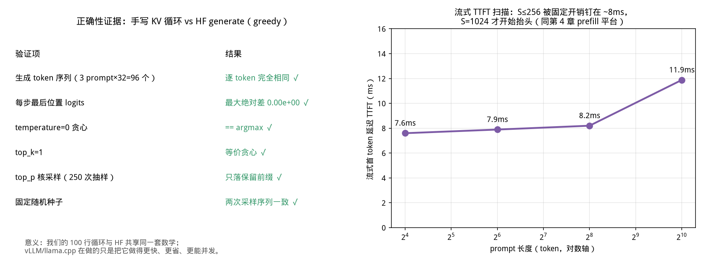
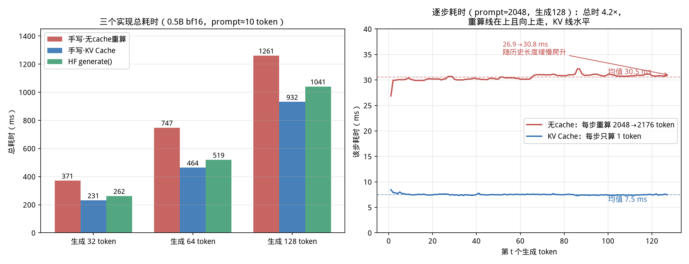
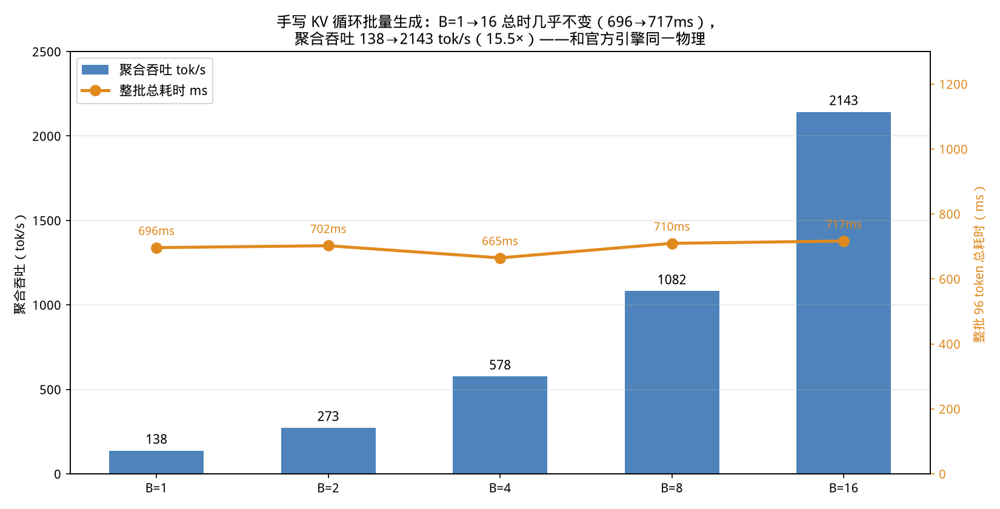

# 第 6 章 手写 generate：100 行看穿文本生成的心脏（Day 10–11）

> 前五章你一直是 generate 的使用者。这一章关掉自动售货机，自己动手装一台：一个 prefill、
> 一个循环、一个采样函数，加起来不到 100 行。装完你会发现，vLLM 和 llama.cpp 那几万行
> 代码里最核心的心跳，和你写的这 100 行是**同一个数学节拍**——而且我们会让它与
> transformers 官方实现逐 logits 精确到零误差。

## 0. 大白话开场

**这章讲什么？** 把第 4 章那张"五步循环"从流程图变成可运行代码：分词 → prefill 前向 →
取末位 logits → 采样出一个 token → 带着 KV Cache 继续前向，循环到 EOS。同时手写采样器
（temperature、top-k、top-p）和流式接口。

**为什么重要？** 三件事。第一，**generate 是推理引擎的心脏**：后面的 Continuous Batching、
PagedAttention、CUDA Graph、投机解码全是在给这个心跳做加速和并发改造，看不懂裸循环就
看不懂它们到底在优化哪一刀。第二，HF 的 `.generate()` 是出了名的"抽象套抽象"——
LogitsProcessorList、StoppingCriteria、GenerationMixin 几百个分支，出问题时你连卡在哪
一层都不知道；自己写过一遍，再读它的源码就是"这个我也写过"的从容。第三，这是面试高频
手撕题："不用 generate 写一个带 top-p 的流式生成"——本章的代码就是可直接默写的答案。

**学完能干什么？** ① 脱稿写出 KV 版 greedy/采样生成循环和 top-p；② 说清 HF generate
慢在哪（本章实测手写版还快 10%）；③ 给你一个 batch 的输入，解释引擎怎么一次 decode
多条（实测 B=1→16 吞吐 ×15.5）；④ 拿到一份"100 行 vs 真实引擎"的差距清单，知道后续
9 章每一种技术在补这 100 行的哪个洞。

**对应什么工作？** 推理引擎开发岗、端侧部署岗的代码关；也对应第 2 章 JD 里"熟悉
Transformer 推理流程、熟悉 KV Cache"的字面要求——不是"用过"，是写得出。

---

## 1. 先看全景：一个生成循环只有 12 行骨架

剥掉所有工程包装，自回归生成的骨架（`code/ch06/mini_generate.py` 的核心）是：

```python
cache = DynamicCache()                                  # ① KV 的家（第 4 章的 2L 个张量）
out = model(ids, past_key_values=cache, use_cache=True) # ② prefill：一次吃完 prompt
nxt = sample_token(out.logits[:, -1])                   # ③ 末位 logits 采样 → 第 1 个 token
for _ in range(max_new_tokens - 1):
    out = model(nxt, past_key_values=cache, use_cache=True)  # ④ decode：只喂这 1 个 token
    nxt = sample_token(out.logits[:, -1])               # ⑤ 采样 → 追加，循环
    if nxt.item() == eos_id: break
```

对照第 4 章的生命周期：② 是"prefill 写入"，④ 每步是"读旧 KV + 追加 1 行新 KV"，循环
结束后 cache 随请求销毁。注意 ④ 的输入永远只有**一个** `(B,1)` 张量——这就是 decode
算术强度 AI≈B 的代码现场（第 3 章）：整步计算只围绕这一个新 token，但为了它要读全部权重。

【类比】还是接龙：prefill 是老师把题目一次念完并记在黑板（cache）上；之后每轮你只需要
说一个新字（④），老师看着黑板上的全部历史（读 KV）决定你下一个该说什么，不用重念题目。

## 2. 采样器：logits 怎么变成"那一个 token"

模型最后一层吐出的是 vocab 大小（Qwen2.5 = 151936）的实数向量 logits，本质是"每个候选
token 的打分"。从分数到 token id，有四种常见玩法，全部在 20 行内：

```python
def sample_token(logits, temperature=1.0, top_k=0, top_p=1.0, generator=None):
    if temperature == 0.0:
        return logits.argmax(-1, keepdim=True)          # 贪心：永远选分最高的
    logits = logits / temperature                        # 温度：缩放分数分布
    if top_k:                                            # top-k：只留分数最高的 k 个
        kth = torch.topk(logits, min(top_k, V), -1).values[..., -1:]
        logits = torch.where(logits < kth, -inf, logits)
    if top_p < 1.0:                                      # top-p（核采样）
        sorted_logits, idx = torch.sort(logits, descending=True, dim=-1)
        cum = F.softmax(sorted_logits, -1).cumsum(-1)
        remove = cum > top_p
        remove[..., 1:] = remove[..., :-1].clone(); remove[..., 0] = False
        sorted_logits = sorted_logits.masked_fill(remove, -inf)
        logits = torch.empty_like(logits).scatter_(-1, idx, sorted_logits)
    return torch.multinomial(F.softmax(logits, -1), 1, generator=generator)
```

逐个说人话：

- **greedy（temperature=0）**：每步选最高分。确定、可复现、适合基准测试（本章对齐就用
  它），但容易复读、无趣——第 4 章 0.5B  greedy 输出"K是键，V是值"循环给你看了。
- **temperature**：先除以 T 再 softmax。T<1 分布变尖（保守、确定），T→0 退化成贪心；
  T>1 分布变平（天马行空，也更容易胡言乱语）。**用人话说就是"创造力旋钮"**，它不改变
  候选集合，只改变抽签的赔率。
- **top-k**：先砍掉分数排名 k 名以外的所有 token（置 -inf，概率归零），再在 k 个里抽。
  k=1 就是贪心。
- **top-p / nucleus**：比 top-k 更聪明的动态截断——按分数从高到低累加概率，只保留累计
  质量刚超过 p（如 0.9）的最小集合。模型很有把握时这个集合可能只有几个 token，模型犹豫
  时自动放宽到几百个。**用人话说：不赌小概率冷门，但热门候选有几个留几个。**

【坑】top-p 的边界处理是面试点：累计概率**第一次超过 p 的那个 token 必须保留**
（代码里 `remove[...,1:]=remove[...,:-1]` 那一行做的就是位移，保证前缀至少留一个）。
漏掉这个 off-by-one，高置信度时可能把所有 token 都删光，softmax 全 -inf 直接 NaN。

【配图建议】一张概率分布条形图：同组 logits 下，greedy 只点最高柱、T=0.5 柱子差距拉大、
top-k=3 给三根柱画保留框、top-p=0.9 的框随分布形状动态大小。

## 3. 无 cache 版：10 行，但是 O(n²) 的那 10 行

为了让对比有痛感，库里也保留了"反例实现"：

```python
def naive_generate(model, ids, max_new_tokens):
    for _ in range(max_new_tokens):
        out = model(ids, use_cache=False)        # 每步把【全部历史】重新过模型
        nxt = out.logits[:, -1].argmax(-1)
        ids = torch.cat([ids, nxt[None]], 1)     # 拼接，下一步重算整段
```

和第 4 章是同一个故事，但这次是你亲手写的：每步序列变长 1，计算量累计 O(n²)。与 KV 版
唯一的区别就是 `use_cache=False` + 喂整段 vs `use_cache=True` + 喂 1 个——两行之差，
性能天壤之别，下一节实测。

## 4. 正确性证明：与 HF generate 逐位相同，而不是"看起来差不多"

自己写的循环最怕"好像能出字"。本章的验收标准定得极高（`01_alignment.py`）：greedy 下
与官方 `model.generate(..., output_scores=True)` 在 3 个中文 prompt × 32 token 上比较——


*从这张图你能看到什么：左表是验收清单——96 个生成 token 逐个相同；每一步最后位置的
logits 与 HF 的 scores **最大绝对差 0.00e+00**（bf16 逐位精确，不是"差不多"）；采样器
五项单测全过。右图是流式 TTFT 随 prompt 长度的扫描，又是第 4 章那个 ~8ms 固定平台。*

为什么能做到零误差而不是 0.01：greedy 路径上没有任何随机性，HF 在 `do_sample=False`
时不挂任何 logits warper，它的 scores 就是模型原始输出（我们也验证了 scores[0] 与直接
prefill 的 logits 差仅 0.03，是 bf16 舍入）；KV Cache 数学上是严格等价变换（缓存的本来
就是同一份 K/V，没有近似）。**只要喂的数据相同，结果就应当比特相同**——如果对不上，
一定是你的 bug。

这个"必须对到零"的执念在工程上有真实价值：量化引擎、投机解码、自定义 kernel 上线前都
要过这种 golden 对齐（第 9、22 章），允许的误差预算是用数值分析论证出来的，不是跑两句
中文看通顺。

【坑】对齐时我们真踩了一个：`torch.stack(out.scores)` 的形状是 `(N,1,V)` 不是 `(N,V)`，
第一版代码漏写 `[:,0]`，广播错位导致 maxdiff 显示 22.9——token 恰好仍相同（argmax 对
广播不敏感），只看文本输出根本发现不了。**只对比文本不对比 logits，会放走数值 bug。**

## 5. 性能实测：手写 KV 版比 HF 还快 10%


*从这张图你能看到什么：左图三个实现的总耗时——短对话下重算版 1.4–1.6× 于 KV 版（又是
第 4、5 章那个固定平台效应），手写 KV 版反而比 HF generate 快约 10%（932 vs 1041ms）。
右图把 prompt 拉到 2048：重算线 26.9→30.8ms 在上且缓升，KV 线 7.5ms 水平，总时 4.2×。*

三个读数：

1. **手写 KV 为什么比官方快？** HF 的 generate 为了支撑几十种采样/停止策略，循环里每步
   都要过 LogitsProcessorList、StoppingCriteria、streamer 回调等一堆 Python 对象；我们的
   循环只有两次 tensor 操作。10% 就是纯调度税。这也告诉你引擎为什么敢把整个循环搬进
   C++/CUDA Graph：真实 workload 里这层开销在 decode 7ms 步长里占比可观（第 8、14 章）。
2. **KV 的收益在长上下文才兑现**：prompt≈10 时大家都在 14ms 固定平台，只差 1.5×；
   S0=2048 时重算线进入线性区（均值 30.5ms，且还在爬升），KV 依旧 7.5ms，4.2×。代码
   仓库里保留两个版本不是怀旧，是让你亲手量出这条分界线。
3. **收益曲线没有尽头**：100 行的我们还没用 SDPA 融合之外的任何加速。llama.cpp 同模型
   Q4 在第 1 章跑到 648 tok/s（约 1.54ms/token），我们 bf16 7.3ms/token——差 4.7 倍的
   空间正是量化（ch9-10）、CUDA Graph（ch8）、专用 kernel（ch7）要填的。

## 6. 批量生成：100 行里的 continuous batching 雏形

把输入从 `(1,S)` 换成 `(B,S)`，同一个循环**一行不用改**就支持批量（torch 的 batch 维
天然广播）：

```python
bid = ids.repeat(B, 1)                 # B 条相同 prompt
gens, steps, _ = kv_generate(model, bid, max_new_tokens=96)
```

实测（96 token 等长输出）：


*从这张图你能看到什么：B 从 1 到 16，**整批总耗时几乎不动**（696→717ms，±4%），聚合
吞吐 138→2143 tok/s，**15.5 倍**。这是第三次在本书见到同一个物理：第 3 章 Roofline 的
batch 红利（0.5B batch 32 聚合 ×29）、第 5 章服务级 32 槽 1900 tok/s、本章裸循环的
15.5×——decode 的权重读取被 B 个请求分摊，所以加 B 几乎不增加步时。*

但别急着宣布我们造出了 vLLM。这个静态 batch 有三个致命简化，恰好定义了后续章节：

1. **齐步走**：B 个请求必须同时开始、凑够一批才跑，输出短的要等输出长的（尾部拖后腿）。
   真实引擎是 **continuous batching**：每个 decode step 动态拼批，谁到了就插队、谁完
   成就出队，不用等——第 13–14 章在 mini-vLLM 里实现。
2. **KV 是一整坨连续张量**：我们的 DynamicCache 按 `(B,n_kv,S,d)` 连续增长，B 个请求
   生死与共，一个请求结束也没法把它的显存让给新来的。真实引擎用 **PagedAttention** 把
   KV 切成 block 随借随还——第 13 章。
3. **所有请求等长等优先级**：没有 chunked prefill（大 prompt 卡住整批 decode 的 TTFT）、
   没有抢占/换出（第 14、24 章）。

【类比】静态 batch 是包场旅游团：凑齐 B 人发车、一起回来；continuous batching 是
公交车：站站停，人到了就上、到站就下，座位动态复用。

## 7. 流式：加 6 个 yield 就是 SSE 服务内核

把"收集成 list 再返回"改成"生成一个 yield 一个"，就是你在 ChatGPT 看到的打字机效果：

```python
def kv_stream(model, ids, max_new_tokens=64, **sample_kw):
    cache = DynamicCache()
    out = model(ids, past_key_values=cache, use_cache=True)
    nxt = sample_token(out.logits[:, -1], **sample_kw)
    yield nxt.item()                          # 第 1 个 token：prefill 一结束立刻吐
    for _ in range(max_new_tokens - 1):
        out = model(nxt, past_key_values=cache, use_cache=True)
        nxt = sample_token(out.logits[:, -1], **sample_kw)
        yield nxt.item()                     # 之后每 decode 一步吐一个
```

服务端拿到 token id 后套 tokenizer 解码、经 SSE/WebSocket 推给浏览器，就构成了第 5 章
时间线上的所有时间戳。TTFT 扫描（图 3 右）显示：S≤256 时首字只需 ~8ms 且几乎不随长度
变化（固定平台），S=1024 才到 11.9ms——**单用户短对话的 TTFT 基本不是模型问题，线上
的 TTFT 主要是排队（第 5 章已经实测到十几秒）**，这个区分非常重要。

【坑】流式解码有个实战细节：tokenizer 是 subword 的，一个汉字可能跨两个 token，逐
token `.decode([id])` 在多字节边界偶尔出乱码/空白。生产做法是维护增量文本，用
`tokenizer.decode(history_ids)` 做前缀差分，或用带 `skip_special_tokens` 的增量解码器
（HF 的 `TextIteratorStreamer` 内部就是这么处理 UTF-8 边界的）。

## 8. 100 行 vs 真实引擎：一张差距地图

写完之后最该问的是：这 100 行离 vLLM/llama.cpp 还差什么？答案就是本书后半本的目录：

| 这 100 行的样子 | 真实引擎的做法 | 章节 |
|---|---|---|
| Python eager 循环，每步几十次 kernel launch | CUDA Graph 捕获整步、一次 launch | 8、14 |
| SDPA 通用注意力 | FlashAttention/PagedAttention 专用 kernel | 7、13 |
| bf16 全精度 | AWQ/GPTQ/FP8 权重+KV 量化 | 9–10、16 |
| 齐步走静态 batch | Continuous batching + chunked prefill | 13–14 |
| KV 连续张量、请求生死与共 | block 分页池、抢占换出 | 13–14 |
| 单卡 | 张量并行/流水并行/PD 分离 | 17、21 |
| 每步真算一个 token | 投机解码：一步猜 K 个、批量验收 | 22 |
| argmax/top-p 就结束了 | beam search、logprobs、stop strings、各类惩罚 | 本章扩展 |
| 来了就算 | 准入控制、有界队列、限流、调度策略 | 5、24 |
| 挂了就挂了 | metrics、优雅退出、多实例 LB、重试退避 | 24 |

**这张表要刻在脑子里**：之后每学一个引擎特性，都回来问一句"它在给 100 行循环的哪一行
擦汗"。能把每个特性映射回这个心跳，就是 Infra 工程师"知其所以然"的标志。

## 9. 工程视角补一刀：为什么 generate 的接口长那样

顺带看懂 HF 接口设计，以后读源码不慌：

- **LogitsProcessor vs LogitsWarper**：Processor 是"无概率解释的硬改"（min_length 内禁
  EOS、repetition_penalty、ban tokens），greedy/sample 都挂；Warper 是"采样专用的概率
  变形"（temperature/top-k/top-p），只有 do_sample 时挂。我们的 sample_token 只实现了
  Warper 三件套，没碰 Processor——大部分业务也只用这些。
- **StoppingCriteria / eos / max_length**：停止条件是可叠加的列表（EOS、长度、自定义
  字符串、外部事件）。真实服务还有"stop 字符串匹配"（API 里的 `stop=["</s>"]`），要在
  解码后的文本流上匹配并回滚多发的 token。
- **use_cache 开关**：训练/梯度检查点/某些调试场景要关；推理永远开（第 4 章已证明
  数学等价、只赚不赔）。

---

## 本章【坑】清单

1. **只对文本不对 logits**：广播/形状 bug 可能不改变 argmax 却污染数值分布，采样后
   才爆。必须 golden logits allclose。
2. **top-p off-by-one**：首个越界 token 要保留，否则极端情况下候选集为空 → NaN。
3. **流式逐 token decode 中文乱码**：subword 跨字节，用前缀差分或增量解码。
4. **以为 KV 循环要自己管位置**：4.56 DynamicCache 自动维护 cache_position；手动管也行
   （差 0.25 bf16 噪声），但别两套混用。
5. **把静态 batch 当 continuous batching**：齐步走的 15.5× 是上限演示，真实收益要等
   动态拼批+分页 KV，且会有调度/碎片代价（第 13–14 章实测）。
6. **temperature 与 top-p 的执行顺序**：必须先 /T 再截断再 softmax，顺序反了结果不同。

## 动手任务

**任务 A（必做，20 分钟）：脱稿写 KV greedy 循环。**
合上教程，新建文件只凭记忆写出 `kv_generate`（含 prefill/decode 分叉、EOS 停止），用
`python 01_alignment.py` 验收。**验收**：3 个 prompt 的 token 与 logits maxdiff 全部
0.00；如果不为 0，用二分打印逐步 logits 找出从哪一步发散。

**任务 B（必做，25 分钟）：加一个 repetition_penalty 并验证。**
HF generate 支持 `repetition_penalty=1.2`。在你的循环里实现它（对已生成 token 的 logit
做 `x→x/penalty`（正分）或 `x→x*penalty`（负分），发生在 temperature 之前），与 HF
`output_scores` 对齐到 maxdiff 0。**验收**：greedy + penalty=1.2 下 64 token 与 HF
完全一致；用第 4 章那个爱复读的 0.5B 对比复读率下降。

**任务 C（挑战，30 分钟）：不等长批量。**
用 `batched_generate`（已提供左 padding 版本）对 3 条长度差异 5 倍的 prompt 生成，验证
结果正确（每条的前几个 token 与单条运行一致）。再尝试把其中一条提前 EOS：观察当前实现
会不会让已结束的请求继续占位。**验收**：能指出"padding token 的 logits 污染"和"死请求
空转"两个问题，并说出 continuous batching 分别怎么解（第 13 章提前思考）。

## 自检三问

1. 不看代码画出 prefill→decode 循环里张量形状的变化：ids `(B,S)`、nxt `(B,1)`、每层
   K 缓存 `(B,n_kv,?,d)` 的 `?` 如何增长？为什么说 cache 是严格等价变换？
2. temperature、top-k、top-p 各自动哪一层（分数/候选集/概率）？为什么执行顺序不能乱？
3. 手写 KV 循环比 HF generate 快 10%，比 llama.cpp Q4 慢近 5 倍——这 10% 和 5 倍分别
是从哪里来的？对照第 8 节的差距地图列出至少 4 项，并索引章节。

---

下一章（Day 12–13）我们第一次下探到硬件：**GPU 体系结构与 CUDA 编程模型**——SM、warp、
显存层级、roofline 那 146 TFLOPS 和 920 GB/s 到底是从哪些硬件参数算出来的，为什么
decode 会被显存带宽而不是算力卡死。
