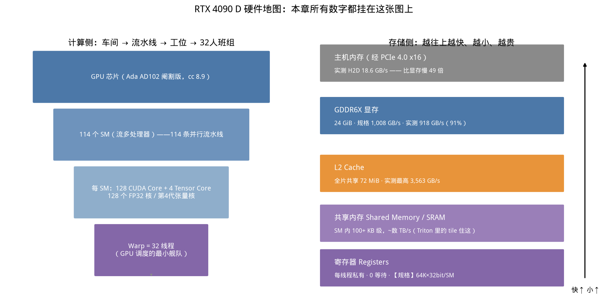
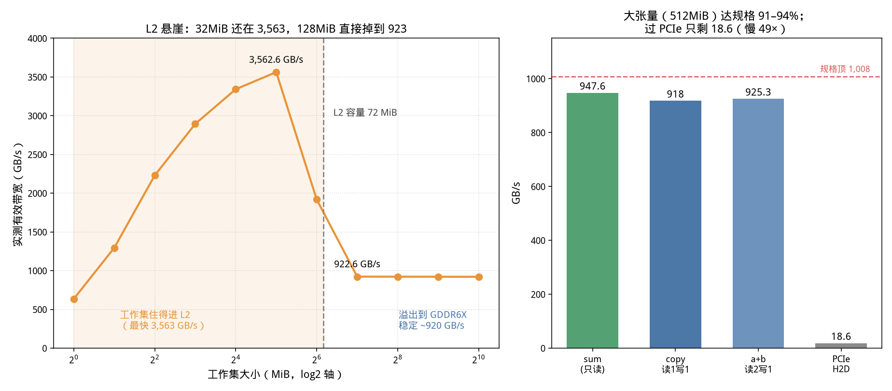
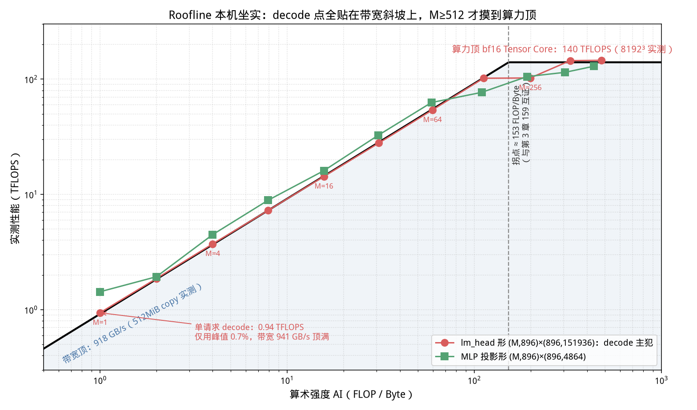
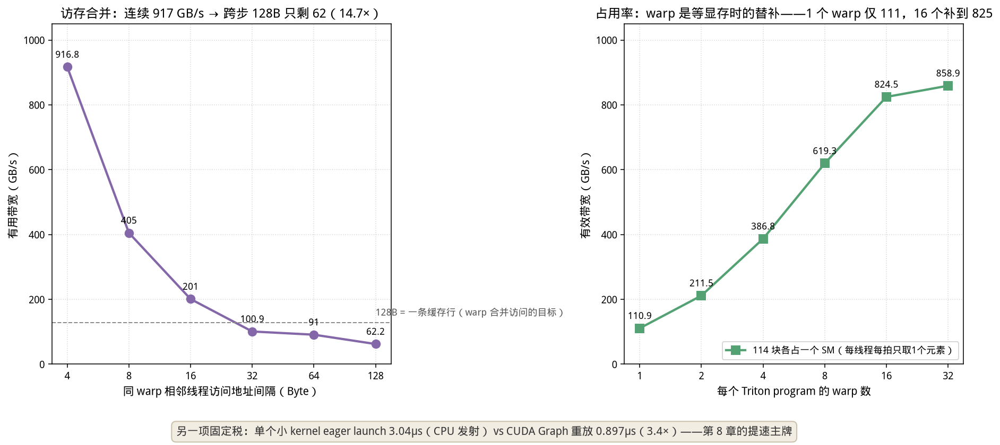

# 第 7 章 GPU 架构与显存层次：decode 为什么注定是"显存打工人"（Day 11–13）

> 前六章我们一直在黑盒外面量延迟、算公式。这一章打开机箱：140 TFLOPS 和 918 GB/s
> 不是黑板上的符号，是 114 个 SM、72 MiB L2、384-bit 显存总线一起跑出来的实物。读完
> 你会亲手在自己卡上量出这两个数字，并看着单请求 decode 只用了算力的 0.7%——那一刻你
> 会真正理解为什么后面半本书都在跟"显存带宽"较劲。

> **前置知识路标**：需要第 3 章的 Roofline（本章解释"墙"的物理来源）；不需要会写 CUDA——Triton 首写是"照抄式"的（逐行讲了为什么），跑不起来也不影响读完。脚本在 [code/ch07/](../code/ch07/)：`01_specs.py` 零依赖查规格，`02_bandwidth.py` 起测带宽，建议按序跑。

## 0. 大白话开场

**这章讲什么？** GPU 的计算组织（GPU→SM→CUDA Core/Tensor Core→warp）和存储层次
（寄存器→共享内存→L2→GDDR6X 显存→主机内存），以及把两者串起来的 Roofline 模型。
全程在你的 4090 D 上实测，不背规格表。

**为什么重要？** 因为推理优化的所有大招——量化、FlashAttention、continuous batching、
PagedAttention、CUDA Graph——本质都在回答同一个硬件问题：**"怎么让那 918 GB/s 的
显存总线别闲着，以及怎么少从显存搬字节？"** 不懂硬件层次，这些技术在你眼里就是一串
名词；懂了之后，你能在看论文/源码时自己推出"它想省哪一层的搬运"。面试里"为什么
decode 是 memory bound""量化为什么能提吞吐""warp divergence 是什么"都是开场题。

**学完能干什么？** ① 画出自己卡的计算/存储地图并报出每层实测带宽；② 用 Roofline
判断任意 kernel 是算力 bound 还是带宽 bound；③ 看懂 Triton kernel 里 `num_warps`、
BLOCK、连续/跨步访问在性能上意味着什么；④ 手算任意模型在任意卡上单流 decode 的
理论延迟下限——这个数以后就是你评估一切引擎的基准线。

**对应什么工作？** 性能调优岗、kernel/引擎开发岗的硬件地基；JD 里"熟悉 GPU 体系结构、
memory hierarchy、roofline 分析"的字面要求。


*从这张图你能看到什么：左半边是计算侧的四级嵌套——GPU 是车间，114 个 SM 是 114 条
流水线，每条线有 128 个 CUDA Core（通用工位）和 4 个 Tensor Core（矩阵乘法专用机床），
而调度单位是 32 线程一队的 warp。右半边是存储金字塔：越往上越快越小越贵，每层本章都
有实测数字。后面每一节都是在往这张图的某个格子里填东西。*

```bash
# 零依赖的两条先跑（任何有 NVIDIA 驱动的机器都能跑）
python3 code/ch07/01_specs.py        # 打印 GPU 规格身份证（SM/L2/显存位宽）
python3 code/ch07/02_bandwidth.py    # 实测显存读写带宽（对照规格算 91–94% 达标线）
# 有 GPU 再补跑：03_gemm_roofline.py（GEMM 落点）、04_triton_warps.py（Triton 首写）
```

## 1. GPU 凭什么比 CPU 快这么多：一个"工种单一的超大车间"

CPU 的芯片面积大头给了控制逻辑、分支预测、乱序执行和大容量私有缓存——它是一个什么
活都接的**全能小作坊**，十几个核，每个核都极其聪明。GPU 反过来：把晶体管预算几乎
全砸在 ALU（算术单元）和宽总线上。4090 D 有 **114 个 SM、14,592 个 FP32 CUDA Core**
（128/SM × 114，【规格】每 SM 128 个 FP32 核），但控制单元简单得可怜。

**用人话说：CPU 是 16 个教授，GPU 是 1.5 万个只会一种动作但从不请假的流水线工人。**
矩阵乘法和逐元素运算恰好是"同一动作重复几百万次"的活，所以 GPU 降维打击；而分支
繁多、串行依赖强的逻辑（调度器、编译器、你的 Python 循环）还得 CPU 来。这也解释了
第 6 章那个 3µs 的 launch 税为什么存在——每个 kernel 都是 CPU 教授给一万多工人
下发一张工单，发工单本身就是串行开销。

几个必须记住的编制：

| 概念 | 在 4090 D 上 | 类比 |
|---|---|---|
| SM（Streaming Multiprocessor） | 114 个 | 流水线，GPU 的基本调度/资源单位 |
| CUDA Core | 128 个 FP32/SM，共 14,592 | 通用工位，一个时钟一对标量乘加 |
| Tensor Core | 4 个/SM（第 4 代） | 矩阵专用机床，一条指令吃一小块矩阵 |
| Warp | 32 个线程 | 最小调度班组，32 人锁步执行同一条指令 |
| 线程块 block / Triton program | 最多 1024 线程 | 一个班组群，共享同一块 shared memory |

## 2. Warp 与 SIMT：32 人锁步划船，以及"分支发散"税

GPU 的执行模型叫 **SIMT**（Single Instruction, Multiple Threads）：warp 内 32 个
线程在同一时钟执行**同一条指令**，但各自用自己的寄存器数据。写 kernel 时你写的是
"一个线程的代码"，硬件把它复制给几万线程。

这套模型有个直接的税：**warp divergence（分支发散）**。如果 32 个线程在同一个 if
上分成两派，硬件不能让两派同时走——只能先关掉 B 派的执行单元让 A 派走 if 分支，
再反过来走 else，两派都到齐后继续。最坏情况下等效并行度从 32 掉到 16、甚至更低。

【坑】推理里典型的 divergence 场景：可变长度序列处理（有的线程遇到 padding、有的
没遇到）、early-exit、MoE 路由（不同 token 选不同专家）。高性能 kernel 会用
predication（无分支掩码，两边都算但作废一边）或重排数据让同 warp 走同一路径来规避。
本章实验中 Triton 的 `mask=offs < n` 就是 predication——尾巴上不满 32 的部分照样
执行，只是结果丢弃，比分支便宜。

【类比】warp 是龙舟：32 人必须同时落桨（锁步）。有人想划左、有人想划右时，船不会
翻，但会变成"左边划十下、右边再划十下"，效率对半砍。

## 3. 存储金字塔：每层都要记住两个数——容量和带宽

GPU 编程 90% 的性能问题都是存储问题。右半张图的五个层次：

| 层次 | 作用域 | 容量（本机） | 带宽/延迟（本机实测或规格） |
|---|---|---|---|
| 寄存器 | 线程私有 | 【规格】64K×32bit/SM | 零等待，编译器分配 |
| Shared Memory（SRAM） | block 内共享 | 100+ KB/SM 级【规格】 | 数 TB/s 级，编程可控的片上暂存 |
| L2 Cache | 全芯片共享 | **72 MiB（实测）** | 本章实测最高 **3,563 GB/s** |
| GDDR6X 显存 | 全局 | 23.5 GiB | 规格 1,008 GB/s，**实测 918–948** |
| 主机内存 | 经 PCIe 4.0 x16 | 系统内存 | **实测 18.6 GB/s**（慢 49 倍） |

两个必须澄清的概念：

1. **4090 用的是 GDDR6X，不是 HBM。** 消费/工作站卡把显存颗粒贴在 PCB 上走 384-bit
总线；A100/H100 用的 HBM 是 3D 堆叠在封装内、通过硅中介层连 GPU，位宽几千 bit，
带宽 2–3.3 TB/s 且更省电。算法一样，物理封装决定带宽档位——第 8 章选型时这是
"为什么云上租 H100 而不是插四张 4090"的核心变量之一。
2. **显存带宽规格的算法**：等效数据率 × 位宽 / 8。本机 10501 MHz 显存时钟 × 2（DDR
双边沿）= 21.0 GT/s，×384 bit / 8 = **1,008 GB/s**【位宽为 AD102 规格值】。这就是
后面所有"下限"计算的分母。

寄存器和 shared memory 由 kernel 显式/隐式使用：寄存器由编译器分配（用得多 →
能同时驻留的 warp 少 → occupancy 低）；shared memory 在 Triton 里就是 tile 的家
（`tl.load` 的一块 BLOCK 数据先进片上再算），在 FlashAttention 里是"不把中间矩阵
写回 HBM"的关键暂存区（第 7 节细讲）。

## 4. 实测一：显存带宽不是规格表数字，是你能跑出来的数字

`02_bandwidth.py` 在 512 MiB 大张量上做三种最简单的操作（流量口径不同：copy 读 1
写 1，a+b 读 2 写 1，sum 只读）：


*从这张图你能看到什么：右图——sum 达到 947.6 GB/s、copy 918、a+b 925，全部跑到
规格 1008 的 91–94%，这说明 PyTorch 内建 elementwise kernel 的访存质量已经接近硬件
极限；过 PCIe 只剩 18.6 GB/s。左图——把工作集从 1 MiB 扫到 1 GiB（保持总流量 4 GiB
不变）：32 MiB 时 3,563 GB/s（L2 内），128 MiB 掉到 923（溢出到 GDDR6X），72 MiB
L2 容量线就是悬崖边。*

三个读数的工程含义：

1. **"实测 91–94% 规格"是正常健康值。** 以后你自己写 kernel，带宽型任务跑到规格的
80%+ 算合格，90%+ 算优秀，长期只有 30–50% 就要找原因（合并访问？occupancy？launch
太碎？）。这是性能调优的第一把尺子。
2. **L2 悬崖决定了"小数据反复用"的操作有多赚。** 归一化、RoPE、小规模 bias add 这类
数据在 L2 内的操作享受 ~3.5 TB/s；而权重复读、大 KV 读取必然落在 920 这一档。
3. **PCIe 18.6 GB/s 是 host↔device 的真实水位**（PCIe 4.0 x16 理论 31.5 GB/s，简单
copy 实测约 59%）。每次把张量搬上卡都要过这条窄管——所以推理服务必须让权重常驻
显存、输入输出走流水线重叠传输；任何"每步都回 CPU 一趟"的设计都是 50 倍降速。
顺便记住：第 8 章会看到 NVLink 把这个数字抬到 600 GB/s 级，那是张量并行的前提。

## 5. 实测二：Roofline 在你自己卡上画出来

Roofline 就一句话：**一个 kernel 的实际性能 = min(算术强度 × 带宽, 算力峰值)**。
算术强度 AI = FLOPs / 搬运字节数。AI 低的（每搬一个字节算不了几下）沿"带宽斜坡"
爬，AI 高的被"算力平顶"按住，两线交点叫**拐点**（ridge point）。

先实测屋顶（8192³ 大矩阵，`03_gemm_roofline.py`）：

| 精度 | 走的硬件单元 | 实测峰值 |
|---|---|---:|
| fp32（TF32 关） | CUDA Core | 50.4 TFLOPS（理论 73.5@2520MHz 的 69%，时钟/功耗墙所致） |
| tf32 | Tensor Core | 76.6 TFLOPS |
| **bf16** | Tensor Core | **140.0 TFLOPS** |
| fp16 | Tensor Core | 142.9 TFLOPS |

bf16 相对 fp32 近 2.8 倍的差距，就是 Tensor Core 这张"矩阵专用机床"的红利；它也
回答了推理为什么默认 bf16/fp16——既省一半字节，又坐进了专用车道。本书后续 roofline
以**实测 140 TFLOPS + 实测 918 GB/s** 为两顶，拐点 140000/918 ≈ **153 FLOP/Byte**，
和第 3 章用 146 TFLOPS 算出的 159 互证（同一台机器、两次独立实验）。

然后放真实模型的点。Qwen2.5-0.5B 的 lm_head 是 `(896)→(151936)` 的投影，权重
272 MiB。让 M（batch×token 数）从 1 爬到 1024：


*从这张图你能看到什么：红点是真实 lm_head，绿点是 MLP 投影。**M=1（单请求 decode）
的点躺在斜坡最脚下：0.94 TFLOPS，只用了算力顶的 0.7%**，而有效带宽 941 GB/s 顶满；
M 翻倍，TFLOPS 跟着翻倍（AI 与 M 成正比）——这就是第 3、6 章 batch 红利的几何形状；
M=256 开始拐弯，M≥512 才贴上 140 的算力顶。decode 的物理位置在这张图上无处可藏。*

【类比】算力顶是工厂的机床总产能，带宽斜坡是来料速度。decode 是"每小时只来一块料、
机床再快也只能干瞪眼"；prefill 是"一火车料一次性拉满，机床连轴转"。提高 batch
就是让一趟车多拉料，但料的总量（权重字节）不变——这就是为什么多人合批几乎免费。

## 6. 实测三：自己写一个 Triton kernel，看 warp 怎么干活

光看 PyTorch 算子还是隔了一层。`04_triton_warps.py` 用约 10 行 Triton（Python 内嵌
DSL，编译成 PTX 进 SM）直接操作线程访问模式，看两个硬件事实：

**事实 A：访存合并（coalescing）——32 个线程的地址必须挨在一起。** warp 发射一次
访存，硬件会把 32 个线程的请求合并成尽量少的缓存行事务（一行 128 Byte）。让相邻
线程访问连续地址（间隔 4B），一次事务全装下，**917 GB/s**；把间隔放大到 128B，每个
线程各占一行，32 次事务只搬回 32 个有用浮点数，**62 GB/s，14.7 倍差距**。


*从这张图你能看到什么：左图每搬一个有用字节的成本随跨步线性恶化；右图把 grid 压到
恰好 114 块（每 SM 一块，排除"别的 block 补位"），每个 program 只有 1 个 warp 时
111 GB/s——一个 warp 发出 load 后整个 SM 在干等显存；warp 加到 16 个补到 825，
32 个 859，7.7 倍。**warp 就是"等待显存时的替补队员"**，在场上的 warp 越多，越能
用别人的计算盖住自己的等待，这就是 occupancy（占用率）。*

【方法学】这两个数都不是一次测出来的。第一版 occupancy 实验用几千个 block + 大
tile，num_warps 从 1 到 16 带宽全打平 ~910——因为 block 在 SM 外面排长队，一个
block 内 warp 少，别的 block 立刻补进来，而且单线程大 tile 内部还有指令级并行
（ILP）。只有把 grid 压到 114、每线程每拍只发一个 load，才隔离出"同 block 内 warp
替补"这一个变量。**做性能实验，先想清楚自己在隔离哪个变量**——这个教训比数字本身
值钱，第 8 章用 ncu/nsys 时还会反复用到。

图底部那行数字是第 6 章埋的伏笔的答案：eager 模式每个小 kernel 发射均摊 **3.04µs**
（CPU 教授发工单），CUDA Graph 重放只剩 **0.897µs**（工单提前录好、整段重放），
3.4×。一个 decode 步有上百个小 kernel，这就是第 8、14 章 CUDA Graph 能提吞吐的
物理来源。

## 7. 总根源：decode 每生成一个 token，就要把全部权重从显存"念"一遍

把前面所有数字拧成一个物理事实。decode 一步对每个权重元素做的事情少得可怜：
矩阵乘 `y = x·W` 中，x 只有一行（M=1），权重 W 的每个元素只参与 **2 次浮点运算**
（一次乘加），却要从显存读 **2 个字节**（bf16）——算术强度 ≈ 1 FLOP/Byte，而拐点
是 153。差了两个数量级。本章图 1 的红点就是铁证：0.94 TFLOPS，99.3% 的算力在
空转，但总线 100% 忙碌。

由此得到全书最重要的公式之一——**单流 decode 的延迟下限**：

$$t_{token} \ge \frac{\text{参数字节数}}{\text{显存带宽}} = \frac{P \cdot b}{BW}$$

大白话：不管理论上算得多快，每个 token 至少要花"把权重完整读一遍"的时间，这是
物理墙。代入 4090 D（BW 取实测 918 GB/s）：

| 模型 | bf16（2B/参数） | INT4（0.5B/参数） |
|---|---|---|
| 0.5B | 1.0 GiB → **1.1 ms/token（≈900 tok/s 上限）** | 0.25 GiB → 0.27 ms |
| 7B | 14 GiB → **15.3 ms/token（65 tok/s 上限）** | 3.5 GiB → **3.8 ms（260 tok/s 上限）** |

第 1 章 ollama 跑 0.5B Q4 实测 648 tok/s（1.54ms），第 6 章手写循环 bf16 实测
7.3ms/token——都显著慢于 1.1ms 的理论墙。差距不是引擎笨，而是真实 decode 还要
付 launch 税（上百 kernel × 3µs）、读 KV、过 lm_head 大词表投影、且小 kernel
occupancy 不足。**理论墙的作用不是预测实际速度，而是给你算"还剩多少优化空间"**：
7.3ms 对 1.1ms 意味着 6.6 倍可挖，这些倍数就分散在后面每一章。

更重要的是，这面墙统一了所有优化技术的动机。**每个技术都在回答"怎么减少/摊薄
要从显存搬的字节"**：

| 技术 | 对带宽墙做了什么 | 章节 |
|---|---|---|
| 权重量化 INT8/INT4 | 权重字节直接减半/变四分之一，t_token 同比例下降 | 9–10 |
| batching/连续批处理 | 一份权重字节同时喂 M 行 x，字节被 M 个请求均摊 | 3/5/6/13 |
| KV Cache 量化 | decode 第二步大流量（KV 读取）字节减半 | 16 |
| PagedAttention | 不减少字节，但消除 KV 显存碎片，让更多请求挤上带宽 | 13 |
| FlashAttention | attention 中间矩阵不落 HBM，N² 级读写降为块内 SRAM 流 | 13 |
| CUDA Graph | 不减字节，但砍掉每步上百次 3µs launch 税 | 8、14 |
| 投机解码 | 一次搬权重验收 K 个 token，把每 token 字节数摊薄 K 倍 | 22 |
| 张量并行 | 权重字节分到多卡多总线，BW 叠加（代价：卡间要 NVLink） | 8、17 |

【类比】显存总线是一条每小时能过 918 吨货的唯一公路，权重是每个 token 都必须从
仓库（显存）运到车间（SM）的整套设备。量化=给设备减重；batching=一辆卡车装多家
货；FlashAttention=有些零件直接在车间里转手、不上公路；CUDA Graph=取消每辆车
的层层路条；投机解码=一趟车送 K 倍的货；TP=修 N 条平行公路。看懂这张表，你就
拿到了引擎技术的"第一性原理索引"。

## 8. 顺带破除三个常见误解

1. **"换更贵的卡 decode 就更快？"** 单流 decode 只认显存带宽，不认算力。一张
算力强但带宽一般的卡，decode 可能不如算力弱但 HBM 宽的卡——第 8 章选型表按
带宽排而不是按 TFLOPS 排。
2. **"bf16 比 fp32 快只是因为数小？"** 更因为它走 Tensor Core（本章 140 vs 50.4）
且字节减半同时缓解了带宽墙——一份优化吃两份红利。
3. **"L2 大就能装下权重？"** 本机 L2 只有 72 MiB，0.5B 的 lm_head（272 MiB）都
装不下，更别说整模型；7B bf16 14 GiB 是 L2 的 194 倍。所以权重读取 99% 落在
GDDR6X 那 918 GB/s 上，别幻想缓存救命（M=1 行测出 941 的轻微超标正是 272 MiB
中热头部在 L2 命中的贡献，量级合理）。

## 本章【坑】清单

1. **只看 TFLOPS 选卡**：decode 卡在带宽。先算 `P·b/BW`，再谈别的。
2. **实测带宽不报流量口径**：copy 是 2×size、a+b 是 3×size、sum 是 1×size，口径
错了数字全错（本章脚本里每个都标了）。
3. **Triton num_warps 乱调不看 grid**：block 排大队时 warp 数影响为零；先问
occupancy 的限制来自哪（warp 槽、寄存器、shared memory）。
4. **跨步访存/线程布局不连续**：128B 跨步 14.7 倍性能税，attention 的各种 tile
排列本质都在解决合并访问。
5. **每个 token 回 CPU 同步**：`torch.cuda.synchronize()` 在 decode 循环里等于
主动放弃流水线；量延迟可以（我们前几章都在量），写引擎绝不行。
6. **把 GDDR6X 的经验外推到 HBM**：带宽差 2–3 倍、延迟模型不同；第 8 章实测
多卡时会重新校准。

### 【落地视角】
本章给你读硬件和读 profile 的共同词汇表：SM/warp/coalescing/L2/带宽，让你能看懂 nsys/ncu 的输出（ch08/ch24 复用），也让你理解"显存带宽为什么是 decode 的墙"（回扣 ch03）。实操上，第一次写 Triton kernel、第一次看 `nvidia-smi` 的拓扑与频率，都从本章出发；"t_token = P·b/BW 的延迟下限"给了你任何优化的理论天花板——**优化做满也翻不过这条线，翻不过时就换思路**。

### 【化学家视角】
GPU 架构像**多通道并行反应阵列**：SM 是反应位点、warp 是同步进料的小组、合并访存是"整板同时取试剂"（散取则来回跑腿，我实测 14.7× 差距）、L2 是中央试剂暂存台（近处取快、远处取慢，3563→923 的悬崖）。层级访存的快慢差，和实验室"实验台→通风柜→库房"的取用成本是同一笔账。

### 【应急方案】
Triton 首写跑不通或比参考实现慢：先对正确性（小输入与 PyTorch 参考逐元素 maxdiff），再查合并访存（索引是否按连续维度步进）与 occupancy（寄存器/共享内存占用）；带宽实测远低于规格：查是否跑在 PCIe 回退路径（数据反复穿越主机），有效带宽含开销属正常、91–94% 规格即及格；"优化后没变快"：先用 nsys 分清 kernel 时间 vs 拷贝/启动时间——launch 开销（3µs 级）不是 kernel 慢。

---

## 动手任务

**任务 A（必做，20 分钟）：在自己卡上重跑全部实验。**
依次跑 `01→02→03→04`，把 json 里的数字与 RESULTS.md 对照。**验收**：能独立
回答：你的卡 SM 数、L2 大小、显存带宽实测/规格比（应在 85%+）、bf16 大 GEMM
峰值、拐点 AI；带宽比明显低于 80% 时检查是否有别的进程占卡（`nvidia-smi`）。

**任务 B（必做，25 分钟）：手算+实测延迟下限。**
① 不查表，用公式算 7B bf16 与 7B INT4 在本机单流 decode 的 t_token 下限和 tok/s
上限；② 写一个 20 行脚本：构造一个 (4864, 896) 的 bf16 权重，循环 1000 次
`x(1,4864) @ W` 量中位耗时，按 2·K·N/时间算有效带宽，验证它贴在 918 墙上；
③ 把 batch 改成 32，再算一次有效带宽与 TFLOPS，在图 1 上标出你的两个点。
**验收**：手算 7B bf16=15.3ms、INT4=3.8ms；单点带宽 ≥850 GB/s。

**任务 C（挑战，30 分钟）：改造 Triton kernel。**
把 `vadd_stride` 的 stride 改成 3，先预测带宽（提示：32 线程×12B 跨度会产生
多少条 128B 事务？），再实测。然后试着改访问映射让它恢复合并（例如用
`i*STRIDE` 换成连续块）。**验收**：预测值与实测误差在 30% 以内，并能一句话
说清 coalescing 对"量化 gather 读权重"这类场景意味着什么（第 9–10 章会真
遇到：INT4 解包布局的性能很大程度上由合并访问决定）。

## 自检三问

1. 画出 4090 D 的计算/存储地图，标出每层容量与你实测的带宽；warp、block、SM
的包含关系是什么，warp divergence 时硬件怎么执行？
2. 单请求 decode 的点为什么在 Roofline 斜坡脚下？写出 t_token 下限公式并心算
13B bf16 在 1000 GB/s 卡上的上限 tok/s（答案约 38）。
3. 不翻第 7 节表格，说出量化、batching、FlashAttention、CUDA Graph、投机解码
分别在减少哪一种时间或字节；为什么其中只有 CUDA Graph 不改变显存流量却仍然有效？

---

下一章（Day 14–15）离开单卡：**PCIe / NVLink / NVSwitch / InfiniBand** 把多张卡
粘成一台机器，我们会实测 P2P 带宽、说清"为什么张量并行必须 NVLink"，并给出
"模型→量化→显存→硬件→月成本"的选型速查表；同时第一次用 nsys/ncu 给第 6 章的
手写循环做正式 profile，把这一章的带宽数字在真实时间线上一一对上号。

## 面试话术（3 条）

**话术 1（decode 为什么受带宽限制）**："decode 每生成一个 token 都要把整个权重重读一遍，但只做一次极小的矩阵乘——算术强度接近 1，落在 Roofline 的带宽侧。我实测过 4090D 的一个 M=1 GEMM 只跑到 bf16 峰值的 0.7%，而有效显存带宽能跑到规格的 91–94%——所以 decode 的优化全在抠字节：量化、投机解码、更大 batch，堆算力没用。"

**话术 2（一次性能实测经验）**："我建立的 profile 习惯是先分层：合并访存（整板连续取 vs 散取我实测有 14.7× 差距）、L2 命中（近远数据 3563→923 的悬崖）、启动开销（单 kernel launch 约 3µs，Graph 后 0.9µs）。判断为什么慢永远按这三层排查，最后才怀疑算法——因为算法往往没错，是访存模式错了。"

**话术 3（优化的理论天花板）**："每个优化都有下限：decode 的 t_token ≥ P·b/BW（权重字节除以带宽），做满也只能逼近这条线。所以我的决策顺序是：先算理论下限、看当前值差多少倍——差很多就 profile 找浪费，已经贴近下限就换维度（量化降 P、投机解码降 b、换更快的卡）。贴近墙还继续调参是最常见的浪费。"
