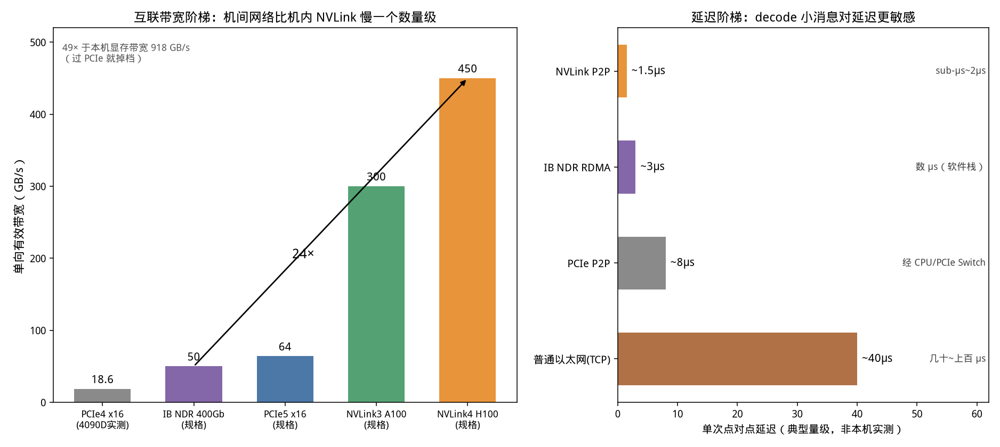
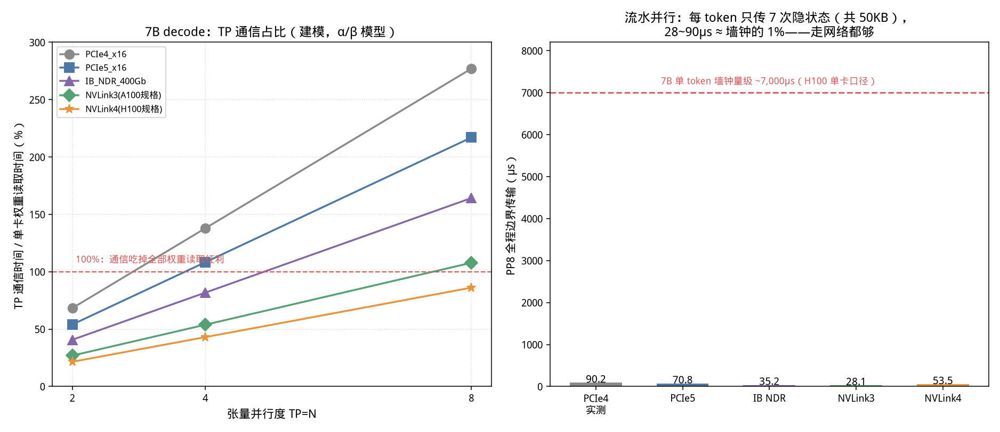
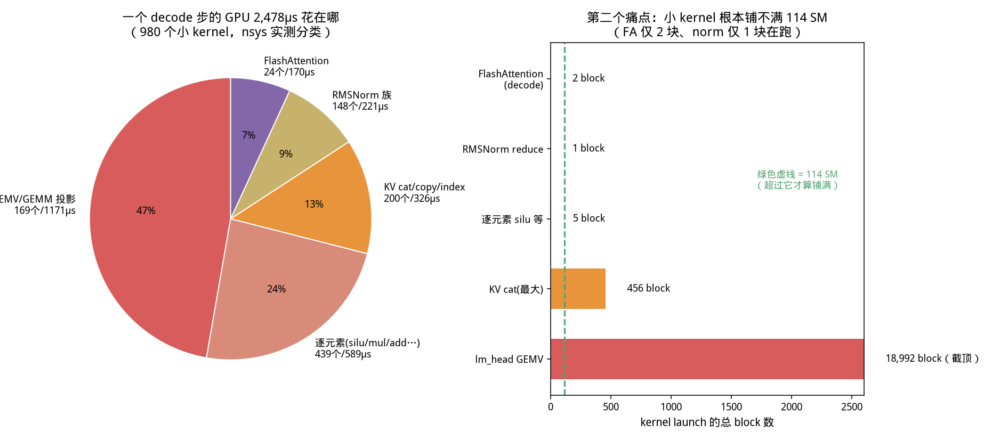
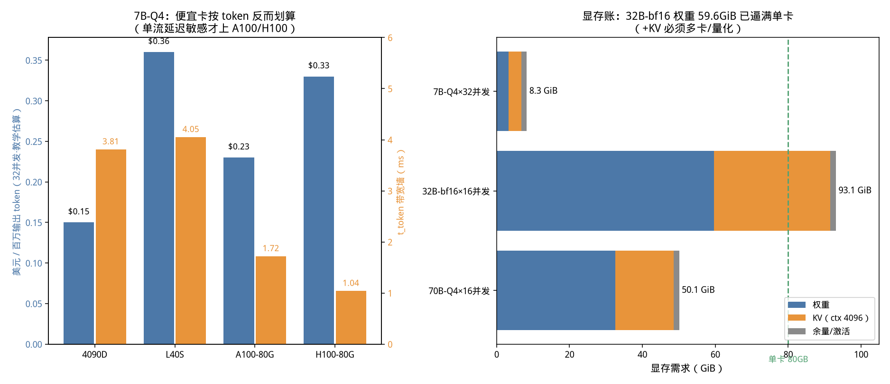

# 第 8 章 互联、国产硬件与选型实操——多卡机器的路，和第一次正式 profile（Day 14–15）

> 实验环境：RTX 4090 D 单卡（Ada，114 SM，GDDR6X 918 GB/s）、nsys 2025.3.1、
> CUDA 12.8；通信部分为 α+β 模型计算（假设全部列明），多卡数字来自公开规格，
> 凡建模/规格/实测三类数字，正文都会标清。

## 0. 从一个采购问题开始

假设公司让你提一个方案："上一套能跑 70B 对话的推理服务，先租一个月试试。"
你面前有一堆选项：4090 D、L40S、A100 80G、H100，单卡、双卡、八卡，还有昇腾
910B 的国产机房报价。销售会跟你说一堆数字：900GB/s NVLink、400G IB、RoCE、
NVSwitch……这一章结束时，你要能在一张餐巾纸上算出：**买什么卡、买几张、插在
什么总线上、每生成一百万 token 大概多少钱**，并且能说清楚为什么。

这条能力链分三段：① 认识多卡机器里里外外的"路"（带宽和延迟）；② 看懂张量并行/
流水并行各自对"路"的要求（我们会把它算成数字）；③ 加上显存账和时价，做选型。
中间插播一项工程师必备手艺：第一次用 Nsight Systems 给真实推理做 profile——
我们在第 6 章手写的 decode 循环，这一章要在时间线上被拆成 980 个 kernel 给你看。

---

## 1. 机内的路：PCIe、NVLink、NVSwitch

### 1.1 先记住一张带宽阶梯表

GPU 算得再快，数据送不进来就干等。数据的路有三层，带宽差一个数量级一层：

| 链路 | 谁和谁相连 | 单向有效带宽 | 典型延迟 | 口径 |
|---|---|---|---|---|
| 板载显存（HBM/GDDR） | SM ↔ 显存 | 918 GB/s（本机）/ 2–3.4 TB/s（A100/H100） | 数百周期 | 实测+规格 |
| **NVLink4**（H100 SXM） | GPU ↔ GPU，直连或经 NVSwitch | **450 GB/s**（双向 900） | 1–2 µs | NVIDIA 规格折半 |
| **NVLink3**（A100 SXM） | GPU ↔ GPU | **300 GB/s**（双向 600） | 1–2 µs | NVIDIA 规格折半 |
| **PCIe 5.0 x16** | GPU ↔ CPU/网卡，或经 CPU 的 GPU↔GPU | 64 GB/s（双向 128） | ~8 µs（经 Switch） | PCIe-SIG 规格 |
| **PCIe 4.0 x16** | 同上（4090/L40S/A100 PCIe 版） | **18.6 GB/s 本机实测**（规格双向 32） | ~8 µs | **ch07 实测** |
| 机间 IB NDR 400Gb | 网卡 ↔ 网卡（RDMA） | 50 GB/s | 数 µs（软件栈） | IBTA 规格 |

几个容易被销售话术绕进去的点，一次说清：

1. **所有 PCIe/NVLink 宣传值都是双向峰值，对打要折半。** PCIe 4.0 x16 标称
   32 GB/s 是收发合计，我们 ch07 实测单向拷贝有效带宽 18.6 GB/s（协议开销后）；
   NVLink4 标称 900 GB/s 双向，单向按 450 估算。
2. **NVLink 是 GPU 之间的专线，不过 CPU。** 两张卡走 NVLink 对传，数据不出
   GPU 子系统；走 PCIe 的两张卡通常要经过 CPU Root Complex（或 PCIe Switch），
   不但慢（18.6 vs 450，差 24 倍），延迟还高（8 µs vs 1.5 µs），还要抢 CPU 的
   PCIe 通道。
3. **NVSwitch 是"GPU 之间的交换机"。** 两张卡可以 NVLink 直连，但 8 张卡想
   全互联，直连需要 28 条线，物理上没法做。NVSwitch 让柜内任意两卡都能以全带宽
   对讲——DGX/HGX 8 卡整机里那颗（或两颗）芯片就是它。没有 NVSwitch 的 8 卡机，
   卡间带宽是不均匀的（近处全速、跨 CPU 要走 QPI/UBLink，掉档）。
4. **消费卡被砍了 NVLink。** RTX 4090/4090D、L40S 都没有 NVLink，多卡只能走
   PCIe。这不是省钱小事，这决定了它们**做不了大模型张量并行**（第 3 节算给你看），
   只能"一卡一模型"或跑流水并行/多实例。

【类比】把 GPU 想成车间，显存是车间里的料场（HBM，2–3 TB/s），NVLink 是车间
之间的专用传送带（450 GB/s），PCIe 是全厂共用的货运电梯（18.6 GB/s，还要在
调度室 CPU 那里登记），机间网络是厂区公路。你不会想用货运电梯在两个车间之间
每秒钟传几百次小料盒——但 decode 阶段张量并行干的恰好就是这事。



> 从这张图你能看到什么：左图是带宽阶梯——本机显存 918 GB/s 之外，NVLink4 以
> 450 独占一档（比 PCIe4 实测快 24 倍），PCIe5/IB/PCIe4 挤在 50–64 GB/s 的
> 矮梯队。右图是延迟阶梯——NVLink P2P 点对点约 1.5 µs，IB RDMA 约 3 µs，
> PCIe 经 Switch 约 8 µs，普通 TCP 以太网几十到上百微秒。**decode 传的是几十
> KB 的小消息，对延迟（柱子的长度）比对带宽更敏感**，这是第 3 节的伏笔。延迟为
> 典型量级示意（非本机实测），落集群请用 nccl-tests 实测。

### 1.2 怎么查自己机器的路

```bash
nvidia-smi topo -m        # 矩阵：任意两卡之间是 NV#（NVLink）还是 PIX/PHB/SYS（PCIe 路径）
nvidia-smi nvlink -s      # NVLink 状态（消费卡这行直接报错，说明没有）
lspci | grep -i nvidia    # 看卡挂在哪条 PCIe、几代 x几
```

`topo -m` 的输出里，`NV#` 表示第几路 NVLink 直连/交换，`PIX` 是同一 PCIe switch
下紧邻，`PHB` 要过一个 PCIe host bridge，`SYS` 要跨 CPU socket——带宽逐级递减。
**租多卡机器第一件事就是跑这条命令**，"8 卡 A100"和"8 卡 A100 全 NVSwitch 互联"
是两个价格、两种命运。

【坑】云上"8 卡"实例有两种：SXM 整机（NVSwitch 全互联，贵）和把 8 张 PCIe 卡
塞进一个机架（过 CPU/Switch，便宜）。vLLM 起 TP=8，前者飞快，后者通信可能比
计算还慢（第 3 节：PCIe 上 TP8 通信占算的 277%）。规格页不写 topology 的，
上机后第一件事自己 `nvidia-smi topo -m`。

---

## 2. 机间的路：以太网、RDMA、InfiniBand、RoCE

单机装不下（比如 175B、405B，或者几百并发），就要多机。机间没有 NVLink，只有网络。

**普通 TCP 以太网**的问题不是带宽（100GbE 物理带宽不小），是延迟和 CPU 开销：
数据要从 GPU 拷到主存→内核协议栈→网卡，对端再倒一次，一次往返 40 µs 起步，
CPU 忙着搬数据。**RDMA**（Remote Direct Memory Access）让网卡绕过内核和 CPU
直接读写远端内存，延迟压到几微秒。RDMA 有两种物理载体：

| 技术 | 物理层 | 特点 | 典型场景 |
|---|---|---|---|
| **InfiniBand（IB）** | 专用 IB 网络（NDR 400Gb/s=50GB/s） | 需 IB 网卡（ConnectX）+ IB 交换机，生态封闭但调优省心，自带 SHARP 网内聚合 | 大厂训练集群标配 |
| **RoCE v2** | 跑在普通以太网上的 RDMA | 需要无损以太网（PFC/ECN 拥塞控制），运维门槛高但复用以太网设备 | 自建机房、国产集群（昇腾集群主流） |
| TCP 以太网 | 通用 | 无要求，但延迟高、吃 CPU | 小规模、PP、容忍慢的场景 |

NCCL 是 NVIDIA 的集合通信库，它会自动选路：NVLink→IB verbs→TCP，能用快的绝不
用慢的。**昇腾对应的是 HCCL，寒武纪对应 CNCL**，接口概念一一对应（第 4 节）。

> 【请联网检索】NDR 之后的 XDR（800Gb/s）、GDR（GPU Direct RDMA，网卡直读显存
> 不过主存）在你读到本书时的部署占比；选型时让机房提供 `ib_write_bw`/
> `all_reduce_perf` 实测，比信标称重要。

---

## 3. 把核心问题算成数字：为什么 TP 必须 NVLink，PP 却能走网络

第 3 章讲过两种并行，现在用 `02_comm_model.py` 算它们对链路的真实要求。
模型：单次集合通信时间 t = α + 流量/(带宽×0.8 效率)，α 是 launch+跳数的固定
延迟（NVLink 取 8–10µs、PCIe 20–25µs、IB 15µs，**典型拟合值非实测**，落集群
用 nccl-tests 替换）。

### 3.1 张量并行（TP）：每一层、每一个 token，都要两次 all-reduce

TP 把矩阵按列/行切开，每层 attention 和 MLP 之后各要一次 **all-reduce** 把部分和
加起来。关键在于：**decode 时每个 token 都要把 28 层×2 次 AR 完整走一遍**，通信
死死卡在每层计算之间的关键路径上，藏不住。

以 7B（隐层 d=3584，bf16）为例，一次 AR 的 payload 只有 3584×2=7KB——小到
**固定延迟 α 主导**，链路带宽反而次要。算"通信时间 / 单卡权重读取时间"的比值，
大于 100% 意味着通信比省下的计算还多，并行纯属倒贴：

| TP 度 | NVLink4 | NVLink3 | IB NDR | PCIe5 | PCIe4（4090D 实测口径） |
|---|---|---|---|---|---|
| 2 | **21.5%** | 26.9% | 40.7% | 54.0% | 68.3% |
| 4 | 43.0% | 53.8% | 81.8% | 108.3% | 137.9% |
| 8 | 86.1% | 107.8% | 164.2% | 217.0% | **277.0%** |

读这张表的正确姿势：

- **NVLink4 上 TP2 只付 21.5% 的通信税，划算；TP8 也才 86%，加上单卡权重读取
  降到 1/8，总时间仍然大赚。** 这是 H100 8 卡整机存在的理由。
- **PCIe4 上 TP2 就 68%，TP8 到 277%**——4090D 八卡跑 TP 比单卡慢近 3 倍。
  消费卡多卡跑大模型 TP 是物理上不成立，不是"优化一下就好"。
- NVLink3（A100）TP8 也到 107.8%，说明 **TP 度不是越高越好**，7B 这种小模型
  TP4 是甜点；大模型权重读取更慢，比值分母变大，才能喂饱更高 TP 度。
- 顺便：0.5B 做 TP2，即使 NVLink4 通信占比也有 70.5%——**小模型别并行**。

### 3.2 流水并行（PP）：整个模型只在阶段边界传隐状态

PP 把层切成段，卡 0 算 1–14 层、卡 1 算 15–28 层，**每个 token 只在边界传一次
隐状态**（7168 B），全程 8 段累计传 7 次共 50KB。

| 链路（PP8 全程累计） | NVLink4 | NVLink3 | IB NDR | PCIe5 | PCIe4 |
|---|---|---|---|---|---|
| 传输耗时 µs | **28.1** | 35.2 | 53.5 | 70.8 | 90.2 |
| 占 7B 单 token 墙钟 ~7000µs | 0.4% | 0.5% | 0.8% | 1.0% | 1.3% |

**最差的 PCIe4 也只有 1.3%，走 IB 是 0.8%——所以 PP 可以跨机器、跨机房。**
代价不是带宽而是另两样东西：① **气泡**（流水线填不满，GPU 空等，要用 micro-batch
摊销）；② 每层都要过边界，层数太少时相对开销变大。这就是大模型多机训练的经典
配方：**机内 TP（吃 NVLink）× 机间 PP/DP（走 IB）**，一个 8 机×8 卡的 64 卡
集群，TP=8 关在单机内，PP=8 跨 8 台机器。



> 从这张图你能看到什么：左图五条线随 TP 度上升而发散，红色虚线是 100% 生死线
> ——NVLink 全线在线下，PCIe4 从 TP4 起就翻到线上方；右图所有柱子（28–90µs）
> 贴在地面，对比红色虚线的 7000µs 墙钟几乎看不见。两张图合起来就是一句话：
> **TP 对链路是刚需，PP 对链路是挠痒。** 另注意 prefill 是带宽主导（S=2048 时
> TP8 单层 AR：NVLink4 0.079ms vs PCIe4 1.751ms），长上下文场景对网络更敏感，
> 第 11 章讲序列并行时再会这张表。

【应急方案】手上只有无 NVLink 的消费卡多卡机怎么办？三种活法：① **一卡一实例**
做横向扩展（4 张 4090D 各跑一个 7B，前面挂负载均衡，总吞吐≈4 倍，最香）；
② 只在能接受 1% 税时用 PP；③ 用 `llama.cpp` 的层切分（本质 PP）把放不下的
模型塞进去，慢但能跑。**唯独不要硬上 TP。**

---

## 4. 国产硬件版图：昇腾、寒武纪，以及你该知道的生态对位

国产化是国内 Infra 岗位简历上越来越常见的要求。不吹不黑，按"和你已经懂的
CUDA 世界怎么对位"来讲。

### 4.1 昇腾（华为 Ascend）

| 型号 | 算力 | 显存 | 互联 | 软件栈 |
|---|---|---|---|---|
| Ascend 910B（2023 起量产，当前主流） | FP16 约 320 TFLOPS，INT8 约 640 TOPS | 32 GB HBM2e，约 1.6 TB/s，310W | **HCCS**（对标 NVLink）+ PCIe4 + **RoCE v2** 集群 | **CANN**（对标 CUDA）、MindSpore、PyTorch 适配层（torch_npu） |
| Ascend 910C | 双芯合封，FP16 约 640 TFLOPS 量级 | 约 64GB 量级 | HCCS 增强 | 同上 |
| Ascend 920（新一代，公开口径） | — | 64GB / 约 2.5 TB/s | **UBMesh**（全互联，对标 NVSwitch+NVLink 域） | CANN 演进 |

（规格为华为开发者社区/发布会公开口径，2025-12 检索；具体 SKU 有 B1/B2/B3/B4
多档，显存与带宽有差异，以交付检测为准。）

关键认知：

- **达芬奇（Da Vinci）架构**和 CUDA 的 SM 不同，编程单元是 AI Core，靠
  TILA 的 cube/vector 单元做矩阵和向量计算；手写算子用 Ascend C（类 CUDA C++
  的领域语言），迁移学习曲线主要在这里。
- **90% 的适配工作不是改模型，是排环境**：torch_npu 的算子覆盖、CANN 版本与
  驱动固件的配套、HCCL 的通信调优。vLLM 有 vllm-ascend 适配分支，主流模型
  （Qwen/DeepSeek/Llama）已能跑，但小众算子会回退慢实现。
- 集群网络主流是 **RoCE v2** 而非 IB，无损以太网的 PFC/ECN 调优是运维硬功夫；
  HCCS 是机内高速互联，带宽公开口径不统一，采购时要 `hccl_test` 实测。
- 面试谈昇腾的正确姿势：能说清"CUDA→CANN、NCCL→HCCL、NVLink→HCCS、
  SM/TP→AI Core/cube"这张对位表，并诚实承认生态差距在算子丰富度和工具链成熟度。

### 4.2 寒武纪（Cambricon）

| 型号 | 关键规格（口径见注） | 互联/软件 |
|---|---|---|
| 思元 370 / MLU370（官网在列） | 24/48 GB，内存带宽 307.2 GB/s，MLUarch03，首款 LPDDR5 云端芯片 | **MLU-Link**（MLU370-X8 双芯卡，每卡 200 GB/s 互联，官网口径）、**Neuware**（对标 CUDA）、CNCL、MagicMind 推理引擎 |
| 思元 590 / MLU590（**第三方媒体口径，官网未列详细 spec，请采购前向官方核实**） | FP16 约 314 TFLOPS、80GB、约 2 TB/s | MLU-Link 演进 |

对位记忆：思元 370 系列大致对标本田期 T4/A100 之间的训练/推理档位；思元 590 的
公开目标是 A100 同级。软件栈 Neuware 含编译器、运行时和迁移工具（CNKit/BangC
类 CUDA C++），PyTorch 通过 `torch_mlu` 接入。

### 4.3 一图流对位表（面试可直接默）

| 维度 | NVIDIA | 昇腾 | 寒武纪 |
|---|---|---|---|
| 架构 | SM（CUDA core/Tensor core） | AI Core（达芬奇 cube/vector） | MLU 处理器核 |
| 软件栈 | CUDA / cuDNN / TensorRT | CANN / MindSpore / torch_npu | Neuware / MagicMind / torch_mlu |
| 集合通信 | NCCL | HCCL | CNCL |
| 机内互联 | NVLink + NVSwitch | HCCS / UBMesh | MLU-Link |
| 机间网络 | InfiniBand 为主 | RoCE v2 为主 | RoCE/以太 |
| 算子语言 | CUDA C++ / Triton | Ascend C | BangC |

【坑】国产卡简历项目最容易露馅的写法是"把模型在 910B 上跑通了"——跑通 demo
毫无信息量。有含金量的是：**哪个算子回退了、怎么用 Ascend C 重写、HCCL all-reduce
实测带宽多少、相对 A100 的性能比和差距归因**。有条件就在昇腾开放平台/云租实例
上做一次第 11 章之后的迁移实操，没有条件至少把对位表和排障流程讲熟。

---

## 5. 工程师手艺：第一次用 nsys 做正式 profile

讲完机器，回到单卡把"GPU 时间到底花哪了"彻底看清。工具：**NVIDIA Nsight
Systems（nsys）画时间线，Nsight Compute（ncu）抠单 kernel 指标**。

### 5.1 三步全流程

```bash
# 目标脚本就是第 6 章的 KV decode：Qwen2.5-0.5B base，prefill + decode 64 步，
# 用 torch.cuda.nvtx.range_mark("decode_i") 给每步打 NVTX 标签
HF_HUB_OFFLINE=1 TRANSFORMERS_OFFLINE=1 \
/usr/local/cuda-12.8/bin/nsys profile -o decode_profile -f true --trace=cuda,nvtx \
  python -u 01_profile_target.py
# 导出 sqlite 做批量分析（NVTX 标签要 JOIN StringIds 表取名）
nsys export --type sqlite --force-overwrite=true decode_profile.nsys-rep
nsys stats --report cuda_gpu_kern_sum --format csv decode_profile.nsys-rep > kern_sum.csv
nsys stats --report cuda_api_sum    --format csv decode_profile.nsys-rep > api_sum.csv
```

【坑】不要加 `-c cudaProfilerApi` 配合代码里的 `cudaProfilerStart/Stop`——本机
直接 futex 死锁 9 分钟；全窗 profile 再按 NVTX range 切片即可。模型也必须用
**base 版**（Instruct 的本地缓存权重被删过，加载报 `'NoneType' has no
attribute 'endswith'`）；transformers 4.56 加载参数是 `dtype=` 不是
`torch_dtype=`。

### 5.2 时间线说了什么：一个 decode 步 = 980 个 kernel

| 事实 | 数字 |
|---|---|
| 每个 decode 步发射的 kernel 数 | **980 个**（64 步，p10 都是 980，极其稳定） |
| 每步 GPU 上 kernel 实算时间（中位） | 2477.6 µs |
| 每步 NVTX 墙钟（中位） | 10928.1 µs |
| GPU busy | **仅 22.7%**，每步有 8449 µs 在 launch 间隙里空转 |
| 全窗口 kernel 总数 | 62,808 |
| `cudaLaunchKernel` | 62,639 次，总计 282.9ms，**单次中位 2.24 µs** |
| `cudaMemcpyAsync` | 4,955 次 / 93.7ms |
| `cudaDeviceSynchronize` | 每步 2 次（128 次/64 步） |

**插账膨胀必须诚实交代**：nsys 下墙钟 10.9ms，而 ch06 裸跑同模型同长度约
7.2ms——插桩和 trace 落盘让墙钟膨胀约 50%。所以上面的**绝对墙钟不要拿去做
性能结论**（以 ch06 裸跑为准），但 kernel 个数、分类占比、grid 形状这些
**结构性事实不受影响**：一个简单的 0.5B 前向，被 eager 模式拆成了近千个碎
kernel，GPU 四分之三的时间在等 CPU 发射。这就是 `cudaLaunchKernel` 2.24µs ×
980 ≈ 2.2ms 纯发射税的直观含义，也是 **CUDA Graph（一次录制、整图重放，第 12
章）和算子融合存在的全部理由**。

### 5.3 2478µs 的去向

| 类别 | kernel 数 | GPU 时长 | 占比 |
|---|---|---|---|
| GEMV/GEMM 投影（QKV/O/gate/up/down/lm_head） | 169 | 1171 µs | **47%** |
| 逐元素（silu/add/mul 等） | 439 | 589 µs | 24% |
| KV cat/copy/index（DynamicCache 追加） | 200 | 327 µs | 13% |
| RMSNorm 族（reduce/pow/rsqrt） | 148 | 221 µs | 9% |
| FlashAttention | 24 | 170 µs | 7% |

真正"读权重干正事"的 169 个 GEMV 拿走 47% 时间；439 个逐元素碎 kernel 只摊到
24% 时间却贡献了 45% 的 launch 次数；还有 13% 花在 KV cache 的 cat 拷贝上——
我们在第 4、12 章会看到，paged KV 和融合算子能把这 13% 连同大部分 launch 一起
消灭。



> 从这张图你能看到什么：左饼图是 2478µs 的分类，投影计算近半壁江山，其余被
> norm/激活/拷贝这些"配菜"分走。右图是更狠的证据——绿色虚线是 114 个 SM：
> **FlashAttention decode 只 launch 2 个 block（grid=(1,1,2)），RMSNorm 只有
> 1 个 block，逐元素最多 5 个**，离 114 差两个数量级；KV cat 最大 456 block；
> 唯一铺满的是 lm_head 的 18,992 个 block（词表 151,936，横轴截顶显示）。单流
> decode 的 SM 利用率在结构上就是个位数百分比——这不是驱动没调好，是 batch=1
> 的数学形状。所以提升 decode 吞吐的正路不是"优化 kernel"，而是 batching 把
> 几十条请求的 block 凑满（第 13–14 章）。

### 5.4 kernel 静态画像（不需要 ncu 也能拿到）

从 nsys 的 sqlite 里直接读每个 kernel 的 grid/block/寄存器/shared memory：

| kernel | grid 最大 | 寄存器/线程 | shared mem | 解读 |
|---|---|---|---|---|
| FlashAttention fwd | (1,1,2) | **255** | **48 KB** | block 极少 + 寄存器/shared mem 吃满，occupancy 双重受限 |
| RMSNorm reduce | (1,1,1) | 32 | 528 B | 896 维 reduce 单 block 128 线程就干完 |
| 逐元素 | (5,1,1) | 22–32 | 0 | 典型小 kernel |
| cublas GEMV | 32→18,992 | 162–168 | 272–528 B | 中间层瘦 GEMV 也只有几十到上千 block |

### 5.5 ncu 权限坑（云上常态，必读）

本章原计划用 ncu 抠单 kernel 的带宽/occupancy，实际一启动就报
`ERR_NVGPUCTRPERM`：本机 `/proc/driver/nvidia/params` 里
`RmProfilingAdminOnly: 1`，且没有 sudo 密码。**云上多租户 GPU 默认禁性能计数器**
（怕侧信道泄露邻居信息），这是常态不是你手残。解法按优先级：

1. 让管理员写 `/etc/modprobe.d/nvidia.conf`：
   `options nvidia NVreg_RestrictProfilingToAdminUsers=0`，reload 驱动/重启；
2. 特权容器启动加 `--cap-add=SYS_ADMIN`（或 `--privileged`）；
3. 租放行 profiling 的专属机型/裸金属。

**拿不到 ncu 也能干活（本章实际路径）**：nsys 的 sqlite 已含 grid/block/
registers/shared memory 静态画像，配上 ch07 的带宽公式手算有效带宽与 occupancy，
"铺不铺得满、是不是访存墙"这两类 90% 的日常问题都能回答；真要 warp stall 细因
（memory dependency、bank conflict）才必须 ncu。

---

## 6. 选型实操：从模型到月账单

### 6.1 四步心法

1. **权重账**：参数量 × 每参数字节。7B bf16=14GB；Q4 量化≈3.5GB（第 9 章细讲，
   经验值每参 0.5 字节+底座开销）；32B bf16≈60GB；70B Q4≈33GB。
2. **KV 账**：用第 4 章公式 `2×L×d×S×B×字节`。7B（L28/d3584）Q8 存 KV、
   ctx4096、32 并发 ≈ 3.5GiB；70B（L80/d8192）16 并发 ≈ 16GiB。
3. **卡数 = 向上取整（权重+KV+15% 激活余量）/ 单卡显存**；多卡只在 NVLink
   机内做 TP，否则横向一卡一实例。
4. **成本**：t_token 下限=权重字节数/显存带宽（并发时摊薄），时租×耗时折成
   $/百万 token。`03_selection.py` 把这套流程写成了 60 行速算器。

### 6.2 三组真实配置（价格为 2026-09/10 海外现货/云租中位，行情波动大）

卡库：4090D 24G/918GB/s/$0.35h（无 NVLink）、L40S 48G/864/$0.79、
A100-80G SXM/2039/$1.20、H100-80G SXM/3350/$2.80。

**场景一：7B-Q4，ctx4096，32 并发（权重 3.26 + KV 3.5 = 8.3GiB，任何单卡装得下）**

| 卡 | t_token（带宽墙，ms） | $/百万 token |
|---|---|---|
| 4090D | 3.81 | **0.15（最便宜）** |
| L40S | 4.05 | 0.36 |
| A100-80G | 1.72 | 0.23 |
| H100-80G | 1.04 | 0.33 |

**反直觉结论**：单流/小模型喂不饱大卡，按 token 算账 4090D 只要 H100 的 45%
成本——大卡的 3350 GB/s 带宽对 3.3GB 权重严重过剩，时租却贵 8 倍。**只有两种
情况为 H100 掏钱**：① 延迟 SLA 苛刻（1.04ms vs 3.81ms，体感差距真实）；
② 高并发把 batch 打上去（大卡多出来的带宽和 SM 才不浪费）。省钱的高性价比
架构是"一堆 4090D 横向一卡一实例 + 负载均衡"，代价是运维复杂度和无 NVLink。

**场景二：32B bf16，16 并发（权重 59.6 + KV 32 = 93.1GiB，单卡 80G 装不下）**

| 配置 | t_token ms | $/百万 token |
|---|---|---|
| A100-80G ×2（TP） | 15.69 | 8.47 |
| H100-80G ×2（TP） | 9.55 | 12.04 |

**场景三：70B-Q4，16 并发（32.6+16≈50GiB，单卡 80G 刚好）**

| 配置 | t_token ms | $/百万 token |
|---|---|---|
| A100-80G ×1 | 17.17 | 4.63 |
| H100-80G ×1 | 10.45 | 6.58 |

注意场景三用 Q4 把 70B 压进单卡，**省下的不只是卡钱，还有一整套 TP 通信**（第 3
节那 21.5%–86% 的税）和跨卡故障面——这就是量化在生产推理里的第一价值，第 9 章
正式拆它的原理与代价。



> 从这张图你能看到什么：左图蓝柱是每百万 token 美元、橙柱是延迟——4090D 蓝柱
> 最矮（$0.15），H100 橙柱最短（1.04ms），**成本最优和延迟最优不是同一台机器**，
> 这是选型课最重要的一眼。右图是显存账：7B-Q4 才 8.3GiB（什么卡都能塞），
> 32B-bf16 93.1GiB 冲过绿色虚线的 80GB 单卡线（必须多卡或量化），70B-Q4 靠
> 量化回到 50.1GiB（单卡可活）。**模型大小不是命运，量化是改变命运的杠杆。**
> （速算器只做教学第一版估算：并发墙钟为带宽墙粗算，多卡仅粗算 TP 通信，真实
> 并发吞吐必须用 vLLM 压测，第 14 章做。）

【应急方案】预算卡死时的降级顺序：先量化（bf16→Q8→Q4，画质/精度换显存与速度）
→ 降并发/限 ctx（砍 KV）→ 更慢但便宜的卡 → 才是换更小的模型。永远先榨架构，
最后才砍效果。

---

## 7. 坑清单（本章新增）

1. **信双向峰值当单向用**：900GB/s NVLink、32GB/s PCIe 都是双向，对打折半再
   打 0.8 效率。
2. **在无 NVLink 的机器上开 TP**：4090D/L40S 多卡 TP8 通信 277%，物理倒贴；
   先 `nvidia-smi topo -m` 再定并行度。
3. **租机不验 topology、不跑 all_reduce_perf**：同名"8 卡 A100"可能是 PCIe
   拼凑机。
4. **nsys 用 cudaProfilerApi 模式**：本机死锁；全窗 + NVTX 切片。
5. **拿 nsys 插账墙钟当性能结论**：本章 10.9ms 含 50% 膨胀，裸跑以 ch06 为准；
   只引用结构性事实。
6. **ncu 报权限不查 RmProfilingAdminOnly**：云上默认禁，找管理员或换 nsys
   静态画像，别耗一下午怀疑环境。
7. **选型只看卡时租、不看每 token 成本**：小模型上 H100 是给云厂商做慈善；
   反过来延迟敏感场景图便宜上 4090D 会被 SLA 教做人。
8. **国产适配简历只写"跑通"**：要写算子回退、重写、实测通信比。

## 动手任务

**任务 A（必做，25 分钟）：给自己的机器画拓扑图。**
跑 `nvidia-smi topo -m`（单卡也跑，记住输出格式），把每个格子是 NV*/PIX/PHB/
SYS 翻译成带宽档位；再跑 `lspci | grep -i nvidia` 确认 PCIe 代际。**验收**：
能口述"我的第 0 和第 3 张卡之间走什么、有效带宽大概多少、这台机器 TP 度上限
建议多少"。无多卡条件的，找任一云上 8 卡机型文档/截图做纸面分析。

**任务 B（必做，30 分钟）：完整跑一遍 nsys 流程。**
按 §5.1 采 trace、导 sqlite、导两份 csv，打开 `decode_profile.nsys-rep` 的 GUI
（或只用 csv），自己数出每步 kernel 数并与 980 对照。**验收**：能独立回答
① 哪类 kernel 数量最多但时间占比不高；② 为什么 FlashAttention 只有 2 个
block；③ 这台机如果开 CUDA Graph，最先被消灭的是表 5.2 里的哪项开销。

**任务 C（必做，20 分钟）：餐巾纸选型。**
不看正文，用 `03_selection.py` 的方法手算："14B 模型 Q4 量化（约 7GB 权重）、
ctx8192、64 并发，4090D 24G 单卡装得下吗（KV 用第 4 章公式）？每百万 token
大概多少钱？"改脚本参数验证你的手算。**验收**：显存账误差 <20%，并能说出
该选一张 4090D 还是两张 L40S、为什么。

**任务 D（挑战，30 分钟）：通信模型敏感性分析。**
把 `02_comm_model.py` 的 α 从 8µs 调到 20µs（模拟拥塞网络），重算 7B TP2/TP8
在 NVLink4 上的通信占比，观察 decode（延迟主导）对 α 多敏感；再把 payload
换成 prefill S=2048 观察带宽主导区。**验收**：一句话总结"decode 选网络看延迟、
prefill 选网络看带宽"，并给出数字证据。

## 自检三问

1. 不查表画出带宽阶梯：显存/NVLink4/PCIe5/IB/PCIe4 的单向有效带宽量级；为什么
   宣传值要折半？`nvidia-smi topo -m` 里的 PIX/PHB/SYS 分别意味着什么？
2. 用 α+β 模型解释：为什么 4090D 双卡在 7B decode 上做 TP 会倒贴（给数量级
   论证），同样两张卡做 PP 为什么几乎无损？大集群"机内 TP、机间 PP"的配方由
   哪两个数字决定？
3. 说出 nsys 与 ncu 的分工；为什么 0.5B 单流 decode 一步有 980 个 kernel、GPU
   busy 却只有 22.7%？这个数字在什么前提下会失真、不能引用？ncu 报
   ERR_NVGPUCTRPERM 的根因和三条对策是什么？

---

下一章（Day 16–17）进入**阶段三·模型工程**，也是全书第一个大项目"量化实验室"
的开场：第 9 章讲**模型文件格式与量化**——safetensors 到底装了什么、FP16/INT8/
INT4 的数怎么表示、GPTQ 和 AWQ 为什么能把 70B 压到 4 bit 还基本不掉点、Q4 的
"每参数 0.5 字节"在工程上怎么落地。本章速算器里那个"把 70B 压进单卡"的杠杆，
下一章拆开给你看。
