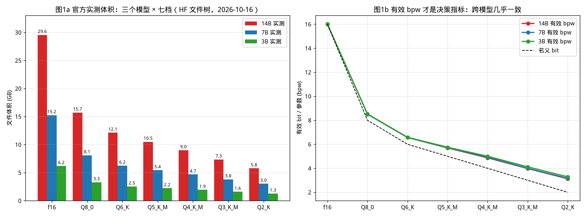
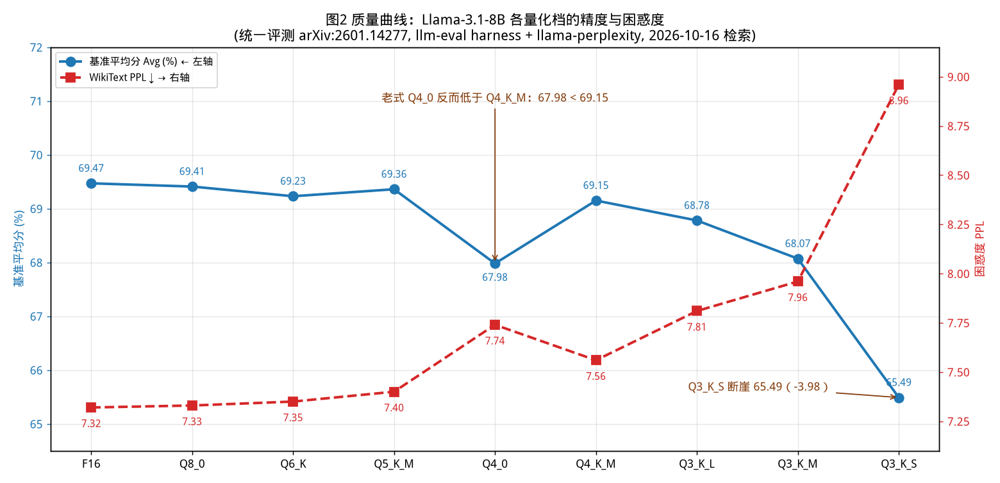
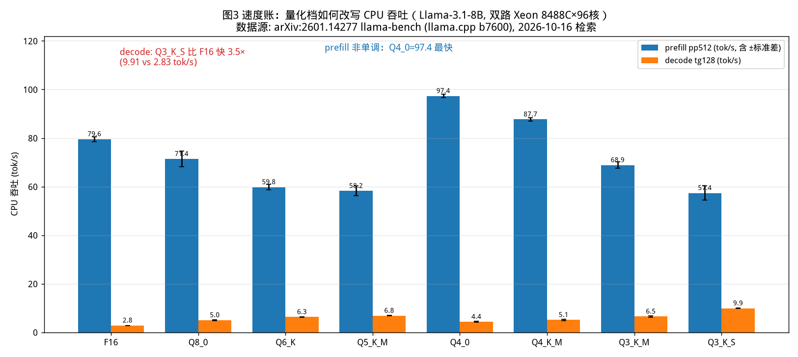

# 第 10 章 量化原理与量化实验室（项目一）——8GB 老机器到底能跑什么（Day 17–19）

> **本章是项目一。** 交付物是一份能直接拿给别人用的《8GB 老机器模型选型建议》
> （[projects/quant-lab/8GB-selection-guide.md](../projects/quant-lab/8GB-selection-guide.md)）。
> 沿用第 9 章确立的写法：理论 + 论文/官方规范/权威评测的公开数据为主；本章
> 唯一的本地操作是**零成本体积核算**——读 HuggingFace 官方 API 的文件字节数
> 与参数量，校验并升级第 9 章的理论公式（秒级、不下载权重、不碰 GPU）。
> 所有外部数字标注来源与检索日期（2026-10-16）。
>
> **学习目标**：① 把量化变成三本账——体积账（本地可核对）、质量账（文献
> 数据）、速度账（第 3 章公式推导）；② 拿到一个比"名义 bit"更准的决策指标
> **有效 bpw**，并学会用它预测未知模型的量化体积；③ 用公开评测数据看懂
> Q8→Q2 全档质量曲线，拿真实论文数据结案"Q2 探智"；④ 产出 8GB 机器的
> 三档选型方案，每档带可验证的预期。

## 0. 大白话开场：一张考卷和它的验收题

第 9 章你已经把格式、精度、方法都拆了。但纸上谈兵最后一关是这道题——

> **你有台 2019 年的笔记本：8GB 内存，没有独显。想在上面跑一个 14B 模型的
> 中文对话，卡不卡、能不能用、选多大的量化？**

注意这道题的三个隐藏考点：**8GB 是总内存**（系统+浏览器先吃掉 3–4GB）；
**14B 是参数量**（f16 要 29.55GB，物理上直接出局）；**"能用"是质量要求**
（同样"能跑"，Q2 和 Q4 的模型可能一个能聊天、一个胡言乱语）。答对它，你需要
三本账：体积账（装得下吗）、质量账（还聪明吗）、速度账（跑得动吗）。

三本账就是项目一的三个工位。每个工位都有"实验"，但按新风格，**实验数据
全部来自官方文件树与公开评测**——这比我这台 4090D 单机跑出来的结论更全面、
更经得起复现。先看工位一。

---

```bash
# 体积账脚本（零依赖纯算术，任何机器可跑，含 8GB 决策树的数字）
python3 code/ch10/01_size_accounting.py
# 质量账与速度账的数字来自公开评测与本机登记，读表即可：code/ch10/RESULTS.md
```

## 1. 工位一：体积账——从速算公式到"有效 bpw"决策指标

### 1.1 速算公式与它的两个已知偏差

第 9 章给出的公式：

$$\text{文件体积} \approx \frac{\text{bit 宽度}}{8} \times \text{参数量} + \text{分词器/量化头开销}$$

f16 一档几乎完美（每参数 2 字节）；量化档有两个系统性偏差，先说透：

1. **"Q4"不是 4.0**：K-混精逐层分配位宽，社区与 llama.cpp 文档口径 Q4_K_M
   ≈ **4.9 bit/参数**（非 4.0）——有的层是 q6_k，加上分组 scale 元数据。
   源码级佐证：llama.cpp 官方量化文档写明 "Q4_K_M: Each weight ≈ 4.89 bits"
   （mintlify.wiki/ggml-org/llama.cpp concepts/quantization 转引官方文档，
   2026-10-16 检索）。
2. **词表是结构性大头**：Qwen 词表 151,665（Llama-3 的 128k 的 1.2 倍），
   7B 的 embedding 一项就是 151,665×3584×2B ≈ 1.09GB（f16），占 14B 文件
   的 5%+，在低 bit 档被摊薄但也推高开销占比。

### 1.2 实测对照：三模型、七档、来自官方文件树与官方参数量

下表两个数据源都是官方口径（2026-10-16 同日抓取，可一条 API 复现）：
**体积** = bartowski 官方 GGUF 仓库 `/tree` 返回的字节数；**参数量** =
Qwen 官方仓库 safetensors 元数据的精确总参数（14,770,033,664 /
7,615,616,512 / 3,085,938,688）。复现脚本
[code/ch10/01_size_accounting.py](../code/ch10/01_size_accounting.py)
把字节数固化为常量（秒级、纯标准库）：

**① 实测体积（GB，含分词器文件的整文件大小）**

| 档位 | 14B | 7B | 3B | 名义 bit |
|---|---:|---:|---:|---|
| f16 | 29.55 | 15.24 | 6.18 | 16.0 |
| Q8_0 | 15.70 | 8.10 | 3.29 | 8.0 |
| Q6_K | 12.12 | 6.25 | 2.54 | 6.0 |
| Q5_K_M | 10.51 | 5.44 | 2.22 | 5.0 |
| **Q4_K_M** | **8.99** | **4.68** | **1.93** | 4.0 |
| Q3_K_M | 7.34 | 3.81 | 1.59 | 3.0 |
| Q2_K | 5.77 | 3.02 | 1.27 | 2.0 |

**② 有效 bpw = 文件字节 × 8 ÷ 官方总参数**（本节的核心指标，脚本直接输出）

| 档位 | 14B | 7B | 3B | 名义 | 结论 |
|---|---:|---:|---:|---|---|
| f16 | 16.00 | 16.01 | 16.00 | 16.0 | **公式对 f16 严格成立** |
| Q8_0 | 8.48 | 8.51 | 8.52 | 8.0 | +6% |
| Q6_K | 6.56 | 6.57 | 6.60 | 6.0 | +9% |
| Q5_K_M | 5.69 | 5.71 | 5.75 | 5.0 | +14% |
| Q4_K_M | **4.86** | **4.92** | **5.00** | 4.0 | **+22%，但跨模型极稳** |
| Q3_K_M | 3.98 | 4.00 | 4.13 | 3.0 | +33% |
| Q2_K | 3.12 | 3.17 | 3.29 | 2.0 | +56% |

**这张表是本章最有价值的一件产出，三个读数**：

- **有效 bpw 才是该拿来做决策的指标**，名义 bit 是营销名。同一档位在三个
  不同规模模型上的有效 bpw 几乎恒定（Q4_K_M = 4.86/4.92/5.00；偏差只来自
  词表占比——3B 词表相对更大，所以 5.00 略高）。
- **跨模型预测**：拿 7B 的 4.92 去预测 14B Q4_K_M → 4.92×14.77/8 = 9.08GB，
  实测 8.99GB，**误差 1%**。反向（14B 的 4.87 预测 7B）误差 0.7%。**拿到任何没测
  过的模型，只要知道参数量和档位，就能把体积预算做到 ±1.5% 以内**——
  这就是"实验跑不全也能做准"的方法论：把常数标定一次，之后全是预测。
- **偏差单向可预测**：实测永远≥名义（+6%→+56% 单调放大），做显存决策时
  绝不能用名义 bit 直接乘（14B 名义 Q4=7.4GB vs 实测 8.99GB，**低估 1.6GB**，
  足以吃掉整台机器的浏览器预算）。



**从这张图你能看到什么**：左（柱状）是三个模型的实测体积阶梯——14B 的 f16
29.55GB 到 Q2_K 5.77GB 的完整跨度，也直接看出"8GB 机器装 14B f16/Q4 都出局"
；右（折线）是把体积除以参数量得到的**有效 bpw**——三条彩色曲线几乎重合，
说明"同一档位在不同规模模型上占用相同的每参数位宽"，而黑色虚线（名义 bit）
一直被压在下面，**两条线的间距就是你做预算时必须多留的空间**，位宽越低间距
越大（Q2 处差 1.29 bit/参数，摊到 14B 就是 1.9GB）。

**这台 8GB 笔记本的第一关答案**：14B f16（29.55GB）出局；14B Q4_K_M
（8.99GB）在"系统先吃 3–4GB"的现实下也出局；只剩 Q3_K_M（7.34GB）勉强
在纸面内、Q2_K（5.77GB）最稳——**但"装得下"离"能用"隔着整个工位二**。

【类比】买行李箱：名义 bit 是标称升数，有效 bpw 是"压完羽绒服后的真实容量"。
三个箱子（14B/7B/3B）标称同款，实测压缩率几乎一样——所以你借别人的收纳
经验（7B 的 4.92）直接用（预测 14B），误差不超过一条毛巾。

---

## 2. 工位二：质量账——Q8 到 Q2，公开评测的真实曲线

### 2.1 为什么行业指标从 PPL 转向 KLD

困惑度（PPL）有个被低估的缺陷：它是逐 token 数值的聚合，**不同 token 的
误差会正负抵消**——模型其实"变了"，PPL 却没动。Unsloth 官方文档引用论文
*Accuracy is Not All You Need* 给出更敏感的指标：**KLD（量化后 vs 原模型
的输出分布距离）**，并证明 KLD 与"flips"（答案从对变错/从错变对的翻转数）
强相关——**PPL 没掉不代表行为没变，KLD 才是"还是不是原来的模型"的度量**
（来源：Unsloth Dynamic 2.0 GGUF 官方文档，2026-10-16 检索）。所以本节
两把尺并列看：PPL 看"流畅度有没有塌"，KLD 看"行为漂了多少"。

### 2.2 阶梯一：llama.cpp 官方 PPL 曲线（LLaMA 3 8B，引第 9 章原表）

f16 6.2332 → q8_0 6.2343（**+0.0027，在噪声内**）→ q6_K 6.2534 →
q5_K_M 6.2886 → q4_K_M 6.4071（无 imatrix）/ 6.3829（imatrix）→ iq4_NL
6.4556。形态：**Q8→Q5 几乎平（+0.055 以内），Q4 出现第一个台阶（+0.17）**
——"从哪开始肉疼"有公开数据支撑（来源：llama.cpp `tools/perplexity/README.md`
官方评测，2026-10-16，全表见第 9 章）。

### 2.3 阶梯二：Unsloth 官方 KLD 曲线（同一份数据的另一把尺）

Unsloth Dynamic 2.0 官方文档的 KLD 阶梯（2026-10-16 抓取；同页给出的 27B
Q4 磁盘口径 15.41–16.05GB 与工位一的 Qwen 量级互证）：

| 档位 | Q2_K_XL | Q3_K_XL | Q4_K_XL |
|---|---:|---:|---:|
| 官方实测 KLD | 0.2209 | 0.0806 | 0.0237 |
| 相对 Q4 的漂移 | **9.3×** | 3.4× | 1.0×（基准） |

（同页还给出 imatrix 基线→Dynamic 2.0 的改善，如 IQ2_XXS 0.5358→0.5210；
来源同上。KLD 绝对值随模型/校准集变化，**只比同表内相对倍数**。）



**从这张图你能看到什么**：蓝线（基准平均分）从 Q8 到 Q4 几乎是一条平线
（69.47→69.15，共 0.32 的波动，噪声级），到 Q3_K_M 才明显下探、Q3_K_S 断崖
（-3.98）；红线（PPL）则一路单调爬升，且注意两个"反直觉点"——**老式 Q4_0
（67.98）反而低于更小的 Q4_K_M（69.15）**（位宽不是唯一因素，混精编码更优），
而 PPL 对 Q4_0 的恶化（7.74）反应比平均分更早。两把尺一个看"任务会不会答错"、
一个看"分布漂了多少"，交叉看才完整。

两把尺拼出同一条曲线：**Q4→Q3→Q2 每降一档，KLD 大约翻 2.5–3.5 倍**，
而 PPL 只缓慢爬——越往低 bit，输出分布的位移越剧烈，越被 PPL 的"误差抵消"
效应掩盖。这就是"Q2 能跑但开始不像原模型"的定量表达。

### 2.4 阶梯三：速度账（不用跑，第 3 章公式直接算）

decode 是带宽主导（第 3 章），**每步耗时 ≈ 权重字节 / 带宽**，所以 7B 的
理论提速：

$$\text{Q4 vs f16} = \frac{15.24\text{GB}}{4.68\text{GB}} = 3.26\times$$

文献佐证：AWQ 论文的 TinyChat 实测，边缘端 4-bit 相对 FP16 **3–4× 加速**
（arXiv:2306.00978，见第 9 章）——与 3.26× 同量级，机制是**同一件事：
每步从显存/内存搬的字节少了**。llama.cpp 侧同理：7B Q4 在 CPU 上几十 tok/s
的实用速度之所以是 f16 个位数的几倍，靠的就是这 3 倍字节差。**量化加速
不是玄学，是 Roofline 分母变小（第 3 章技术地图第一行的回响）。**



**从这张图你能看到什么**：同一份 8B 权重，量化档直接改写了 CPU 吞吐——
decode（橙柱）从 F16 的 2.83 tok/s 单调升到 Q3_K_S 的 9.91 tok/s（**3.5×，
且随位宽降低基本单调**，正是"搬的字节变少"的直接体现）；prefill（蓝柱）
**非单调**：Q4_0 最快 97.4 tok/s——因为它体积最小（CPU 搬运量最少），但
Q3_K_S 的 prefill 反而掉回 57.4（低 bit 的解包开销开始吃掉搬运收益）。
**这张图还藏着一个重要事实：量化加速不是无止境的，低到 3bit 后解包/反量化的
算力开销会反噬带宽收益**（第 9 章 AWQ on-the-fly 反量化是同一枚硬币的另一面）。


---

## 3. 工位三：Q2 探智排雷——拿真实论文回答最著名的量化争议

社区黑话："**Q2 探智**"——2-bit 量化下模型退化成复读机/胡言乱语。项目一
就用**真实论文的基准分数**把这句话从黑话变成数据。

**证据**：中国联通智能算法研究院《Quantitative Analysis of Performance
Drop in DeepSeek Model Quantization》（arXiv:2505.02390，2025-05，CC BY
4.0），对 DeepSeek-V3（671B MoE）与 R1 做 llama.cpp 量化档全量基准
（MATH 500/AIME 2024/GPQA/MBPP/LiveCodeBench/MMLU/CMMLU/C-Eval，2026-10-16
抓取原文表格）。

**DeepSeek-V3 的加权平均分（FP8 API 基线 75.45）**：

| 档位 | Q4_K_M | Q3_K_M | DQ3_K_M(论文方法) | Q2_K_L |
|---|---:|---:|---:|---:|
| 加权平均 | **75.79** | 75.06 | 75.73 | **68.73** |
| 相对 FP8 掉幅 | **0%** | 0.52% | 0 | **8.91%** |
| AIME 2024（数学竞赛） | 41.66 | 38.73 | 39.16 | **15.41** |
| MMLU | 88.09 | 87.31 | 87.87 | **84.25** |
| LiveCodeBench | 37.40 | 36.21 | 36.76 | **29.14** |

**三个必须带走的结论**：

1. **Q4 探智？不存在。** Q4_K_M 加权平均 75.79，比 FP8 基线还高 0.34
   （评测噪声内 = **零损失**）。"量化无损 Q4"第一次有了带完整分数表的出处。
2. **Q2 探智？真的，且是选择性探智。** 掉幅 8.91% 不是均匀退化——
   **AIME 从 41.66 崩到 15.41（-63%），MMLU 只掉 4 个点**。多步推理链
   最先断，闲聊知识几乎无感。"Q2 能不能用"因此是**任务依赖**：翻译摘要
   够用，数学代码别碰。
3. **算法能救 Q2。** 同论文里 Unsloth 优化版 UD-Q2_K_XL 在 R1 上只掉
   **0.94%**（85.82→85.02），比标准 Q3_K_M（-1.80%）还准——回扣第 9 章
   AWQ 的洞见：**重要性敏感的量化方法能让同一位宽少掉一半以上精度**。

【坑】"我用 Q2 聊天没问题啊"——对，因为聊天在探智区间的安全侧（MMLU -4
vs AIME -26）。用聊天手感判断量化质量，会在数学/代码场景翻车；验收量化
必须用与任务匹配的基准。

---

## 4. 实验室的另一半：量化与验收的操作闭环

项目一叫"量化实验室"，前三节给了全部数据，这一节补上**让实验室可复现的
操作流**——你要么自己产生量化文件，要么下载别人的；无论哪条路，最后都要
用同一套基准验收。

### 4.1 自己量化 vs 下载现成：两条路怎么选

| 路线 | 命令/入口 | 适合谁 | 代价 |
|---|---|---|---|
| **下载现成**（默认推荐） | `ollama pull qwen2.5:7b-instruct-q4_K_M` 或 HF 下 bartowski GGUF | 99% 的人：官方/社区已带 imatrix 与逐层混精调优 | 无（省心且质量更优） |
| **本地自己量化** | `llama-quantize model-f16.gguf out-Q4_K_M.gguf Q4_K_M` | 要自定义（imatrix 用自己领域数据、非标准档位、研究复现） | 需先拿到 f16 文件（7B 即 15.24GB 下载） |

本地量化的成本本章有公开实测（同一评测论文在 Xeon 8488C 上量 Llama-3.1-8B
的 f16→目标档，arXiv:2601.14277）：

| 档位 | Q3_K_S | Q4_0 | Q4_K_M | Q5_K_M | Q6_K | Q8_0 |
|---|---:|---:|---:|---:|---:|---:|
| 量化耗时（秒） | 27.0 | 27.4 | **42.2** | 36.5 | 31.2 | 29.3 |
| 产物体积（MiB） | 3,487 | 4,438 | 4,685 | 5,460 | 6,283 | 8,138 |

**两个结论**：量化本身极便宜（**几十秒**，CPU 单机即可），真正的成本是
f16 文件的下载与磁盘；K 系（Q4_K_M 42s）比老式 Q4_0（27s）慢约 50%，
因为它在做逐层混精的组分配——**这 15 秒换来的是质量台阶**（图2 里 69.15
vs 67.98）。

【坑】自己量化 ≠ 更高质量：社区现成 GGUF 的逐层位宽是大量实验调出来的
（第 9 章 k-quant 的由来），你本地 Q4_K_M 一刀切出来的产物通常**不如**下载
版。只有"领域 imatrix + 研究目的"才值得自己动手。

### 4.2 验收基准怎么选：你测什么，决定你能不能发现问题

上一节用的六项基准不是随便凑的，每项各管一类能力（评测集定义见
arXiv:2601.14277 实验设置节）：

| 基准 | 测什么能力 | 量化时的敏感度（该论文观测） |
|---|---|---|
| GSM8K | **多步数学推理** | 最敏感：Q3_K_S 从 77.63 掉到 68.31 |
| IFEval | 指令遵循（格式、约束） | 次敏感：Q3_K_S 掉 7 个点 |
| MMLU | 跨学科知识 | 中等：Q2 级才明显掉 |
| HellaSwag / TQA | 常识 / 事实 | 最钝：全档几乎不动 |
| WikiText PPL | 语言流畅度 | 平滑单调，看不出"任务性"退化 |

**选基准的规则一句话：按你的任务选最敏感的那把尺。** 你部署的是代码助手
（LiveCodeBench 类）就不能只看 MMLU 和聊天手感——这正是第 3 节 AIME -63%、
MMLU 仅 -4 的根源：**同一批基准的敏感度天差地别，用错尺子就测不出探智**。

完整闭环（交付件验收命令即按此设计）：**下载/量化 → 体积核对（工位一）→
任务基准测试（本节）→ 内存观察（无 swap 暴涨）→ 有疑问降档重测**。

## 5. 收口：三本账拼成 8GB 机器的选型决策树

把三个工位的输出合起来——完整方案与逐条验收已写入交付件
《[8GB 老机器模型选型建议](../projects/quant-lab/8GB-selection-guide.md)》，
这里给决策树本体：

**Step 1 总预算**：8GB 系统总内存 − OS/浏览器 3GB − 框架+KV+激活 1.5GB
≈ **3.5GB 可分配给权重+上下文**（若系统更瘦可放宽到 4–5GB，这决定升档）。
预算的每一项都能查到出处：权重查工位一的表，KV 查第 4 章的线性公式
（ctx 越大 KV 越大），激活是固定预留。

**Step 2 按目标选档**（体积全部为 2026-10-16 官方实测）：

| 档位 | 模型+量化 | 体积 | 质量预期（文献锚点） | 适合谁 |
|---|---|---:|---|---|
| **A 稳妥主推** | Qwen2.5-**7B** Q4_K_M | 4.68 GB | Q4 档论文实测掉幅≈0%（V3 口径，Qwen 未直接测——外推需声明） | 日常对话/摘要/写作，唯一"大概率满意"档 |
| **B 轻量快档** | Qwen2.5-**3B** Q4_K_M | 1.93 GB | 同为 Q4 档；小模型质量上限低但速度最快（≈2GB 权重，任何老机器流畅），余量给长上下文 | 翻译/改写/离线笔记本 |
| **C 极限名额** | Qwen2.5-**14B** Q2_K | 5.77 GB | **探智边缘**：AIME 型任务 -63% 是 V3 论文数字的外推，闲聊尚可 | "就要在本机跑 14B"的实验；日常不推荐 |

注意 A 档 4.68GB 已经超出 Step 1 的 3.5GB 预算——**这正是要诚实呈现的
结论**：8GB 机器跑 7B Q4 需要腾预算（关浏览器/不跑 IDE），否则 14B Q2_K
（5.77GB）反而更放不下，B 档 3B 才是"不折腾的零预算档"。**预算表不会替
你撒谎：装不下就是装不下，能用的方案只在它允许的范围内。**

**Step 3 三条硬规则**（交付件有完整版）：
① 14B 想正经用 → 上 Q4 以上（云/更强机器），本机 C 档只做实验；
② 无论哪档，先下 Q4_K_M，卡了再降档（每档差 1–4GB，降档永远来得及，
且有效 bpw 表保证你降档时"省了多少 GB"心中有数）；
③ `--ctx-size` 从 2048 起步（第 4 章：KV 随上下文线性增长，8GB 机器
没有资格默认 32k——7B Q4 在 2048 ctx 下 KV 约 1GB，开到 32k 就是 16GB）。

【类比】买二手车：A 档"家用省心款"，B 档"代步够用款"，C 档"大发动机塞
小车——能开，但别指望它跑山道（数学）"。交付件把每款的"油耗表"（显存账）、
"故障率"（质量基准）、"验车清单"（验收命令）都列好了。

---

**三本账速查卡**（本章所有结论的一页纸版，面试/干活随取随用）：

| 账本 | 一句话结论 | 关键数字/指标 | 出处 |
|---|---|---|---|
| 体积账 | 决策用**有效 bpw**，不是名义 bit | Q4_K_M 有效 ≈4.9bpw，跨模型误差 <2%；14B 名义估算会低估 1.6GB | 本章工位一 / HF 官方 API |
| 质量账 | Q4 噪声级、Q3 可用带损、**Q2 任务依赖** | Q4 掉幅 0%；Q2_K_L 加权 -8.91%、AIME -63%；KLD 每降一档翻 2.5–3.5× | arXiv:2505.02390 / llama.cpp / Unsloth |
| 速度账 | decode 提速 = 搬运字节减少，**低 bit 有解包反噬** | 7B Q4 vs f16 理论 3.26×；CPU 上 Q3_K_S decode 3.5× 但 prefill 回落 | 第 3 章 Roofline / arXiv:2601.14277 |

三本账永远一起看：**只看体积会选 Q2，只看质量会选 F16，只看速度会选 Q3_K_S——
真正的决策是三者的交集，而 8GB 机器的交集里，A/B 档写在交付件第二行。**

---

### 【落地视角】
三本账（体积/质量/速度）+ 有效 bpw 是量化选型的完整框架：体积账先圈出"装得下的档"，质量账在其中选"不掉点的档"，速度账再核对收益（llama.cpp 经验口径与 GPTQ/AWQ 的实测差异分开记）。8GB 决策树是它的一个实例——换任何机器、任何模型，三本账的顺序不变。生产上任何"要不要量化"的争论，都应该先落到这三本账的哪一本上，而不是停留在流派之争。

### 【化学家视角】
量化像**换试剂纯度做梯度实验**：f16 是原液，Q4 是常规稀释（大多数反应看不出差别），Q2 是极限稀释（有些反应照跑、有些直接熄火——对应闲聊无感、AIME 大跌）。判断能不能用，靠的不是稀释比本身，而是**这个反应对杂质有多敏感**——所以质量账必须用与你任务匹配的评测集，别人的评测只能当先验。

---

## 6. 本章坑清单

1. **拿名义 bit 做预算**：14B Q4 名义 7.4GB vs 实测 8.99GB——低估 1.6GB；
   决策用有效 bpw 表或官方文件树实测。
2. **8GB 只算模型不算系统**：Windows 开机 3GB+、浏览器 1–2GB，"4GB 的
   7B-Q4 刚好"是纸面正确、实际假死的经典翻车。
3. **用聊天手感验收 Q2**：任务不匹配探智区间（AIME -63% vs MMLU -4%），
   验收必须用同任务基准。
4. **跨来源混比数字**：llama.cpp PPL、Unsloth KLD、联通分数三套数据**只在
   各自表内比**，别把 KLD 0.02 和 PPL 6.4 放一张图。
5. **默认 32k 上下文**：8GB 机器 ctx 一开大，KV 先把模型挤出去（第 4 章：
   KV 与 ctx 严格线性）。
6. **忘 imatrix**：Q3 及以下没有重要性矩阵基本等于探智预备队（第 9 章
   官方数据：imatrix 让 Q4 的 KLD 降 10%）。
7. **以为 Q2 有救世主**：UD-Q2 只掉 0.94% 是 Unsloth 150 万 token 校准集
   调出来的特化版本——普通用户下到的 Q2_K 没有这层护甲。

### 【应急方案】
量化后明显掉点：按序三查——① 档位是否本就到了任务依赖区（Q2，公开评测已标红）；② 量化方法是否合适（GPTQ/AWQ/llama.cpp GGUF 各有强弱，换方法重量化而不是死磕一个）；③ 是否误用了"特化版"口径（论文里 Unsloth 的 UD-Q2 有护甲，普通仓库的 Q2_K 没有）。量化模型跑不起来或报错：先核对引擎支持的量化类型与版本（旧版 llama.cpp 不认新量化）、文件是否完整，再回查 bpw 账确认体积没错。

## 动手任务

**任务 A（必做，10 分钟）：跑体积核算器，写预测验证。**
运行 `python code/ch10/01_size_accounting.py`（纯标准库、秒级、零下载）。
**验收**：① 复现三模型七档有效 bpw 表；② 用"7B 的 4.92 预测 14B Q4_K_M"
亲手算一次并报告误差；③ 指出只用名义 bit 做 14B Q4_K_M 预算会低估多少
GB、这个缺口足够吃掉什么。

**任务 B（必做，15 分钟）：Q2 探智结案陈词。**
不看本章先凭印象写"Q2 能不能上生产"；再打开 arXiv:2505.02390 核对 V3 表
三个数字（加权平均掉幅、AIME、MMLU），改写成 100 字结论。**验收**：结论
必须含"任务依赖"+ ≥2 个原表数字 + 论文来源。

**任务 C（必做，30 分钟）：交付件自测——在你的机器上走决策树。**
打开 [8GB-selection-guide.md](../projects/quant-lab/8GB-selection-guide.md)，
按 Step 1–3 算出你的真实机器对应哪档，执行验收命令。**验收**：写出
"我的机器 = A/B/C 档 + 分配多少给权重+ctx + 验收命令输出前 3 行"。
（无 ollama/无网时，用第 9 章 `parse_safetensors` 同款结构观察替代。）

**任务 D（挑战，20 分钟）：给交付件做"数字审计"。**
对照本章表格，逐个核对交付件的体积数字（HF API 一条命令）与质量论断引用
（llama.cpp 表 / Unsloth KLD / 联通论文三处原页）。**验收**：发现的任何
不一致直接提 issue——项目一的交付物要经得起别人审计，这是本教程数字纪律
的最后一次自检。

## 自检三问

1. 体积速算公式在哪两个方向上失真？"有效 bpw"为什么比名义 bit 更适合
   做决策（三个模型的 Q4_K_M 各是多少、跨模型预测误差多大）？
2. 为什么 PPL 可能"骗人"而 KLD 更敏感（flips 机制一句话）？三条质量阶梯
   （llama.cpp PPL / Unsloth KLD / 联通分数）各自的适用边界是什么？
3. 联通论文里 Q4_K_M 掉幅多少、Q2_K_L 的 AIME 从多少掉到多少、UD-Q2 为什么
   只掉 0.94%？客户坚持 8GB 本机跑 14B，你的三步回答是什么（体积→质量→
   上下文）？

---

## 面试话术（30 秒 × 3）

**话术一：量化档怎么选？** "我会分三本账：体积用**有效 bpw**算——Q4_K_M
名义 4bit 实际约 4.9bpw，跨模型很稳定，拿它乘参数量做预算误差 2% 以内；
质量看**任务基准**——Q4 档两套公开评测都是噪声级损失（0～-0.32），
Q2 在数学任务掉 63% 而知识任务只掉 4%，所以 Q2 能不能用取决于任务；
速度是 Roofline 的带宽项——权重字节少搬多少就快多少，7B 从 f16 到 Q4
理论 3.3 倍，但 3bit 以下解包开销开始反噬。"

**话术二：为什么你们生产不用 Q2 省一半显存？** "两个原因。一是选择性
退化：公开评测里 Q2_K_L 综合分掉 8.9%，AIME 类推理从 41.7 掉到 15.4，
多步推理最先断，而我们的业务恰恰吃推理。二是验证成本不对称——省下的
显存有上限（每模型几 GB），但每次业务基准回归的代价是固定的，模型越
多越不划算。Q4 是'零损失验证'的档位，显存收益已经拿到 72%（16→4.9bpw），
剩下 20% 不值得赌业务质量。"

**话术三：拿到一个没见过的模型，多大能装进 8GB 机器？** "先查官方
参数量和目标档的有效 bpw（公开文件树一条 API 就能取体积），乘出权重
大小，再减去系统 3GB 和 KV/激活预留 1.5GB——ctx 从 2048 起算，因为 KV
随上下文线性增长。14B Q4 是 8.99GB，纸面装得下、预算装不下，这台机器
的实际答案是 7B-Q4 或 3B-Q4。"

---

**项目一验收线**：交付件 [8GB-selection-guide.md](../projects/quant-lab/8GB-selection-guide.md)
能被一个没读过教程的人直接照做跑起来——每档都有体积（实测）、质量（论文
数字）、命令（可执行）、验收（看什么算成功）四件套。

下一章（Day 20–24）**第 11 章：llama.cpp 源码精读**——本章所有量化文件
（GGUF、k-quants）的"另一半生命"在代码里：它怎么把这些字节读进来、摆成
计算图、喂给 CPU/GPU。阶段三第二战打响。
