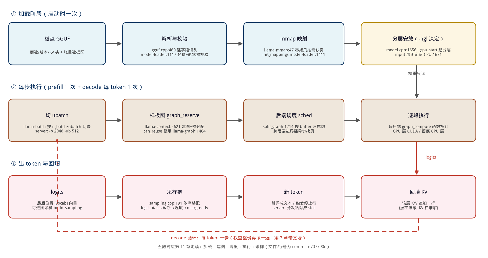
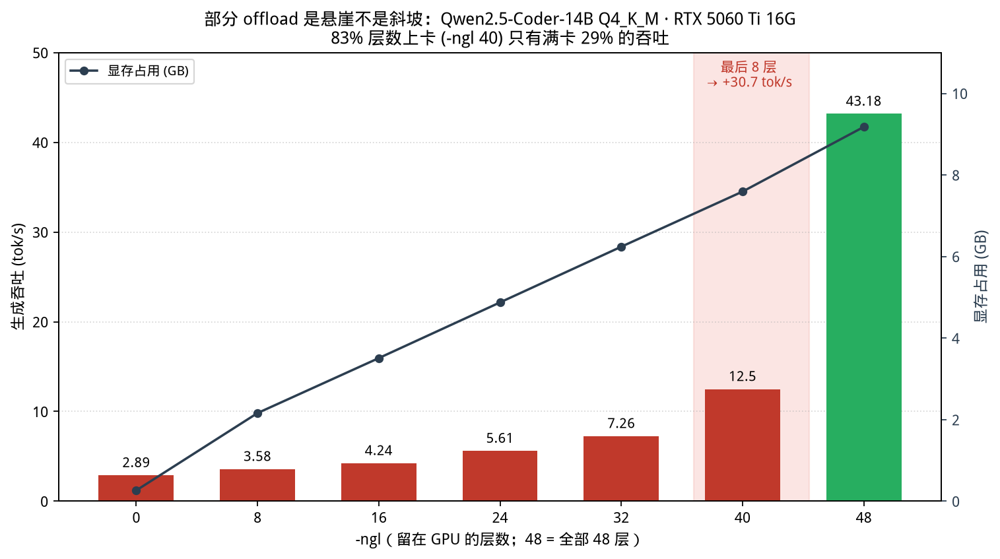

# 第 12 章｜混合推理、offload 与并发天花板（Day 25–30）

> **这章讲什么**：三个问题串成一条线——① 你的模型有一层留在内存（没全进显存）时，程序里到底发生了什么，为什么速度是"断崖"而不是"缓坡"？② 一台机器最多同时伺候几个请求，天花板由哪三道墙决定，怎么用一个公式算出来？③ 把墙撞穿的三条路（多卡、量化、降上下文）分别值多少、代价是什么。
>
> **为什么重要**：第 11 章你读完了 llama.cpp 的五段链路，但它默认"全在一张卡上"。真实世界里你经常面对"8G 卡想跑 14B"——于是 `-ngl` 这个参数成了新手最常用、也最被误解的旋钮。而"我们能开多少并发"是部署岗面试的必考题：它把你学过的 KV 账（第 4 章）、Roofline（第 3 章）、量化三本账（第 9、10 章）第一次拧到一起。
>
> **学完能干什么**：① 拿到任何"层数-吞吐"实测表，30 秒判断悬崖在哪、还值不值得调 `-ngl`；② 用"三时延公式"心算部分 offload 的速度，和实测对上；③ 给定显存和 SLO，算出并发上限并说清是哪道墙先倒；④ 说清楚 layer split 和 tensor split 什么时候各用什么（面试高频）。
>
> **本章数字纪律**：按第 9 章起的写作风格，**零性能跑测**。外部数据全部标注来源与检索日期（2026-10-16）：offload 悬崖实测来自 InventiveHQ 公开基准（数据与脚本开源），并发数据来自 llama.cpp 官方仓库 `tools/batched-bench/README.md` 样例表，PCIe 带宽为本书第 7 章本机实测。算术推导明确标注为"算账"，与实测分列。

---

## 0. 大白话开场：一个参数引发的血案

假设你有一张 8 GB 显存的卡，想跑 Qwen2.5-14B Q4_K_M（8.99 GB，第 10 章实测），显存装不下。你的第一反应是"那就让它一部分跑 GPU、一部分跑 CPU"——这正是 `-ngl`（n-gpu-layers）参数存在的意义：**指定多少层留在 GPU，剩下的层回退到内存**。

直觉告诉你：8 GB 装得下 80% 的模型，那我该拿到接近 100% 的速度，至少七八成吧？

**实测会给你一记耳光。** 2026 年 6 月 InventiveHQ 用一台带独立显卡的机器做了完整扫描（Qwen2.5-Coder-14B Q4_K_M，48 层，RTX 5060 Ti 16G）：把 83% 的层放进显存（`-ngl 40`），吞吐只有满卡的 **29%**；只有最后 8 层也进显存的那一瞬间，速度直接从 12.5 跳到 43.18 tok/s。**这不是斜坡，是悬崖。**

**本章验收题**（学完应能张口回答）：

> 14B Q4_K_M（9 GB 权重）在一台机器上，`-ngl 40`（8 层留在内存）时，为什么只有 12.5 tok/s？请用一个公式算出这个数字的量级，并指出把最后 8 层也塞进显存后公式里哪一项消失了。

答案在第 3 节，公式只有三项。

---

```bash
# -ngl 悬崖实测（需编译好的 llama.cpp 与一个 GGUF 模型）
llama-bench -m <model.gguf> -p 512 -n 128                    # 默认单路基线
./llama-batched-bench -m <model.gguf> -c 8192 -b 2048 -ub 512   -ngl 99 -npp 128 -ntg 128 -npl 1,2,4,8,16,32               # 扫并发阶梯
# 换挡 -ngl 40 / 48 重跑，对比启动日志的 "offloaded XX/XX" 行与吞吐——悬崖自己复现
```

## 1. 全景：GGUF 到 token 的数据流大图

先把第 11 章的五段走读连成一张图——本章讨论的一切（offload 在哪切、并发在哪拼）都发生在这张图的特定位置上：



**从这张图你能看到什么（盯着看一分钟）**：

1. **三行分别是三个时间尺度**：第一行"加载阶段"整个请求生命周期只发生一次；第二行"每步执行"prefill 走一次、decode 每个 token 走一次；第三行"出 token 与回填"接在第二行之后。红色虚线是 decode 的循环——每绕一圈，权重整份再读一遍（第 3 章的带宽墙就贴在这里）。
2. **"分层安放"那个黄色框是本章 2 节的主角**：`-ngl` 决定层在显存还是内存，它是加载阶段的一次性决定，却把代价烙进了第二行的每一次执行——**你在启动时省下的显存，会在每个 token 上反复收费**。
3. **"切 ubatch"是本章 5 节的主角**：并发的多个请求就是在这里被拼进同一个 batch 的。显存够不够（KV）、拼多大（batch）、每请求多慢（延迟）的三角关系，全部汇聚在这个框里。

【类比】这张图是一家快递分拣中心：加载是开业前把货上架（一次性），decode 循环是每小时跑一遍的分拣线（反复付费），"分层安放"决定哪些货放门口小仓库（便宜但慢）、哪些放冷库（贵但快），"切 ubatch"决定这一趟车装几个包裹。

---

## 2. offload 原理：`-ngl` 切在哪，代码是怎么分的

### 2.1 分层安放的三行核心逻辑

第 11 章的导航表在 `src/llama-model.cpp`，offload 的分层代码就在其中（commit e707790c）：

```c
// llama-model.cpp:1656
const int i_gpu_start = std::max(n_layer_all + 1 - n_gpu_layers, 0);
// llama-model.cpp:1660
if (il < i_gpu_start || (il - i_gpu_start) >= act_gpu_layers) {
    return {cpu_dev, &pimpl->cpu_buft_list};       // 该层 → CPU
}
// 否则按 tensor_split 比例分给各 GPU
```

用人话说：**`-ngl` 是"从后往前数"的配额**。模型有 48 层 + 1 个输出头，`-ngl 40` 表示"最后 40 个可卸载单元进显存"，**前面的层（第 0 层开始）留内存**。注意两个源码里的细节：

1. **输入层永远留 CPU**（llama-model.cpp:1670 附近注释原话："there is very little benefit to offloading the input layer, so always keep it on the CPU"）——嵌入查表是访存操作，搬上 GPU 不划算。所以日志里 `offloaded N/M layers` 的 M = 层数 + 1（含输出头），比 48 大 1：启动时看到 `offloaded 49/49` 才是"全部卸载成功"。
2. **每层放哪台设备在加载时就定死**，写进 `dev_layer` 数组；之后每一步 decode 都按这张表执行。`-ngl` 是启动参数，**改它必须重启**。

### 2.2 只留一层在 CPU 的代码里都能看见

`src/llama-context.cpp:2857`（在 `graph_get_cb()` 这个建图回调里，第 11 章走读过的调度挂钩）：

```c
const bool full_offload = model.n_gpu_layers() > model.hparams.n_layer_all;
if (ubatch.n_tokens < 32 || full_offload) {
    // 强制把 norm 等收尾算子钉在本层设备上，避免调度器把它"顺手"放到下一层的设备
}
```

这段防御性代码本身就是证据：**作者知道部分 offload 时调度器容易把算子放错家**（norm 被拖到下一层的设备上，凭空多一次跨设备搬运），所以在小 batch / 未全量卸载的场景特意钉死。一个参数的行为，连源码注释都在替你预警。

### 2.3 全量卸载才解锁的隐藏福利：流水线并行

`llama-context.cpp:517-523` 还藏着一个多卡才走的分支：

```c
bool pipeline_parallel =
    model.n_devices() > 1 &&
    model.n_gpu_layers() > model.hparams.n_layer_all &&   // 必须全量上卡
    model.split_mode() == LLAMA_SPLIT_MODE_LAYER &&
    cparams.offload_kqv && ...;                            // KQV/KV 也上卡
```

**两个 GPU、层全在卡上时，llama.cpp 才启用"流水线并行"**——两张卡像两级传送带一样重叠工作（GPU0 算第 l 层的同时 GPU1 算第 l−1 层的上一批 token）。部分卸载（有 CPU 层）时这个优化直接禁用：CPU-GPU 的同步交接无法重叠，流水线根本转不起来。**这就是"部分 offload 损失的不只是那几层"的源码级证明。**

【坑】把 `-ngl 40` 理解成"40 层快 1 层慢，我损失 1/48"——错。真实损失是三重的：① 那几层的权重每个 token 从内存读一遍；② 每次层边界都跨一次 PCIe；③ 流水线并行、调度器钉层这些优化全部失效。下一节用数字看它多重。

---

## 3. 悬崖：三时延公式，把 12.5 tok/s 算出来

### 3.1 实测悬崖（外部数据，标注来源）

InventiveHQ 的 `-ngl` 全扫描（**来源：inventivehq.com "The VRAM Cliff" 一文，2026-06-26 发布，2026-10-16 检索；测试条件：Qwen2.5-Coder-14B-Instruct Q4_K_M 48 层，RTX 5060 Ti 16G，机器为 i7-8700 + DDR4-2400 + PCIe 3.0 x8，贪心解码 256 token，数据与脚本在 GitHub 开源**）：



**从这张图你能看到什么**：柱子是吞吐，右轴折线是显存占用。**`-ngl` 从 0 涨到 40（83% 的层已上卡），柱子只从 2.89 爬到 12.5——整段"部分卸载区"只赚到满卡的 29%；而 40→48 这最后一格，一根柱子直接跳到 43.18（+30.7 tok/s），是前面五步总和的 3 倍多。** 悬崖精确地站在"最后一个 CPU 层消失"的位置上。显存折线倒是乖乖线性（每 8 层约 1.3–1.6 GB，到 9,179 MB）。

### 3.2 三时延公式：为什么算得出来

第 3 章的 Roofline 讲了两堵墙（算力、带宽）。部分 offload 在 decode 场景下可以扩展成**三项串行时间**——因为层与层是严格串行的，GPU 段、CPU 段、跨界段谁也叠不上谁：

$$T_{\text{每 token}} = \underbrace{\frac{W_{\text{GPU}}}{B_{\text{GPU}}}}_{\text{显存段读权重}} + \underbrace{\frac{W_{\text{CPU}}}{B_{\text{内存}}}}_{\text{内存段读权重}} + \underbrace{\frac{2 \times \text{跨界激活量}}{B_{\text{PCIe}}}}_{\text{层边界往返}} + \text{固定开销}$$

$$\text{tok/s} = 1 / T_{\text{每 token}}$$

拿悬崖表的 `-ngl 40` 算账（**算账，非实测**；权重 8.99 GB、CPU 段 8/48 层）：

| 项 | 代入 | 结果 |
|---|---|---:|
| 显存段 40/48 权重 ÷ GDDR7 ~448 GB/s | 7.49 GB ÷ 448 GB/s | ~16.7 ms |
| 内存段 8/48 权重 ÷ DDR4 有效 ~25 GB/s | 1.50 GB ÷ 25 GB/s | ~60 ms |
| 跨界激活（每边界每 token 约 10 KB 量级） | ×2 次边界 ÷ PCIe 3.0 x8 ~8 GB/s | <1 ms |
| **合计（不含杂项）** | | **~77 ms → ~13 tok/s** |

**实测 12.5 tok/s，算账 13 tok/s——量级完全吻合。** 同一公式验两端：

| 场景 | 公式 | 实测 | 吻合度 |
|---|---|---:|---|
| 全 CPU（`-ngl 0`） | 8.99 ÷ 25 GB/s ≈ 360 ms → 2.8 tok/s | 2.89 | ✓ |
| 全 GPU（`-ngl 99`） | 9.18 ÷ 448 GB/s ≈ 20.5 ms → 48.8 tok/s | 43.18 | 达到理论 **88%** |
| 部分（`-ngl 40`） | ~77 ms → ~13 tok/s | 12.5 | ✓ |

（全 GPU/全 CPU 的吻合依赖带宽取值：DDR4 有效带宽取 25 GB/s、GDDR7 取 448 GB/s 为该硬件标称/典型值；本机第 7 章实测 PCIe 4.0 x16 拷贝 18.6 GB/s 可作 PCIe 量级参照。）

**验收题答案**：公式里消失的是 **$W_{\text{CPU}}/B_{\text{内存}}$ 这一项**——1.5 GB/token 的内存读取没了，只剩 7.49 GB 的显存读取（16.7 ms），加上流水线并行解锁、调度钉层开销归零，冲到 43 tok/s。

### 3.3 为什么是悬崖不是斜坡：三个"叠不起来"

公式各项之间**无法重叠**，这才是残酷的根源：

1. **串行依赖**：第 l 层必须等第 l−1 层算完，CPU 段和 GPU 段只能交替阻塞，不能像多卡流水线那样你算我传；
2. **每 token 全额收费**：CPU 段那 1.5 GB 不是"加载时读一次"，是**每个 token 都读一遍**——decode 每步读整份权重的规律（第 3 章）对 CPU 段同样成立，只是从 448 GB/s 的显存降级到 25 GB/s 的内存；
3. **PCIe 惊人地慢**：第 7 章本机实测 PCIe 4.0 x16 拷贝 18.6 GB/s——**比显存慢 50 倍**。层边界每跨一次就往这条窄路上倒一次激活，还带着不可隐藏的同步延迟。

【类比】全 GPU 是流水线上全程走传送带；部分 offload 是传送带中间被剪开一段，换成人工手递——每次交接两头都要停手（同步），递的东西再小（激活才 10 KB），停手的次数乘上每个 token 都发生，就再也追不上了。**你不能靠"把人工那段练快点"解决问题，只能把断口接回去。**

【坑：把 `-ngl` 当线性旋钮调"最佳值"】InventiveHQ 的结论原话级：部分卸载区**不存在甜点**——`-ngl 40` 已是该区上沿，也只有满卡 29%。调 `-ngl` 的唯一正确姿势是"要么全部、要么换更小的模型/更狠的量化"（第 7 节的决策表）。另外注意此悬崖是 **PCIe 架构的悬崖**：Apple Silicon 等统一内存架构没有 PCIe 往返这一项，悬崖会平缓得多——此为架构推断，【请联网检索 M 系列芯片 -ngl 扫描实测数据补充】。

---

## 4. 并发天花板：三道墙与一个公式

"我们这台机器能同时开多少路"——本节把它变成一道算术题。

### 4.1 第一道墙：KV 显存（第 4 章公式直接用）

回忆第 4 章：7B GQA 每 token 56 KiB（bf16），`B=32、S=8192` 就要 **14 GiB**。并发上限的第一刀：

$$B_{\max,\text{KV}} = \frac{\text{KV 池预算（GiB）} \times 1024}{\text{每 token KiB} \times \text{平均上下文}}$$

例：8 GB 卡跑 7B Q4（4.68 GB 权重，第 10 章），剩 ~2.5 GB 给 KV，上下文 4096 → 2560 ÷ 56 ÷ 4096 ≈ **11 路**。**这道墙用 `-ctk q8_0`（KV 量化砍半）或 GQA 能直接推高**——量化动的是分子，第 10 章的账在这里复用。

### 4.2 第二道墙：算力/带宽的 batch 收益递减（官方数据逐行读）

llama.cpp 仓库自带 `llama-batched-bench`（专门测并发），其 README 的样例表（**来源：github.com/ggml-org/llama.cpp `tools/batched-bench/README.md`，LLaMA 7B F16，N_KV_MAX=16384，2026-10-16 检索**）：

| 并发数 B | 聚合生成吞吐 S_TG | **每路速度 = S_TG ÷ B** | 聚合 prefill | 单路 prefill 延迟 T_PP |
|---:|---:|---:|---:|---:|
| 1 | 41.57 | **41.57** | 1,187 | 0.108 s |
| 2 | 50.90 | 25.45 | 1,295 | 0.198 s |
| 4 | 74.44 | 18.61 | 1,374 | 0.373 s |
| 8 | 139.43 | 17.43 | 1,363 | 0.751 s |
| 16 | 242.23 | 15.14 | 1,305 | 1.570 s |
| 32 | 465.40 | **14.54** | 1,202 | **3.408 s** |

（单位 tok/s；官方样例机为 8 线程配置，数据取自该 README 样例表，非本书机器实测。）

三个必须看清的事实：

1. **聚合吞吐 1→32 涨 11.2 倍，但每路速度掉到 35%**（41.57 → 14.54）。第 3 章 0.5B 实测"每路几乎不掉速"（141→129）在这里不成立——因为这是 **F16 7B**：B=32 时每步 448 GFLOPs，撞上了算力墙，decode 从带宽区滑进了算力区。**模型越大、精度越高，batch 的"免费午餐"结束得越早。**
2. **聚合 prefill 几乎是常数（~1200–1374）**：B 个请求 × 各自 prompt 的 token 总量进了同一条 prefill 流水线，总吞吐锁死在算力上。代价全转嫁给了**排队**：单路 TTFT 从 0.108 s 涨到 3.408 s（**31 倍**）。
3. **这就是"天花板"的真面目**：不是某个 B 处突然崩，而是**每路延迟随 B 线性恶化**——真正的约束是"每路 TPOT/TTFT 不超 SLO"。SLO 反推的 B，往往比 KV 算出来的 B 小。

### 4.3 第三道墙：引擎的 batch 结构（llama.cpp server 的三组参数）

并发不是想拼就拼，引擎给了物理上限（**来源：`tools/server/README.md`，2026-10-16 检索**）：

| 参数 | 默认 | 作用 |
|---|---:|---|
| `-np / --parallel` | -1（auto） | **槽位数**：每个并发请求一个 slot，KV 按 slot 划 |
| `-b / --batch-size` | 2048 | 逻辑 batch（一次调度循环最多收多少 token） |
| `-ub / --ubatch-size` | 512 | 物理 batch（一次前向真正算多少 token） |
| `-cb / --cont-batching` | **默认开** | 连续批处理：新请求随时插队，完成的随时退场（第 14 章细讲） |

也就是说 **llama.cpp server 已内置 Continuous Batching**——第 3 章"推理引擎行业的存在理由"，在 llama.cpp 里是默认行为，不需要开关。`-np` 是你的显存许可，`-ub` 是单次前向的粒度（decode 一步每路贡献 1 个 token，32 路就是 32 token，离 512 远得很——所以 server 的 decode 并发瓶颈几乎从不来自 `-ub`）。

### 4.4 合起来：并发天花板公式

$$B_{\max} = \min\Big(\underbrace{B_{\text{KV}}}_{\text{显存墙}},\ \underbrace{B_{\text{SLO}}}_{\text{延迟墙（4.2 表反推）}},\ \underbrace{B_{\text{引擎}}}_{\text{槽位配置}}\Big)$$

【坑】只算第一项就报"能开 64 路"——面试官追问"第 64 路的 TPOT 是多少"就露馅了。**完整答案永远是三者的 min，并明确说出当前是哪道墙先倒**（算不出就是"KV 墙，因为…"或"SLO 墙，因为…"）。第 5 节的动手任务会让你把这个公式跑一遍。

---

## 5. 撞穿天花板的三条路

| 路 | 拆哪道墙 | 代价 | 适用信号 |
|---|---|---|---|
| **多卡 layer split** | KV 墙 + 带宽墙 | 需第二张卡；卡间走 PCIe/NVLink（第 8 章：TP 必须 NVLink） | 一台机器两卡、模型单卡装不下 |
| **量化（权重 / KV）** | KV 墙（-ctk）+ 全局带宽 | 质量（第 10 章三本账） | 权重挤占 KV；长上下文 |
| **降上下文 / 截断 prompt** | KV 墙、TTFT 墙 | 上下文能力 | 业务平均长度可控 |

**多卡的四挡开关**（来源：llama.cpp 官方 `docs/multi-gpu.md`，2026-10-16 检索）：

| split-mode | 机制 | 定位 |
|---|---|---|
| `none` | 只用一张卡（`--main-gpu` 选哪张） | 明确不需要多卡 |
| `layer`（**默认**） | **流水线并行**：每卡连续一段层，KV 跟层走 | 兼容性最好、prefill 优先、能忍慢互联 |
| `tensor`（实验性） | **张量并行**：每层横切，逐层做跨卡 all-reduce | decode 延迟优先、要求快速互联（NCCL/NVLink）；仅白名单架构支持 |
| `row` | 旧的行切分 | 官方标注 Deprecated，新部署别用 |

官方文档的那句对比值得背下来：**"流水线并行最大化 batch 吞吐；张量并行最小化单请求延迟"**——和第 8 章 α+β 通信建模完全同源：layer split 每 token 只在卡间传激活（小），tensor split 每层都要 all-reduce（大，靠互联带宽扛）。多卡开销的账在第 15 章（TP/PP）展开。

【类比】两台收银机：layer split 是"你买完这排货架的东西才去下一排"（流水线，货品不来回搬）；tensor split 是"每个商品两个人同时各扫一半"（快但俩人要不停对账——all-reduce）。对账频率高了，收银台之间的过道（互联）就是命。

---

## 6. 落地：8 GB 卡跑 14B 的三条路对质（回扣第 10 章）

第 10 章给了选型建议，现在用悬崖数据把它钉死。目标：8 GB 卡跑 Qwen2.5-14B（权重 8.99 GB Q4_K_M / 5.77 GB Q2_K）：

| 方案 | 配置 | 速度账（本节算账/引测） | 质量账（第 10 章） | 结论 |
|---|---|---|---|---|
| A. 部分 offload | Q4_K_M，`-ngl ≈ 70%` | 引测 ~12.5 tok/s（悬崖区，7.4 GB 在卡） | Q4_K_M 加权 0% 掉幅 | **被悬崖判死** |
| B. 全卡更狠量化 | Q2_K 5.77 GB，`-ngl 99` | 算账：5.77 ÷ 448 GB/s ≈ 13 ms → **理论 ~77 tok/s**（16G 卡参照系，本机卡需按实测带宽折算） | 联通论文 Q2_K_L 加权 **−8.91%**、AIME −63%（任务依赖） | 速度赢，质量看任务 |
| C. 换更小模型 | 7B Q4_K_M 4.68 GB 全卡 | 第 10 章速度账 3.26× f16 | 7B Q4 ≈ 0 掉幅量级 | 稳妥默认项 |

InventiveHQ 的结论与我们三本账殊途同归（原文大意）：**"悬崖惩罚总是压过量化惩罚"**——同一个 14B，全卡 Q2_K 会显著快于部分 offload 的 Q4_K_M。翻译成本书语言：**第 10 章质量账里 Q2 的 8.91% 掉幅是一次性、可评测、可接受与否由你的任务决定的；而悬崖是每个 token 支付 3.5 倍的时间税，没有选择余地。**

【坑】"我先 `-ngl 40` 凑合用，等有钱换卡"——凑合方案是所有方案里**体验最差**的（29% 速度 + Q4 的质量，两头都没占）。正确动作顺序：① 确认 `offloaded 49/49` 了吗？② 没有 → 降档（量化/小模型）而不是降 `-ngl`；③ 有多卡 → layer split。

---

### 【落地视角】
三时延公式（算/搬/调度分项加和）+ offload 悬崖实测给了你"8GB 老机器能干什么"的第一手答案；三道墙（KV 显存/SLO/引擎自身）给了并发天花板的排查顺序。真实落地两条：① 给同事/家人配本地模型时，用三条路对质（全上卡/部分下沉/纯 CPU）直接出配置建议；② 接到"并发上不去"的求助，先按三道墙定位是哪面墙，再谈加卡或调参——顺序错了白花钱。

### 【化学家视角】
offload 悬崖像**换热介质切换**：权重在显存（本机加热）快而贵，下沉到内存（外供热源）慢但省——层与层之间的传递带宽有限，超过某个比例后，省下的显存被搬运时间吃掉，整体反而更慢（14B 83% 上卡仅 29% 吞吐的悬崖就是介质切换点）。工程上任何"下沉换容量"的决策，都要先算搬运时间占不占得住。

---

## 7. 【坑】清单 + 动手任务 + 自检 + 面试话术

### 7.1 本章【坑】清单

1. **【坑】启动日志没看"offloaded 49/49"**——差 1 层也在悬崖下（第 2.3 节：部分卸载连流水线并行都禁用了）。启动必看这一行。
2. **【坑】以为 `-ngl` 可以运行时调**——它是加载期决定（dev_layer 表），改它必须重启；真正的运行时旋钮是 `-c`、`-np`、`-ctk`。
3. **【坑】用聚合吞吐报性能**——B=32 的 465 tok/s 是 32 路加起来的，每路只剩 14.5；给用户报数字必须写明口径（聚合/单路、TTFT/TPOT）。
4. **【坑】以为 llama.cpp 没有连续批处理**——server 默认开（`-cb`），面试时把它和 vLLM 的 Continuous Batching 并排放（第 14 章展开），别再说"llama.cpp 只能单请求"。
5. **【坑】多卡默认就开 tensor split**——默认是 `layer`；`tensor` 实验性、要 NCCL、架构白名单（MoE/SSM 系直接报错），换挡前读官方 multi-gpu.md 的 Troubleshooting 表。
6. **【坑】PCIe 数字背错**——第 7 章本机实测 PCIe 4.0 x16 拷贝 **18.6 GB/s**（理论 31.5）；拿"PCIe 4.0 是 32 GB/s"当实际带宽算账会低估跨界惩罚一半。

### 【应急方案】
扫 `-ngl` 撞到掉速悬崖：先用三时延公式核对账（算账与实测差一个量级才继续查），区分"悬崖"（搬运主导，符合公式）与"配置错误"（突然掉到不合理值，查 split-mode 与 offload 路径）；多卡 split-mode 结果异常：核对四挡配置与卡间互联（回扣 ch08，卡间走 PCIe 时"加卡"可能更慢）；`batched-bench` 看不懂：先看官方样例表的两列解读——每路延迟随并发的涨法说明命中的是三道墙中的哪道（KV 墙会先报显存错误，SLO 墙先报延迟超标）。

### 7.2 动手任务（零跑测为主，有卡可选实测）

**任务 A：用三时延公式复核悬崖表（20 分钟，纸笔/任意计算器）**

取 InventiveHQ 表的 `-ngl 0/40/99` 三行，用第 3 节公式（GDDR7 448、DDR4 有效 25 GB/s）算三档 tok/s，与实测 2.89/12.5/43.18 对比。

*验收标准*：三档误差均在 40% 以内（算账只求量级正确）；能说出 `-ngl 40` 档里占比最大的是哪一项、它为什么叠不进显存段。

**任务 B：grep 出"分层安放"和"流水线条件"（15 分钟）**

在 llama.cpp 源码里：`grep -n "i_gpu_start" src/llama-model.cpp`、`grep -n "pipeline_parallel" src/llama-context.cpp`，把命中行的判断条件抄下来。

*验收标准*：写出 i_gpu_start 公式并解释 `-ngl 0`、`-ngl 99`（=n_layer_all+1 默认值，见 llama-model.cpp:2408）各落在哪个分支；列出 pipeline_parallel 的全部 6 个条件。

**任务 C：算你自己的并发天花板（20 分钟）**

选你手头一台机器 + 一个模型：① 用第 4 章公式算 B_KV；② 从 4.2 节表格趋势线性外推你 SLO（如 TPOT ≤ 1.5× 单路值）允许的 B_SLO；③ 写出 B_max = min(…) 并标注当前先倒的是哪道墙。

*验收标准*：三个数齐全且 min 的选择有一句理由；若你只有 8 GB 卡，用 7B Q4 + 4096 上下文这个默认组合。

**任务 D（有卡才做，可选）：本机复刻并发表**

`llama-bench -m <model> -p 512 -n 128` 看默认单路基线；再 `./llama-batched-bench -m <model> -c 8192 -b 2048 -ub 512 -ngl 99 -npp 128 -ntg 128 -npl 1,2,4,8,16,32` 扫并发。

*验收标准*：交一张自己的 B↔每路速度表，和 4.2 官方表并排，指出你的机器是"带宽墙主导"（每路掉得慢）还是"算力墙主导"（每路掉得快）——**与模型/精度/显卡强相关，两种结果都对，说清原因即可**。

### 7.3 自检三问（闭卷作答）

1. `-ngl 40` 和 `-ngl 48` 之间，公式里差了哪一项？为什么差这一项是 3.5 倍而不是 1/48 ≈ 2%？
2. 官方表里 B 从 1 到 32，聚合 prefill 几乎不变而 TTFT 涨 31 倍——这两个数字矛盾吗？各自由什么决定？
3. "并发上限"面试题的完整答案框架是什么？为什么只报一个数会被追问到穿帮？

### 7.4 面试话术（可直接背）

**话术 1：被问"模型装不满显存，你会怎么配？"**

> "先看启动日志的 offloaded N/M 是否全量。部分 offload 不是线性折损：公开基准里 14B Q4 放 83% 层进显存只有满卡 29% 吞吐，因为 CPU 段每个 token 都要从内存读一遍权重、层边界跨 PCIe 同步往返、流水线并行也被禁用，三重惩罚串行叠加。所以我的决策顺序是：全卡更狠的量化（Q2/Q3）、换小模型、多卡 layer split，唯独不接受部分 offload 凑合——悬崖惩罚永远压过量化惩罚。"

**话术 2：被问"80G 卡上 7B、32k 上下文能开多少并发？"**

> "分三步：先算 KV 墙——GQA 56 KiB/token，32k 就是 1.75 GiB/路，权重 bf16 14 GiB，剩 ~60 GiB 给 KV 约 34 路；再算延迟墙——路数上去后每路 TPOT 因 batch 排队线性恶化，用 bench 的 B 曲线按 SLO 反推，往往比 34 小；最后取 min 并声明当前瓶颈。我还会补一句口径：这是 bf16、可加 `-ctk q8_0` 把 KV 墙直接翻倍，量化动的是公式分子。"

**话术 3：被问"llama.cpp 和 vLLM 的并发能力差在哪？"**

> "机制上 llama.cpp server 同样内置 continuous batching（`-cb` 默认开）和 slot 化 KV，单机多请求并不弱；差别在调度精细度和大 batch 下的 kernel 效率——llama.cpp 的 `-ub` 512 物理批是单前向上限，vLLM 的 PagedAttention 把 KV 碎片压到 4% 以内、chunked prefill 把长 prompt 拆进空闲算力槽（第 13、14 章）。换句话说 llama.cpp 赢在零依赖和量化全家桶，vLLM 赢在高并发调度的极限——选型看我是要在笔记本上跑起来，还是要在集群上榨吞吐。"

---

## 参考与版本说明

- **offload 悬崖数据**：InventiveHQ "The VRAM Cliff: 15× Slower the Moment Layers Spill to CPU"（2026-06-26，2026-10-16 检索），Qwen2.5-Coder-14B-Instruct Q4_K_M · RTX 5060 Ti 16G · i7-8700/DDR4-2400/PCIe 3.0 x8 · CUDA 后端；原始数据与脚本随文开源。
- **并发样例表**：llama.cpp 仓库 `tools/batched-bench/README.md`（LLaMA 7B F16，N_KV_MAX=16384，2026-10-16 检索），非本书机器实测。
- **多卡 split-mode**：llama.cpp 官方 `docs/multi-gpu.md`（2026-10-16 检索）。
- **server 参数**：`tools/server/README.md`（`-np`/`-b`/`-ub`/`-cb` 默认值，2026-10-16 检索）。
- **源码事实**：llama.cpp commit `e707790c`（与第 11 章同一 commit）。
- **本书内引用**：PCIe 4.0 x16 实测 18.6 GB/s（第 7 章）；KV 56 KiB/token 与三巨头预算（第 4 章）；batch 扩展 ×29.4 与 Roofline（第 3 章）；体积/质量/速度三本账（第 9、10 章）。
- **本章配图 2 张**均为程序生成示意图，数据出处如上；生成脚本与数据登记见 [code/ch12/RESULTS.md](../code/ch12/RESULTS.md)。
