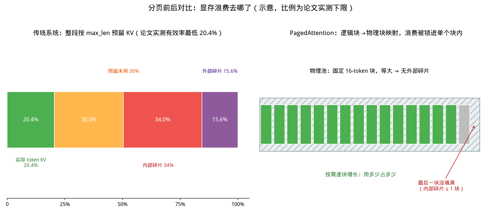
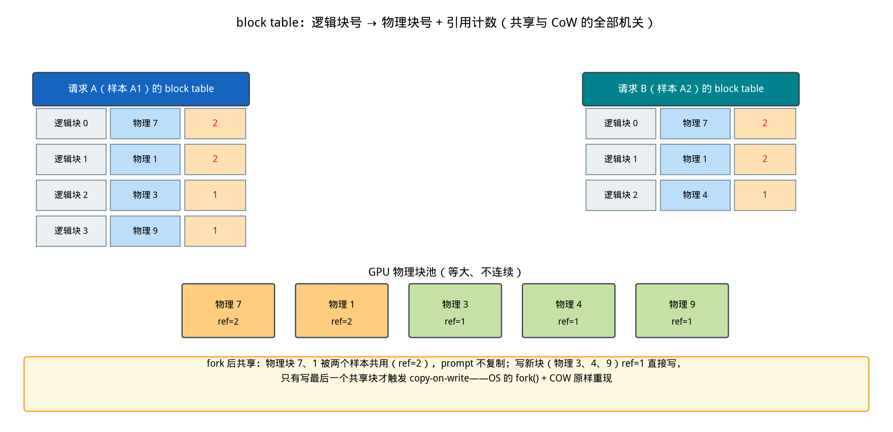
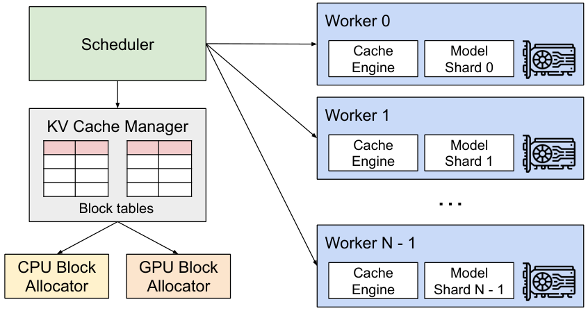

# 第 13 章｜PagedAttention：把虚拟内存搬进显存（Day 31–34）

> **这章讲什么**：三个问题串成一条线——① 推理服务的显存为什么会"明明有很多空闲、却装不下下一个请求"？② PagedAttention 是怎么把操作系统跑了几十年的"分页"原封不动搬进 GPU 显存的，为什么它能同时做到"几乎零浪费"和"多个请求共用一份数据"？③ 打开 vLLM 源码，这套东西今天（2026-10）长什么样，哪些当年论文里的设计被保留、哪些被改掉了？
>
> **为什么重要**：PagedAttention 是 vLLM 的立身之本（SOSP '23 论文），也是"OS 思维迁移到 LLM 推理"这条学习心法的最大一次兑现——面试里只要问"vLLM 为什么快"，八成要落到它头上。而且它直接决定第 12 章并发天花板公式里 `B_KV` 那道墙有多高：**KV 显存的有效利用率，就是你能开的并发数的乘数**。
>
> **学完能干什么**：① 用论文实测数字说清传统引擎浪费在哪、浪费了多少（20.4% 这个下限数字要张口就来）；② 画出 block table 并解释 fork/COW 怎么让并行采样和 beam search 省下 37%–66% 的 KV；③ 在 vLLM 源码里定位块元数据、引用计数、抢占重算三条链路的具名文件与行号；④ 被问"分页和 OS 虚拟内存到底哪里一样、哪里不一样"时给出有细节的对照表。
>
> **本章数字纪律**：按第 9 章起的写作风格，**零性能跑测**。外部数字全部标注来源与检索日期（2026-10-16）：论文数字来自 arXiv:2309.06180（SOSP '23，CC BY 4.0）原文；源码行号来自 vLLM 仓库 commit `642c18d`（2026-10-15），逐一 grep 核验；4090D 等本机数字只引用本书前 8 章已实测记录。

---

## 0. 大白话开场：一张显存的"停车场困局"

假设你经营一个停车场（显存），按老办法停车：**每个车主（请求）进场前，你按他可能停的最久时间一次性圈占地**——"你最多停 4 小时，我把 4 小时的地都划给你"。结果来了 10 个车主，每个人实际只停了 40 分钟，但圈出来的地全占着。更糟的是，10 个圈地大小不一，彼此之间的缝隙谁也塞不进去。

停车场地面明明空着一半，新车主却进不来——**这就是传统推理引擎的显存碎片**。SOSP '23 论文实测：传统系统里真正存了 token KV 的显存**只有 20.4%–38.2%**，剩下的全是预留和碎片（§3.1/Fig.2，检索 2026-10-16）。

PagedAttention 的解法来自操作系统：**不圈地，改成"停车位按 16 个 token 一块、用多少停多少、随时续租"**，再配一张"车牌号 → 实际车位号"的对照表（block table）。这就是虚拟内存分页：每个请求看到的是连续编号的逻辑块，底下物理上东一块西一块没关系，查表就行。更有意思的是，OS 的 fork + copy-on-write 也被原样搬来——**两个采样结果可以共用同一份 prompt 的 KV，只在各自写新数据时才复制**。

**本章验收题**（学完应能张口回答）：

> 为什么"每个请求按最大长度预留 KV"会浪费 60% 以上的显存？PagedAttention 用哪三个机制把浪费压到"接近零"，其中哪一个机制让 beam search 省下了最多 55% 的 KV 内存？

答案在第 1、2、6 节：三个机制是**小块按需分配、等大块消灭外部碎片、引用计数共享**；省最多的机制是块共享 + copy-on-write。

---

## 1. 碎片从哪来：三种浪费，实测只剩 20.4%

### 1.1 先看这笔账有多大

论文 §2.1 给了一个可以直接心算的例子（原文公式原样）：OPT-13B 单个 token 的 KV 是

$$2\ (\text{key,value}) \times 5120\ (\text{hidden}) \times 40\ (\text{层}) \times 2\ \text{bytes(FP16)} = 800\ \text{KB}$$

OPT 最长生成 2048 token，**一个请求最多要吃 1.6 GB**。而 A100 40GB 扣掉权重（13B×FP16≈26 GB）后，KV 池也就十几 GB——就算全部给 KV，也只能伺候**十几个请求**。第 4 章你算过 7B 是 56 KiB/token（本机 StaticCache 实测），量级一致，结论一致：**KV 是并发的第一道墙**（回扣第 12 章 `B_max = min(B_KV, B_SLO, B_引擎)`，这里动的是 `B_KV` 的分子——有效容量）。

【类比：停车场】墙的高度取决于"能停几辆车"，而决定停几辆的不是地面总面积，是**有效利用率**。传统系统地面 60% 以上是划了却没停的圈和缝——所以 PagedAttention 的第一刀，砍的是利用率。

### 1.2 三种浪费，逐个点名

论文 §3.1 与 Fig.3 把传统引擎（按 max_len 整段预分配 + buddy allocator）的浪费拆成三种：

| 浪费类型 | 大白话 | 对应 OS 概念 | 发生时机 |
|---|---|---|---|
| **reserved（预留未用）** | 圈了 4 小时的地，只停 40 分钟 | over-provisioning | 请求全程都占着 |
| **internal（内部碎片）** | 圈的大小 ≠ 实际需要，差额填不满 | 分配粒度过粗 | 实际长度 < 预留长度 |
| **external（外部碎片）** | 地面空着但东一小西一小，整块塞不进新请求 | buddy/伙伴算法碎片 | 分配器回收后遗留 |

三者叠加的实测结果（论文 Fig.2，ShareGPT + Alpaca 真实负载）：**KV 内存实际存了 token 状态的比例只有 20.4%–38.2%**。也就是说，同样一块显存，传统引擎能开的并发，**天生只有分页引擎的 1/3 到 1/5**。



**从这张图你能看到什么（盯着看一分钟）**：

1. **左边的堆叠条是论文的下限**：绿色（真正存 KV 的部分）只占 20.4%，右边三段橙红紫全是"看得见摸不着"的浪费——这就是"有效内存低至 20.4%"的视觉版。中间两段的具体拆分比例为教学示意（论文只给出合计有效率区间 20.4%–38.2%），图题已注明"示意"。
2. **右边是分页后的样子**：等大的 16-token 块横着排，用一块拿一块，灰块标注"最后一块没填满"——**全部内部碎片被锁死在这一个块里**（最多 15/16 的浪费，即 <6.25%），而等大块让外部碎片**从定义上消失**（没有任何缝隙可言）。
3. **两图对比的结论**：分页不是"把浪费变没"，而是**把无界的、随机的浪费压成有界的、单块的浪费**。论文原话：所有块从左往右填满才申请新块，"limits all the memory wastes for a request within one block"（§4.2）。

---

## 2. 三个机制：小块按需、等大块、查表翻译

论文 §4.1 定义了 PagedAttention 的核心对象——**KV block**：一个块装固定 B 个 token 的 key（和 value）向量。注意一个关键设计选择（§4.1 脚注 1）：每个 token 在所有层、所有头上的 KV 可以打包进一个块，也可以**"每层每头单独一个块、单独一张表"**——论文说两种实现没有性能差异，选了后者因为好实现。**现代 vLLM 就是后者：KV cache 按层（和头组）分开管理**，第 4 章"显存三巨头"里 KV 那一坨，在引擎眼里其实是几十张平行的块表。

attention 计算本身也被改写成按块累加（论文 Eq.4）：每个块内部正常算 softmax 分值，跨块的结果用分块求和的方式拼起来——**这就是"PagedAttention 算法"：kernel 不再假设 KV 连续，而是拿着一串块号跳着读**。

### 2.1 机制一：小块 + 按需分配（消灭 reserved 和大半 internal）

逻辑上请求"第 n 个 token 的 KV 放在逻辑块 ⌊n/B⌋"，但**逻辑块只有用到时才去物理池里申请**。生成到一半内存不够？下一个块的物理页等有空闲再说，甚至先把请求挂起（§4.5 抢占，见 5.3 节）。预留浪费从"max_len − 实际长度"缩到"最后一个不满的块 ≤ B−1 个 token"。

### 2.2 机制二：等大块（消灭 external）

所有物理块一样大，分配器永远不需要"找一块大小刚好的空洞"——**外部碎片在几何上不可能存在**。这是分页最古老也最彻底的好处，OS 用它解决了几十年，这里原样复用。

### 2.3 机制三：block table（逻辑↔物理解耦，一切高级玩法的地基）

论文 Fig.6 的例子（B=4）：请求的逻辑块 0、1 映射到物理块 7、1；prefill 算完，前 4 个 token 进逻辑块 0、第 5–7 个进逻辑块 1（还空 1 格）；decode 一步写进那 1 格，`#filled` 更新；下一格满了，就申请物理块 3 并更新表。**这张表就是页表**，每条记录 = 逻辑块号 → 物理块号 + 已填位置数。

kernel 拿到的输入只有"每行一串物理块号"（vLLM 里叫 block table tensor，见 §5.4），模型和 kernel 完全不知道有没有共享、是否跨层——**翻译工作全部被这张表隔离在调度层**。论文 §4.4 特别强调：正因为 kernel 只看见物理块列表，跨请求共享才能对模型完全透明。



**从这张图你能看到什么（盯着看一分钟）**：

1. **上方两张表是两个样本（A1/A2）各自的 block table**：前两行都指向物理 7、1（ref=2，橙色）——这就是"并行采样共享 prompt"：prompt 的 KV **只存了一份**，两张表指同一处；后几行各自指向不同物理块（ref=1，绿色）——开始各写各的了。
2. **中间的物理池是"等大、不连续"的**：物理 7、1、3、4、9 在池子里挨着摆只是为了画图，真实情况下它们在显存里可以相距十万八千里——**查表能翻译，所以连续性要求被彻底解除**。
3. **底部黄框是本章最值钱的一句话**：写 ref>1 的共享块才触发 copy-on-write（一次块拷贝），写 ref=1 的新块直接写——**这正是 OS fork() 的语义**，一个字都没改。

---

## 3. OS ↔ LLM 推理对照总表（本章核心交付）

按学习心法第 5 条——你是在把系统思维搬过来，不是学新学科。下表把论文里出现的每一处 OS 概念逐一对位，**面试被问"分页和虚拟内存什么关系"，照这张表答**：

| OS 概念 | LLM 推理对应物 | 论文/vLLM 位置 | 一句话说明 |
|---|---|---|---|
| 虚拟地址空间 | 请求视角的连续 token 位置（逻辑块序列） | §4.2 逻辑块 | 每个请求都以为自己独占一整段连续 KV |
| 物理页帧（frame） | 物理 KV 块（固定 B token 的显存块） | GPU Block Allocator | 等大、预切、入池 |
| 页大小（page size） | block size B（默认 16 token） | §7.2 / `cache.py:72` | 太小伤 kernel 并行，太大增内部碎片 |
| 页表（page table） | **block table**（逻辑块→物理块 + filled） | Fig.6 / `worker/block_table.py` | kernel 按表跳读，翻译在调度层完成 |
| 缺页（page fault） | 需要新块时向池申请 / free list 取块 | §4.2 | 拿不到块 → 触发抢占（见下两行） |
| 过度分配（overcommit）压力 | 显存块耗尽 | §4.5 | 生成中 KV 持续增长，会真的耗尽 |
| 页面回收/驱逐（evict） | 抢占请求（preemption），all-or-nothing | §4.5 | 一个请求的所有块要么全在要么全走 |
| swap 到磁盘 | **swap 到 CPU 内存**（论文方案） | §4.5 | CPU 侧块池上限 = GPU 块数；**v1 已移除，见 5.3** |
| 换入时重算 | **recomputation**：输出拼回 prompt 一次性重算 | §4.5/§7.3 | OS 没有的选项；实测开销 ≤ swap 的 20% |
| **fork()** | parallel sampling / beam search 分身 | §4.4 | 分身与父共享全部 prompt 块（ref=2） |
| **copy-on-write** | 分身写最后一个共享块时才复制 | §4.4 Fig.8 | 一次块拷贝，之后各自直写 |
| 共享库（shared library） | 预置共享前缀（system prompt 模板） | §4.4/§6.3 | 运营商预留一批块，所有请求映射过去 |
| 页缓存（page cache）命中 | prefix cache：块哈希命中直接复用 | vLLM `--enable-prefix-caching` | 现版 vLLM 默认开（`cache.py:142`） |
| buddy allocator | 传统引擎的 KV 分配（论文基线假设） | §6.1 Orca 实现假设 | 等大块让它没有存在必要 |
| 内存压缩（compact） | 请求 KV 重排 | §3.1 明确否定 | KV 太大，压缩不现实 |
| gang scheduling | 序列组（sequence group）整组抢占/恢复 | §4.5 | beam 各分支有共享块，必须同进退 |
| swap 空间上限 | CPU 块池 ≤ GPU 块数 | §4.5 | 有界，不会把内存吃穿 |

【类比：字典编排】页表是"外文单词→词典页码"，block table 是"token 位置→显存块号"。词典可以散装重订页序，只要查得着；fork 时两个学生共用一本词典（ref=2），谁在页边写字（写 KV）谁先抄走那页（CoW）。

---

## 4. 官方架构实图解读（论文 Fig.4，CC BY 4.0）

下面这张是论文原图，已按项目约定下载本地存储（来源与许可见 [images/real/CREDITS.md](../images/real/CREDITS.md)）：



> 图片来源：Kwon et al., *Efficient Memory Management for LLM Serving with PagedAttention*, arXiv:2309.06180v1, Figure 4（vLLM system overview），CC BY 4.0，2026-10-16 下载。

**从这张图你能看到什么（盯着看一分钟）**：

1. **左上角的 Scheduler 是总指挥**（论文 §4：centralized scheduler）：所有模型并行切分下的 GPU worker 听同一个调度器的令。为什么敢只有一个 KV cache manager？论文 §4.6 解释：模型并行只是切模型，**所有 shard 处理的是同一批 token、同一批位置**，所以块表天然全局一致——一份映射全网通用。
2. **中间 KV Cache Manager 持有 Block tables**（图中两组表格示意多层/多请求），它是唯一"知道共享关系"的组件；它向下指挥两个分配器：**GPU Block Allocator（显存块）和 CPU Block Allocator（swap 用的内存块）**——论文里的三级结构一目了然。
3. **右侧每个 Worker 内是 Cache Engine + Model Shard**：worker 只按调度指令"往块号 X 写/读"，不理解逻辑地址。**控制面（左）与数据面（右）的这条分界线，就是 block table 存在的全部意义**——第 11 章讲 llama.cpp 后端抽象时"框架层持元数据、kernel 层只算"的同款分工。
4. **对照今天**：vLLM v1（2026）的分工没变——CPU swap 分配器没了（见 5.3），调度器演化成了 `vllm/v1/core/sched/scheduler.py`，Cache Manager 拆成 `kv_cache_manager.py` + `block_pool.py` + `block_table.py` 三层，第 5 节逐个走读。

---

## 5. vLLM v1 源码走读：这块地基今天长什么样

以下行号全部来自 vLLM commit `642c18d`（2026-10-15 clone），grep 逐一核验（检索 2026-10-16）。

### 5.1 块的元数据：一个 dataclass 承载全部 OS 页框信息

`vllm/v1/core/kv_cache_utils.py:162` 的 `KVCacheBlock`：

```python
@dataclass(slots=True)
class KVCacheBlock:
    block_id: int                      # 物理块号，0..num_gpu_blocks-1
    ref_cnt: int = 0                   # 引用计数 ← fork/COW 的机关
    pool: "BlockPool | None" = ...     # 回收时归还给哪个池
    _block_hash: ... = None            # 块满后的哈希 ← prefix cache 命中键
    prev_free_block / next_free_block  # ← 空闲链表指针（alloc/free O(1)）
```

对照第 3 节的表：`ref_cnt` 是 COW 用的引用计数，`_block_hash` 是"页缓存命中键"，前后指针是**空闲链表**（物理页管理的经典结构，`FreeKVCacheBlockQueue` 定义在 `kv_cache_utils.py:258`）。一个块同时身兼"页框 + 缓存条目 + 链表节点"三职——**OS 三套数据结构，vLLM 合成一个对象**。

### 5.2 分配主链：`allocate_slots()`——按需续租的入口

`vllm/v1/core/kv_cache_manager.py:371` 的 `allocate_slots()` 是每步调度都会调的分配入口。它的 docstring 里有一段 ASCII 图（`:420` 的 `Blocks layout`），把请求当前的块排布画成五段：

```
| < comp > | < new_comp > | < ext_comp > | < new > | < lookahead > |
```

含义：已算过的块、前缀缓存命中而采纳的块、外部（KV connector）已算的块、本步要新算的块、投机解码预看块。要点：

- **命中即采纳**：`new_computed_blocks` 是 prefix cache 命中拿到的现成块，直接把它们的 `ref_cnt` 加上（不重算），这就是"页缓存命中"在代码里的样子。
- **水位线**：`watermark_blocks = int(watermark * num_blocks)`（`:208`），但只对 WAITING/PREEMPTED 的新请求生效（`:509-516`）——给在途请求留逃生舱，防止"全塞满导致谁都跑不完"。注意默认值：`vllm/config/scheduler.py:196` `watermark: float = Field(default=0.0, ...)`，**默认 0，即默认不做预留**（想稳可以 `--watermark 0.01`）。
- 拿不到块不报错、**返回 None**，把决策权交还调度器——调度器于是执行 OS 式的"内存不足处理"（见 5.3）。

引用计数的增减集中在 `vllm/v1/core/block_pool.py`（`class BlockPool` 在 `:136`）：释放走 `free_blocks()`（`:776`），`ref_cnt -= 1`（`:795`），**归零才回空闲链表**（`:796`）——和页框回收一模一样，共享块则"多一人分摊，少一人记账"。

### 5.3 抢占：v1 弃用 swap，只用"释放 + 重算"

论文给了两条恢复路：swap 到 CPU（§4.5）与 recomputation（§4.5）。**2026 年的 v1 调度器里 `grep -c swap vllm/v1/core/sched/scheduler.py` = 0**——CPU Block Allocator 那条路在 v1 被拿掉了，抢占只做一件事：**释放块 + 把进度归零**。

`vllm/v1/core/sched/scheduler.py:84` 是 `class Scheduler`。块不够时的抉择在 `:848-857`：优先级模式挑最低优先级的，普通模式直接挑**最后到的运行中请求**（`self.running[-1]`，FILO——先保护先来的大请求？不，是牺牲新来的）。随后 `_preempt_request()`（定义在 `:1649`）执行：

```python
self._free_request_blocks(request)          # :1667 释放全部块（ref_cnt 记账）
request.status = RequestStatus.PREEMPTED
request.num_computed_tokens = 0              # :1671 进度归零 ← 关键
request.num_preemptions += 1                 # :1686 计数（监控指标）
```

`num_computed_tokens = 0` 就是"重算"的开关：请求被踢回等待队列，重新入队时**prompt + 已生成的输出拼成一个新 prompt，一次 prefill 全量重算 KV**。对应论文 §4.5 的原话——重算因为 decode 出来的 token 能拼进 prompt，一个前向就全补齐了。v1 只留这条路的原因，论文 §7.3 其实早给了弹药：**recompute 开销从不超过 swap 延迟的 20%**（小块导致 PCIe 上一堆碎拷贝，有效带宽被打残；而 recompute 走的是 GPU 算力，跟块大小无关）。第 12 章的三时延公式在这里换个主角重演：**在 PCIe 18.6 GB/s（第 7 章本机实测）面前，搬运永远输给计算**。

【坑：老教程对照源码会翻车】网上大量 vLLM 教程还在讲"swap 到内存再换回来"的 v0 调度器——**v1 已无 swap 路径**，你照着旧教程在 `scheduler.py` 里找 swap 函数会一无所获。引用时务必带上版本（v0/v1）与 commit 号。

### 5.4 kernel 怎么按表取数：slot mapping

调度层翻译完，worker 层要真正把"物理块号"变成 kernel 的地址。`vllm/v1/worker/block_table.py:153` 的 `compute_slot_mapping()` 调用一个 CUDA kernel，输入是每请求的块表 + 每个 token 的**位置编号**，输出是每个 token 的 KV 写入槽位（显存线性地址）：

```
物理槽位 = block_table[位置 // B][位置 % B] 展开成线性 offset
```

算完后 `commit_block_table()`（`:181`）把 CPU 侧块表拷到 GPU——**每步调度一次，块表常驻显存供 attention kernel 跳读**。这一步对应论文 Fig.6 的"翻译"，也是第 12 章数据流大图里"每步执行"行中容易被忽略的开销：块表很小（每请求几十个 int），但每步都要跟 kernel 对齐口径。

### 5.5 配置三件套：今天旋钮在哪

| 旋钮 | 2026-10 现状 | 位置 |
|---|---|---|
| `--block-size` | 默认 **16**（与论文 §7.2 结论一致，8 年没改）；`CacheConfig.DEFAULT_BLOCK_SIZE = 16` | `vllm/config/cache.py:72`、`:344`（validator） |
| `--enable-prefix-caching` | 默认 **True**（v1 开箱即用） | `vllm/config/cache.py:142` |
| `--watermark` | 默认 **0.0**（不预留） | `vllm/config/scheduler.py:196` |
| 特殊后端约束 | CPU MLA 后端强制 block_size=16 | `vllm/platforms/cpu.py:276` |

`--block-size` 可选 8/16/32（官方 engine-args 文档，2026-10-16 检索），与论文的"16–128 在 ShareGPT 最优、16 多数情况够用"一脉相承——**一个 2023 年的消融结论固化成了三年后的默认值**，这是好论文的样子。

---

## 6. 为什么能共享：fork + copy-on-write 的三次复用

第 2 节图 2 已给了机制，这里补齐**收益的实测数字**（全部来自论文 §6.3，Fig.15/16，检索 2026-10-16）：

| 场景 | 共享范围 | 节省 KV（Alpaca 短负载） | 节省 KV（ShareGPT 真实对话） |
|---|---|---|---|
| parallel sampling（一问多答） | 只共享 prompt | **6.1%–9.8%** | **16.2%–30.5%** |
| beam search（k 支并行扩展） | prompt + 已分叉的公共前缀 | **37.6%–55.2%** | **44.3%–66.3%** |
| 共享前缀（system 模板 + few-shot） | 跨请求预置块 | 吞吐 **1.67×**（1 例 80 token） | 吞吐 **3.58×**（5 例 341 token） |

三个数字该怎么读：

1. **parallel sampling 省得少**，因为 prompt 只占 KV 的 12%（论文 §3 实验口径）——一旦开始各写各的（每步 sample 不同 token），之后的 KV 一分都共享不了，最后那个共享块还得 CoW 复制一次。
2. **beam search 省得多**，因为分支会"重聚"：论文 Fig.9（k=4）里候选 0 和 3 死掉、候选 4–7 全部源自 1 和 2——公共前缀越长共享越多，**共享模式随 decode 动态演化，像 OS 里的进程树 fork 来 fork 去**（论文原话 compound forks）。对应地，吞吐优势从基础采样的 1.3× 涨到 beam=6 的 2.3×（vs Orca Oracle，§6.3）。
3. **共享前缀是"跨请求"的**，论文类比成 OS 的共享库：运营方预留一批物理块存 system prompt/few-shot，新请求的逻辑块直接指过去，只有最后不满的块标 CoW——**prefill 只算用户新输入的那截**。这是今天 vLLM `--enable-prefix-caching`（默认开，`cache.py:142`）的前身，也是 agent 场景（长 system + 短轮次）最重要的优化，第 16 章会与 SGLang RadixAttention 对打。

【坑：把"共享省显存"直接换算成"吞吐 ×N"】省 KV ≠ 吞吐同比例涨：共享后 `B_KV` 墙变高，但吞吐还要过 `B_SLO`、`B_引擎` 两道墙（第 12 章公式）。论文的对应口径是"同样的延迟下能承受 1.7×–2.7× 请求率"，不是"快 2.7 倍"。面试说错这句会被抓住。

---

## 7. 总账：20.4% → 2–4×，中间的因果链

把全章数字串成一条可复述的因果链（全部论文口径）：

```
传统引擎有效 KV 仅 20.4%–38.2%（§3.1）
  └─ 三机制：小块按需（≤1 块内碎片）+ 等大块（零外碎片）+ block table 解耦
       ├─ 近零浪费 ⇒ 同显存能多塞请求：OPT-13B 同时在批 2.2×（vs Orca Oracle）/ 4.3×（vs Orca Max）（§6.2）
       ├─ table 解耦 ⇒ fork/COW 共享 ⇒ beam 省 44%–66% KV（ShareGPT）（§6.3）
       └─ batch 变大 ⇒ 吞吐 2–4×（同延迟，vs FasterTransformer/Orca；ShareGPT 请求率最高 22× vs FT）（§6/摘要）
```

**放回第 12 章的公式**：并发天花板 `B_max = min(B_KV, B_SLO, B_引擎)`——PagedAttention **只抬高 `B_KV` 这一道墙**（有效容量从 ~20% 提到 ~96%，即论文的 near-zero waste）。墙抬高后能开多少并发，还得看另外两道墙先倒谁。一个粗账（算账，非实测）：若某 7B 服务 KV 池 16 GiB，传统 20.4% 有效 ≈ 3.3 GiB 真实可用，分页 ~96% ≈ 15.4 GiB——**容量比 ~4.7×，与论文"2–4× 吞吐"同量级**（吞吐还要被算力与 SLO 打折，见 RESULTS.md 口径提醒）。

【类比：三道墙齐升高】PagedAttention 把 KV 墙从 1 层楼抬到 5 层楼；SLO 墙、引擎墙没动。**别把"KV 墙抬高 5 倍"讲成"楼高 5 倍"**——楼高 = min 三墙。

---

## 8. 【坑】清单 + 动手任务 + 自检 + 面试话术

### 8.1 本章【坑】清单

1. **【坑】把 block 说成 CUDA thread block**——官方文档开篇就警告（docs.vllm.ai paged_attention）：PagedAttention 的 block 是"KV 分页块"，和 GPU 线程块一词两义，讲解必须先声明。
2. **【坑】照旧教程找 v1 的 swap 代码**——v1 无 swap 路径（`grep -c swap` = 0），抢占只有 free + recompute；引用必须标版本。
3. **【坑】以为 block 可以运行时改**——`--block-size` 是启动期决定（显存布局、kernel 编译都按它切），改必须重启；同理第 12 章 `-ngl` 也是加载期决定。
4. **【坑】把共享节省当吞吐倍数**——省 KV 只动 `B_KV` 墙；论文口径是"同延迟承受 1.7–2.7× 请求率"，不是端到端提速。
5. **【坑】认为分页 kernel 可以随便读非连续 KV**——不行，attention kernel 必须按块表跳读并做分块归一化（论文 Eq.4），vLLM 自研 kernel（`csrc/attention/`）就是为块式访存写的；换 kernel 要重写。
6. **【坑】漏掉 watermark 默认 0**——`config/scheduler.py:196` 默认不预留，极端负载下"水位保护"是你要自己开的，不是出厂就有。
7. **【坑】拿论文数字当 2026 年实测**——2–4×、20.4% 是 2023 年 A100/OPT 时代的数字（SOSP '23）；引用时说清"论文实测"，竞品（TGI/TRT-LLM）这三年也长进了。

### 8.2 动手任务（零跑测为主，有环境可选）

**任务 A：把论文三种浪费拆到你自己的场景（20 分钟，纸笔）**

取第 4 章的 7B（56 KiB/token）+ 4096 上下文：① 按"整段预留 4096"算传统单请求 KV 占用；② 若实际平均输出 512 token，算 reserved 浪费占比；③ 用 block=16 算分页后的实际占用（⌈4608/16⌉ 块）。

*验收标准*：三个数齐全，能说出"分页后浪费 ≤1 块 = 16 token"并把它换算成 KiB 与总量对比（应 <1%）。

**任务 B：grep 出四条链（20 分钟，需 vLLM 源码 `git clone --depth 1`）**

```bash
grep -n "ref_cnt" vllm/v1/core/block_pool.py | head
grep -n "num_computed_tokens = 0" vllm/v1/core/sched/scheduler.py
grep -n "DEFAULT_BLOCK_SIZE" vllm/config/cache.py
grep -c swap vllm/v1/core/sched/scheduler.py
```

*验收标准*：把四个命中抄进笔记并各写一句人话（尤其最后一行 = 0 的含义：v1 抢占策略是重算不是换出）；行号与第 5 节对上（若你的 commit 不同，行号允许±，函数名必须一致）。

**任务 C：默画 block table（10 分钟，闭卷）**

画出"两个样本共享 prompt、各生成 3 token"的两张 block table + 物理池，标出每块 ref 数与触发 CoW 的那一刻（对齐本章图 2）。

*验收标准*：共享块 ref 数正确、CoW 发生位置正确（写最后一个共享块时），能说出"此后 ref=1，第二份不再复制"。

**任务 D（有 vLLM 环境才做，可选）：观察 prefix cache 与抢占计数**

`vllm serve <model> --enable-prefix-caching` 发两次相同长 prompt，第二次看日志 TTFT 是否显著下降（prefix 命中）；再压并发至日志出现 preemption 计数增长。

*验收标准*：记录两次 TTFT 数字与 preemption 计数；**结果方向可能因模型/机器不同，说清观察到的现象即可**，不预设"必须下降"。

### 8.3 自检三问（闭卷作答）

1. 传统引擎浪费的三种类型各在什么时机发生？为什么"等大块"能直接消灭外部碎片，却只能"限制"内部碎片？
2. fork/COW 在 PagedAttention 里对应哪两行代码语义？为什么 beam search 的节省比例（44%–66%）远大于 parallel sampling（16%–30%）？
3. 论文的 swap 和 recompute 两条恢复路，v1 选了哪条？用论文 §7.3 的哪个数字 + 本书哪个本机实测支撑这个选择？

### 8.4 面试话术（可直接背）

**话术 1：被问"vLLM 为什么比朴素推理快？讲讲 PagedAttention"**

> "根子是 KV 显存管理。朴素引擎按 max_len 整段预分配，实测只有 20.4%–38.2% 的 KV 内存真正存了数据，预留、内部碎片、外部碎片三重浪费直接压低并发上限。PagedAttention 借用 OS 分页：KV 切成固定 16 token 的等大块，按需从池里申请，逻辑地址经 block table 翻译成物理块号——内碎片锁死在一个块内、外碎片几何上消失，有效率接近满格。同显存下 OPT-13B 同时在批提升 2.2 倍，端到端吞吐 2–4 倍且不损失精度，因为这纯粹是内存管理，不改模型计算。"

**话术 2：被问"分页和操作系统虚拟内存的异同"**

> "同构九成：页↔KV 块（16 token）、页表↔block table、缺页↔按需向块池申请、fork/COW↔并行采样与 beam 的块共享、共享库↔预置前缀、swap↔换出到 CPU 内存。差异有三处：一是 LLM 可以'重算'代替换入——decode 输出能拼回 prompt 一次 prefill 全算完，论文实测开销不超过 swap 的 20%，所以 vLLM v1 直接删了 swap；二是驱逐粒度不同——我们 all-or-nothing，一个请求的块要么全留要么全走，因为处理请求要求它的 KV 全部在场；三是页表本身放显存，每步由 kernel 按表跳读，翻译必须便宜到每 token 不可察觉。"

**话术 3：被问"block size 为什么是 16，能改吗？"**

> "论文消融给过结论：太大增加内碎片、降低共享概率，太小让 kernel 读 KV 的并行度不足，ShareGPT 负载下 16–128 都行、Alpaca 短序列下大块明显变差，所以取 16 做默认——三年过去 vLLM 默认值仍是 16。可以改（8/16/32），但它是启动期参数，显存布局和 kernel 按它编译，改要重启；另外特殊后端有约束，比如 CPU MLA 路径强制 16。我会按负载调：超短序列、共享前缀多的 agent 场景可以试 8 换更低内碎片，长序列大 batch 用默认 16 起步。"

---

## 参考与版本说明

- **论文**：Kwon et al., *Efficient Memory Management for Large Language Model Serving with PagedAttention*, arXiv:2309.06180v1（2023-09-12 提交，SOSP '23，DOI 10.1145/3600006.3613165，CC BY 4.0；2026-10-16 检索）。碎片率 20.4%–38.2%、800 KB/token、2–4×、2.2×/4.3×、1.7–2.7×/2.7–8×/22×、共享节省各区间、block size 消融、recompute≤20% swap 均为该文原文数字。
- **vLLM 源码**：commit `642c18d`（2026-10-15 clone，Apache-2.0），全部行号 grep 核验；v1 调度器无 swap 为 `grep -c` 结果。
- **vLLM 官方文档**：`docs.vllm.ai`（paged_attention 历史文档警告、engine-args block-size 选项 8/16/32，2026-10-16 检索）。
- **本书内引用**：7B KV 56 KiB/token 与显存三巨头（第 4 章）；PCIe 4.0 x16 实测 18.6 GB/s（第 7 章）；并发天花板 `B_max = min(B_KV, B_SLO, B_引擎)` 与 offload 悬崖（第 12 章）。
- **本章配图**：2 张程序生成（`code/ch13/make_figures.py`）+ 1 张论文原图（CC BY 4.0，已登记 `images/real/CREDITS.md`）；数据与算账登记见 [code/ch13/RESULTS.md](../code/ch13/RESULTS.md)。
- **下一章**：第 14 章《Continuous Batching 与调度器》——本章管"显存怎么摆"，下一章管"请求怎么排队"，两者合起来才是第 12 章三道墙的完整解法。
