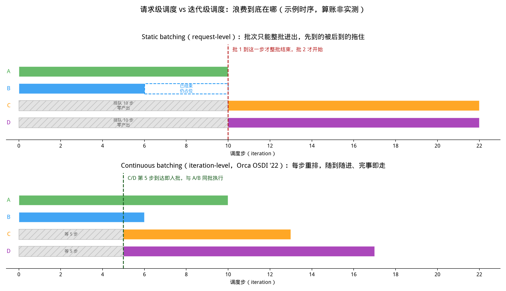
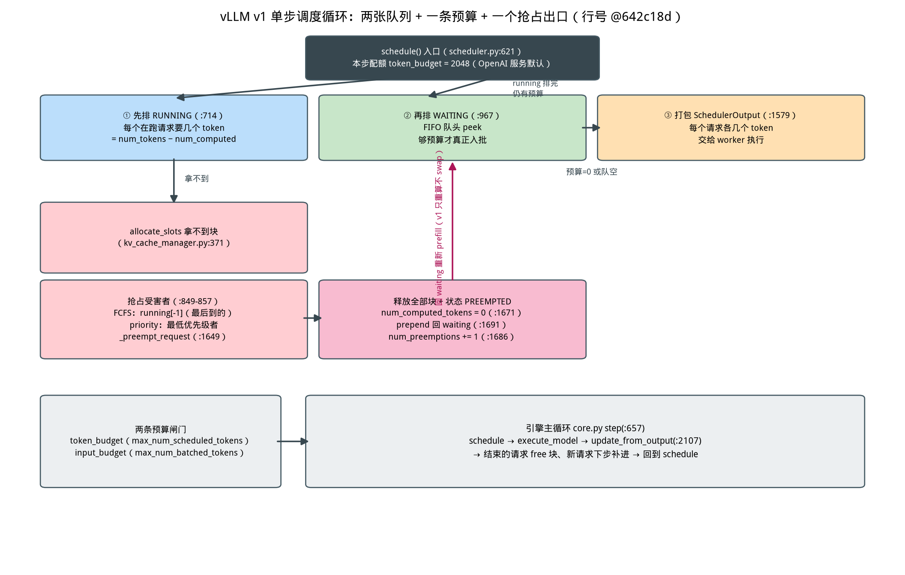

# 第 14 章｜Continuous Batching 与调度器（Day 35–38）

> **这章讲什么**：三个问题串成一条线——① "把一堆请求拼成一批一起算"这件事，为什么在 LLM 推理里会浪费掉大量 GPU 时间，浪费具体在哪一步？② Continuous Batching（连续批处理）到底改了什么，才让 Orca 论文喊出"同延迟下吞吐 36.9×"？③ 打开 vLLM v1 调度器源码，这套"每步重排"的循环今天长什么样——两张队列、一条预算、一个抢占出口，逐行走读。
>
> **为什么重要**：第 13 章解决了"显存怎么摆"（PagedAttention），本章解决"请求怎么排队"（调度器）——两者合起来才把第 12 章并发天花板 `B_max = min(B_KV, B_SLO, B_引擎)` 里最硬的两道墙真正抬起来。而且调度器是引擎里**唯一每天都在改、最容易提 PR 的地方**：vLLM 的 issue 里调度相关占比一直很高，看懂它等于拿到 vLLM 社区的入场券。
>
> **学完能干什么**：① 用一张时序图讲清 static batching 浪费在哪、连续批处理省回了什么；② 说清 Orca 的 iteration-level scheduling 与 Sarathi-Serve 的 chunked prefill 各自解决什么问题、数字分别是多少；③ 在 vLLM 源码里定位调度循环的三段主干、两条预算闸门、抢占重算回路的具名文件与行号；④ 被问"怎么改 vLLM 的调度策略"时，知道 `policy`、`max_num_batched_tokens`、`enable_chunked_prefill` 这几个旋钮在哪、改了会发生什么。
>
> **本章数字纪律**：按第 9 章起的写作风格，**零性能跑测**（本机无 vllm 环境，也从不拿单机跑分冒充行业结论）。外部数字全部标注来源与检索日期（2026-10-16）：Orca 数字来自 USENIX 官方论文页；Sarathi-Serve 数字来自 arXiv:2403.02310 原文；DistServe 数字来自 arXiv:2401.09670 原文；源码行号来自 vLLM 仓库 commit `642c18d`（2026-10-15 clone），逐一 grep 核验。

---

## 0. 大白话开场：一家只按"整桌"上菜的餐厅

假设你经营一家餐厅（GPU），采用老式规矩：**一桌客人点完菜才能开火，而且必须等这一桌所有人全部吃完、一起离席，才能招呼下一桌**。问题来了——这桌 4 个人，有人 10 分钟吃完干坐着，有人要吃 40 分钟；隔壁 2 个人早在门口等了 30 分钟，但锅还占着。

餐厅明明空着一半台子，门口却排着长队。**这就是 static batching（静态批处理）：批次以"请求"为生命周期，只能整批进出。**

Orca 论文（OSDI '22）把它改成了另一套规矩：**以"迭代"为调度单位——每生成完一个 token 就重新清点一次：谁完成了谁离席（还占的座立刻释放），门口等的人谁先来谁插空坐下**。这就是 iteration-level scheduling（迭代级调度），也是 Continuous Batching 的学名。

规矩一改，同延迟下的吞吐变成 **36.9×**（GPT-3 175B 对比 NVIDIA FasterTransformer，Orca 论文摘要，检索 2026-10-16）。注意这个数字的口径是"同一延迟水平下"——不是简单快 36 倍，而是"原本为了低延迟只能开很小批次，现在能开满批次还保持低延迟"。

**本章验收题**（学完应能张口回答）：

> static batching 的浪费发生在哪三个时刻？Continuous Batching 靠哪一条机制把它们全部消掉？为什么有了 Continuous Batching 还不够，必须再加 chunked prefill？

答案在第 1、2、3 节：浪费在**批次等待期、短请求等待结束、新请求长 prefill 卡住全批**三个时刻；机制是**每次迭代结束后重新组批（iteration-level）**；还必须加 chunked prefill 是因为**新请求的 prefill 太长，会把整批 decode 拖死**（第 3 节的 stall 问题）。

---

## 1. Static batching 到底浪费在哪

### 1.1 三种浪费，逐个点名

按"请求级"组批的系统（Orca 论文之前的服务，包括早期的 Triton/HF-TGI 老模式），浪费发生在三个时刻：

| 浪费时刻 | 大白话 | 对应 OS/系统概念 | 后果 |
|---|---|---|---|
| **批次等待**：早到的请求等凑够一批才开跑 | 门口 2 人等满 4 人才开席 | 批量收集（batch-and-wait） | TTFT 无谓膨胀，低并发下尤其致命 |
| **短请求等长请求**：批内最长者决定整批结束时间 | 10 分钟吃完的陪 40 分钟的干坐 | 长尾拖累（straggler） | 占着槽位不出活，显存同步浪费（KV 仍持块） |
| **新请求进不来**：批次跑到一半，新请求必须等整批结束 | 下一桌只能等这一桌全体离席 | 静态配额、无准入重评 | 高峰期新请求饿死，服务像"走走停停的班车" |

第 13 章讲过 PagedAttention 消灭的是**显存**的三种浪费；本节这三种是**时间与算力**的浪费——注意两者是独立的：就算 KV 管理做到零碎片，组批方式不对，GPU 照样闲着。**显存省了不等于吞吐高了**，这是面试常见追问点。

【类比：餐厅翻台】显存管理 = 怎么摆桌子、一桌能挤几个人（PagedAttention）；调度 = 什么时候放人进来、什么时候赶人走（Continuous Batching）。**一家店桌子摆得再好，翻台规矩烂，照样不赚钱。**

### 1.2 看图算账：同一组请求的两种命运



**从这张图你能看到什么（盯着看一分钟）**：

1. **上半张（static）**：A、B 先到先组批，批次必须跑到最长的 A 结束（第 10 步）才能解散——**B 第 6 步就完成了，剩下 4 步是白占的虚线框**（短请求陪长请求干坐）。C、D 第 5 步就到了，但只能在斜纹区干等 10 步，**零产出**。
2. **下半张（continuous）**：C、D 第 5 步到达后**下一步就入批**（每步迭代结束后重排），与 A、B 同批执行；B 第 6 步完成即刻退出，槽位让给后面的人。**同样的 4 个请求，总完成时间从 22 步缩到 17 步**——这是本图的算账结果（教学示例时序直接相减，非实测负载；图题已注明"算账非实测"）。
3. **关键差异只有一条**：调度的原子单位从"请求"变成了"迭代"。上半张的红色虚线是"批 1 整批结束"才允许动的关卡，下半张的绿色虚线每一步都可以动。**这就是 Orca 论文原话"schedule the execution of the engine at the granularity of iteration instead of request"的视觉版。**

浪费的账也能直接算（示例口径，算账非实测）：static 下 C、D 各白等 10 步共 20 个"请求·步"，B 又空占 4 步，合计 **24 请求·步被浪费**；continuous 下只浪费 10 步（C、D 各等 5 步）+ B 零空占。**真实负载里请求长度方差越大（ShareGPT 那种长短混杂），这个差距越大**——这也解释了为什么 PagedAttention 论文选 ShareGPT 做主战场（回扣第 13 章 §1.2）。

---

## 2. Orca：连续批处理的出处（iteration-level scheduling）

### 2.1 论文到底改了哪两件事

Orca（Yu et al., OSDI '22，USNIX Open Access，检索 2026-10-16）提出两个机制，缺一不可：

1. **iteration-level scheduling（迭代级调度）**：调度器每次只让引擎跑**一步**（一个 iteration），跑完立刻检查——完成的请求返回客户端、释放资源；新请求和继续生成的请求**重新参与本步组批**。论文原话："a newly arrived request can be considered for processing after waiting for only a single iteration"（新请求最多等一步就能被考虑）。
2. **selective batching（选择性批处理）**：这一步是配套的工程手段。自回归模型里 attention 算子要求每个序列看自己的历史（形状依赖序列长度），不能像 GEMM 那样无脑拼批——Orca 的做法是**只对形状无关的算子（线性层）批量执行，attention 按序列单独执行**。注意：PagedAttention 的分块 kernel 后来把这一步也统一了（第 13 章 §2：kernel 拿着块表跳着读，天然支持任意长度拼批）——**两者是接力关系：Orca 解决"什么时候批"，PagedAttention 解决"怎么批得动"**。

### 2.2 数字与口径（引用时必须带定语）

| 数字 | 口径 | 来源（2026-10-16 检索） |
|---|---|---|
| 吞吐 **36.9×** | 同一延迟水平下，GPT-3 175B vs NVIDIA FasterTransformer | Orca 摘要（USNIX 官方页） |
| 迭代级调度"最多等一步" | 机制描述，非性能数字 | Orca §3 |
| PagedAttention 引用 Orca 的"Oracle/Max"两档 | **Oracle = 事后诸葛亮式的最优组批（上界估计）**，Max = 最大并发不抢占 | arXiv:2309.06180 §6.1 |

【坑：36.9× 是跨系统对比，不是"连续批处理单独贡献"】36.9× 里同时含了 selective batching、分布式实现与 FasterTransformer 对照组的低效。面试引用时说"Orca 论文报告同延迟下相对 FasterTransformer 36.9×"，**不要说"开连续批处理能快 36.9 倍"**——本章没有任何单一技术能兑现这个数字。

### 2.3 为什么"等一步"就够了

回扣第 5 章的指标账：TTFT 的敌人是"批次收集等待"，TPOT 的敌人是"单步被拖慢"。迭代级调度把批次收集从"等凑齐 N 个"压缩成"等一次迭代"（几十到几百毫秒级），**TTFT 里属于调度的部分几乎归零**；而"短请求随完随走"让 batch 里的活跃度始终接近满格，**吞吐（第 5 章口径：单位时间总输出 token）随之抬升**。两头都赢的原因是调度延迟本身被压到了"一次前向"的量级。

---

## 3. Chunked Prefill：把大 prefill 切碎，别卡住全批

### 3.1 Continuous Batching 的遗留问题：stall

连续批处理解决了"进出"问题，但没解决"**批内相互踩踏**"：每步的批次由 decode 请求（每人 1 token，快）和新请求的 prefill（prompt 可能几千 token，慢）混编。第 3 章算过账——prefill 一步要算完整个 prompt，**decode 请求全部要陪它等这一步**。Orca 与 vLLM v0 的老做法是"prefill 优先"：来了大 prefill 就整批 decode 停摆一步（stall）。prompt 越长，这次停摆越久，**在途请求的 TPOT 出现毛刺**。

Sarathi-Serve（Agrawal et al., OSDI '24，arXiv:2403.02310，检索 2026-10-16）的诊断：prefill 是算力 bound、decode 是带宽 bound（第 3 章 roofline 的老朋友）——**decode 批次其实"算力有富余"**，可以把大 prefill **切成等大的小块（chunk），每步只塞一块进剩余算力预算里，decode 一个都不用停**。这就是 stall-free scheduling（无停顿调度）。

### 3.2 机制：一个预算统管全局

论文 §4.1–4.3 的做法一句话：每步 batch 总 token 数不超过预算 τ（chunk size，由 SLO 反推），**在途 decode + 一个 prefill chunk 拼成"hybrid batch"**——大 prompt 被切成近似等大的块，摊到多个迭代里算完。副产品有二（论文 §4.2/摘要）：

- 每步迭代的计算量变得**近乎恒定** → 延迟可预测（不再有"今天没事明天一个 8k prompt 卡 3 秒"）；
- 对流水线并行，**等大的 micro-batch 意味着气泡变小**——Falcon-180B 上端到端吞吐提升 **5.6×** 就是这条。

### 3.3 论文数字（全部原文口径）

| 数字 | 条件 | 来源（2026-10-16 检索） |
|---|---|---|
| 服务容量 **2.6×** | Mistral-7B，1×A100，尾延迟约束下，vs vLLM | arXiv:2403.02310 摘要 |
| 服务容量最高 **3.7×** | Yi-34B，2×A100（TP2），不同 SLO 目标 | 同上 |
| 端到端容量最高 **5.6×** | Falcon-180B，PP2×TP4，8×A100 over ethernet | 同上 |
| 分离收益 **7.4× 更多请求 / 12.6× 更严 SLO** | PD 分离的 DistServe，>90% 请求满足约束 | arXiv:2401.09670 摘要（OSDI '24，回扣第 16/21 章） |

"服务容量"（serving capacity）的口径要说清：**在延迟 SLO 约束下每 GPU 能扛的请求率**——它不是"单请求变快"，而是"延迟不塌的前提下能开更多并发"，与第 12 章 `B_max` 公式完全同构（chunked prefill 主要抬的是 `B_SLO` 那道墙：把 prefill 对 TPOT 的冲击压掉，SLO 卡得更死也扛得住）。

【坑：chunk size 不是越大越快】太大 → 退回"整块 prefill 卡批"的老毛病；太小 → kernel 效率掉（碎片化的 prefill 算力利用率下降，论文 §5.4.1 专门测过 chunked prefill 的开销）。工程上的默认取法见第 5.5 节的 vLLM 参数表。

---

## 4. vLLM v1 调度器总览：一个"没有阶段"的循环

以下行号全部来自 vLLM commit `642c18d`（2026-10-15 clone），grep 逐一核验（检索 2026-10-16）。

### 4.1 最反直觉的设计：调度器里没有 prefill/decode 之分

打开 `vllm/v1/core/sched/scheduler.py:621` 的 `schedule()`，紧跟着一段注释（`:623-632`，原话翻译）：

> **调度算法 NOTE**：调度器里**不存在"decode 阶段"也没有"prefill 阶段"**。每个请求只有两个数：`num_computed_tokens`（已算到第几个 token）和 `num_tokens_with_spec`（总共有多少 token 要算）。每步调度器试图让前者的进度追上后者。这足够通用，可以同时覆盖 chunked prefill、prefix caching、投机解码，以及未来的 jump decoding。

这一段是本章的"题眼"，值得反复读三遍：

1. **第 3 章的两阶段世界观在调度器里不存在**——prefill 和 decode 被统一成同一个问题："这个请求还差几个 token 没算"。差得多（几千）就是 prefill，差 1 个就是 decode，**只是 `num_tokens − num_computed` 的大小差别，代码里是同一个 `if`**。
2. 因为统一了，**chunked prefill 不是一个特殊功能开关，只是"把差值截断到预算内"**（`:1224` 一行 `min()` 就完了，见 5.3）；投机解码、前缀缓存也都能塞进同一个框架。
3. 这也解释了为什么 v1 能删掉 v0 里"prefill 队列 / decode 队列"两套逻辑——**一个状态量 + 一条预算线**就够了。

【类比：进度条】调度器看每个请求就像看一堆进度条：每步给每个进度条**推进一小段**，推进量总和不超过本步预算。进度条短的（decode，差 1 格）一下就推满；进度条长的（prefill）一次只推一格——但它们在同一个循环里，**没有"队列 A"和"队列 B"**。

### 4.2 三份数据结构：两张队列 + 一个 running 列表

`Scheduler` 的状态非常克制（`__init__` 在 `:85`）：

| 结构 | 行号 | 类型 | 作用 |
|---|---|---|---|
| `self.running` | 见 `:712` 起的主循环 | list | **已入批、本步要跑的请求**（顺序即 FCFS 到达序，抢占时从尾部踢） |
| `self.waiting` | `:223` | `create_request_queue(policy)` | **等准入的请求**：默认 FCFS 是 deque（`request_queue.py:75` `FCFSRequestQueue`），priority 模式是堆（`:131` `PriorityRequestQueue`） |
| `self.kv_holding_waiting` | `:227` | 同上 | **特殊子队**：持有 KV 块却尚未入批的请求（异步 KV 加载等），每步**优先**从它出队（`:970` 注释"Requests holding KV blocks are always drained first"）——已经付了显存的钱，必须先让它跑起来 |

加上第 13 章的块管理器（`kv_cache_manager`），调度器一共只有三类东西在动：**队列、预算、块**。图 2 是整张循环的骨架。



**从这张图你能看到什么（盯着看一分钟）**：

1. **主干只有三段**（顶部一排）：① 先排 RUNNING（在跑的请求要多少 token，`:714`）→ ② 剩预算再排 WAITING（队头 peek，够预算才入批，`:967`）→ ③ 打包 `SchedulerOutput`（`:1579`）交给 worker。**顺序很重要：先保住老请求，再放新请求**——这就是 FCFS 的实质，新请求永远不会把在途请求挤掉。
2. **左下的红色支路是唯一的"出口"**：`allocate_slots` 拿不到块（`kv_cache_manager.py:371`，第 13 章 §5.2 的同一函数）→ 挑受害者（`:849-857`）→ `_preempt_request`（`:1649`）释放块 + 进度归零 + 插回 waiting 队头（`:1691`）。
3. **粉色竖箭头是抢占的代价回路**：`num_computed_tokens = 0` 意味着下个 step 要把 prompt + 已生成输出**全部重算一遍 prefill**——v1 无 swap 路径（第 13 章 §5.3 `grep -c swap` = 0），抢占永远伴随重算。**这条回路每次触发都在烧算力**，所以监控它（5.4 节）是调度器运维的第一课。

### 4.3 引擎主循环：schedule 与 update 的三拍子

调度器不自己跑，由引擎核心驱动（`vllm/v1/engine/core.py`）：

```python
def step(self):                                     # core.py:657
    scheduler_output = self.scheduler.schedule(...)  # :667  ① 排产
    model_output = self.model_executor.execute_model( #      ② GPU 执行
        scheduler_output, non_block=True)
    engine_core_outputs = self.scheduler.update_from_output(  # :681  ③ 收工
        scheduler_output, model_output)
    return engine_core_outputs, ...
```

`update_from_output()`（`scheduler.py:2107`）干三件事：**采样出的 token 追加进请求、命中停止条件的请求标记完成并 free 块、投机解码被拒的 token 回滚进度**（`:2207` `num_computed_tokens -= num_rejected`）。下一步的 `schedule()` 就看到一个更新过的世界。**每步都是完整的"排产—执行—收工"小循环，这就是 iteration-level scheduling 在 vLLM 里的形态**——和 Orca 论文描述的完全一致，四年过去，骨架没变。

---

## 5. schedule() 逐段走读：预算、准入、截断

### 5.1 两条预算闸门（本章最实用的参数）

`schedule()` 开头（`:641-644`）立刻建两条预算：

```python
token_budget = self.max_num_scheduled_tokens      # :641 本步总共能算多少 token
input_budget = self.scheduler_config.max_num_batched_tokens  # :644 本步输入 token 上限
```

| 闸门 | 对应参数 | 默认值（本步取值逻辑） | 定位 |
|---|---|---|---|
| `token_budget` | `--max-num-scheduled-tokens`（未设则等于下者） | 继承 `max_num_batched_tokens`（`scheduler.py:137-141`） | 每步调度的 token 总量硬顶 |
| `input_budget` | `--max-num-batched-tokens` | **按硬件与用法自动选**：API 服务（`OPENAI_API_SERVER`）≥160GB 卡 16384、≥70GB 卡 8192、其他 **2048**；离线 `LLM_CLASS` 对应 16384/16384/8192（`vllm/engine/arg_utils.py:2952-2980`） | 输入侧总量，含 prompt 与 decode |

【坑：OpenAI 服务在消费级/中端卡上默认只有 2048】`arg_utils.py:2979-2980` 的兜底档（4090/L40S/4090D 这类 <70GB 的卡）API server 默认 `max_num_batched_tokens = 2048`、`max_num_seqs = 256`（`:2982`）。**意味着每步最多 2048 个 token**——一条 8000 token 的 prompt 要分 4 步 chunk 才进得来（chunked prefill 默认开，`config/scheduler.py:134`）。压测发现 TTFT 偏高、长 prompt 进得慢，先看这个参数，别一上来怀疑模型。

### 5.2 第一段：排 RUNNING（:714）

主循环骨架（简化自 `:714-913`）：

```python
while req_index < len(self.running) and token_budget > 0:    # :714
    request = self.running[req_index]
    num_new_tokens = (request.num_tokens_with_spec
                      + request.num_output_placeholders
                      - request.num_computed_tokens)         # :758 这一步要算几个
    num_new_tokens = min(num_new_tokens, token_budget,
                         input_budget - draft_slots)         # :765 截断到预算
    if 0 < long_prefill_token_threshold < num_new_tokens:    # :763 超长 prefill 上限
        num_new_tokens = long_prefill_token_threshold
    new_blocks = self.kv_cache_manager.allocate_slots(       # :833 要块
        request, num_new_tokens, ...)
    if new_blocks is None:                                   # :901 要不到→抢占（见 5.5）
        break
    scheduled_running_reqs.append(request)
    token_budget -= num_new_tokens                           # :911 扣预算
```

三个细节：

- **"要几个 token"就是进度差**（`:758-762`）：decode 请求差 1；正在 chunk 中的 prefill 差一截；`long_prefill_token_threshold`（默认 0 关闭，`config/scheduler.py:79`）打开后把超长 prefill 单步强制截到该值——**防止一个 32k prompt 一步吃光全部预算，把在途 decode 全饿死**（跨过 `input_budget` 时老逻辑直接 `break`，长 prompt 反而短路后队，见 `:1216-1222`）。
- **每步只保证"先跑完 running"**：running 循环结束后若还有预算（且本步没有发生抢占，`:955`），才进入 waiting 循环。
- **`token_budget` 耗尽即停**：这是"每步算力封顶"的实现，也是 chunked prefill 的执行端——budget 多小，单个请求一步就最多推进多少。

### 5.3 第二段：排 WAITING（:967）与 chunked prefill 的真身

```python
while token_budget > 0:                                     # :967
    request_queue = self.kv_holding_waiting                 # :970 先出"已付显存"的
    if not request_queue: request_queue = self.waiting      # :972 再出普通队
    request = request_queue.peek_request()                  # :981 只看队头
    ...
    num_new_tokens = request.num_tokens - num_computed_tokens  # :1184 还差多少
    if (not enable_chunked_prefill                          # :1215 关键开关
        and num_new_tokens > request_token_budget):
        break                                               # :1222 不许切就整批停下等
    num_new_tokens = min(num_new_tokens, request_token_budget)  # :1224 ← chunked 一行
    new_blocks = self.kv_cache_manager.allocate_slots(...)  # :1311 要块
    if new_blocks is None: break                            # :1330 要不到就先不收
    request_queue.pop_request()                             # :1404 真正入队
    self.running.append(request)                            # :1406
    token_budget -= num_new_tokens                          # :1427 扣预算
```

**chunked prefill 的全部秘密就是 `:1215-1224` 这五行**：

- 开关**开**（v1 默认，`config/scheduler.py:134`）：超预算就 `min()` 截断，**先收一半，剩下的 prompt 下一步继续**——请求在 `:1446` 被登记进 `_inflight_prefills`（还没 prefill 完的集合），`is_prefill_chunk` 标志在 `_update_after_schedule()` 里每步刷新（`:1712`：`num_computed_tokens < num_tokens` 即仍在 prefill）。
- 开关**关**：`break` 直接放弃本步收新请求——**decode 优先的旧世界**（长 prompt 要么等预算足够大，要么等不到）。注意模型是否"官方支持"由 `model_config.is_chunked_prefill_supported` 决定（`vllm/config/model.py:2171`，按 attention 类型判断），默认 None 时引擎自动选择（`arg_utils.py` `_set_default_chunked_prefill_and_prefix_caching_args`），手动关掉一个默认支持的模型会打警告——**"这个模型不官方支持关闭 chunked prefill"**。

【坑：关掉 chunked prefill ≠ 变快】关掉后长 prompt 请求会一直 `break` 直到等来一次"足够空的迭代"，在线服务里表现为长 prompt 饿死 + decode 反而更稳（老式 decode-only 模式）。**这是延迟优先的取舍，不是免费优化**——要关，必须配套压测 TTFT 分布（第 5 章的分位数口径）。

### 5.4 优先级、水位与长 prefill 上限

| 旋钮 | 默认 | 行号 | 作用 |
|---|---|---|---|
| `--policy` | `"fcfs"`（可选 `"priority"`） | `config/scheduler.py:159` | waiting 队列换成优先级堆（`request_queue.py:131`），排队按 `(priority, arrival_time)`；FCFS 是 `popleft`（`:82`） |
| 抢占挑谁 | FCFS 模式**踢最后到的**（`self.running[-1]`，`:857`）；priority 模式踢 `(priority, arrival_time)` 最大者（`:851-855`） | `scheduler.py:849-857` | 被踢者进度归零重算（见 5.5）——**FCFS 下先来的请求受保护，后来者牺牲** |
| `--watermark` | **0.0**（`config/scheduler.py:196`，回扣第 13 章 §5.2） | 同左 | 收新请求时预留块比例，防"塞满导致全员抢占" |
| `--long-prefill-token-threshold` | 0（关闭，`:79`） | `scheduler.py:678-688` | 超长 prefill 单步强制截断；`>1` 个 eligible 请求才生效，且自适应下限 = `input_budget // 请求数`（`:686-688`），**保证谁都不低于公平份额** |
| `scheduler_reserve_full_isl` | **True**（`config/scheduler.py:190`） | `scheduler.py:1325` | 收新请求时要求**整条 prompt 都放得下才收**——防 chunked prefill 把一条 prompt 切进来后 KV 半路耗尽、反复抢占（"KV cache thrashing"，docstring 原话） |

**`scheduler_reserve_full_isl=True` 值得单独记**：它与第 13 章的"按需分配"形成张力——按需是"用多少占多少"，这条开关是"**要么整条进，要么别进**"。因为 chunked prefill 让"进一半"成为可能，而进一半之后 KV 不够就必须抢占自己（刚收进来的请求自己把自己踢出去），代价是重算两次。**工程上的解法是先看总量再放行**，这是调度里"准入控制（admission control）"的第一课。

### 5.5 抢占：从"块不够"到"重跑"的完整回路

第 13 章 §5.3 已经给过现场，这里补调度视角的完整链（行号 @642c18d）：

1. **触发**：`allocate_slots` 返回 `None`（`:839` 判空）——显存里的 KV 块不够给这个请求推进一步。
2. **选受害者**（`:849-857`）：FCFS 踢 `running[-1]`（**最后进入批次的**——先来的大请求更安全，代价是新来的可能刚进来就被踢）；若受害者的块因延迟 free 而无法立刻回收（`:860` `_request_blocks_can_be_freed`），直接 `break` 放弃本步——**宁可不排产，不空转**。
3. **执行**（`_preempt_request`，`:1649`）：释放全部块（`:1667`）→ `status = PREEMPTED`（`:1670`）→ **`num_computed_tokens = 0`（`:1671`）** → `num_preemptions += 1`（`:1686`）→ `waiting.prepend_request()` 插回队头（`:1691`）。
4. **代价**：进度归零 = 重算。恢复时按"prompt + 已输出 token 拼成新 prompt"一次 prefill（第 13 章 §5.3）。**第 13 章讲的是"块怎么还"，本章讲的是"人怎么排回来"**——插回 waiting 队头意味着它下个 step 优先复出（FCFS 语义下不重新排队尾）。

【坑：抢占是隐性吞吐杀手】抢占一次 = 重算一整条 prompt 的 prefill，而 prefill 是算力大头（第 3 章）。监控里 `vllm:num_preemptions` 计数器（`vllm/v1/metrics/loggers.py:739-740`，"Cumulative number of preemption from the engine"）**只要在涨，就说明 `B_KV` 墙已经见底**——第 12 章三道墙的实操判据。应对顺序：① 调小 `max_num_seqs`（少收点）→ ② 开 `--watermark 0.01`（留逃生舱）→ ③ 加显存/换更小模型。

---

## 6. 调度全景：从 Orca 到 vLLM v1 的四代演进

把前三节的机制按年份排成一张表——面试被问"连续批处理的来龙去脉"，照这张答：

| 年份/系统 | 调度单位 | prefill 处理 | 解决的问题 | 代价/遗留 |
|---|---|---|---|---|
| ≤2021 各家 static | **请求**（整批进出） | 整条进批 | 实现简单 | 批次收集 + 长尾拖累 + 新请求饿死（第 1 节三种浪费） |
| 2022 **Orca**（OSDI '22） | **迭代**（每步重排） | 整条进，prefill 优先 | 随到随进、完事即走（36.9× vs FT） | 大 prompt 卡住全批（decode stall） |
| 2023 **vLLM + PagedAttention**（SOSP '23） | 迭代 | 整条进 | 显存零碎片，同批请求 **2.2×/4.3×**（第 13 章） | prefill 仍可能整步独占 |
| 2024 **Sarathi-Serve**（OSDI '24） | 迭代 + **chunk** | **切块进预算** | stall-free，容量 **2.6×–3.7×**，PP 气泡 **5.6×** | chunk 太小伤 kernel 效率 |
| 2026 **vLLM v1**（本章） | 迭代 + chunk（默认开） | 切块 + 可选长 prefill 截断 | 一套循环覆盖四件事（§4.1 注释） | 抢占重算、预算默认值依赖硬件档位 |

四代演进的主线只有一条：**把"一步能算多少"从"由最长的请求决定"改成"由调度器的预算决定"**。static 时代预算是隐式的（= 批内最长 prompt），Orca 把预算变成每步重算，Sarathi 把预算钉死成常数 τ，vLLM 把三者焊进一个循环加两个参数。

【类比：公交线路】static = 定员满 30 人发车、必须全员到终点；Orca = 走一站上一个下一座位立刻补；Sarathi = 规定每站最多上 5 人，保证班次准点（延迟可预测）；vLLM v1 = 时刻表（预算）+ 站台排队规则（FCFS/priority）+ 满员时请最后上车的人下去重排（抢占）。

---

## 7. 落地视角：调度器的四个旋钮与它们的脾气

生产上调 vLLM 调度，本质是在四个量之间做权衡——全部有源码依据（行号 @642c18d）：

| 目标 | 动哪个旋钮 | 代码位置 | 连锁反应 |
|---|---|---|---|
| **TTFT 低（新请求快进）** | 调大 `--max-num-batched-tokens`（2048→4096/8192） | `arg_utils.py:2979` 默认档 | 单步 batch 变大 → 在途 decode 的 TPOT 变差（第 3 章：一步 token 多了就慢）；显存激活峰值也涨 |
| **TPOT 稳（老请求不毛刺）** | `--long-prefill-token-threshold` 设个值（如 4096）；保持 chunked 开 | `config/scheduler.py:79`、`scheduler.py:763` | 长 prefill 单步被截断 → 进来变慢（TTFT 涨一点），decode 每步更均匀 |
| **少抢占（不烧重算）** | 调小 `--max-num-seqs`；`--watermark 0.01` | `config/scheduler.py:196` | 并发上限降 → 吞吐可能降，但 `vllm:num_preemptions` 归零 |
| **高优先级请求先走** | `--policy priority` + 请求带 `priority` 字段 | `config/scheduler.py:159` | FCFS 队变优先级堆；注意抢占也改规则（踢低优先级者） |

**验证闭环**（回扣第 5 章埋点口径）：改任何旋钮，跑固定请求集，看三个数——**TTFT p99、TPOT p99、preemptions 计数**（Prometheus 指标 `vllm:num_preemptions`）。三者一起看，因为它们互为代价：调大 token 预算 = TTFT 降、TPOT 涨；调小 max_num_seqs = 抢占降、吞吐降。**没有"调优后三项全变好"，只有"按业务 SLO 排序后选组合"**——这正是第 12 章 `B_max = min(...)` 公式的操作化。

【应急方案】线上看到 `vllm:num_preemptions` 持续增长：立刻 `--max-num-seqs` 砍 30% 观察是否止血（一般立刻见效，因为块压力正来自收太多）；若要保并发，再看 KV 占用（`vllm:gpu_cache_usage` 口径见 `scheduler.py:2696` `get_kv_cache_usage()`）是否真满——没满却抢占，查 watermark 与 `scheduler_reserve_full_isl` 组合是否过保守。仍不止血 → 加显存或降模型精度（回扣第 10 章量化选型）。

---

## 8. 【坑】清单 + 动手任务 + 自检 + 面试话术

### 8.1 本章【坑】清单

1. **【坑】以为调度器里有 prefill/decode 两个阶段**——v1 明确没有（`scheduler.py:623-632` 注释原话）；被问"vLLM 怎么区分 prefill 和 decode"，标准答案是"靠 `num_tokens − num_computed` 的差值，不是靠队列"。
2. **【坑】把 static batching 的浪费和显存碎片混为一谈**——前者浪费时间/算力，后者浪费显存，两者独立（第 1、13 章各管一摊）。面试同时问起时先分账再合并。
3. **【坑】照 v0 教程找"prefill 队列/decode 队列"**——v1 只有 `running` + `waiting`（+ `kv_holding_waiting` 子队），v0 的 `waiting`/`running` 之上的 prefill 优先逻辑已被 chunked prefill 预算制取代；引用带版本。
4. **【坑】`max_num_batched_tokens` 默认 2048 就以为"vLLM 默认 2048"**——那是 `<70GB 卡 + API 服务` 的兜底档（`arg_utils.py:2979`）；H100 API 服务是 8192、B200 档 16384、离线档普遍翻倍（`:2955/2969-2970`）。报数字必须带硬件与用法。
5. **【坑】以为抢占会 swap 到内存**——v1 无 swap（第 13 章 `grep -c swap` = 0），只有 free + `num_computed_tokens = 0` 重算；重算是算力成本（prefill），不是 IO 成本。
6. **【坑】把 Sarathi 的 2.6×/3.7× 当成"开 chunked prefill 就白拿"**——论文口径是"尾延迟约束下的服务容量 vs vLLM"（vLLM 当年还没默认 chunked prefill），且不同 SLO 目标下数值不同；引用带条件。
7. **【坑】认为 FCFS 抢占踢"最老的"**——代码是 `self.running[-1]`（`:857`），**最后进入批次的**；先到的大请求反而被保护。想让新小请求免死要上 priority 模式。
8. **【坑】忽略 `scheduler_reserve_full_isl=True` 的准入语义**——默认要求整条 prompt 放得下才收，长 prompt 场景下会"看着有块却进不来"；这是防 thrashing 的设计，不是 bug。

### 8.2 动手任务（零跑测为主，有环境可选）

**任务 A：把本章三种浪费拆到你自己的场景（20 分钟，纸笔）**

取第 5 章的压测设定：4090D、目标并发 32。① 若 8 个请求长度为 [512, 3072, 1024, 4096, 768, 2048, 1536, 2560]，static 分两批（各 4 个）时，两批各要等多久（以最长者计，单位"等效步"）？② continuous 下谁先完成谁先释放，算两者总"请求·步"浪费差。③ 若每步预算 2048 token，最长的 4096 prompt 要几步进完？

*验收标准*：三个数齐全，能说出"static 的批次时长由批内最长者决定"与"chunk 数 = ⌈prompt/预算⌉"。

**任务 B：grep 出五条链（20 分钟，需 vLLM 源码 `git clone --depth 1`）**

```bash
grep -n "There's no \"decoding phase\"" vllm/v1/core/sched/scheduler.py
grep -n "token_budget = self.max_num_scheduled_tokens" vllm/v1/core/sched/scheduler.py
grep -n "preempted_req = self.running\[-1\]" vllm/v1/core/sched/scheduler.py
grep -n "enable_chunked_prefill: bool = True" vllm/config/scheduler.py
grep -rn "vllm:num_preemptions" vllm/v1/metrics/loggers.py
```

*验收标准*：五个命中抄进笔记并各写一句人话（第 1 条 = 调度器无阶段的注释出处；第 3 条 = FCFS 踢尾部；第 5 条 = 抢占监控指标）；行号与第 4、5 节对上（commit 不同允许 ±，函数名与默认值必须一致）。

**任务 C：默画调度循环（10 分钟，闭卷）**

不看书，画出 `schedule()` 的三段主干（running→waiting→SchedulerOutput）+ 两条预算闸门 + 抢占出口，标出每段行号（对齐本章图 2）。

*验收标准*：三段顺序正确（先 running 后 waiting）、抢占回路的四步（free→PREEMPTED→归零→插队头）齐全、能说出"下个 step 重新 prefill"。

**任务 D（有 vLLM 环境才做，可选）：观察预算是怎么切长 prompt 的**

`vllm serve <model>`（默认档）发一条 8000 token 的 prompt，盯启动日志的 iteration 日志行（`INFO ... compute seconds ...` 或 `num_reqs`），数它经过几个 iteration 才出现首 token；再发一条短的对比。然后 `--max-num-batched-tokens 4096` 重启重测。

*验收标准*：记录两次的迭代次数与方向；**结果方向可能因模型/机器不同，说清观察到的现象即可**，不预设"必须变少"（chunk 数理论值 = ⌈prompt/预算⌉，实测应同量级）。

### 8.3 自检三问（闭卷作答）

1. static batching 的三种浪费分别发生在什么时刻？为什么"每步重排"能同时消掉前两种，却消不掉第三种（长 prefill 卡批）？
2. v1 调度器为什么敢说"没有 prefill/decode 阶段"？`enable_chunked_prefill` 开与关，在 `:1215-1224` 分别走哪条路？
3. 抢占为什么要"进度归零"而不能"原地挂起"？v1 用哪个数字（论文）+ 哪个本机实测（本书）支持这个选择？监控用哪个指标发现它？

### 8.4 面试话术（可直接背）

**话术 1：被问"什么是 Continuous Batching，它解决了什么问题？"**

> "它是把调度粒度从'请求'降到'迭代'的机制，出处是 Orca（OSDI '22）。请求级调度有三种浪费：凑批时早到的请求白等、批内短请求陪最长的干坐、批次中途新请求进不来。迭代级调度每次前向结束后重排批次——完成的立刻退出释放槽位，新请求最多等一个迭代就能入批。Orca 报告同延迟水平下相对 FasterTransformer 吞吐 36.9 倍；配套还有 selective batching 解决 attention 算子不能无脑拼批的问题。vLLM 里对应 scheduler.py 的 schedule()：先排 running、再排 waiting，每步打包一个 SchedulerOutput。"

**话术 2：被问"连续批处理之后还有什么问题？chunked prefill 干嘛的？"**

> "还剩一个'批内相互踩踏'：新请求的 prefill 可能几千 token，一步就把在途 decode 全拖住，表现为 TPOT 毛刺。Sarathi-Serve（OSDI '24）的解法是把 prefill 切成等大 chunk，每步只用掉 decode 批剩余的算力预算——decode 一个不停，这叫 stall-free。论文口径是尾延迟约束下服务容量 2.6 倍（Mistral-7B/A100）、最高 3.7 倍（Yi-34B/2×A100），流水线并行下端到端 5.6 倍因为批大小变均匀、气泡变小。代价是 chunk 太小伤 kernel 效率，所以 vLLM 默认块预算按硬件分档，不建议盲目调小。"

**话术 3：被问"带你看 vLLM 调度器源码，你会讲哪几处？"**

> "三处。第一，schedule() 开头的注释就写了调度器没有 prefill/decode 阶段，一切由 num_tokens 减 num_computed 的差值驱动，chunked prefill 因此只是 :1224 的一个 min() 截断。第二，两条预算：max_num_scheduled_tokens 和 max_num_batched_tokens，后者按硬件与用法分档默认，API 服务在中端卡上只有 2048——这是长 prompt TTFT 的第一嫌疑。第三，抢占回路：allocate_slots 拿不到块就踢 running[-1]，_preempt_request 释放块、num_computed_tokens 清零、插回 waiting 队头，下步重算——v1 没有 swap，监控指标 vllm:num_preemptions 涨就要砍 max_num_seqs 或开 watermark。"

---

## 参考与版本说明

- **Orca 论文**：Yu et al., *Orca: A Distributed Serving System for Transformer-Based Generative Models*, OSDI '22, pp. 521–538, ISBN 978-1-939133-28-1，USNIX Open Access（usenix.org/conference/osdi22/presentation/yu，2026-10-16 检索）；36.9×、iteration-level scheduling、selective batching 均为原文摘要/正文数字。
- **Sarathi-Serve 论文**：Agrawal et al., *Taming Throughput-Latency Tradeoff in LLM Inference with Sarathi-Serve*, arXiv:2403.02310v3（2024-06-17 修订，OSDI '24）；2.6×/3.7×/5.6× 为摘要原文数字（2026-10-16 检索）。
- **DistServe**：Zhong et al., *DistServe: Disaggregating Prefill and Decoding for Goodput-optimized LLM Serving*, arXiv:2401.09670v3（OSDI '24）；7.4×/12.6× 为摘要原文（2026-10-16 检索，详见第 16/21 章）。
- **vLLM 源码**：commit `642c18d`（2026-10-15 clone，Apache-2.0），全部行号 grep 核验；调度循环 `schedule():621`、抢占 `:849-857/:1649`、chunked 五行 `:1215-1224`、配置默认 `config/scheduler.py:79/134/159/196`、按档默认 `arg_utils.py:2952-2980`、指标 `metrics/loggers.py:739`。
- **vLLM 官方文档**：engine args（max-num-batched-tokens / max-num-seqs / policy / long-prefill-token-threshold），2026-10-16 检索。
- **本书内引用**：prefill/decode 算力与带宽差异、roofline（第 3 章）；TTFT/TPOT/吞吐口径与分位数（第 5 章）；offload 三时延与并发天花板 `B_max = min(B_KV, B_SLO, B_引擎)`（第 12 章）；PagedAttention 三机制、`allocate_slots`、v1 无 swap（第 13 章）；量化降显存（第 10 章）。
- **本章配图**：2 张程序生成（`code/ch14/make_figures.py`，零外部图片）；数据与算账登记见 [code/ch14/RESULTS.md](../code/ch14/RESULTS.md)。
- **下一章**：第 15 章《并行策略：TP/PP/SP/EP 与通信量》——本章的调度器默认管单机多请求，多卡时代要回答"一批 token 怎么摊到多张卡、通信多大"，接第 8 章互联带宽账与第 12 章 split-mode 四挡。
