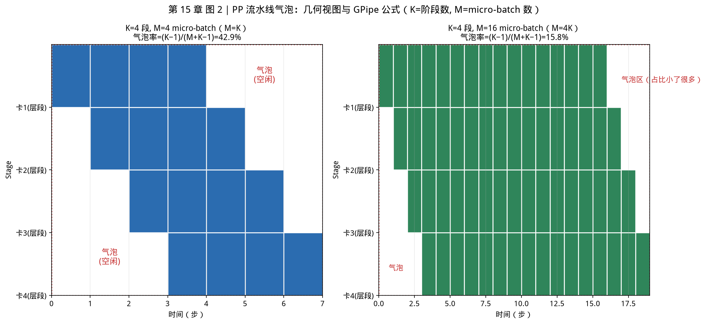
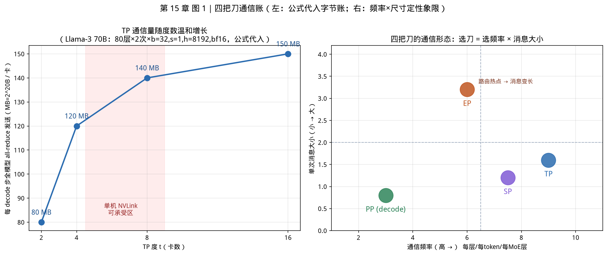

# 第 15 章｜并行策略：TP/PP/SP/EP 与通信量（Day 39–40）

> **这章讲什么**：一个模型大到单卡装不下、或单卡跑不动时，业界把"切模型"这件事拆成了四把刀——TP 切权重、PP 切层、SP 切序列、EP 切专家。这四把刀各切什么、每切一刀要付多少通信、什么时候该用哪把刀，本章用"通信量账"把四个问题一次算清，再打开 vLLM 源码看这四把刀今天长什么样。
>
> **为什么重要**：第 8 章算过"PCIe vs NVLink vs IB 的带宽账"，第 12 章讲了 llama.cpp 的 split-mode 四挡——但那两章都停在"能跑"层面。本章回答的是 Infra 面试的必考题："**为什么 TP 不能开到 8 以上？PP 和 TP 为什么常组合用？**"答案全部落在通信量上：TP 每层两次 all-reduce 是高频小消息（怕延迟、走 NVLink），PP 每 token 一次点对点是低频大消息（走网络也行）。**四把刀的本质区别 = 通信的频率 × 大小 × 走哪条路。**
>
> **学完能干什么**：① 拿到一个模型 + 一堆卡，能在 10 分钟内给出 TP/PP/EP 的初版组合并说出理由；② 手算 TP 每层的 all-reduce 通信字节数；③ 说清 TP 加速比为什么不线性、GPipe 气泡率公式怎么用；④ 在 vLLM 源码里定位四把刀各自的入口（`linear.py` 两类并行线性层、`core.py` 的 batch queue、`fused_moe/config.py` 的 EP 配置）。
>
> **本章数字纪律**：按第 9 章起的写作风格，**零性能跑测**。外部数字全部标注来源与检索日期（2026-10-16）：TP 通信公式来自 Megatron-LM SC '21 论文原文；气泡率公式来自 GPipe arXiv:1811.06965 原文；SP 数字来自 arXiv:2205.05198 摘要原文；TP 非线性与 PP 通信模型来自各论文原文口径；源码行号来自 vLLM 仓库 commit `642c18d`（2026-10-15 clone），逐一 grep 核验。本章的字节算账全部是**公式代入**（零成本结构性计算），登记于 [code/ch15/RESULTS.md](../code/ch15/RESULTS.md)。

---

## 0. 大白话开场：四把刀，切的不是同一个东西

假设你面前有一整条生产线（一个 Transformer 模型），要塞进几间小车间（几张 GPU）。你会怎么做？业界真的有四种做法，而且**切的东西完全不同**：

1. **TP（张量并行）**：每间车间都留**同一道工序的一半设备**——注意力的 32 个头，1 号卡算 1–16 号头，2 号卡算 17–32 号头。**权重被劈成两半**，每步算完必须把两半的结果**加起来**（all-reduce）才能进下一层。
2. **PP（流水线并行）**：1 号卡管第 1–20 层，2 号卡管第 21–40 层。**层被劈成几段**，数据像流水线上的零件一样从 1 号卡**传**给 2 号卡（send/recv）。谁都不用等谁"加结果"，但流水线启动和收尾有空转（**气泡**）。
3. **SP（序列并行）**：谁也不切权重——**把一条长序列（4096 个 token）切成 4 段**，每张卡只攥着自己那一段的激活值。省的是**激活显存**，不是权重显存。
4. **EP（专家并行）**：只在 MoE 模型上用——8 个专家每卡放 1 个，token 被路由到"专家住在哪张卡"就**搬到哪张卡**算（all-to-all）。

【类比】TP 像**合唱分声部**（唱完必须合一遍）；PP 像**接力赛**（交棒有交接时间）；SP 像**长卷分段装裱**（每人裱一段，拼起来是一整幅）；EP 像**寄快递**（每个包裹按地址送到对应网点）。

**本章验收题**（学完应能张口回答）：

> 四把刀各切什么？TP 每层要付几次什么通信？PP 的气泡率公式是什么、什么时候可忽略？为什么 TP 开到 8 就基本到头了？

答案在第 2–6 节：TP 切权重、**每层两次 all-reduce**（Megatron SC '21 口径）；气泡率 **O((K−1)/(M+K−1))**，**M ≥ 4K 时可忽略**（GPipe 原文）；TP 到头是因为**每层 all-reduce 的通信时间占比随度数上升，且 decode 是小消息延迟 bound**（第 3 节）。

---

## 1. 为什么单卡到头了：先看三个上限，再挑刀

回扣第 12 章的并发天花板 `B_max = min(B_KV, B_SLO, B_引擎)`——单卡时代你只有三道墙可拆；**多卡并行本质上是给这三道墙换更大的地基**，但每换一次都要交"通信税"：

| 单卡上限 | 谁先撞上 | 对应的刀 |
|---|---|---|
| **权重装不下**（70B bf16 = 140 GB > 单卡 80 GB） | 大模型部署第一分钟 | TP（切权重，卡内摊）、PP（切层，跨机摊） |
| **KV 装不下**（第 4 章账：并发一涨 KV 先爆） | 高并发服务 | TP（多卡 KV 合起来算）、加大 `max_num_seqs` |
| **带宽不够快**（decode 每 token 要把全部权重读一遍，第 3/7 章 roofline） | 单流长输出 | TP 把"每卡要读的权重"除以 N，**读得快了**——这是 TP 在 decode 场景的真正卖点 |
| **激活装不下**（长序列 32k 的激活比权重还大） | 长上下文训练 | SP |
| **MoE 专家总量爆炸**（DeepSeek 级 MoE 激活参数大但总参数更大） | MoE 推理 | EP |

注意第三行：**TP 在 decode 里的第一收益不是"算力翻倍"，而是"每张卡要读的权重减半"**——decode 是带宽 bound（第 3 章），4 张卡各读 1/4 权重，等效带宽 ×4。这也预示了它的代价（第 2.3 节）：每层还要把结果**合回去**。

【坑：并行不解决单请求慢，只解决"装得下"和"吞吐"】TP=2 后单请求不会快 2 倍——通信吃掉一部分，batch 小时甚至可能变慢（vLLM AMD 博客原话：gains aren't always linear，communication overhead increases as more devices are involved，2026-10-16 检索）。**面试被问"加卡变快吗"，先问清楚是装不下还是跑不动，再谈收益。**

---

## 2. TP 张量并行：切权重，每层两次 all-reduce

### 2.1 机制：列并行 + 行并行，中间那次通信被"藏"掉一半

TP 的教科书出处是 **Megatron-LM**（Shoeybi et al., arXiv:1909.08053，检索 2026-10-16）。它对 Transformer 的 MLP 做了一个漂亮的手术，把通信压到最少：

```
标准 MLP：  Y = GeLU(X·A)·B
Megatron：  X ──列并行(GPU1: A₁ / GPU2: A₂)──> GeLU（本地！）──行并行(B 按行切)──> 各得半成品
                                                            └──> all-reduce 相加 = Y
```

关键洞察有两条（论文 §2.2/§3）：

1. **GeLU 之类的激活函数是"逐元素"的**——每张卡拿自己那半列的结果直接激活，**不需要通信**；
2. **注意力按头切天然无依赖**——Q/K/V 的 GEMM 按 head 列并行，每个头本来就独立算（论文 Figure 3b）。

所以通信只剩两处：MLP 出口一次、attention 出口一次。**每个 Transformer block 在前向里恰好 2 次 all-reduce**（反向对应 2 次，训练时每层每 microbatch 共 4 次）。这就是"插入几个通信算子就能在原生 PyTorch 上实现"（论文摘要原话）的含义。

### 2.2 通信量账：每层每卡多少字节

Megatron-LM SC '21 版（Narayanan et al., arXiv:2104.04473，原文 §"communication analysis"，检索 2026-10-16）给出了训练口径的闭式账：

> 张量并行下，总大小为 **bsh** 的张量在 t 个副本间每层前向 all-reduce 2 次、反向 2 次，每卡每层每 microbatch 通信量合计 **8bsh·(t−1)/t**。

其中 b = batch，s = 序列长，h = hidden size。**推理时只看前向，系数从 8 降到 4**（前向 2 次 all-reduce，每次 ring 算法每卡发送 2(t−1)/t·bsh 字节；带宽项 2(N−1)/N 为 ring all-reduce 的教科书口径，检索 2026-10-16）。

代个账（公式代入，零成本算账，详见 RESULTS.md）：Llama-3 70B，h=8192，bf16=2 字节，decode 单步 s=1、b=32（32 个并发请求每步各 1 token）：

| 度数 t | 每层每次 all-reduce 每卡发送 | 每层 2 次 | 80 层合计（每 decode 步） |
|---|---|---|---|
| t=2 | 2×(1/2)×32×1×8192×2 B = **512 KB** | 1 MB | **80 MB/步** |
| t=4 | 2×(3/4)×32×1×8192×2 B = **768 KB** | 1.5 MB | **120 MB/步** |
| t=8 | 2×(7/8)×32×1×8192×2 B = **896 KB** | 1.8 MB | **140 MB/步** |

对回第 8 章的带宽表：**NVLink4 单向 450 GB/s**，80 MB（2^20 口径）走 NVLink 理论 0.19 ms——而 decode 一步（第 3 章口径，70B 一步权重读取本身就要几十 ms 量级）里这 80 MB 不是大头。**换成 PCIe 4.0 实测 18.6 GB/s：80 MB 要 4.5 ms——一步 decode 的时延里通信开始喧宾夺主。** 这就是"TP 必须 NVLink"的定量版（回扣第 8 章 §3，本章把账算到了层上）。

> 表中 MB 按 2^20 字节计（与 6.1 图 1 同口径）：代入 4·b·s·h·(t−1)/t × 2 次 × 80 层，b=32、s=1、h=8192、bf16=2B。
>
> **看图要点（6.1 图 1 左半）**：t 从 2→8，发送字节只涨了 1.75 倍（(t−1)/t 项趋近 1），但**卡间可用带宽被 t−1 路分摊**，且每卡算的活少了、通信占比相对上升——通信字节数温和增长 ≠ 代价温和增长，见 2.3。

### 2.3 为什么 TP 加速比不线性：三个原因

1. **通信从"捎带"变"主角"**：bsh 变小（decode 的 s=1），all-reduce 是**小消息**，latency bound 而非 bandwidth bound。*Accelerating Large Language Model Decoding with Speculative Sampling*（arXiv:2302.01318，检索 2026-10-16）原话说得很直接：Megatron 式每层 all-reduce "since only the activations for a small number of tokens are transmitted, this operation is typically **latency bound** instead of throughput bound"。小消息的延迟由硬件定（NVLink 约 8–10 µs，第 8 章口径），**卡翻倍延迟不减半**。
2. **Amdahl 定律**：每步里 attention/softmax/采样/调度这些**没被切的部分**（第 14 章的 scheduler 也在 CPU 上串行跑）不随 t 缩小。
3. **KV head 数卡死切分上限**：TP 度不能超过 KV 头数（Llama-3 70B 只有 8 个 KV head，TP=16 时每头还要再切，vLLM 会直接校验报错——`parallel.py:594` 起的整除检查一族）。

业界实测口径的佐证（非本书跑测）：vLLM AMD MI300X 博客（2024-10-23，2026-10-16 检索）明言 TP4→TP8 "gains aren't always linear"，原因是通信开销随设备数上升、单卡工作量下降；DeepSpeed Inference 论文（arXiv:2207.00032，检索 2026-10-16）也写明 "tensor parallelism can only scale efficiently to **a few GPUs** due to communication overhead"。**经验法则：单机内 TP ≤ 卡数且优先 2/4/8（2 的幂，ring 分块均匀），跨机绝不开宽 TP。**

### 2.4 vLLM 源码：四把刀的刀口在哪

以下行号全部来自 vLLM commit `642c18d`（2026-10-15 clone），grep 逐一核验（检索 2026-10-16）。

**刀口一：两类并行线性层**（`vllm/model_executor/layers/linear.py`）

| 结构 | 行号 | 干什么 |
|---|---|---|
| `class ColumnParallelLinear` | `:436` | 权重按**输出维**切；`forward` 在 `:616` |
| （列并行出口） | `:627` | `output = tensor_model_parallel_all_gather(output_parallel)` ——**需要完整激活时做 all-gather** |
| `class RowParallelLinear` | `:1639` | 权重按**输入维**切，各卡算半成品 |
| （行并行出口） | `:1785` `forward` → `:1804` | `if self.reduce_results and self.tp_size > 1: output = tensor_model_parallel_all_reduce(...)` ——**TP 的第二次通信在这里，一个 `if` 守门** |
| `divide(input_size, self.tp_size)` | `:1694` | **整除校验：切不匀就地炸**——这就是"TP 度必须整除头数/词表"的代码出处 |

通信原语本身极薄（`vllm/distributed/communication_op.py:12`）：`tensor_model_parallel_all_reduce` 就一行 `get_tp_group().all_reduce(input_)`——**"TP 的全部通信"在源码里收敛成两个函数调用 + 一串 if**（`communication_op.py:12/17/24` 分别是 all-reduce / all-gather / reduce-scatter）。

**刀口二：通信后端怎么选**（`vllm/distributed/device_communicators/cuda_communicator.py:57`）

```python
if unique_name.split(":")[0] != "tp":
    # custom allreduce or torch symm mem can be used only by tp
    use_custom_allreduce = False
```

一行揭示 vLLM 的私心：**手写 custom all-reduce、对称内存等低延迟优化只给 TP 组用**（PP 组走不走 NVLink 不影响正确性，不值得配）；`parallel_state.py:1713` `_ENABLE_CUSTOM_ALL_REDUCE = True` 是总闸。也就是说 TP 的每一次 all-reduce，vLLM 会在这条链上挑最快的一档：**custom IPC all-reduce（最小消息）→ NCCL（`pynccl.py:91` `PyNcclCommunicator`，`:268` `all_reduce`）→ 更大的走 ring**。第 8 章"NCCL 自动选路 NVLink→IB→TCP"的机制就落在这几个文件里。

---

## 3. PP 流水线并行：切层，气泡是它的原罪

### 3.1 机制与那条著名的公式

PP 把 L 层切成 K 段（stage），每段住一张卡。数据在卡间**点对点传送**：prefill 时每段收发 2Sp·h 字节、decode 时每生成一个 token 收发 2hb 字节（Ohio State MVAPICH MUG '25 分布式推理通信分析，检索 2026-10-16）——注意这个量级：**decode 每 token 只有 KB 级（h×2 字节的量级），比 TP 每层的 all-reduce 还小，且只在 stage 边界发生**（K−1 条链路）。这就是第 8 章"PP 能走网络"的根源：**低频、小消息、天然点对点**，网络的高延迟被低频率掩盖。

代价是**气泡（bubble）**：流水线填满（fill）与排空（drain）期间，前面的 stage 算完没活干、后面的 stage 还没等到输入。**GPipe**（Huang et al., arXiv:1811.06965，§2.3，检索 2026-10-16）给出原文公式：

> 气泡时间开销为 **O((K−1)/(M+K−1))**，摊在 M 个 micro-batch 上；实验中发现 **M ≥ 4K 时气泡开销可忽略**（negligible）。



**从这张图你能看到什么（盯着看一分钟）**：

1. **左格（M=K=4）**：蓝色方块是"第 m 个 micro-batch 在第 k 段卡上的执行"，起始时刻 = m+k——**左下角和右上角的对角空白就是气泡**：流水线刚启动时后面段没活、结束时前面段没活。红色虚线框内共 4×7=28 格，只填 16 格、空白 12 格——气泡率 = 12/28 = (4−1)/(4+4−1) = 42.9%。
2. **右格（M=16=4K）**：同样的对角空白，但被 64 个蓝格稀释——(4−1)/(16+4−1) = 15.8%。**空白的绝对量没变（三角形一样大），变的是分母**——这就是"多切 micro-batch"消气泡的几何本质。
3. **两条红色对角线永远填不满**：任何 M 下首尾两个角都是空的，所以公式里永远有 K−1 这一项——**卡越多，启动/收尾的固定代价越大**，这就是跨机 PP 要靠 M 稀释的根源。

K = stage 数、M = micro-batch 数。代入算账（公式代入，登记 RESULTS.md）：

| K（卡/段数） | M=K | M=4K | 要把开销压到 <10% 需要 |
|---|---|---|---|
| 4 | 3/7 = **42.9%** | 3/19 = **15.8%** | M ≥ 28 |
| 8 | 7/15 = **46.7%** | 7/39 = **17.9%** | M ≥ 64 |

（口径说明：M=4K 时按公式严格算是 15.8%–17.9%，**GPipe 论文却判断此时气泡"可忽略"**——O() 是渐近上界、常数因子未定，且论文的判断是叠加重计算等其他开销后的端到端体感。**引用时两者分开说：公式口径约 16%–18%，论文判断"可忽略"——不要把"可忽略"当成"气泡归零"。**）

【坑：把 GPipe 的 M≥4K 背成"气泡 4 倍小"】公式的分母是 M+K−1，不是 M——**增加 micro-batch 收益递减**，而且 M 太大会拖长单步调度（回扣第 14 章 chunked prefill 对 PP 的意义：等大 chunk 让 M 个 micro-batch 长度均匀，Sarathi 论文的 5.6× 正是 PP2×TP4 下测的）。

### 3.2 推理场景的 PP：比训练友好，但仍非免费

推理（尤其 decode）对 PP 比训练友好得多，三个原因：

1. **没有反向传播**，气泡只有"填"没有"排空梯度"的对称负担；
2. **decode 的消息极小**（每 token 每边界 2hb 字节，见 3.1），网络可承受；
3. **连续批处理能填泡**：第 14 章的调度器每步重排，不同请求在不同 stage 上各跑各的——vLLM 源码里为此专门留了口子（`vllm/v1/engine/core.py:216-219`，原话）：

```python
# Setup batch queue for pipeline parallelism.
# Batch queue for scheduled batches. This enables us to asynchronously
# schedule and execute batches, and is required by pipeline parallelism
# to eliminate pipeline bubbles.
self.batch_queue_size = vllm_config.max_concurrent_batches
```

即 **v1 引擎用"多批次异步排队"消 PP 气泡**——调度器可以先排好下一批（第 14 章 §4.3 的三拍子循环不受 stage 停顿阻塞）。相关开关还有 `scheduler.py:362` `self.use_pp = ...pipeline_parallel_size > 1`、`multiproc_executor.py:289-290` 读 `pp_size` 组执行器。**面试若问"vLLM 怎么消 PP 气泡"，答 batch_queue + chunked prefill 均匀 micro-batch，两条都有行号。**

### 3.3 什么时候上 PP

| 场景 | 选择 | 依据 |
|---|---|---|
| 单机 2–8 卡，模型单机装得下 | **TP only**（2/4/8） | 机内 NVLink，TP 通信免费；PP 气泡在单请求低并发下最疼 |
| 跨机（模型单机装不下） | **TP=每机卡数 × PP=机器数** | vLLM 官方文档原话："common practice is to set the tensor parallel size to the number of GPUs in each node, and the pipeline parallel size to the number of nodes"（docs.vllm.ai Parallelism and Scaling，2026-10-16 检索） |
| 超大 batch 离线批处理 | PP 更划算 | 气泡被大 M 稀释，网络通信可容忍 |
| 单流低延迟 | TP，别上 PP | PP 每 token 要串行过 K 段，单步延迟 ≈ 各段之和（不省时间，只省显存） |

【坑：PP 不省单请求时间】PP 是"显存的刀"不是"延迟的刀"——K 段串行，单请求每步仍要走完全程。**给单流延迟场景上 PP 是负优化**，除非配合多请求填泡。

---

## 4. SP 序列并行：切激活，不切权重

### 4.1 它补的是 TP 的哪块短板

TP 把权重切了，但 **LayerNorm / Dropout / 激活函数的输入（激活值）在每张卡上是完整复制的**——序列越长这份复制越肥（32k 上下文时激活能到 GB 级）。SP（Megatron 系，Korthikanti et al., arXiv:2205.05198，检索 2026-10-16）的做法：**在 TP 不管的区域（非张量并行区域）把激活按序列维切开**，进 attention 前 all-gather 拼回来，出来再 reduce-scatter 切回去。

论文摘要原文数字（2026-10-16 检索）：

> 与选择性重计算结合，方法把**激活显存降低 5×**，把重计算的执行时间开销降到 **4.4%（GPT-3 规模）/ 1.5%（1T 参数）**。

**通信形态变了但总量没变**：TP 的 all-reduce = reduce-scatter + all-gather，SP 把这两个操作**移到了原本无通信的区域**——所以 SP 的通信量不比 TP 多，省的是每卡激活显存（序列维 ÷ N）。这就是它被称为 "TP 的免费午餐"的原因：**显存白省，通信不加**。

【类比】TP 是"合唱团分声部"，SP 是"分声部之余，每人只拿自己那页谱——唱到合声那句再把谱拼齐"。拼谱的次数和以前一样，但平时每人的书包轻了。

### 4.2 什么时候用 SP

- **训练长序列**：激活显存主导（第 4 章账：激活 ∝ 序列长）→ SP 是标配；
- **推理**：短 decode 阶段激活本来就小，SP 收益小；**长 prefill（128k 上下文）时**才有感；
- vLLM 侧的入口在 MoE：`parallel.py:768` `use_sequence_parallel_moe`（原话注释："If using expert-parallelism, replicated tokens results in useless duplicate computation and communication... ensure the input to the experts is sequence parallel to avoid the excess work"，`:760-767`）——**推理框架里 SP 的现实角色是给 EP 当配套**，避免每个 EP rank 都收到全量复制的 token。开关条件在 `:780-791`：`enable_expert_parallel and tensor_parallel_size > 1 and data_parallel_size > 1` 且 all2all 后端匹配。

---

## 5. EP 专家并行：MoE 专属，all-to-all 是它的税

### 5.1 机制：token 找专家，不是专家找 token

MoE 层有 E 个专家，每卡放 E/P 个（P = EP 度）。每个 token 过 router 选 top-k 专家后，**被打包送到专家所在的卡**（dispatch），算完再**送回原卡**（combine）——一来一回是两次 **all-to-all**。

出处与口径（检索 2026-10-16）：

- **Switch Transformer**（Fedus et al., arXiv:2101.03961，§2）：论文明确描述 all-to-all 形态——"Because each core has its own expert, we do an **all-to-all communication** of size [E, C, d_model] to now shard the E dimension instead of the n-dimension"（C=每卡 token 数）。**top-1 路由**把每 token 的通信压到最小，同时论文用辅助损失压负载不均。
- **DeepSpeed Inference**（arXiv:2207.00032，附录 A，检索 2026-10-16）：明确区分 tensor-slicing（非专家参数）与 expert-slicing（专家参数），并警告 TP "can only scale efficiently to a few GPUs"——**MoE 的答案是 EP 而非宽 TP**。
- 后续量化批评：*Speculative MoE*（arXiv:2503.04398，检索 2026-10-16）指出 DeepSpeed-MoE 的效率瓶颈恰恰是 EP——"largely bottlenecked by EP, which is implemented with **costly all-to-all collectives**"。**EP 的税是结构性的：all-to-all 的字节数随 EP 度线性涨，且负载不均时最慢的 rank 拖死全局。**

通信量账（公式代入，登记 RESULTS.md）：all-to-all 每卡发送 = 总量 × (P−1)/P——每卡把要发往其他 P−1 卡的 token 都推出去。**与 TP 的区别在消息粒度**：TP 是"每层 2 次、消息 = 激活张量"，EP 是"每 MoE 层 2 次（dispatch+combine）、消息 = 该发的 token 批"，且**消息大小随路由结果波动**（热点专家卡突然变大），这就是 EPLB（专家负载均衡，`parallel.py:65` `EPLBConfig`、`:569` 强制 `enable_expert_parallel`）存在的原因。

### 5.2 vLLM 源码：EP 的配置面比 TP 大一个数量级

| 结构 | 行号 | 说明 |
|---|---|---|
| `enable_expert_parallel: bool = False` | `parallel.py:190` | **默认关**——MoE 模型单机多卡也建议显式开 |
| `all2all_backend` 默认 `"allgather_reducescatter"` | `parallel.py:220` | 后端可选 14 种（`:45-59` 的 `All2AllBackend` Literal：deepep_high_throughput/deepep_low_latency/pplx/mori/moonep/nixl_ep/flashinfer_nvlink_* 等） |
| `class FusedMoEParallelConfig` | `fused_moe/config.py:1015` | EP/DP/SP/TP 尺寸的汇合点（`:1016-1029` 字段，tp/pcp/dp/ep/sp 五组） |
| `use_ep` / `ep_size` | `fused_moe/config.py:1467` / `:1439` | EP 开关与度数 |
| `use_all2all_kernels` | `fused_moe/config.py:1035` | `use_ep and (dp>1 or pcp>1 or sp>1)`——**EP 一开，通信内核就换了** |
| all2all 管理器 | `fused_moe/all2all_utils.py:128` `get_ep_all2all_manager` | 从 `ep_group.device_communicator.all2all_manager` 拿句柄（`:133-136`），`parallel_state.py:1659` `get_ep_group()` 是组入口 |
| MoE 出口的 all-reduce 门控 | `fused_moe/layer.py:246-251` | `skip_final_all_reduce = (not reduce_results and not use_all2all_kernels and not is_sequence_parallel ...)` ——**all2all 路径下最后那次 all-reduce 被跳过**（通信形态整体切换，不是叠加） |

【看图要点（6.1 图 1 右半）】四把刀的通信**频率**和**消息尺寸**是两个独立轴：TP 高频中消息、PP 低频小消息（decode）、SP 把 TP 的通信搬了家、EP 中频变长消息。**选刀 = 选通信形态**，而通信形态能不能跑得动，由第 8 章的带宽表决定。

---

## 6. 通信量总账：四把刀一张表 + 组合公式

### 6.1 一张表对比（本章核心交付）



**从这张图你能看到什么（盯着看一分钟）**：

1. **左半（字节账）**：TP 通信量随度数只温和上扬——t=2 时 80 MB/步、t=4 时 120 MB、t=8 时 140 MB（Megatron SC'21 公式代入，`(t−1)/t` 项趋近 1 的数学后果）。**字节涨得慢不等于代价涨得慢**：粉红区标出"单机 NVLink 可承受"，换 PCIe（第 8 章实测 18.6 GB/s）时同样 120 MB 要 6.8 ms——**同一笔账，走对路是零头，走错路是主菜**。
2. **右半（频率×尺寸象限）**：TP 在"高频+中消息"角（每层 2 次），PP decode 在"低频+小消息"角（每 token 每边界），EP 独自占据"消息可变长"的上方（路由热点让它上下浮动），SP 与 TP 几乎重合（它就是把 TP 的通信搬了家，量不变）。
3. **选刀的读法**：横轴决定"打扰硬件的次数"（延迟 bound 程度），纵轴决定"每次搬多少"（带宽 bound 程度）。**左下角是理想的通信形态，右上角是最贵的**——这就是为什么 TP 必须 NVLink（高频）、EP 必须配负载均衡（变长）。


| 维度 | **TP** | **PP** | **SP** | **EP** |
|---|---|---|---|---|
| 切什么 | 层内权重（GEMM 的一维） | 层（stage） | 激活的序列维 | MoE 专家 |
| 通信原语 | all-reduce（每层 2 次）/ all-gather | P2P send/recv（每边界） | all-gather + reduce-scatter | all-to-all（dispatch+combine） |
| 通信频率 | **每层 2 次**（高频） | prefill 每 microbatch 每边界 1 次；decode 每 token 每边界 1 次 | 与 TP 同量级（搬家不加量） | 每 MoE 层 2 次 |
| 消息尺寸 | 激活 bsh（decode 时 s=1，小） | prefill 2Sp·h / decode 2hb | 同 TP | 变长（随路由波动） |
| 走哪条路 | **必须 NVLink**（第 8 章） | 机内 NVLink，机间网络可忍 | 同 TP | 机内 NVLink（deepep/flashinfer 名字里都带 nvlink） |
| 主要收益 | 权重/KV 摊薄 + decode 带宽 ×N | 显存按层摊薄 | 激活显存 ÷N | 装下大 MoE |
| 原罪 | 加速比不线性；小消息延迟 bound | 气泡 O((K−1)/(M+K−1)) | 收益只在长序列 | all-to-all 税 + 负载不均 |
| 单机默认 | **2/4/8** | 少用 | 长序列才开 | MoE 显式开 |

**通信量公式汇总**（全部有出处，见 RESULTS.md）：

```
TP：每卡每层每 microbatch = 4·b·s·h·(t−1)/t   （前向口径；训练含反向为 8·bsh·(t−1)/t，Megatron SC'21）
PP：气泡率 = O((K−1)/(M+K−1))，M ≥ 4K 可忽略（GPipe）
PP：每边界每 token 通信 ≈ 2·h·b 字节（decode，MVAPICH MUG'25）
SP：激活显存 ÷N，通信量与 TP 同（all-gather/reduce-scatter 搬家）
EP：all-to-all 每卡发送 = 总量×(P−1)/P + 负载不均惩罚（Switch/DeepSpeed-MoE 口径）
```

### 6.2 组合的乘法：vLLM 的官方配方

vLLM 官方文档（Parallelism and Scaling，2026-10-16 检索）的配方一句话：**TP=单机卡数，PP=机器数**，例子是"16 卡 2 机 → TP=8, PP=2"。背后的账本逻辑：

- **TP 用掉机内带宽**（NVLink 免费，超了就浪费）；
- **PP 用掉机间带宽**（每 token 每边界 2hb 字节，10 GbE 都扛得住）；
- 两者**乘起来** = 总卡数：TP×PP×（DP 副本数）= world_size。vLLM 在 `parallel.py:295` 校验 "the product of pipeline_parallel_size and tensor_parallel_size"（整除检查在 `:574-594` 一族，含 `tp % dcp != 0` 的报错例）。

再乘上 DP（数据并行：多副本各接流量，KV 各自独立——这是**吞吐型扩容**的主力，与第 12 章并发账直接相乘）和 EP（只切专家），就是大厂部署的 "TP8×PP4×DP2×EP8" 这类黑话的全貌。**面试黑话题：见到 3D-parallel 就先问"哪个维度走机内、哪个走机间"——答不上来说明没算过通信账。**

【坑：EP 与 TP 抢同一份卡】MoE 推理里 EP 和 TP 都想切专家外的公共部分（router、shared expert、attention），**两者叠加时有效切分变小**。vLLM 用一个配置面统一裁决（`FusedMoEParallelConfig`，`fused_moe/config.py:1015`），就是因为这个交叠——**不要手工两套都开满，交给引擎按 `enable_expert_parallel` 推导**。

---

## 7. 落地视角：给模型挑刀的决策流程

### 7.1 十分钟决策树

```
模型单卡装得下吗？
├─ 装得下 → 还卡吗（第 12 章 B_max 三道墙）？
│   ├─ 不卡 → 不并行，先优化 batch/量化（第 10、14 章）
│   └─ KV 不够 → 加卡开 TP=2/4（KV 摊薄，收益直接）
└─ 装不下 →
    ├─ 单机装得下 → TP = 卡数（2/4/8，2 的幂；≤KV头数）
    ├─ 单机装不下 → TP = 每机卡数，PP = 机器数（官方配方）
    ├─ MoE 模型 → 上两项 + enable_expert_parallel（EP），盯负载均衡
    └─ 长序列训练/128k prefill → 再加 SP（激活摊薄）
```

**每步的验证**（不是"开完就完"）：① `nvidia-smi topo -m` 确认 TP 组内是 NV#（第 8 章）；② 看 per-step 通信占比（nccl profile 或 `vllm:num_preemptions` 之类既有指标之外，重点看单步墙钟是否随度数劣化）；③ 回扣第 5 章口径：**加卡后看 TTFT/TPOT/吞吐三个一起看**——TP=2 若吞吐 ×1.7 而 TP=4 只再 ×1.2，第 4 张卡该不该用，账在 SLO 上算，不在 FLOPS 上算。

### 7.2 【落地视角】生产环境的三条经验

1. **TP 度宁小勿大**：TP=2→4 的吞吐收益通常还在，4→8 经常只买到显存不买到速度（vLLM AMD 博客口径）；**8→16 基本是负收益**，且撞 KV head 上限。
2. **跨机先 PP 后 DP**：单副本模型跨机时 PP 是唯一能压机间通信的刀；**能多副本（DP）就多副本**——DP 的通信只有梯度/权重同步（推理时为零）或调度心跳，几乎免费。
3. **EP 是 MoE 的默认刀，但要配均衡**：开 EP 就准备应对热点专家（EPLB、冗余专家），否则 all-to-all 的尾延迟由最慢 rank 决定（第 5 章分位数的老话：**平均值骗人，尾部要命**）。

【应急方案】**加卡反而变慢**：① 先 `nvidia-smi topo -m` 查拓扑——TP 组走 PIX/SYS（PCIe 路径）是头号嫌疑（第 8 章：PCIe 4.0 实测 18.6 GB/s vs NVLink 450 GB/s，差 24 倍）；② 查 TP 度是否为 2 的幂、是否整除 KV 头数（`linear.py:1694` 的 `divide` 会报错）；③ 降一档 TP 换 DP 副本，看吞吐是否回来；④ 若是 decode 单流场景，确认是不是误开了 PP（3.3 的坑）。

【坑】**把"模型并行"当成银弹**：并行只解决装得下与聚合带宽，**不解决单请求算法层的慢**（采样、调度、长 prefill——第 13/14 章的地盘）。面试被问"模型太大怎么办"，完整答案永远是三件套：**量化（第 10 章）→ 并行（本章）→ 调度（第 13/14 章）**，顺序还是这个顺序——量化最便宜。

---

## 8. 【坑】清单 + 动手任务 + 自检 + 面试话术

### 8.1 七条坑（含本章新增）

1. **信双向峰值**（第 8 章老坑，本章重罚）：NVLink 900 GB/s 是双向，单向 450；PCIe 32 GB/s 双向、实测 18.6。**算 TP 通信账用单向值**，否则账面乐观 2 倍。
2. **TP 度 ≠ 加速比**：三个原因（2.3）——小消息 latency bound、Amdahl、KV 头上限。**报告 TP 收益必须带 batch 与 SLO 口径**（第 5 章纪律）。
3. **PP 不省单请求时间**（3.3）：它是显存的刀。低延迟单流场景上 PP = 负优化。
4. **GPipe "M≥4K 可忽略" ≠ 气泡率 0**（3.1）：公式口径下 M=4K 仍有 16%–18% 的空转开销，论文的"可忽略"是叠加其他开销后的体感判断。**引用时分开说。**
5. **SP 通信量并不比 TP 少**（4.1）：它是搬家不是减量，省的是激活显存。宣称"SP 更快"是错的，正确说法是"SP 在同通信下省显存"。
6. **EP 开了就换内核**（5.2 `fused_moe/config.py:1035`）：`use_all2all_kernels` 一开，通信路径整体切换（连最后的 all-reduce 都被跳过，`layer.py:246-251`）——**切换前后 profile 不可直接对比**，口径变了。
7. **不查拓扑就开 TP**：TP 组内不是 NVLink 时（消费卡 4090 无 NVLink，第 8 章），TP 几乎必然劣于 DP。**`nvidia-smi topo -m` 是并行部署的第一个命令。**

### 8.2 动手任务

**任务 A：算一笔通信账（15 分钟，纸笔/计算器）**

Llama-3 70B（h=8192，80 层，8 个 KV 头），bf16，decode 每步 b=32 并发：① TP=4 时每步全模型 all-reduce 发送字节总量（用 2.2 公式）；② 换成 4090D 无 NVLink、PCIe 4.0 实测 18.6 GB/s，这 80/120 MB 要多少毫秒，占一步 decode（本章口径约几十 ms 量级，用 40 ms 保守估计）的百分比；③ KV 头只有 8 个，TP=16 会怎样（查 `linear.py:1694` 的 `divide`）？

*验收标准*：三个答案齐全——① 120 MB/步（公式代入）；② 约 6.8 ms、约 17%；③ 报错（16 > 8 头数，整除/超限校验触发）。能说出"通信占比超 15% 就该换拓扑"的判断逻辑。

**任务 B：grep 四把刀的刀口（20 分钟，需 vLLM 源码 `git clone --depth 1`）**

```bash
grep -n "class ColumnParallelLinear\|class RowParallelLinear" vllm/model_executor/layers/linear.py
grep -n "tensor_model_parallel_all_reduce(output_parallel)" vllm/model_executor/layers/linear.py
grep -n "Setup batch queue for pipeline parallelism" vllm/v1/engine/core.py
grep -n "enable_expert_parallel: bool" vllm/config/parallel.py
grep -n "use_sequence_parallel_moe" vllm/config/parallel.py
```

*验收标准*：五个命中抄进笔记各写一句人话（第 1 条 = TP 的两类刀口；第 2 条 = TP 第二次通信的守门 if；第 3 条 = v1 消 PP 气泡的批队列；第 4 条 = EP 默认关，MoE 要显式开）；行号与本章对上（commit 不同允许 ±，函数名与默认值必须一致）。

**任务 C：闭卷画决策树（10 分钟）**

不看书，画出 7.1 的决策树，并在每条分支标出"为什么"（拓扑？显存？SLO？）。

*验收标准*：四层判断齐全（装得下？卡在哪道墙？机内还是机间？MoE/长序列特判），能说出"量化→并行→调度"的优先级顺序。

**任务 D（有多卡机器才做，可选）：亲眼看一次拓扑对 TP 的判决**

单机两卡以上：`nvidia-smi topo -m` 记录 TP 组内互联类型；用 vLLM 起 `--tensor-parallel-size 2` 跑通同一模型，记录启动日志里的通信后端提示（custom all-reduce / NCCL 初始化行）；若机器是消费卡 PCIe 路径，把"没有 NVLink"这件事与 2.3 的 latency bound 论断对照写进笔记。

*验收标准*：拓扑截图或文字记录 + 后端选择记录；**只记录观察到什么，不做性能跑分**（本章零跑测纪律）。

### 8.3 自检三问（闭卷作答）

1. 四把刀各切什么、各付什么通信？为什么 TP 的通信"必须"NVLink 而 PP "可以"走网络？
2. GPipe 气泡公式里 K 和 M 分别是什么？M=4K 时按公式算开销多少？论文为什么仍说"可忽略"？
3. TP 加速比不线性的三个原因分别是什么？其中哪一个能靠"换更快的卡间互联"缓解，哪两个不能？

（答案线索：1 → 2.1/2.2 与 3.1 的频率×尺寸账；2 → 3.1 表格；3 → 2.3：只有 latency bound 那条能靠互联缓解，Amdahl 与 KV 头上限不能。）

### 8.4 面试话术（可直接背）

**话术 1：被问"TP 是怎么工作的？每层通信几次？"**

> "TP 把 Transformer 层内的 GEMM 沿一维切开，用列并行+行并行的组合让激活函数段无通信，出口处做一次 all-reduce——所以每个 block 前向两次 all-reduce（attention 出口和 MLP 出口），这是 Megatron-LM 的设计。通信量按 SC'21 论文口径是每卡每层 4·bsh·(t−1)/t（前向）。decode 时 s=1、消息小，是延迟 bound，所以 TP 卡间必须 NVLink——PCIe 上 80 MB 一步要几毫秒，一步 decode 直接被通信吃掉一截。vLLM 里就是 ColumnParallelLinear 和 RowParallelLinear 两个类，all-reduce 收敛在 communication_op.py 的一个函数里。"

**话术 2：被问"PP 和 TP 怎么选？为什么不一直加 TP？"**

> "看通信形态：TP 每层两次 all-reduce，高频、走 NVLink 免费、走网络要命；PP 每 token 每边界一次点对点，低频小消息，网络能扛。所以官方配方是 TP=单机卡数、PP=机器数。TP 不能一直加有三个原因：小消息延迟 bound、Amdahl 里没切的部分、KV 头数上限（Llama-3 70B 只有 8 个头，TP=16 直接除不开）。实测口径上 vLLM 官方博客也说过 TP4 到 TP8 收益不线性。PP 的代价是气泡，GPipe 公式 O((K−1)/(M+K−1))，micro-batch 够多才可忽略；vLLM v1 用 batch_queue 异步调度填泡。"

**话术 3：被问"MoE 模型为什么用 EP？有什么坑？"**

> "EP 把专家分到各卡，token 路由到哪张卡就 all-to-all 送到哪张卡，出处是 Switch Transformer：每个 core 拿自己的专家，做一次 [E,C,d_model] 的 all-to-all 把分片从 batch 维换成专家维。收益是装得下大 MoE 且专家间零依赖；坑有三个：all-to-all 税随 EP 度涨（DeepSpeed-MoE 的效率瓶颈就被专门论文批评过）、负载不均让慢 rank 拖尾（所以要 EPLB）、开了 EP 后通信内核整体切换（vLLM 的 use_all2all_kernels），profile 口径都变了。vLLM 默认 enable_expert_parallel=False，MoE 要显式开，后端有 deepep/flashinfer 等十几种。"

---

## 参考与版本说明

- **Megatron-LM（训练侧 TP 出处）**：Shoeybi et al., *Megatron-LM: Training Multi-Billion Parameter Language Models Using Model Parallelism*, arXiv:1909.08053（检索 2026-10-16）；列并行/行并行、按头切注意力、"few communication operations in native PyTorch"、8.3B 收敛均为原文。
- **Megatron-LM SC '21（通信量公式出处）**：Narayanan et al., *Efficient Large-Scale Language Model Training on GPU Clusters Using Megatron-LM*, arXiv:2104.04473，SC '21 Best Paper；"8bsh(t−1)/t per layer per device per microbatch" 为原文公式（检索 2026-10-16）；PTD-P 组合与 52% peak 亦为原文。
- **GPipe（PP 气泡公式出处）**：Huang et al., *GPipe: Easy Scaling Micro-Batch Pipeline Parallelism*, arXiv:1811.06965，§2.3；"O((K−1)/(M+K−1))"与"M ≥ 4K 时 negligible"为原文（检索 2026-10-16）。
- **Sequence Parallelism**：Korthikanti et al., *Reducing Activation Recomputation in Large Transformer Models*, arXiv:2205.05198；摘要原文 "reduces activation memory by 5×"、执行时间开销 4.4%（GPT-3）/1.5%（1T）（检索 2026-10-16）。
- **Switch Transformer（EP 出处）**：Fedus et al., *Switch Transformers*, arXiv:2101.03961，§2 all-to-all 形态与 top-1 路由（检索 2026-10-16）。
- **DeepSpeed Inference**：Aminabadi et al., arXiv:2207.00032，tensor-slicing/expert-slicing 区分与 "scale efficiently to a few GPUs" 警告（检索 2026-10-16）。
- **Speculative MoE（EP 批评口径）**：arXiv:2503.04398，"DeepSpeed-MoE efficiency largely bottlenecked by EP / costly all-to-all"（检索 2026-10-16）。
- **Pope et al., Efficiently Scaling Transformer Inference**：arXiv:2211.05102，TPU v4 上的多维切分解析模型与 prefill/decode 口径（检索 2026-10-16）。
- **Speculative Sampling 论文（all-reduce latency bound 论断）**：Leviathan et al., arXiv:2302.01318，"typically latency bound instead of throughput bound"（检索 2026-10-16）。
- **MVAPICH MUG '25**：*Characterizing Communication Patterns in Distributed LLM Inference*（arXiv:2507.14392 同源），PP 通信量 prefill 2Sp·h / decode 2hb 口径（检索 2026-10-16）。
- **vLLM 官方文档**：Parallelism and Scaling（TP=单机卡数、PP=机器数配方）、optimization 页（TP 适用场景），2026-10-16 检索；vLLM AMD MI300X 博客（2024-10-23）TP4→TP8 非线性论断，2026-10-16 检索。
- **vLLM 源码**：commit `642c18d`（2026-10-15 clone，Apache-2.0），全部行号 grep 核验：`linear.py:436/616/627/1639/1694/1785/1804`、`communication_op.py:12/17/24`、`cuda_communicator.py:57`、`pynccl.py:91/268`、`custom_all_reduce.py:120`、`parallel_state.py:1659/1713`、`v1/engine/core.py:216-219`、`v1/core/sched/scheduler.py:362`、`multiproc_executor.py:289-290`、`config/parallel.py:45-60/140/144/147/190/220/295/574-594/768/791`、`fused_moe/config.py:1015/1035/1439/1467`、`fused_moe/all2all_utils.py:128`、`fused_moe/layer.py:246-251`。
- **本书内引用**：带宽阶梯与 NVLink/PCIe 实测（第 8 章）；offload 与并发天花板（第 12 章）；split-mode 四挡（第 12 章）；roofline 与 decode 带宽 bound（第 3 章）；KV Cache 显存账与 GQA/MQA（第 4 章）；指标口径（第 5 章）；量化（第 10 章）；PagedAttention（第 13 章）；调度器与 chunked prefill 填泡（第 14 章）。
- **本章配图**：2 张程序生成（`code/ch15/make_figures.py`，零外部图片）；数据与算账登记见 [code/ch15/RESULTS.md](../code/ch15/RESULTS.md)。
- **下一章**：第 16 章《前缀缓存、结构化输出与压测实战》——并行把单步变快之后，回到服务层：相同前缀怎么复用（APC/RadixAttention）、agent 场景的 JSON 怎么保证合法（xgrammar）、以及怎么压出自家的并发-延迟曲线。
