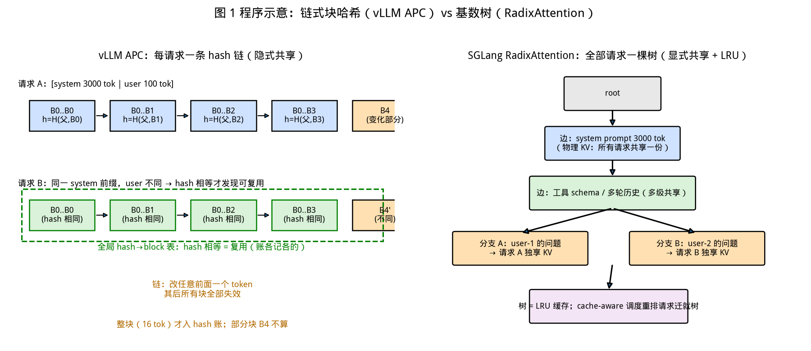
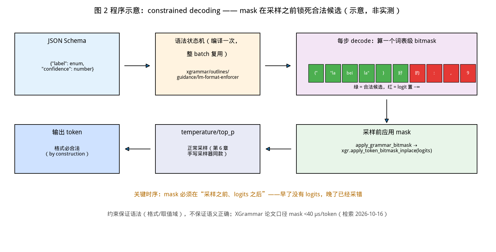
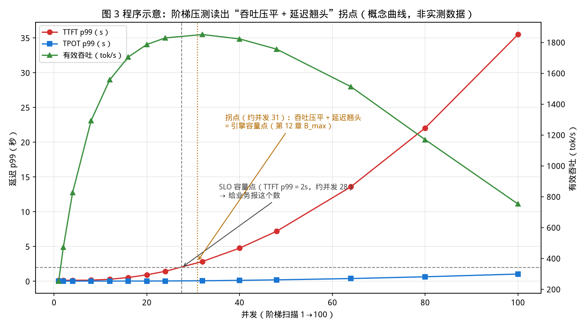

# 第 16 章｜前缀缓存、结构化输出与压测实战（Day 41–42）

> **这章讲什么**：进入 agent 时代后，推理服务撞上了三个新的现实问题——① agent 每一轮都把几千 token 的 system prompt、工具 schema、历史对话原样重发，引擎每次都从头 prefill，纯属烧钱；② 下游程序要的是合法 JSON，而模型"心情不好"时给一坨 markdown 包裹的半截 JSON，整条 pipeline 崩掉；③ 上线前没人说得清"我的服务到底能扛多少并发、从哪个点开始崩"。这三件事分别对应本章三块内容：**前缀缓存**（APC vs SGLang RadixAttention）、**结构化输出**（constrained decoding 与 xgrammar）、**压测方法论**（压出自家的并发-延迟曲线）。
>
> **为什么重要**：这三件事是第 5 章"并发崩塌曲线"和第 13/14 章"PagedAttention + 调度器"之后，**服务层最后三块拼图**——引擎内核再快，前缀重算、JSON 重试、容量拍脑袋三个漏洞任何一个都能把利润漏光。而且它们恰是面试里"你上一份工作做过什么"最容易出彩的地方：**前缀缓存命中率、结构化输出成功率、压测报告**，三个都是可量化、可展示的成果。
>
> **学完能干什么**：① 说清 vLLM APC 的 block hash 链与 SGLang RadixAttention 基数树的结构差异，知道什么时候谁更占优；② 手写一个带 `response_format` 的 OpenAI 兼容请求，并解释 token mask 在采样前如何"锁死"输出合法；③ 用 `vllm bench serve` 压出自家服务的并发-延迟曲线，定位拐点并写出三句话结论；④ 在 vLLM 源码里定位前缀缓存与结构化输出的关键入口。
>
> **本章数字纪律**：按第 9 章起的写作风格，**零性能跑测**。外部数字全部标注来源与检索日期（2026-10-16）：SGLang 论文（arXiv:2312.07104 v2）的 6.4×、命中率 50%–99%、生产命中 74.1% 等；XGrammar 论文（arXiv:2411.15100，MLSys '25）的 100×、80×、44.2→6.8 ms 等；源码行号来自 vLLM 仓库 commit `642c18d`（2026-10-15 clone），逐一 grep 核验。本章的省算账均为**公式代入**（零成本结构性计算），登记于 [code/ch16/RESULTS.md](../code/ch16/RESULTS.md)。

---

## 0. 大白话开场：agent 时代的三个漏钱窟窿

假设你部署了一个 8B 模型做客服 agent，日活一万。你很快会发现三件事：

1. **每个请求都在重复劳动**：用户每问一句，客户端就把 3000 token 的 system prompt + 10 个工具的 JSON schema + 前 20 轮对话历史**全部重发一遍**。第 5 轮对话时 prompt 已经 6000 token，其中 5900 和上一轮完全相同——但引擎（没开前缀缓存时）每次都老老实实重新 prefill 这 5900 个 token。**prefill 是算力活，钱就这么烧掉了。**
2. **JSON 输出靠运气**：你在 prompt 里写"请严格返回 JSON"，模型 95% 的时候听话，剩下 5% 返回 ```json 包裹、多一句解释、或者字段名拼错。下游 `json.loads()` 一炸，你的重试逻辑再把整个请求重新发一遍——**一次失败 = 双倍成本 + 用户等待翻倍**。
3. **上线前没有容量数字**：老板问"能扛多少人同时用"，你只能拿第 5 章那台 4090D 的通用曲线来猜。真实服务的 prompt 分布、输出长度、前缀复用率都不同——**别人的曲线救不了你的命**。

本章的三节正好各治一个窟窿。**本章验收题**（学完应能张口回答）：

> ① 前缀缓存为什么"整块才认账"？vLLM 和 SGLang 的数据结构差在哪？② constrained decoding 是怎么保证 JSON 一定合法的，mask 在哪个时刻被应用？③ 压测的五条控制变量是什么，拐点怎么从曲线上读？

答案分别在第 2–4、5、7 节。

---

## 1. 为什么 agent 时代前缀缓存是刚需

### 1.1 三种共享模式，共享的就是 prefill 的钱

回扣第 3 章：**prefill 是算力 bound，decode 是带宽 bound**；一个 6000 token 的 prompt，prefill 占了这个请求 90% 以上的计算量（decode 只有几十 token 的话）。所以"重复 prefill"浪费的不是边角料，是大头。

agent 负载的共享模式有三种，按共享量从大到小：

| 共享模式 | 典型场景 | 共享内容 |
|---|---|---|
| **全量前缀** | few-shot 分类、批量摘要 | 固定示例/固定文档 + 变化的用户输入 |
| **多轮累积** | 多轮对话、ReAct agent | system prompt + 工具 schema + 历史轮次——**每轮新发的只有最新一句** |
| **树状分叉** | Tree-of-Thought、并行投票 | 同一 prompt fork 出多条分支，**分支之间也共享**（第 13 章 beam search 的 fork/COW 是同一件事） |

关键账：多轮对话到第 10 轮时，若每轮用户输入 100 token、前缀已滚到 4000 token，**新信息只占 2.4%**——没有前缀缓存，97.6% 的 prefill 是纯重算。

### 1.2 这不是新发明，PagedAttention 论文里就写好了

第 13 章引用过的 vLLM 论文（arXiv:2309.06180，检索 2026-10-16）在讲共享内存时点过名：

> "For this type of application, many user prompts share a prefix, thus the LLM service provider can store the KV cache of the prefix in advance to reduce the redundant computation… **as how OS handles shared library across processes.**"

**OS 对照总表再加一行（第 13 章 19 行总表的续篇）**：共享前缀 KV ↔ 共享库的 .text 段——多进程（多请求）映射同一份物理页（物理 KV block），各自持有逻辑页表（block table），谁都不用自己再算一遍。

SGLang 论文（arXiv:2312.07104 v2，检索 2026-10-16）把这个痛点说得更直接：现有引擎 "the KV cache of a request is **discarded after processing is completed**"（请求一结束 KV 就被丢弃），导致跨调用的相同计算被反复重做。**这正是"缓存失效"的经典形态——KV Cache 的生命周期不该等于请求的生命周期。**

---

## 2. vLLM APC 原理：一条 hash 链锁死"从哪开始复用"

### 2.1 机制：块 hash = H(父块 hash, 本块 token, extra_keys)

vLLM 的方案叫 **Automatic Prefix Caching（APC）**，核心一句话：**给每个 KV block 算一个"内容指纹"，指纹相同 = 内容相同 = KV 可以直接拿来用。**

源码在 `vllm/v1/core/kv_cache_utils.py:707`（commit `642c18d`，grep 核验，2026-10-16）：

```python
def hash_block_tokens(
    hash_function, parent_block_hash, curr_block_token_ids, extra_keys=None,
) -> BlockHash:
    """...
    parent_block_hash: The hash of the parent block. None if this is the first block.
    curr_block_token_ids: A list of token ids in the current block.
        The current block is assumed to be full.
    ..."""
    if not parent_block_hash:
        parent_block_hash = NONE_HASH
    curr_block_token_ids_tuple = tuple(curr_block_token_ids)
    return BlockHash(
        hash_function((parent_block_hash, curr_block_token_ids_tuple, extra_keys))
    )
```

三个要点，每个都对应一个工程决策：

1. **父块 hash 参与计算** → 这是一条**链**：block N 的指纹依赖 block 0…N−1 的全部内容。所以 hash 相同不仅意味着"本块 16 个 token 相同"，还意味着**整段前缀逐字节相同**。这就是"链式哈希"（chaining）——和 git commit 指向 parent、区块链一个道理：**改任何一个前面的字，后面全部失效**，这是正确性的来源。
2. **"assumed to be full"（docstring 原话，`:723`）** → **只有整块（block_size 个 token）才参与 hash**。部分块（最后一块没填满）不进指纹库——因为部分块还会被继续填充，指纹会变。block_size 默认 16（第 13 章消融口径），所以**命中粒度是 16 token 的整数倍，前缀对齐误差最多 15 个 token**。
3. **extra_keys（`:637` `generate_block_hash_extra_keys`）** → 指纹的"调料"：LoRA 名、多模态内容 id、`cache_salt`、prompt embeds 都掺进去（`:668-669`）。**注意里面没有采样参数（temperature/top_p/输出长度）**——这是故意的：KV 只由输入决定，两个请求 prompt 相同但 temperature 不同，**prefill 阶段的 KV 完全一样**，照样复用；从第一个生成 token 起两边分道扬镳（生成的部分各存各的 block）。

### 2.2 一次命中的完整链路（v1 源码走读）

```
新请求 → kv_cache_manager.py:264 get_computed_blocks()
              ├─ :297 coordinator.find_longest_cache_hit(request.block_hashes, ...)
              │        沿 hash 链找到"最长已计算前缀"（整块对齐）
              └─ 返回 (命中 block 列表, 还需计算的 token 数)
         → kv_cache_manager.py:371 allocate_slots()
              只为"未命中部分"分配新 block —— 命中部分直接挂到本请求 block table
         → 调度器只把 num_new_computed_tokens 交给 prefill（第 14 章 chunk 逻辑复用）
```

**淘汰**：物理 block 用完时走 `block_pool.py:811 evict_blocks`；空闲块挂在 `free_block_queue` 上按**淘汰顺序**排列（`block_pool.py:139` "stores the free blocks in eviction order" 原话），带 hash 的缓存块走 LRU（`block_pool.py:785` "Identify blocks with hash (LRU cache)"、`:801` "FIFO reuse of cached blocks for LRU eviction behavior"）——**和 CPU cache/OS page cache 同一套语义：最近用过的留下，最久没用的先踢**。

### 2.3 开关与默认值

`vllm/config/cache.py:142-144`（grep 核验）：

```python
enable_prefix_caching: bool = True        # 默认开！
prefix_caching_hash_algo: PrefixCachingHashAlgo = "sha256"
```

但别高兴太早——引擎参数层还有道闸（`vllm/engine/arg_utils.py:3020-3024`、`:3054-3060`）：`enable_prefix_caching is None` 时才套默认，而默认值 = `model_config.is_prefix_caching_supported`。**换句话说：默认开启的前提是该模型架构被声明支持前缀缓存**（绝大多数主流架构支持；滑窗注意力、部分 state-space 模型不支持）。【坑】见 8.1 第 1 条。

【落地视角】**APC 对你意味着什么**：vLLM v1 默认开，所以你的 agent 服务**已经在省这份钱了，但省了多少必须测**——命中率不进监控就是盲飞。vLLM 的 `/metrics` 暴露了 prefix cache 命中统计（`scheduler.py:3009 make_prefix_cache_stats` 一族），上线时把它接到 Grafana 上（第 23 章的地盘），**"命中率 < 50% 就去查 prompt 为什么抖"**。

---

## 3. SGLang RadixAttention：从"链"到"树"

### 3.1 结构差异：基数树把"所有共享前缀"显式建出来

SGLang 论文（arXiv:2312.07104 v2 §3，检索 2026-10-16）的原话：

> "our system maintains an **LRU cache of the KV cache for all requests within a radix tree**… It allows the runtime to handle various reuse patterns with a **cache-aware scheduling policy**."

两者对比着看最清楚（下图为程序生成示意）：



**看图要点**：左边（vLLM APC）每个请求独立持有自己的一条 hash 链，公共前缀**内容相同但"账"是各记各的**（靠 hash 相等发现可复用）；右边（RadixAttention）把所有 token 序列插入**同一棵树**，公共前缀在树上是**共享的父节点**——"谁共享什么"在数据结构里是显式可见的。

这个差异带来三个实际区别：

1. **匹配粒度**：APC 按整 block（16 token）对齐匹配；基数树可以按**token 级**前缀匹配（树边上的 token 串），对齐误差更小。实际引擎里两者都在 block 粒度落地（SGLang 也有 block 化），但树的结构允许更细的共享边界表达。
2. **多级共享**：论文里 HellaSwag 例子是"few-shot 示例 + 共同题干"两级共享，ReAct agent 是"模板 + 历史调用"多级共享——树天然支持任意深度分叉，且**分支出去再合并（并行 fork）在树上就是走同一条边再分岔**（第 13 章 fork/COW 的推广）。
3. **调度耦合**：这是最关键的一条。APC 的命中发生在**请求进来之后**（先到先算）；SGLang 的 RadixAttention 带 **cache-aware scheduling**——调度器**主动重排请求顺序去迁就缓存**（让共享同一前缀的请求挨着跑，共享一次 prefill）。论文消融证实这条是必要的：把 cache-aware 调度换成 FCFS/随机序，性能明显劣化（Fig. 8(c) 口径，§6.3 原文 "each of these components is required"）。

### 3.2 论文实测数字（全部为原文引用，检索 2026-10-16）

| 数字 | 原文口径 |
|---|---|
| 吞吐最高 **6.4×**、延迟最高降 **3.7×** | §6.2，对 Guidance/vLLM/LMQL，跨 agent/推理/few-shot/JSON/RAG/多轮对话 |
| 各 benchmark 缓存命中率 **50%–99%** | §6.2，"the cache hit rate ranges from 50% to 99%" |
| cache-aware 调度达到最优命中率的 **96%**（均值） | §6.2，Fig. 13 口径 |
| 生产环境（Chatbot Arena，一月）：Vicuna-33B 命中 **74.1%**、LLaVA-NeXT-34B **52.4%** | §6.2 Production deployment |
| Vicuna-33B 首 token 延迟平均降 **1.7×** | 同上，"reduces first-token latency by an average of 1.7×" |
| 无复用场景开销 **0.2s / 74.3s**（ShareGPT 100 请求，**<0.3%**） | §6.3，"negligible overhead of less than 0.3%" |
| 多模态最高 **6×**（LLaVA 0.18→1.15 image/s；视频 0.02→0.10 frame/s） | Table 2 |

**怎么读这组数字**：命中率 50%–99% 的巨大方差说明——**收益不取决于引擎，取决于你的负载有没有可共享的前缀**（第 7 节压测就是来测这个的）；<0.3% 的开销说明"开了不亏"（类似第 13 章结论：无论负载如何都该开 PagedAttention）；**74.1% 是真实生产环境的锚点数字**——面试时报"业界生产命中率在 50%–75% 量级（SGLang 论文 Chatbot Arena 实测 74.1%）"比报一个自己跑的孤数有说服力得多。

【坑】**别把论文 6.4× 当成"开个开关就有 6.4×"**：6.4× 是 SGLang **整套系统**（前端并行原语 + cache-aware 调度 + 压缩 FSM + RadixAttention）对 Guidance/LMQL 这类**弱基线**的最大值，其中 Guidance "lacks batching and parallelism support"（论文原话）。**引用时必须带上"最高值、对弱基线、整套系统"三个限定词。**

---

## 4. APC vs RadixAttention：一张对比总表

| 维度 | vLLM APC | SGLang RadixAttention |
|---|---|---|
| 数据结构 | 每请求独立 hash 链 + 全局 `hash→block` 表 | 所有请求共用一棵基数树 + LRU |
| "谁和谁共享" | **隐式**（hash 相等才发现） | **显式**（树上共享父节点） |
| 匹配粒度 | 整 block（默认 16 token） | token 级结构、block 粒度落地 |
| 部分块 | 不参与 hash（`kv_cache_utils.py:723`） | 同理（未满块不产生可共享条目） |
| hash 输入 | 父块 hash + 本块 token + extra_keys（LoRA/多模态/cache_salt） | token 序列 + 多模态内容 hash |
| 调度耦合 | **被动命中**（请求到达后查） | **主动调度**（cache-aware，重排请求迁就缓存） |
| 淘汰 | free queue 上 LRU（`block_pool.py:785/801`） | 树上 LRU（论文 §3） |
| fork/分支 | block 共享（第 13 章 fork/COW，beam 省 44%–66%） | 树分叉天然共享（论文多级共享示例） |
| 分布式 | 每 worker 本地缓存 | 论文 §A.4 DP 分布式 RadixAttention（跨 rank 共享） |
| 默认状态 | v1 默认开（`cache.py:142`，受模型支持性闸） | 论文即默认开（开销 <0.3% 的论证） |

**一句话选型**：**用 vLLM 就用好 APC（本来就是默认），用 SGLang 就是把调度也买了**——如果你的负载是"请求高度共享前缀但到达顺序随机"，cache-aware 调度的收益可能比数据结构本身更大（论文 FCFS 消融的教训）。真正的分水岭在第 7 节：**先压测出你自己的命中率，再谈选谁。**

【应急方案】**命中率出奇地低**：① 查 prompt 是否在"抖"——时间戳、随机 few-shot 顺序、每次变化的工具列表都会把 hash 链打断（**第一个不同的 token 之后全部失效**，链式哈希的残酷之处）；② 查 block_size 对齐——前缀不足 16 token 的倍数部分不进账；③ 查是否多实例部署（第 8 章负载均衡轮询会把缓存摊薄到每个实例都不热——**要么加 sticky session，要么每实例都热**）；④ 查 `enable_prefix_caching` 实际生效没有（启动日志或 `/metrics`）。

---

## 5. 结构化输出：让模型"不可能"说错话

### 5.1 为什么 prompt 约定不可靠

"请返回合法 JSON"是**概率约束**——模型 99% 会照做，1% 不会；而下游代码要的是**确定性**。确定性只能来自系统层。业界的解法叫 **constrained decoding（约束解码）**，原理一句话：

> **每生成一个 token 之前，用语法引擎算出一个"允许集合"（bitmask），把所有非法 token 的 logit 置为 −∞——模型不是"被说服"说 JSON，而是"根本说不出"别的。**



**看图要点**：JSON schema 先被编译成语法状态机；每步 decode 时，当前状态下词表 128,256 个 token 被切成"合法/非法"两半（图示 `{"name":` 后只允许继续字符串内容或闭合引号）；mask 在**采样之前** AND 到 logits 上——temperature/top_p 采样照常运行，只是候选池被锁死了。**结构合法由构造保证（by construction），和模型心情无关。**

工程上的三个设计要点（SGLang 论文 §1/§4，检索 2026-10-16）：

1. **mask 是每 token 一个**，粒度比"整段约束"细，开销必须压到微秒级——不然 CPU 侧语法计算会拖垮 GPU（XGrammar 论文 §4.2 观察到 vLLM 旧版的短板：**batch 越大，CPU 语法处理压力越大，TPOT 劣化越明显**，原文 "a larger batch size leads to higher throughput, putting greater pressure for grammar processing on the CPU side"）。
2. **语法缓存复用**：同一 schema 的编译结果给整个 batch 共享，"otherwise, redoing the preprocessing for each request makes the throughput **2.4× lower**"（SGLang §6.3 原文）。
3. **压缩状态机（SGLang 特有）**：把"只有一条出路的多 token 路径"压成一步直接吐多个 token——JSON 解码吞吐 **+1.6×**（§6.3 原文）。

### 5.2 四个后端与 xgrammar 的账

vLLM 支持四个语法后端（`vllm/config/structured_outputs.py:11-13`，grep 核验）：

```python
StructuredOutputsBackend = Literal[
    "auto", "xgrammar", "guidance", "outlines", "lm-format-enforcer"
]
```

默认 `"auto"`（`:20`）——按请求内容与各库当前能力自动挑，且**逐版本可能变**（docstring 原话 "the behavior is subject to change in each release"）。四库定位：

| 后端 | 能力 | 特点 |
|---|---|---|
| **xgrammar**（默认推荐） | regex + **CFG**（任意嵌套 JSON/XML/Python 子集） | C++ 实现（12,000 行，论文 §4），自适应 token mask 缓存 + 与推理引擎 overlap |
| outlines | regex + JSON schema | 业界元老（arXiv 形式化出处），编译重、逐 token 开销高 |
| guidance | 微软，正则+模板 | 表达力强，vLLM 里是 `backend_guidance.py` |
| lm-format-enforcer | 纯 regex 路线 | 轻量，不支持 CFG |

**XGrammar 论文数字**（arXiv:2411.15100，MLSys '25，检索 2026-10-16，全部原文口径）：

| 数字 | 原文位置与口径 |
|---|---|
| CFG 每 token mask 延迟**最高降 100×**；端到端输出 token 率**最高 80×**（H100，Llama-3.1） | 摘要、§4.2，对当时最佳基线 |
| JSON Schema mask **<40 µs/token**，CFG JSON 同；XML/Python <200 µs | §4.1，Llama-3.1-8B、7950X+4090 |
| 同一引擎（SGLang）换后端：**Outlines 44.2 → XGrammar 6.8 ms/token**（Llama-3.1 8B）；DeepSeek-V2-Lite 15.8 → 4.8 | Table 1，每输出 token 时间（JSON Schema 任务） |
| 逐项消融 65.776 → 0.018 ms/token（node merging 1.7×↓、**adaptive mask cache 248.6×↓**、rule inlining、context expansion） | Table 3 |
| 自适应 mask 缓存：Llama-3.1 JSON 语法词表掩码存储 **160 MB → 0.46 MB（0.2%）** | §3，自适应存储格式 |
| 开/关 XGrammar TPOT 6.2 → 6.3 ms（MLC-LLM，batch 1，JSON Schema）——**近零开销** | Table 2 |

**怎么读**：44.2 → 6.8 那行最有说服力——**同一引擎、同模型、同任务，只换语法库，每 token 快 6.5 倍**；而 6.2→6.3 那行告诉你约束解码本身的税已经收到近零（mask 开销不再是瓶颈，瓶颈回到 GPU 算力）。SGLang 论文的 1.6× 与 XGrammar 的 80× **不矛盾**：前者是"多 token 一步吐"的解码策略收益，后者是"mask 计算不拖后腿"的工程收益，两个正交的优化面。

### 5.3 vLLM 源码链路：从请求到 mask 落地

行号全部来自 commit `642c18d`（grep 核验，2026-10-16）：

```
请求带 response_format/json_schema
  → chat_completion/protocol.py:237 response_format 字段；:803-812 json_schema 校验
  → sampling_params.py 把请求编译进 StructuredOutputRequest（structured_output/request.py:21）
  → 每请求第一次用到后端时才初始化（懒编译，v1/structured_output/__init__.py:126 grammar_init）：
      :141-176 if backend == "xgrammar": XgrammarBackend(...)
               elif "guidance" / "outlines" / "lm-format-enforcer"  ← 四后端选择链
  → 每步 decode 前算 bitmask：__init__.py:330 grammar_bitmask property
                              （:219 grammar.fill_bitmask(...)，:350 allocate_token_bitmask）
  → gpu_model_runner.py:4328-4332 模型 forward 出 logits 后、采样前：
      # Apply structured output bitmasks if present.
      apply_grammar_bitmask(scheduler_output, grammar_output, self.input_batch, logits)
  → structured_output/utils.py:101 apply_grammar_bitmask →
      :177/:191 xgr.apply_token_bitmask_inplace(logits, grammar_bitmask, ...)
  → 正常走第 6 章的 temperature/top_p 采样 —— 只是合法候选已被锁死
```

两个隐藏细节值得面试时讲：

1. **后端是服务级而非请求级**：`sampling_params.py:1244-1261`，请求里指定的 `_backend` 与服务端初始化不一致会**直接报错**（"Request-level structured output backend selection is not supported"）——因为 `grammar_init` 的注释写明 "We only support a single backend"（`__init__.py:138-140`）。**同一批请求必须用同一语法后端。**
2. **bitmask 是 CPU 算、GPU 用**：`utils.py` 里 bitmask 先在 numpy/CPU 侧排布（`:141-160` 按 batch 顺序重排），再 non_blocking 搬上 GPU（`:160`）——这就是 5.2 说的"CPU 语法处理压力"落点，batch 越大这段越热。

【落地视角】**agent 生产线的标配组合**：`response_format={"type":"json_schema", ...}` 锁死 schema（工具调用场景）+ `{"type":"json_object"}` 兜底（自由 JSON 场景）+ **仍然保留 try/except 重试**——约束解码保证"格式合法"，但不保证"内容正确"（字段值胡说八道照样能通过语法检查）。**schema 设计上少用深嵌套**：`sampling_params.py:1288` 附近会主动拒绝过深嵌套（防语法编译爆炸），层数是编译成本的一阶因素。

【坑】**温度为 0 也可能"内容变了"**：约束锁的是**语法**不是**语义**；另外 `seed`（`chat_completion/protocol.py:238`）可以固定采样，但只要 prefix cache 命中状态、batch 组成变化导致浮点归约顺序变化，同一 seed 的输出也未必 bit 级一致——**别向下游承诺"同 seed 必同输出"，承诺"同输入格式必合法"是稳的。**

---

## 6. vLLM OpenAI 服务参数全解：一张能直接抄的表

服务端启动（关键旗标，源码依据见下表）：

```bash
vllm serve Qwen/Qwen2.5-7B-Instruct \
  --port 8000 \
  --enable-prefix-caching \        # v1 默认已开，显式写出方便审计
  --structured-outputs-backend auto \   # auto/xgrammar/outlines/...
  --max-model-len 8192
```

请求侧参数速查（OpenAI 兼容层，行号 commit `642c18d` 核验）：

| 参数 | 位置/行号 | 作用与建议 |
|---|---|---|
| `response_format={"type":"json_schema","json_schema":{...}}` | `chat_completion/protocol.py:237`，校验 `:803-812` | **强约束**：schema 编译成语法，输出必合法 |
| `response_format={"type":"json_object"}` | 同上 | **弱约束**：只保证是 JSON 对象，不锁字段 |
| `response_format={"type":"text"}`（默认） | — | 无约束 |
| `seed` | `:238`（field 定义），透传 `:757` | 固定采样随机性；复现实验用，见 5.3 坑 |
| `temperature/top_p/max_tokens` | 采样参数族（第 6 章手写采样器同名） | 压测时**必须固定并报告**（第 7 节控制变量） |
| `stream` | — | 流式输出；压 TTFT 必开 |
| `chat_template` / `--chat-template` | 服务端 | **不匹配模板 = 命中率杀手**：模板变了 prompt 就变了 |
| `--enable-prefix-caching` | `config/cache.py:142`（默认 True，`arg_utils.py:3054` 按模型支持性兜底） | 关闭只在"内存极紧且确定无共享前缀"时考虑 |
| `--structured-outputs-backend` | `config/structured_outputs.py:20`（默认 `auto`） | 需要确定性行为时**显式钉死 xgrammar** |
| `--random-prefix-len`（压测） | `benchmarks/datasets/datasets.py:1909` | 给压测集注入固定共享前缀，专测命中率（第 7 节） |

一个完整的强约束请求（可直接复制）：

```python
import json, requests

payload = {
    "model": "Qwen/Qwen2.5-7B-Instruct",
    "messages": [{"role": "user", "content": "把这句话的情感分类：快递晚了三天"}],
    "response_format": {
        "type": "json_schema",
        "json_schema": {
            "name": "sentiment",
            "schema": {
                "type": "object",
                "properties": {
                    "label": {"enum": ["pos", "neu", "neg"]},
                    "confidence": {"type": "number", "minimum": 0, "maximum": 1}
                },
                "required": ["label", "confidence"],
                "additionalProperties": False
            },
            "strict": True
        }
    },
    "temperature": 0.0,
    "seed": 42,
    "max_tokens": 64
}
r = requests.post("http://127.0.0.1:8000/v1/chat/completions",
                  json=payload, timeout=30)
data = r.json()["choices"][0]["message"]["content"]
print(json.loads(data))   # 不会抛异常 —— 语法层保证了这里永远解析成功
```

**验收这个请求的三个观察点**：① `json.loads` 永不失败（语法保证）；② `label` 必在三值内（enum 被编译进语法，不只是文档约定）；③ 把 `temperature` 改 0.9 重发 100 次，格式成功率仍是 100%——**这就是概率约束 vs 语法约束的区别**（第 7 节动手任务 B 就是压这个）。

---

## 7. 压测实战：压出自家的并发-延迟曲线

### 7.1 五条控制变量（第 19 章双引擎对打的预演）

压测最常见的死法不是工具不会用，而是**变量没锁死，数字不可比**。开压前把这五条钉死并写进报告抬头：

1. **模型与精度**：同 checkpoint、同量化档（第 10 章）、同 `max_model_len`；
2. **采样参数**：`temperature`（压测常规取 0 或 1，报告里必须写）、`max_tokens` 固定——**输出长度直接决定 decode 时长**，一个请求 50 token 另一个 5000 token 混在一起，TPOT 曲线毫无意义；
3. **压测集分布**：ISL（输入长）、OSL（输出长）、**前缀共享率**（`--random-prefix-len` 注入）三项固定（`datasets.py:1888/1894/1909`）；
4. **到达过程**：`--request-rate`（`serve.py:1708`）固定泊松到达，或用 `--max-concurrency`（`:1641`）固定并发环——**两者选一并报告**，`--burstiness`（`:1717`）默认值也要写明；
5. **服务端配置**：TP/PP 度、chunked prefill 长度、前缀缓存开关、后端——**一个字都不能省**（第 14/15 章的旋钮全是混杂因子）。

### 7.2 阶梯压测法：一条曲线三个读数

工具用 vLLM 自带的 `vllm bench serve`（`vllm/benchmarks/serve.py`）——**引擎自家的压测器和自家调度器同源，口径最一致**。方法论（回扣第 5 章三阶段崩塌）：

```bash
# 阶梯 1：先测单流基线（无排队污染）
vllm bench serve --model Qwen/Qwen2.5-7B-Instruct --request-rate inf \
  --num-prompts 50 --random-input-len 1024 --random-output-len 256

# 阶梯 2：按 1,2,4,8,16,32,64... 扫 request-rate，每档固定请求数
for r in 1 2 4 8 16 32 64; do
  vllm bench serve --model ... --request-rate $r \
    --num-prompts 500 --random-prefix-len 512 \
    --random-input-len 1024 --random-output-len 256
done

# 阶梯 3：并发环模式（不依赖到达假设，直接钉死并发数）
vllm bench serve --model ... --max-concurrency 16 --num-prompts 500 ...
```

每个数据点记四个数：**TTFT p99、TPOT p99、有效吞吐（output tok/s）、成功率**——全部带分位数（第 5 章纪律：**均值骗人，尾部要命**）。把各档画成一张图：



**看图要点（这是第 5 章崩塌曲线的"读图复习"，图为概念示意）**：吞吐线先线性涨（队列还没形成，加请求=加产出）后**压平**（GPU 饱和，引擎顶到第 12 章 B_max）；TTFT 与 TPOT 在同一点之后**翘头**——**拐点 = 你的服务容量点**，即"有效并发"。三个实操动作：

1. **拐点之前定 SLO 容量**：假设 SLO 是 TTFT p99 < 2 s，拐点在并发 32 而 SLO 线在并发 20 就击穿——**给老板的数字是 20，不是 32**（Goodput 口径，第 5 章）；
2. **拐点之后看成功率**：第 5 章那台 4090D 的老账——成功率从 100% 掉到 40.9%，**吞吐封顶 ~1900 tok/s 就是墙**；
3. **加前缀复用变量再压一轮**：`--random-prefix-len 512` vs `0` 各跑一遍——**两条吞吐曲线的差就是前缀缓存给你挣的钱**，这是把第 2–4 节变成报表数字的唯一途径。

【落地视角】**压测报告三句话模板**（面试/汇报通用）："模型 X、配置 Y，阶梯压测 N 档；**SLO（TTFT p99 ≤ T）下最大有效并发 C，对应吞吐 U**；超过 C 后 TPOT 从 S ms 涨至 S' ms，失败率抬头，判定容量点为 C。"——第 5 章的口径、第 7 章的数据、一句话闭环。

【坑】**压测器自己成为瓶颈**：`--request-rate` 高档位时压测进程（CPU 发请求）可能先于服务端饱和——判别方法是压测端 CPU 打满或请求发出时间戳出现空洞；解法是拉长每档间隔、换 `--max-concurrency` 环模式、或分布式压测（第 24 章项目三再展开）。

---

## 8. 【坑】清单 + 动手任务 + 自检 + 面试话术

### 8.1 七条坑（含本章新增）

1. **"默认开"≠"一定生效"**（2.3）：`cache.py:142` 默认 True，但 `arg_utils.py:3054` 按 `is_prefix_caching_supported` 兜底——**不支持的架构会被静默关掉**；多实例部署还会把命中摊薄。上线必查 `/metrics` 的前缀缓存命中统计。
2. **链式哈希"一点脏全断"**（2.1）：前缀里插一个时间戳/随机 few-shot 顺序，**该 token 之后的所有 block 全部重算**。共享前缀必须**字节级稳定**——把易变内容（时间、user id）放 prompt 尾部。
3. **部分块不进账**（2.1）：只有整块（16 token）参与 hash，前缀命中以 16 为步进——**给压测注入共享前缀时用 `--random-prefix-len 512`（整数倍）**，否则你会测出一个"看似变低"的命中率。
4. **6.4× 有三个限定词**（3.2）：最高值、对弱基线（Guidance 无批处理）、整套系统功劳——单说"开前缀缓存 6.4×"是失真引用。
5. **约束解码不保内容只保格式**（5.1/5.3）：schema 通过 ≠ 语义正确；`additionalProperties/enum` 是语法层的，字段值对不对要靠下游校验（LLM-as-judge 或业务规则）。
6. **后端请求级切换会报错**（5.3）：`sampling_params.py:1244-1261` 直接 raise——**多租户平台要在网关层统一 `--structured-outputs-backend`，别让用户自带**。
7. **压测不锁采样参数**（7.1）：`max_tokens` 混着报、`temperature` 不写、到达过程不提——**三个漏一个，曲线就不可比**；压测器饱和是第 8 条暗坑（7 节【坑】）。

【应急方案】**压测发现容量远低于预期**：① 先分诊瓶颈在哪——看 `/metrics`：前缀命中率异常低 → 查 prompt 抖动（坑 2）；TTFT 高 TPOT 正常 → prefill 排队，考虑开 chunked prefill（第 14 章）或加大 `max_num_batched_tokens`；TPOT 高且随 batch 涨 → 看 CPU 侧（语法编译、调度）是否打满（5.3 的 bitmask 落点）；② 用 `--max-concurrency` 复压排除压测器瓶颈；③ 分档记录 `nvidia-smi` 利用率——GPU 没满而吞吐平 = 软件层（调度/同步），GPU 满了 = 硬件墙（第 12 章三道墙）。**报告里写"瓶颈定位于 X"，比写一个低吞吐数字值钱十倍。**

### 8.2 动手任务

**任务 A：grep 出前缀缓存的四个刀口（15 分钟，需 vLLM 源码 `git clone --depth 1`）**

```bash
grep -n "enable_prefix_caching: bool" vllm/config/cache.py
grep -n "def hash_block_tokens" vllm/v1/core/kv_cache_utils.py
grep -n "The current block is assumed to be full" vllm/v1/core/kv_cache_utils.py
grep -n "find_longest_cache_hit\|def allocate_slots" vllm/v1/core/kv_cache_manager.py
grep -n "LRU cache" vllm/v1/core/block_pool.py
```

*验收标准*：五个命中抄进笔记各写一句人话（默认开在 `cache.py:142`；hash 链含父块；**整块才 hash**；查找与分配分两步；LRU 淘汰）；行号与本章对上（commit 不同允许 ±10 行，函数名与默认值必须一致）。

**任务 B：一次强约束请求 + 一次压测读数（30 分钟，需可用的 vLLM 服务或任何 OpenAI 兼容端点）**

① 把第 6 节的 payload 发 20 次（`temperature` 分别 0 与 0.9），统计 `json.loads` 成功率与 `label` 值域；② 用 `vllm bench serve` 跑 3 档 `--request-rate 2/8/32`（`--num-prompts 100 --random-prefix-len 512`），抄下每档 TTFT p99、吞吐。

*验收标准*：① 40 次全部解析成功、`label` 仅出现三值（**若没有 vLLM 端点，用任何支持 `response_format` 的服务等价替代，并注明端点**）；② 三档读数成表，能指出哪一档开始 TTFT 抬头；③ **只记录观察值，不做跨引擎/跨机器比较**（本章零跑测纪律下的最低限度本地观察）。

**任务 C：闭卷画链路（10 分钟）**

不看书，画出两棵树：a) 一个请求从带 `response_format` 到 token 被采样，mask 经过的路径；b) 一个新请求从前缀命中到只 prefill 未命中部分，APC 经过的路径。

*验收标准*：a 路含"编译语法→逐 token bitmask→**采样前**应用→正常采样"四站；b 路含"block hash→最长命中→allocate 只分配增量→LRU 淘汰兜底"四站。

### 8.3 自检三问（闭卷作答）

1. 为什么 APC 只让"整块"参与 hash？链式哈希（父块掺入）保证了什么、代价是什么？
2. constrained decoding 的 mask 在哪一步、对谁生效？它保证什么、不保证什么？
3. 阶梯压测的五条控制变量是什么？拐点和"SLO 容量点"是不是同一个数？

（答案线索：1 → 2.1，部分块会变+链保证全前缀一致、代价是一点脏全断；2 → 5.1/5.3，采样前对 logits、保语法不保语义；3 → 7.1 与 7.2，SLO 容量点 ≤ 拐点。）

### 8.4 面试话术（可直接背）

**话术 1：被问"前缀缓存怎么实现的？vLLM 和 SGLang 有什么区别？"**

> "vLLM 的 APC 是链式块哈希：每个 16 token 的 block 算 hash(父块 hash, 本块 token, extra_keys)，整块才入账，所以命中天然意味着整段前缀逐字节相同；查的时候先 find_longest_cache_hit 找最长命中前缀，再只给增量部分分配 slot，淘汰走 LRU。extra_keys 里有 LoRA 和多模态，但没有采样参数——KV 只由输入决定，同 prompt 不同 temperature 照样复用前缀。SGLang 的 RadixAttention 把所有请求插进同一棵基数树，共享前缀显式可见，并且带 cache-aware 调度——调度器主动重排请求去迁就缓存，论文消融里把调度换成 FCFS 性能明显掉。生产锚点数字：SGLang 论文在 Chatbot Arena 实测一个月命中 74.1%，首 token 延迟平均降 1.7 倍；无复用场景开销低于 0.3%，所以默认开是稳的。"

**话术 2：被问"怎么保证 LLM 输出一定是合法 JSON？"**

> "靠 constrained decoding，不是靠 prompt。把 JSON schema 编译成语法状态机，每生成一个 token 之前算一个词表级 bitmask，把非法 token 的 logit 置负无穷，再做正常采样——格式合法是构造保证的。vLLM 里就是 structured_output 目录：请求的 response_format 走 protocol 校验，懒编译语法，每步 decode 在 gpu_model_runner 的 apply_grammar_bitmask 里、采样之前 AND 上去。后端有 xgrammar/outlines/guidance/lm-format-enforcer 四个，服务端统一选，请求级切换会报错。性能上 XGrammar 论文数据：同引擎换后端每 token 44.2ms 到 6.8ms，mask 计算 40 微秒级，端到端最高 80 倍。要强调：约束保格式不保语义，字段值的正确性还得业务层校验。"

**话术 3：被问"你怎么给一个线上推理服务定容量？"**

> "阶梯压测加 SLO 口径。五条控制变量先锁死：模型精度、采样参数（temperature/max_tokens）、压测集分布（ISL/OSL/前缀共享率，用 vllm bench serve 的 random-prefix-len 注入共享前缀）、到达过程（request-rate 或 max-concurrency 二选一并写明）、服务端全部配置。然后按 1/2/4/8... 扫档，每档记 TTFT p99、TPOT p99、吞吐、成功率，画出吞吐线压平、延迟线翘头的曲线，拐点是引擎容量点，但给业务的数字是 SLO 线上的最大有效并发——比如 TTFT p99 两秒以内对应并发 20，而不是拐点 32。我还会对比有无前缀共享各压一轮，把前缀缓存的收益量化成报表数字。报告就三句话：配置、SLO 容量、拐点后失效模式。"

---

## 参考与版本说明

- **SGLang / RadixAttention**：Zheng et al., *SGLang: Efficient Execution of Structured Language Model Programs*, arXiv:2312.07104（v2, 2024-06-06）；6.4×/3.7×、命中率 50%–99%、96% of optimal、Chatbot Arena 74.1%/52.4%、TTFT 1.7×、开销 0.2s/74.3s(<0.3%)、压缩 FSM 1.6× 与不复用预处理 2.4× 降、LLaVA 6×（Table 2）均为原文（检索 2026-10-16）。
- **XGrammar**：Dong et al., *XGrammar: Flexible and Efficient Structured Generation Engine for Large Language Models*, arXiv:2411.15100（MLSys '25）；100×/80×、<40µs、44.2→6.8ms（Table 1）、消融 65.776→0.018ms（Table 3）、160MB→0.46MB、TPOT 6.2→6.3ms（Table 2）、12,000 行 C++ 均为原文（检索 2026-10-16）。
- **PagedAttention（前缀共享 OS 类比出处）**：Kwon et al., arXiv:2309.06180，"as how OS handles shared library across processes"（第 13 章已核验，检索 2026-10-16）。
- **vLLM 源码**：commit `642c18d`（2026-10-15 clone，Apache-2.0），全部行号 grep 核验：`config/cache.py:142/144`、`engine/arg_utils.py:3020-3024/3054-3060`、`v1/core/kv_cache_utils.py:637/668-669/707/723`、`v1/core/kv_cache_manager.py:264/297/371`、`v1/core/block_pool.py:139/785/801/811`、`config/structured_outputs.py:11-13/20`、`v1/structured_output/__init__.py:47/126/138-140/141-176/330`、`v1/structured_output/request.py:21`、`v1/structured_output/utils.py:101/141-160/177/191`、`v1/worker/gpu_model_runner.py:193/4328-4332`、`sampling_params.py:112/1244-1261/1288`、`entrypoints/openai/chat_completion/protocol.py:237/238/757/803-812`、`vllm/benchmarks/serve.py:1641/1708/1717`、`vllm/benchmarks/datasets/datasets.py:1888/1894/1909`、`v1/core/sched/scheduler.py:3009`。
- **本书内引用**：prefill/decode 两阶段与算力/带宽属性（第 3 章）；手写采样器（第 6 章）；并发崩塌曲线与 Goodput（第 5 章）；KV 显存账（第 4 章）；量化（第 10 章）；offload 与三道墙（第 12 章）；PagedAttention 与 fork/COW（第 13 章）；调度器与 chunked prefill（第 14 章）；多卡配置旋钮（第 15 章）。
- **本章配图**：3 张程序生成（`code/ch16/make_figures.py`，零外部图片）；数据与源码行号登记见 [code/ch16/RESULTS.md](../code/ch16/RESULTS.md)。
- **下一章**：第 17 章《核心项目：mini-vLLM 从零实现》——本章所有机制（分页 KV、调度、前缀命中、约束采样）都要在你的 500–1000 行 PyTorch 引擎里亲手再实现一遍，收尾阶段 5。
