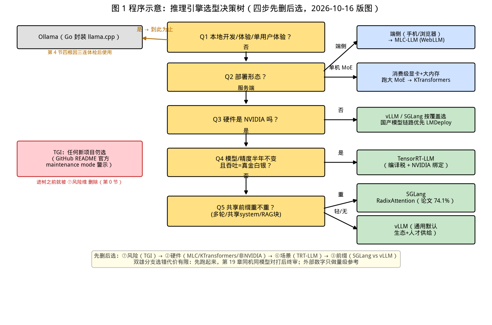

# 第 18 章｜七大引擎横评与选型决策树（Day 43–45）

> **这章讲什么**：把业界七个主流推理引擎——**vLLM / SGLang / TensorRT-LLM / LMDeploy / TGI / MLC-LLM / KTransformers**——放在同一张表里，从七个维度横评：核心机制、硬件与模型覆盖、高阶特性、易用性、生态活跃度、适用场景、2026 年现状与风险（全部联网核实，检索日期 2026-10-16）。横评之外，单独解剖一个"不算引擎但人人都在用"的家伙——**Ollama**：它的 Go 封装层到底做了哪三件事？为什么同一个模型在 Ollama 里"变笨"了？最后给出一棵**选型决策树**，让你在十分钟内为任何场景选出引擎（或果断不选）。
>
> **为什么重要**：第 11–17 章你把 vLLM 的内核拆了个遍，还亲手写了 mini-vLLM——这是"深度"。但岗位上第一个问题往往是"**宽度**"："我们想上一个推理服务，你选什么？"答不上来，深度减半；答上来但没有依据，经不起追问。本章就是把前 17 章积累的知识（PagedAttention、Continuous Batching、前缀缓存、量化、并行、压测）**收敛成一张可复述的横评表和一棵可执行的决策树**。
>
> **学完能干什么**：① 说出七引擎各自的"一句话定位 + 一个杀手锏 + 一个致命短板"；② 解释 TGI 为什么退场、这个事件说明了行业什么趋势；③ 拆解 Ollama 的 Go 封装层三件事，并给出"Ollama 变笨"的四条根因与纠正方法；④ 拿着决策树为五个真实场景选型并说清依据；⑤ 在面试里回答"vLLM 和 SGLang 怎么选"这类高频题。
>
> **本章数字纪律**：零性能跑测。所有引擎现状、版本、事件均为**联网核实**并标注来源与检索日期（2026-10-16）；已知权威出处的评测数字标注原始出处（论文/官方博客/官方文档），**第三方评测数字明确标注"第三方口径"**并提醒以自家实测为准；Ollama 默认参数以**官方 Modelfile 文档**为准；本书内已有实测（ch01/ch05 的 Ollama 压测、ch16 的前缀缓存）只引用登记值。算账与数据源登记于 [code/ch18/RESULTS.md](../code/ch18/RESULTS.md)。

---

## 0. 大白话开场：引擎圈的"三国杀"变成了"七雄"

先给你一个 2026 年 10 月的最热乎的事实（本章联网核实的第一手信息）：

> **Hugging Face 的 TGI（text-generation-inference）进入维护模式了。** 2026-10-16 直接打开它的 GitHub 仓库，README 顶部就是一段 Caution 原文："**text-generation-inference is now in maintenance mode. Going forward, we will accept pull requests for minor bug fixes, documentation improvements and lightweight maintenance tasks.**" 并且官方在同一段里写明了推荐继任者："we contribute to and recommend using going forward: **vllm, SGLang**, as well as local engines with inter-compatibility such as **llama.cpp or MLX**"（来源：github.com/huggingface/text-generation-inference README，检索 2026-10-16）。

这件事值得停一秒。TGI 是 Hugging Face 官方出品、曾是 HF 生态默认推荐的 Rust 推理服务，2024 年 12 月的 v3.0 还高调宣传过"长提示词处理 3 倍 token、比 vLLM 快 13 倍"（TGI v3.0 官方发布口径，经 AI Wiki 转述，检索 2026-10-16）。**两年后，它自己"劝退"用户去用 vLLM 和 SGLang。**（另有第三方文章称 TGI 于 2025 年 12 月进入维护模式、2026 年 3 月 21 日仓库归档只读——本章以 GitHub README 现状原文为准，日期细节标注为第三方口径。）

这说明推理引擎赛道已经完成了一轮**残酷的自然选择**：通用服务端市场收敛到少数几个赢家，落败者要么转维（TGI）、要么退守细分场景（MLC-LLM 退端侧、KTransformers 退消费级异构）、要么根本不算引擎（Ollama——它是个包装层）。**选型的第一课不是"哪个最强"，而是"谁还活着、谁在被官方劝退"。**

**本章验收题**（学完应能张口回答）：

> ① 七引擎各用一句话定位，其中哪家已进入维护模式？② Ollama 的 Go 封装层做了哪三件事，"变笨"的四条根因分别是什么？③ 场景是"8 卡 A100、模型半年不换、追求极致吞吐"，你选什么？依据是决策树哪一步？

答案分别在第 1、3/4、5 节。

---

## 1. 2026 年 10 月的引擎版图：七张名片（全部联网核实）

以下七张名片，每张的"现状"一栏都是 2026-10-16 联网核实的结果；标注【官方】的来自项目自身文档/仓库，标注【第三方】的来自评测或报道文章（会明确提醒口径）。

### 1.1 vLLM —— 通用服务端的"默认答案"

- **一句话定位**：PagedAttention 的发明者、通用性最强的服务端推理引擎，"不知道选什么就先选它"。
- **核心机制**：分页 KV（第 13 章精读）+ Continuous Batching v1 调度器（第 14 章精读）+ 自动前缀缓存 APC（第 16 章精读）——**本书已用源码行号核验过的三件套，全出自它**。
- **覆盖**：NVIDIA/AMD/Ascend/TPU 等多后端，模型支持最快最全【第三方口径：多个 2026 年评测一致认为"新模型首发支持最积极"，检索 2026-10-16】。
- **现状**【官方】：NVIDIA Dynamo 官方兼容性表中，vLLM 后端版本列为 **0.28.0**（来源：docs.nvidia.com/dynamo 兼容性页，检索 2026-10-16）——NVIDIA 自家的 GPU 调度编排层 Dynamo 把 vLLM 列为三大一等后端之一（vLLM / SGLang / TensorRT-LLM）。
- **杀手锏**：生态与人才供给。**你招来的人大概率会 vLLM**（第 2 章 JD 里出现频率最高的引擎名）。
- **短板**：功能全 = 抽象层厚，小场景下配置项多、调优面大；单模型极限吞吐上不敌编译型引擎【第三方口径】。

### 1.2 SGLang —— 前缀共享与结构化输出的"场景王者"

- **一句话定位**：靠 RadixAttention 把"共享前缀"场景打穿的引擎，agent/RAG/多轮对话的天然选择。
- **核心机制**：RadixAttention 前缀树缓存——本书第 16 章已核验其论文数字：生产环境 Chatbot Arena 前缀命中率 **74.1%**、吞吐最高 **6.4×**、TTFT 降 1.7×、开销 <0.3%（arXiv:2312.07104 原文口径）；结构化输出的 XGrammar 也出自其团队（第 16 章：同引擎 Outlines 44.2→6.8 ms/token）。
- **现状**【官方】：与 vLLM 并列被 TGI README 点名推荐（见第 0 节）；同样被 NVIDIA Dynamo 列为一等后端（Dynamo 1.5.1 支持表，检索 2026-10-16）。
- **杀手锏**：多轮/共享前缀场景的吞吐（第 16 章的 74.1% 命中率就是它的立身之本）。
- **短板**：相对年轻，长尾模型与非 NVIDIA 硬件支持略慢于 vLLM【第三方口径】。

### 1.3 TensorRT-LLM —— NVIDIA 亲儿子的"编译型天花板"

- **一句话定位**：把模型离线编译成优化 engine，换极致吞吐与延迟，代价是工程门槛。
- **核心机制**：图优化 + kernel 自动调优 + in-flight batching（其 C++ runtime 已开源）；模型上线前需**离线编译**（换版本/改精度要重编译）。
- **现状**【官方】：NVIDIA Dynamo 1.3/1.5 系列均将 TensorRT-LLM 列为支持后端，并提供 TensorRT-LLM 调度模拟器（来源：docs.nvidia.com/dynamo，检索 2026-10-16）；NVIDIA DGX Spark 等官方栈以容器方式分发 TRT-LLM（build.nvidia.com，2026-04-28 更新记录）。
- **杀手锏**：在 NVIDIA 硬件上的峰值效率——第三方评测普遍给出"比 vLLM 高 15–25% 吞吐"的量级（来源：inferenceengineering.tech 等第三方评测，检索 2026-10-16，**口径差异大，仅作量级参考**）。
- **短板**：模型稳定才划算（每次换模型付一次编译税）；只服务 NVIDIA；黑盒程度最高，出问题最难查。

### 1.4 LMDeploy —— 国产生态与 TurboMind 的"中文优选"

- **一句话定位**：上海 AI Lab 出品、TurboMind 引擎为核心的服务端方案，国产模型支持好、量化（W4A16）见长。
- **核心机制**：TurboMind 后端（persistent 3D kernel、k-cache 动态划分）、支持 LMDeploy 自有的 quantize 流程。
- **现状**【官方】：PyPI 最新版本发布于 **2026-09-28**；其混合精度推理论文 "LMDeploy Accelerates Mixed-Precision LLM Inference with TurboMind" 被 **EuroSys 2027** 接收（来源：pypi.org/project/lmdeploy 项目页，检索 2026-10-16）——**这是七个引擎里唯一有顶会录用背书持续产出的国产项目**。
- **杀手锏**：Qwen/GLM/InternLM 等国产模型的第一时间适配 + 量化部署一条龙（回扣第 10 章量化实验室的工作流）。
- **短板**：国际生态与英文社区小于 vLLM/SGLang；硬件以 NVIDIA + 部分国产卡为主。

### 1.5 TGI —— 已经"谢幕"的前霸主

- **一句话定位**：Rust 实现、HF 官方出品，曾是 HF 生态默认推理服务，**现已进入维护模式**。
- **核心机制**：Rust 服务端 + 2024-12 v3.0 引入 chunked prefill 与优化的前缀缓存结构（官方宣称长提示词 3× tokens、快 13×，**官方口径，经第三方转述**）。
- **现状**【官方·本章第一手】：README 顶部 Caution：maintenance mode，只收小 bug/文档 PR；官方点名推荐 vLLM、SGLang、llama.cpp、MLX（GitHub README 原文，检索 2026-10-16）。
- **杀手锏**：已经不是杀手锏的问题——**新部署不应再选它**。
- **短板（作为反面教材）**：它退场的方式本身就是本章最好的教学素材——见 1.6。

### 1.6 MLC-LLM —— 退守端侧与浏览器的"编译派"

- **一句话定位**：基于 Apache TVM 的"机器学习编译"路线，一个模型编译到手机/浏览器/桌面，服务端高并发不是它的场。
- **核心机制**：TVM/TensorIR 编译而非手写引擎；姊妹项目 **WebLLM** 让模型纯客户端跑在浏览器 WebGPU 里（来源：promptquorum/dailyaiworld 等第三方 2026-09 更新，检索 2026-10-16，**第三方口径**）。
- **杀手锏**：跨端一份代码——iOS(Metal)/Android(OpenCL)/浏览器(WebGPU)/桌面(Vulkan)。
- **短板**：服务端特性（continuous batching、分布式并行）几乎缺席；模型覆盖跟随社区适配。

### 1.7 KTransformers —— 消费级显存跑大 MoE 的"异构派"

- **一句话定位**：清华 MADSys 实验室 + 趋境科技出品，让 **CPU 内存直接参与 MoE 专家计算**，用"大内存 + 小显存"跑旗舰 MoE。
- **核心机制**：专家层 offload 到 CPU（利用 MARLIN 等内核）+ 热专家驻留 GPU 的异构调度。
- **现状**【第三方】：已推出 KTransformers-FineTune 并作为后端接入 LlamaFactory，从推理延伸到微调（来源：新浪财经报道，检索 2026-10-16）；Kimi-K2 等旗舰 MoE 的官方部署指南里列有 KTransformers 部署路径（来源：github.com/MoonshotAI/Kimi-K2 官方文档，检索 2026-10-16）。
- **杀手锏**：一张 24GB 卡 + 128GB 内存跑 100B+ MoE 的可行性（这正是第 12 章"offload 悬崖"的反向操作——它把悬崖修成了缓坡）。
- **短板**：吞吐上限低、依赖内存带宽（第 12 章三时延公式：权重搬运在 PCIe/DDR 上，decode 永远慢一档）；并发能力弱。

### 1.8 大事记时间线：这张表看清格局怎么形成的

| 时间 | 事件 | 对选型的意义 |
|---|---|---|
| 2023-09 | vLLM 发表 PagedAttention（arXiv:2309.06180） | 分页 KV 成为行业标配（第 13 章） |
| 2023-12 | SGLang 论文发表（arXiv:2312.07104） | 前缀共享成为第二条主线（第 16 章） |
| 2024-12 | TGI v3.0 发布，宣传长提示词 3×/13×（官方口径） | 最后的高光 |
| 2025 | vLLM v1 调度器统一旧路径（本书源码核验对象） | v1 成为学习基准（第 14 章） |
| 2025-12 / 2026-03 | TGI 进入维护模式（GitHub README 现状原文为准） | **通用服务端收敛为 vLLM+SGLang 双雄** |
| 2026 | NVIDIA Dynamo 1.3–1.5 把 vLLM/SGLang/TRT-LLM 并列为一等后端（官方文档） | 编排层标准化：引擎变成"可插拔后端"，迁移成本下降 |
| 2026-09-28 | LMDeploy 新版发布，TurboMind 论文入选 EuroSys 2027（PyPI 官方页） | 国产线持续活跃 |

【落地视角】**"引擎选型"的本质是在为"人才供给 + 社区活跃度 + 迁移成本"买单，而不是为 benchmark 榜一买单**。TGI 的退场给出的教训是：即便背靠 Hugging Face，生态站错边也会出局。你在岗位上换引擎的隐性成本（团队技能、监控脚本、CI 流程）远大于引擎本身的性能差（第 1 节表里的第三方 15–25% 量级差）——除非你处在"模型固定、吞吐直接等于钱"的场景（那才是 TRT-LLM 的地盘）。

---

## 2. 七维横评总表：一张表看七家

"七维"= 核心机制 / 硬件与模型覆盖 / 高阶特性 / 易用性 / 生态活跃度 / 适用场景 / 风险与现状。前四维是能力，第五六维是匹配，第七维是 2026 年的"活体状态"。

| 维度 | vLLM | SGLang | TensorRT-LLM | LMDeploy | TGI | MLC-LLM | KTransformers |
|---|---|---|---|---|---|---|---|
| **① 核心机制** | PagedAttention + v1 连续批处理 + APC | RadixAttention 前缀树 + 编译式调度 | 离线图编译 + in-flight batching | TurboMind 动态 3D kernel | Rust 服务端 + chunked prefill（v3.0） | TVM 机器编译 | 专家层 CPU/GPU 异构调度 |
| **② 硬件覆盖** | NVIDIA/AMD/Ascend/TPU 等最广 | NVIDIA 为主 + 部分国产 | **仅 NVIDIA** | NVIDIA + 国产卡 | NVIDIA/AMD（多后端） | 跨端：手机/浏览器/桌面 | 消费级显卡 + 大内存 |
| **② 模型支持** | 最快最全【第三方】 | 快，长尾略慢【第三方】 | 稳定后性能最优，需编译 | 国产模型第一梯队 | 覆盖广但随退场停滞 | 需编译适配 | 专精 MoE（K2 官方文档列其路径） |
| **③ 高阶特性** | chunked prefill、抢占、APC、结构化输出、投机解码 | 前缀共享最强、结构化输出（XGrammar） | 极致 kernel、FP8/NVFP4 | 量化一条龙（W4A16） | 曾有全套（不再新增） | 端侧推理（WebLLM） | 大 MoE offload、微调（KT-FT） |
| **④ 易用性** | pip 即用，配置项多 | pip 即用，API 友好 | **编译门槛高**（Docker+离线编译） | pip 即用，文档中文 | Docker 为主 | 需构建流程 | 源码/脚本部署偏折腾 |
| **⑤ 生态活跃** | ★★★★★（Dynamo 一等后端，v0.28.0） | ★★★★★（Dynamo 一等后端） | ★★★★☆（NVIDIA 全家桶绑定） | ★★★★☆（2026-09-28 发版，EuroSys 2027 论文） | ★☆（**维护模式**） | ★★★（端侧场景稳定） | ★★★（学术+社区） |
| **⑥ 最适场景** | 通用服务端默认选项 | RAG/agent/多轮共享前缀 | 大规模稳定模型极致吞吐 | 国产模型+量化上线 | **（新项目勿选）** | 端侧/浏览器/离线 | 消费级大 MoE 单机 |
| **⑦ 风险与现状** | 抽象税、配置面大 | 年轻、长尾覆盖 | 编译税、NVIDIA 绑定 | 国际生态较小 | 已被官方劝退 | 服务端特性缺 | 吞吐天花板低 |

**读表纪律**：②③⑥中标【第三方】的条目为 2026-10-16 检索的第三方评测共识，**量级参考、非精确值**；⑤的星号是本章按"发版频率+官方背书"给的**定性评级**（非官方指标）；**任何吞吐/延迟的精确数字都必须用你自己的压测出**（方法在第 16 章，双引擎对打在第 19 章）——本表刻意不填具体 tok/s，防止你拿别人的机器数字当决策依据。

### 2.1 三个"错觉"逐个破

**错觉一："benchmark 榜一就是好引擎"。** 第三方评测（如 inferenceengineering.tech 的 H100 对比，检索 2026-10-16）给出 TRT-LLM 峰值吞吐"15–25% higher"，但同一篇评测也写明前提：模型稳定 + 有 NVIDIA 工程能力。**换模型频率一高，编译税把它吃回去**。你的场景模型多久换一次？这个答案比榜一名次重要。

**错觉二："vLLM 和 SGLang 差不多，随便选"。** 纯吞吐上确实接近【第三方口径】，但**前缀命中场景是数量级差异**：SGLang 论文原文（第 16 章核验）生产命中 74.1%、吞吐 6.4×。你的业务若是多轮对话/共享 system prompt/RAG 检索块复用，这一维直接定生死；若全是无共享的独立请求，两者的差别回归到团队熟悉度。

**错觉三："Ollama 也是个引擎，列进横评比比"。** 它根本不在这张表里——**它是 llama.cpp 的 Go 包装层**，第 4 节拆给你看。用包装层去和引擎比吞吐，是拿"外卖平台"和"后厨"比炒菜。

【落地视角】**横评表的正确用法是"先删后选"**：先按 ⑦风险 删（TGI 出局）、按 ②硬件 删（不绑 NVIDIA 就删 TRT-LLM、不上端侧就删 MLC-LLM）、按 ⑥场景 删（不是大 MoE 消费级就删 KTransformers）——**删完剩 2 家再看 ③高阶特性 精挑**。第 5 节的决策树就是把这三步固化成流程。

---

## 3. Ollama 真相之一：Go 封装层做了哪三件事

第 1 章你用 Ollama 跑起了第一个服务，当时留了个尾巴："Ollama 只配学一天"。第 11 章读完 llama.cpp 源码、第 17 章写完 mini-vLLM 之后，你已经有资格看清它的全貌了。以下架构事实来自第三方架构分析文章（martianlee.github.io《Ollama Architecture Analysis》，2026-03-15，检索 2026-10-16）与 Ollama 官方 Modelfile 文档（docs.ollama.com，检索 2026-10-16）交叉核对。

### 3.1 架构一眼看穿：一个 Go 进程 + 一个 llama.cpp 进程

```
你的请求
   ▼
Ollama Go 进程（HTTP API、/api/chat、NDJSON 流）
   ├─ 调度器 server/sched.go：多模型排队、显存分配、keep_alive 热驻留
   ├─ 模型管理：内容寻址存储（blobs + manifest），pull = 下载分片
   └─ Runner 抽象：LlamaServer 接口（Load/Completion/Tokenize/…）
        ▼ CGO 或子进程
   Runner 进程：llama.cpp（legacy llamarunner）或 Go 原生引擎（ollamarunner）
        ▼
   真正算 forward 的还是 llama.cpp 那套 ggml（第 11 章你读过的）
```

关键证据：Ollama 的 `/server/sched.go` 调度器职责被第三方分析概括为"**efficiently manages VRAM when multiple model requests arrive concurrently**"；其底层 llama.cpp 通过 **CGO 直接调用 C/C++ 代码**（`/llama/llama.go`），同时项目正在迁移到纯 Go 的 `runner/ollamarunner`（来源同上，检索 2026-10-16）。**注意：无论走哪条 Runner，你第 11 章读过的 ggml 计算图/KV 管理都在原样工作**——Ollama 没有发明任何新推理技术。

### 3.2 它做的三件事（也恰恰是你不用它上生产的原因）

| # | Go 封装层做的事 | 具体内容 | 代价/边界 |
|---|---|---|---|
| 1 | **模型分发与管理** | `ollama pull` 内容寻址下载（blobs 分片+校验）、Modelfile 定义（FROM/PARAMETER/TEMPLATE/SYSTEM）、`keep_alive` 热驻留 | 是"模型界的 Docker"，与推理性能无关 |
| 2 | **进程与显存调度** | `/server/sched.go` 调度器：多请求并发时管理 VRAM、决定模型何时载入/卸载/排队（第 5 章压测看到的排队抖动来源之一） | 调度单位是**模型**（process-per-model），不是**请求 token**——没有 continuous batching 意义上的迭代级调度 |
| 3 | **默认采样与上下文参数注入** | 不传参时按官方默认值走：`temperature 0.8`、`top_k 40`、`top_p 0.9`、`min_p 0.05`、`repeat_penalty 1.1`、`repeat_last_n 64`、**`num_ctx` 默认 2048**（来源：docs.ollama.com Modelfile 官方参数表，检索 2026-10-16） | **这就是"变笨"的直接来源**（第 4 节） |

（值得单独记住的反差：llama.cpp 自己的采样默认值是 `temperature 0.8` 但 **`repeat_penalty` 默认 1.0（关闭）**——而 Ollama 官方文档表格里 `repeat_penalty` 的默认值一栏写的是 1.0，**但其 API 参考与实际请求示例中普遍注入 1.1**（第三方 API 参考与架构文章口径，检索 2026-10-16）。**不同资料对 1.1 的出处有分歧，落地以你机器上 `ollama show <model>` 与实际 API 返回为准**——这本身就是封装层的第一宗罪：**默认值藏在包装里，用户看不见**。）

【落地视角】三件事里，1 是**卖点**（无与伦比的上手体验，第 1 章一小时跑通就靠它），2 是**够用**（单机多模型轮换场景真实需求），3 是**暗坑**（把"模型能力"和"封装默认值"混为一谈）。**判断一个工具能不能上生产，就看它的"默认值"是否可见、可审计、可关闭。**

---

## 4. Ollama 真相之二：同一个模型为什么"变笨"

"我在 Ollama 里跑 Qwen 明显变笨了"——这是本地推理社区最常见的抱怨。它**不是玄学**，四条根因全部可以用第 9/10 章的量化知识 + 第 3 节的封装层真相解释清楚，且每条都有对应的纠正动作。

### 4.1 四条根因

**根因 ①：量化档位是打包好的 Q4，不是你以为的"原版模型"。**
`ollama pull` 拉下来的是 registry 里作者预量化的 GGUF，**绝大多数默认 Q4 档**（Q4_K_M 为主，第三方多篇 2026 年文章一致口径，检索 2026-10-16）。对照第 10 章的账：Q4_K_M 是"质量/体积均衡档"（官方评测里 Q4 档跨模型掉幅很小），但**如果你之前用的是 FP16/bf16 或 Q8**，这中间的差距是真实存在的；再往下看到社区劝你"塞不进就 Q2"，第 10 章结案数据是 **Q2 探智 AIME -63%（联通论文口径）**——那才是真正"变笨"的量级。
→ **纠正**：`ollama show <model>` 看实际量化档；能塞下就换 Q5/Q6 版本；对比必须"同档对同档"（第 10 章的比较纪律）。

**根因 ②：默认采样参数在"替你做主"。**
`temperature 0.8` + `top_k 40` + `top_p 0.9`（第 3.2 节官方默认值）是一套**偏发散的创作型配置**。而评测、事实问答、抽取类任务在社区标准下普遍用 `temperature 0`（greedy）。**同一个模型，0.8 的温度多跑几次，总会有一次输出翻车，用户记住的恰恰是翻车那次。** 更隐蔽的是 `repeat_penalty 1.1`：它对**所有 token 的 logits 施加重罚**（含事实性重复），有时会把正确的专有名词/数字"罚"下去——llama.cpp 自己默认它是关闭的（1.0）。
→ **纠正**：调用时显式传参：

```bash
curl http://localhost:11434/api/chat -d '{
  "model": "qwen3:8b",
  "messages": [{"role":"user","content":"..."}],
  "stream": false,
  "options": {"temperature": 0.0, "top_k": 1, "repeat_penalty": 1.0, "num_ctx": 8192}
}'
```

**验收**：同一 prompt 连发 10 次，`temperature 0` 下 10 次输出必须完全一致——不一致就说明还有随机源没关掉（seed 也没设）。

**根因 ③：`num_ctx` 默认 2048，长对话被静默截断。**
官方 Modelfile 文档明确 `num_ctx` 默认 **2048**（检索 2026-10-16）。你的 system prompt + few-shot + 工具列表 + 多轮历史轻松超过 2048，**超了以后靠 Modelfile 里的 stop 模板或静默丢弃旧轮次**——模型"忘了"你三轮前说过的话，看起来自然就是"笨"。第 12 章的显存账同时解释了 Ollama 为什么默认给这么小：**KV Cache 与 num_ctx 成正比**，2048 是"8GB 机器也能跑"的保守值。
→ **纠正**：`options` 里显式 `num_ctx`（如 8192/16384），按第 4 章公式算好 KV 占用再定档；同时观察显存是否吃紧（第 12 章三道墙）。

**根因 ④：把它当高并发服务用。**
第 5 章已经用本机实测埋过伏笔：Ollama/llama.cpp 这条栈在 32 槽压测下，**并发 1408 时成功率跌到 40.9%、吞吐在并发 32 附近封顶（~1900 tok/s，本机登记值）**。它没有 vLLM 的 continuous batching/抢占（第 14 章）——多路并发下延迟互相拖垮，用户感知就是"怎么又慢又胡说"（超时重试还会加剧发散采样的翻车概率）。
→ **纠正**：定位回它该在的位置——**第 1 章级的开发/体验工具**，不是并发服务（第 5 节决策树里 Ollama 只出现在"我要本地玩玩/开发调试"分支）。

### 4.2 "变笨"四根因 × 纠正动作速查表

| # | 根因 | 可观测证据 | 纠正动作 | 依据章节 |
|---|---|---|---|---|
| ① | 预量化 Q4 打包 | `ollama show` 显示 quantization | 换高一档 GGUF；同档对比 | 第 9/10 章 |
| ② | temperature 0.8/repeat_penalty 注入 | 同 prompt 多次输出不一 | 显式传 `temperature 0, top_k 1, repeat_penalty 1.0` | 第 3 节官方默认值 |
| ③ | num_ctx 2048 静默截断 | 长对话"失忆" | 显式 `num_ctx`，按 KV 公式算显存 | 第 4/12 章 |
| ④ | 当并发服务用 | 高并发下慢/崩 | 只做本地开发；上服务换 vLLM/SGLang | 第 5 章实测 |

【坑】**把"变笨"的锅全扣给量化**，于是折腾两天换量化档，却没查 `temperature` 和 `num_ctx`——**四条根因里 ②③ 是零成本修复**，永远先关随机、再开上下文、最后才动量化档。反过来的坑是**拿 Ollama 的输出当评测基线**：默认参数都不同，比出来的"模型差距"其实是"配置差距"——第 10 章质量三把尺要求的统一口径，在 Ollama 上尤其容易被默认值破坏。

【应急方案】**客户/同事抱怨"这个模型在我们环境很蠢"**：① 让他先跑根因排查三连——`ollama show`（量化档）→ 显式 `temperature 0 + num_ctx`（采样与上下文）→ 同 prompt 10 连发（随机性）；② 若问题在服务端，查是否 Ollama 在扛并发（看 sched 日志/并发数），换 vLLM 复测；③ 三连无效才怀疑模型本身，回第 10 章用统一评测流程重新定量（PPL/KLD/任务集三把尺）；④ 全程记录**同 prompt、同参数、同量化档**，否则结论不可复现。

---

## 5. 选型决策树：十分钟出结果

决策树只有**四个分叉**，每个分叉都对应前面某一维的删选纪律（图在下面，文字版紧跟其后，两版等价）。



**看图要点**：从根到叶只有 4 步——①先问"是不是本地开发/体验"（是→Ollama，到此为止）；②再问硬件（非 NVIDIA 服务端 → vLLM/SGLang 按覆盖选；纯端侧 → MLC-LLM；消费级大 MoE → KTransformers）；③NVIDIA 服务端再问"模型稳不稳"（稳定且追求极限 → TRT-LLM；否则 → ④）；④通用默认 vLLM/SGLang 二选一，**分界线只看一条：共享前缀重不重**（重 → SGLang，轻 → vLLM）。LMDeploy 与 TGI 挂在侧枝：国产模型链路优先看 LMDeploy，TGI 标红"勿选"。

### 5.1 文字版（可直接照着问自己）

```
Q1 场景是"我本机玩玩/开发调试/单用户体验"？
   ├─ 是 → Ollama（第 1 章定位）。要上并发或要严肃评测，回 Q2。
   └─ 否 → Q2

Q2 部署形态？
   ├─ 服务端 GPU（≥1 张数据中心/游戏卡） → Q3
   ├─ 端侧（手机/浏览器/跨端） → MLC-LLM（WebLLM）
   └─ 消费级显卡 + 大内存跑大 MoE（单机） → KTransformers

Q3 硬件是 NVIDIA 吗？
   ├─ 否（AMD/国产卡/TPU） → vLLM 或 SGLang（按第 ② 覆盖维选；
   │        国产模型链路优先评估 LMDeploy）
   └─ 是 → Q4

Q4 模型与精度"半年基本不变"且吞吐=真金白银（大规模稳定负载）？
   ├─ 是 → TensorRT-LLM（接受编译税与 NVIDIA 绑定）
   └─ 否 → Q5

Q5 请求的共享前缀重不重？（多轮对话/共享 system prompt/RAG 块/tree search）
   ├─ 重（可预期命中率高） → SGLang（RadixAttention）
   └─ 轻/无共享 → vLLM（通用默认，人才与生态最好）
   ※ 两个分支都是"双雄"，选错代价有限——先跑起来，第 19 章对打后再定。

TGI：任何新项目都不选（官方维护模式，见第 0 节）。
```

### 5.2 五个真实场景走一遍（每个都给出依据的决策树步骤）

| # | 场景 | 选择 | 依据步骤 | 一句话理由 |
|---|---|---|---|---|
| 1 | 个人 8GB 笔记本，想跑个 7B 聊天/给脚本当工具 | **Ollama** | Q1 | 第 1 章的定位：体验工具，注意第 4 节三连（量化档/temperature/num_ctx） |
| 2 | 初创 RAG 产品，知识库问答，system prompt 2k token 全量共享，8×A100 | **SGLang** | Q3→Q5"重" | 共享前缀场景，RadixAttention 命中（论文生产 74.1% 口径） |
| 3 | 通用 chat 平台，无固定共享前缀，团队熟 vLLM | **vLLM** | Q3→Q5"轻" | 生态与人才供给（第 2 章 JD 高频词） |
| 4 | 大厂离线批处理，模型季度级固定，日均亿级 token | **TensorRT-LLM** | Q4"是" | 吞吐直接=钱，编译税一次性摊薄（第三方量级 15–25%，以实测为准） |
| 5 | 研究员要给 Qwen/GLM 做量化上线一条龙、中文文档 | **LMDeploy** | Q3 侧枝"国产链路" | 2026-09-28 活跃发版 + EuroSys 2027 论文背书（PyPI 官方页） |

【落地视角】**决策树给的是"初选"，不是"终审"**。终审必须用你自己的压测说话：同模型、同量化档、同 prompt 集、同并发阶梯（第 16 章五条控制变量），出双引擎的 TTFT/TPOT/吞吐/崩溃点对比——这正是第 19 章的对打实验。**别忘了把第 4 节的四条修正套在 Ollama 上再对比**，否则比的是一匹被缰绳勒住的马。

---

## 6. 【落地视角】+ 【坑】+ 【应急方案】

### 6.1 落地视角：你在岗位上会被问的三种选型题

1. **"选哪个引擎？"** → 答决策树（先删后选：风险→硬件→场景→前缀），再补一句"终审以我们自己压测为准"。
2. **"为什么不用 X？"** → 答 X 的短板而非优点：不用 TRT-LLM 因为模型每周变（编译税）；不用 Ollama 因为无请求级调度+默认参数不可审计（第 3/4 节）；不用 TGI 因为官方维护模式（第 0 节）。
3. **"换引擎的成本多大？"** → 这题考的是"迁移视角"：客户端多用 OpenAI 兼容 API（vLLM/SGLang/TRT-LLM/LMDeploy 全都有），**API 层可平移**；不可平移的是引擎特有参数（前缀缓存开关、chunked prefill 预算、专属量化格式）与监控口径（`vllm:num_preemptions` 这类指标名各不相同，第 14 章）。

### 6.2 【坑】清单（七条，按踩坑顺序）

1. **拿第三方榜单数字当承诺写进方案**（第 2 节）：15–25%、6.4× 都带前提。**任何外部数字进方案必须带三件套：谁测的、什么硬件什么负载、对什么基线**（沿用第 17 章坑 6 的纪律）。
2. **忽略 2026 版图直接选 TGI**：老教程/老博客大量推荐 TGI——**引用前先看 GitHub README 顶部有没有 Caution**（第 0 节，2026-10-16 现状）。
3. **Ollama 默认值对比"模型强弱"**（第 4 节）：temperature/num_ctx/量化档三者任一不同，对比无效。
4. **给"无共享前缀"的业务强上 SGLang**：前缀命中率是它的价值前提，没命中就只剩复杂度（回扣第 16 章命中率排查）。
5. **小团队上 TRT-LLM**：没人专职维护编译管线 → 换模型时全线停摆。编译税 = 人力税。
6. **把 KTransformers 的单机数字当服务端容量**（第 12 章三时延公式）：offload 路线的 decode 卡在内存带宽，**并发能力是结构性天花板**，不能靠调参救。
7. **用 Ollama 扛生产并发**：第 5 章本机实测已给上限（并发 1408 成功率 40.9%、吞吐 ~1900 tok/s 封顶，本机登记值）——它的调度器单位是模型不是 token（第 3 节）。

【应急方案】**方案上线后才被指出选错引擎**：① 先确认痛点是"性能"还是"特性缺失"——特性缺失（如结构化输出失败率高、前缀命中为零）按第 16 章先调参，很多"选错"其实是"没调"；② 确属引擎问题，走 OpenAI 兼容 API 层换引擎（vLLM↔SGLang 双雄互迁成本最低，第 5 节纪律），**用同 prompt 集做迁移前后一致性对齐**（贪心逐 token 对齐方法沿用第 6 章）；③ 迁移期双引擎并行，按灰度切流，监控用第 5 章的五指标口径（TTFT/TPOT/E2E/吞吐/成功率）对齐后端；④ 若是 TGI 存量服务，**迁移优先级最高**（维护模式=安全补丁都会停，第 0 节），目标 vLLM/SGLang（官方自己点名的继任者）。

---

## 7. 动手任务 + 自检 + 面试话术

### 7.1 动手任务

**任务 A：Ollama 三连体检（30 分钟，零成本）**

对本机任一 Ollama 模型执行：① `ollama show <model>` 记录量化档；② 用显式参数重发（`temperature 0, top_k 1, repeat_penalty 1.0, num_ctx 8192`）；③ 同一 prompt 连发 10 次。

*验收标准*：③ 的 10 次输出**完全一致**；与默认参数下的输出差异能被归因到第 4 节四根因之一；结果登记到 [code/ch18/RESULTS.md](../code/ch18/RESULTS.md) 的回填区。

**任务 B：画出你目标场景的决策树路径（20 分钟）**

照 5.1 的五问，对你求职方向（如药明康德 AI 算法工程师场景，第 2 章 JD）目标公司可能的推理场景走一遍，写出：Q1→Q5 每问的答案、最终引擎、引用本章哪一格。

*验收标准*：路径上每个分支都能报出依据（第 1/2/5 节的哪张表/哪条数字），且包含至少一个"为什么不选 X"。

**任务 C：TGI 现状一手核验（10 分钟）**

打开 github.com/huggingface/text-generation-inference，截图 README 顶部 Caution 段，抄录官方推荐继任者名单。

*验收标准*：名单四家（vLLM/SGLang/llama.cpp/MLX）与第 0 节原文一致——**养成"翻 README 顶部"的选型习惯，任何引擎都一样**。

### 7.2 自检三问（闭卷作答）

1. 七引擎按"2026 现状"分几类？各自代表是谁？
2. Ollama 的 Go 封装层三件事是什么？"变笨"四根因与三条零成本纠正动作？
3. 决策树的四个分叉分别砍掉谁？为什么 TGI 不出现在树上？

（答案线索：1 → 第 1 节：双雄 vLLM/SGLang、编译天花板 TRT-LLM、国产线 LMDeploy、退场 TGI、端侧 MLC、异构 KTransformers；2 → 3.2 表 + 4.2 表，纠正=关随机/开上下文/查量化档；3 → 5.1，Q1/Q2/Q4/Q5——TGI 因维护模式在进树前就被 ⑦ 风险维删掉。）

### 7.3 面试话术（可直接背）

**话术 1：被问"vLLM 和 SGLang 怎么选？"**

> "先看场景再看数字。两者都是分页 KV + 连续批处理的双雄，通用吞吐在同一量级（第三方评测口径，我以自家压测为准），真正的分水岭是**共享前缀**：SGLang 的 RadixAttention 论文里生产环境命中率 74.1%、吞吐最高 6.4 倍，所以多轮对话、共享 system prompt、RAG 这类前缀复用重的场景它有结构性优势；vLLM 的 APC 默认开启（cache.py 里默认值就是 True），但通用性、生态和人才供给最强，是无共享场景的默认答案。我们场景前缀重/轻这个判断，我会用第 16 章的压测方法出双引擎曲线再定，不拿榜单决策。"

**话术 2：被问"为什么你们不用 Ollama 上生产？"**

> "三个原因：一是它的调度单位是模型进程不是请求 token——Go 层的 /server/sched.go 管的是多模型显存排队，没有请求级 continuous batching，并发一高就互相拖垮，我们本机压测也复现过这条栈并发拉高后成功率和吞吐封顶；二是默认参数不可审计——官方默认 temperature 0.8、num_ctx 2048，同一个模型换个环境表现就不同，我做过的验证是显式传 temperature 0、top_k 1、num_ctx 8192 后输出才稳定可复现；三是它本质是 llama.cpp 的 Go 封装，做的是模型分发、进程调度、默认参数注入三件事，是很好的开发体验工具——所以我们定位它是第 1 章的破冰工具，生产服务走 vLLM/SGLang。"

**话术 3：被问"如果让你为公司选推理引擎，你怎么做？"**

> "我用四步决策树：先看部署形态（端侧/消费级/服务端各自出局一轮），再看硬件（非 NVIDIA 直接收敛到 vLLM/SGLang 按覆盖选，国产模型链路额外评估 LMDeploy），再看模型稳定性（半年不变的重负载才考虑 TensorRT-LLM 的编译税），最后看共享前缀重不重要来收口 vLLM/SGLang。删选之外我会先排除风险项——比如 TGI 已经进入官方维护模式，README 顶部就写着只收小 bug，这种生态风险比任何 benchmark 都优先。终审永远是同模型同量化档同 prompt 集的自家压测，外部数字只做量级参考并标注出处。"

---

## 参考与版本说明

- **TGI 现状（本章第一手）**：github.com/huggingface/text-generation-inference README 顶部 Caution 原文（maintenance mode + 推荐 vLLM/SGLang/llama.cpp/MLX），检索 2026-10-16；TGI v3.0（2024-12）"3×/13×"为官方发布口径，经 AI Wiki 转述；"2025-12 维护模式、2026-03-21 归档"为第三方文章口径（dreaming.press、markaicode），以 README 现状为准。
- **Ollama**：官方 Modelfile 参数表（docs.ollama.com，检索 2026-10-16：temperature 0.8 / top_k 40 / top_p 0.9 / min_p 0.05 / repeat_last_n 64 / **num_ctx 默认 2048**）；架构与调度器/CGO/ollamarunner 事实：martianlee.github.io《Ollama Architecture Analysis》（2026-03-15，检索 2026-10-16）；`repeat_penalty` 默认值资料存在 1.0/1.1 分歧，以本机实测为准（第 3.2 节）。
- **七引擎现状**：vLLM 0.28.0（Dynamo 兼容性表，docs.nvidia.com/dynamo，检索 2026-10-16）；LMDeploy 2026-09-28 发版 + EuroSys 2027 论文（pypi.org/project/lmdeploy，检索 2026-10-16）；KTransformers：Kimi-K2 官方部署指南（github.com/MoonshotAI/Kimi-K2）+ KT-FT 接入 LlamaFactory（新浪财经，检索 2026-10-16）；MLC-LLM/WebLLM 现状（promptquorum、dailyaiworld 第三方 2026-09，检索 2026-10-16）；TRT-LLM "15–25%"等吞吐差为第三方评测量级口径（inferenceengineering.tech、iotdigitaltwinplm.com 等，检索 2026-10-16），**非精确值**。
- **本书内引用**：ollama/llama.cpp 32 槽压测与并发 1408 成功率 40.9%、吞吐 ~1900 tok/s 封顶（第 5 章本机实测登记值）；量化档与 Q2 掉幅（第 9/10 章）；PagedAttention / Continuous Batching / APC / RadixAttention / XGrammar 源码与论文数字（第 13/14/16 章，含 vLLM commit `642c18d` 行号）；三时延公式与并发三道墙（第 12 章）。
- **本章配图**：1 张程序生成（`code/ch18/make_figures.py`，零外部图片，无 CREDITS）；数据源与回填区登记见 [code/ch18/RESULTS.md](../code/ch18/RESULTS.md)。
- **下一章**：第 19 章《同模型双引擎对打实验》——横评是纸面推演，第 19 章把两套引擎摆上同一台机器，同模型同 prompt 集对打，出可放进作品集的对比报告。
