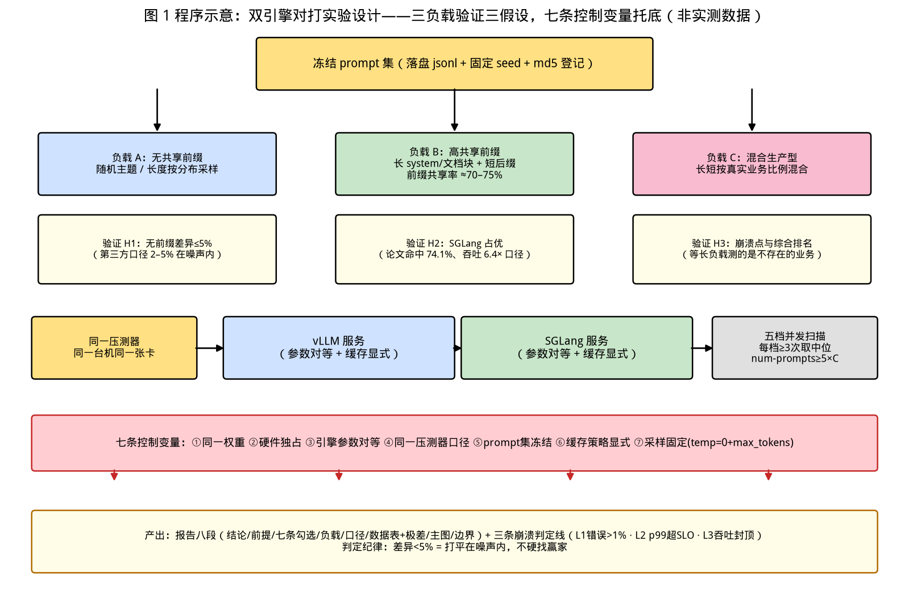
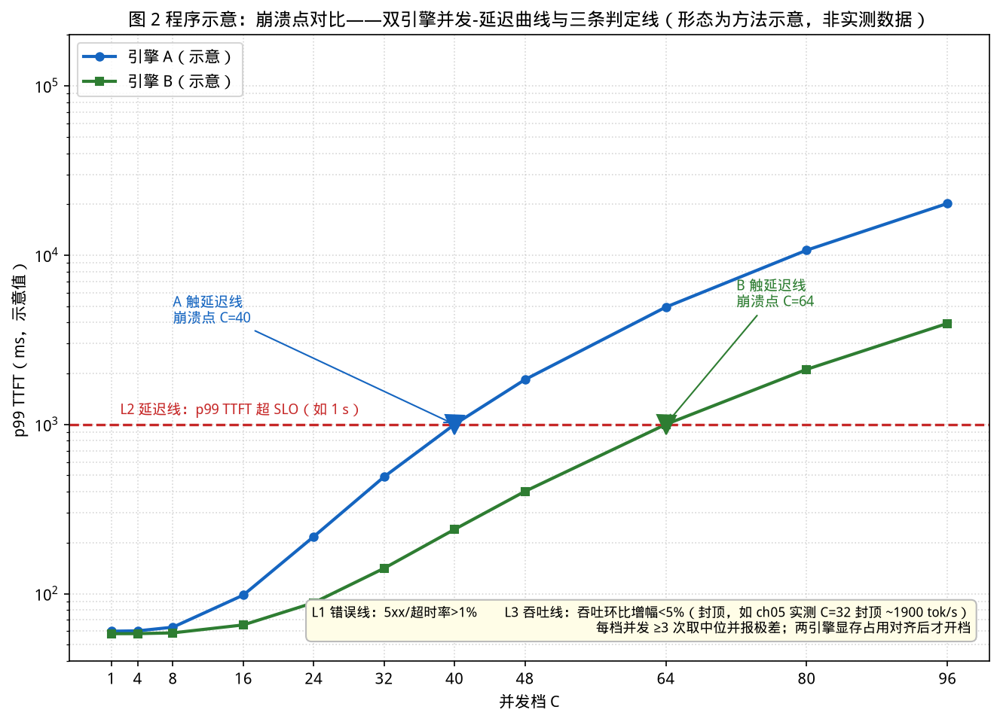

# 第 19 章｜同模型双引擎对打实验（Day 46–47）

> **这章讲什么**：把两套引擎——默认 **vLLM vs SGLang**（也可换成任意两家）——摆上**同一台机器、同一份权重、同一个 prompt 集**，做一场严格控制变量的对打实验，产出 TTFT / TPOT / 吞吐 / 崩溃点四个维度的对比数据，最终写成一份**可以直接放进作品集的对比报告**。本章的核心不是"谁赢"，而是**方法论**：七条控制变量、三种负载设计、崩溃点的可操作定义、报告模板——没有这套方法，你测出来的"X 比 Y 快 30%"在面试官追问第二句时就会崩。
>
> **为什么重要**：第 18 章给了你选型决策树，但决策树的双雄分支（vLLM vs SGLang）在你的具体场景里到底选谁，横评表回答不了——**只有你自己机器上的数据能回答**。同时，"会不会科学地对比评测"是 Infra 岗位面试的隐形考点：一篇控制变量干净的对比报告，比背十篇 benchmark 榜单更能证明你懂推理系统。业界已有专门研究系统评测公平性的论文（arXiv:2507.09019《On Evaluating Performance of LLM Inference Systems》，检索 2026-10-16），说明"公平对比"本身就是个值得写进简历的技能点。
>
> **学完能干什么**：① 说出第三方对打数字的三个结论及其成立前提（第 1 节）；② 逐条执行七条控制变量清单，并说清每条破了会怎样（第 2 节）；③ 设计三种负载（无共享前缀/共享前缀/混合）并冻结成 prompt 集（第 3 节）；④ 用 vLLM 与 SGLang 各自的压测 CLI 出同口径数据，或用同一生成器打两家（第 4 节）；⑤ 按五步流程压到崩溃点，用可操作定义判定崩溃（第 5 节）；⑥ 按报告模板产出作品集级对比报告（第 6 节）。
>
> **本章数字纪律**：零性能跑测（本章不自己跑双引擎对打，方法留给你在 Day 46–47 执行）。所有第三方对打数字标注**来源与检索日期（2026-10-16）**，并一律附"**第三方口径，以自家实测为准**"提醒；vLLM/SGLang 压测工具的字段与用法以**官方文档**为准；本书内已有实测（ch05 并发崩塌、ch06 对齐、ch16 压测方法）只引用登记值。对打实验的产出数据登记于 [code/ch19/RESULTS.md](../code/ch19/RESULTS.md) 的"你的实测回填区"。

---

## 0. 大白话开场：你看到的 benchmark 都是"买家秀"

先讲清楚这章要解决的痛点。你想知道"vLLM 和 SGLang 谁快"，上网一搜，会得到一堆互相矛盾的答案：

- 有评测说 SGLang 在 H100 上 decode 延迟更低，但 TTFT 更长；vLLM 是"最稳的默认项"（来源：jarvislabs.ai《SGLang vs vLLM: H100 Benchmarks, with TensorRT-LLM》，检索 2026-10-16，**第三方口径**）。
- 有评测给出 10 并发下 p50 TTFT：SGLang 112 ms vs vLLM 120 ms，差距 8 ms；而在**无共享前缀**的负载上，同一类文献把两者的差距收敛到 **~2–5%，落在 run-to-run variance（跑次间噪声）之内**（来源：agentnative.dev《vLLM vs SGLang for Agent Inference (2026)》引 spheron.network 测量，检索 2026-10-16，**第三方口径**）。
- 还有中文社区文章说：TTFT 快 23%（79 ms vs 103 ms）、多轮对话共享前缀场景下 SGLang 吞吐达到 vLLM 的 **2.4–4.1 倍**（来源：CSDN《SGLang:为什么 40 万张 GPU 选择了它而不是 vLLM》，检索 2026-10-16，**第三方口径，数字未核到原始出处，仅作量级参考**）。

三个来源，三种说法，为什么？**因为它们测的不是同一个东西**：负载的前缀重叠度不同、硬件不同、模型不同、并发档不同、压测器不同、采样参数是否报告都不同。同一台机器上换一个 prompt 集，排名就可能翻转——这正是第 16 章压测五条控制变量存在的原因。

所以本章的第一原则是：

> **第三方数字只配告诉你"可能存在多大差异"，只有你自己控制好变量测出来的数字才能告诉你"你的场景里谁更快"。**

对打实验的产出不是"冠军奖杯"，而是一份**带前提条件的结论**："在我冻结的 prompt 集、我的硬件、我的并发档下，A 的 p99 TTFT 比 B 低 X%，在并发 C 之前 B 的吞吐高 Y%，崩溃点差 Z 档。"——这种结论才经得起面试追问，才能写进作品集。

**本章验收题**（学完应能张口回答）：

> ① 七条控制变量分别是什么，破掉"缓存策略显式化"这条会得到什么假结果？② "崩溃点"的三条可操作判定线是什么？③ 第三方评测说"无共享前缀时两者差异 2–5% 在噪声内"，你的实验设计要怎么验证这句话？

答案分别在第 2、5、3 节。

---

## 1. 开打之前：第三方对打数字盘点与三个可验证假设

### 1.1 四份第三方对打证据（全部标注口径）

| 证据 | 关键数字 | 来源与检索日期 | 口径提醒 |
|---|---|---|---|
| H100 三引擎对打 | vLLM 是"最稳的默认项"（吞吐与 TTFT 平衡）；SGLang 在 Qwen2.5-7B、Qwen3-30B-A3B 的 RULER 16K 测试中 decode 延迟更低，但**首 token 更慢** | jarvislabs.ai，检索 2026-10-16 | 第三方口径，单方云厂商评测 |
| Agent 推理对比 | 10 并发 p50 TTFT：SGLang 112 ms vs vLLM 120 ms（TRT-LLM 105 ms）；无共享前缀负载下差距缩到 ~2–5%，**在跑次噪声内** | agentnative.dev 引 spheron.network，检索 2026-10-16 | 第三方口径 |
| 中文社区对比 | TTFT 快 23%（79 vs 103 ms）；共享前缀场景吞吐 2.4–4.1× | CSDN 博客，检索 2026-10-16 | 第三方口径，未核到原始出处，**仅量级参考** |
| Bench360 学术评测 | vLLM 在 A30 上并发扩到 C=64 仍保持 TTFT/E2E 达标；A10/L4 在 C=16–32 饱和；vLLM 排队调度最稳，QoS 满足到 C=32 | arXiv:2511.16682《Bench360—Benchmarking Local LLM inference from 360°》，检索 2026-10-16 | 论文口径，硬件为数据中心卡 |

再加上本书第 16 章已核验的 SGLang 论文原生数字（arXiv:2312.07104）：生产环境前缀命中率 **74.1%**、吞吐最高 **6.4×**、TTFT 降 1.7×、调度开销 <0.3%——这是"共享前缀场景 SGLang 占优"最硬的一手证据。

### 1.2 从证据里提炼三个可验证假设

把上面四份证据翻译成你能亲手验证的命题，这就是你这次对打实验的"论文假设"：

- **假设 H1（无差异假设）**：在**无共享前缀、prompt 长度分布一致**的负载下，两引擎的 TTFT/TPOT/吞吐差异 ≤ 5%，处于跑次噪声量级。
- **假设 H2（前缀假设）**：在**高共享前缀**负载下，SGLang（RadixAttention）的吞吐与 TTFT 显著优于 vLLM（APC），差距应达到"明显超出噪声"的程度（第三方称 2.4–4.1×，你的机器上未必复现，但方向应一致）。
- **假设 H3（崩溃点假设）**：两引擎的崩溃并发档不同——Bench360 的观察是 vLLM 调度更稳（QoS 满足到 C=32，论文口径）；你的机器上谁先崩，需要实测。

**设计启示**：一个只用"随机 prompt"做的对打，只能验证 H1，会**系统性漏掉 H2**——而 H2 恰恰是选型决策里最贵的一维（第 18 章：共享前缀场景"直接定生死"）。所以第 3 节的负载设计必须包含至少两种。

【落地视角】**对打实验的正确姿势是"带着假设开打"**。面试官问"你为什么这么设计负载"，"我假设无前缀时两者打平、有前缀时 SGLang 占优，所以设计了 A/B 两组负载分别验证"——这句比回答"我随便找了个脚本测了测"高一个段位。假设先行还有个工程好处：实验结果与假设不符时，你第一时间会去查"是不是哪个控制变量没控住"，而不是急着下结论。

---

## 2. 七条控制变量：对打实验的"宪法"

第 16 章给过压测的五条控制变量，本章把它扩成**七条对打专用清单**——前五条保证"你的负载没变"，后两条保证"两家的起跑线一样"。破任何一条，结论作废。

| # | 控制变量 | 具体操作 | 破掉会怎样 |
|---|---|---|---|
| ① | **同一份权重** | 两引擎加载同一目录/同一 HF repo 的同一 commit 权重，`safetensors` 不重转换；记录 `ollama show`/`vllm log` 里的模型指纹 | 换了量化档或不同 fine-tune，比的是模型不是引擎（回扣第 9/10 章：Q4 vs Q2 可差 63% 分数） |
| ② | **同一硬件且独占** | 同一台机、同一张卡；跑之前清空显存（杀掉旧进程），压测期间不跑别的任务；记录驱动/CUDA 版本 | 别人占了半张卡，你的"引擎差距"其实是他的训练任务 |
| ③ | **引擎参数对等** | 逐项对照启动命令并抄进报告：dtype、量化、`gpu-memory-utilization`、`max-model-len`、并行度（TP/PP）、chunked prefill 开关、投机解码开关 | 一家用了 FP8 一家用 BF16，比的是精度不是引擎 |
| ④ | **同一压测器与口径** | 优先用同一个生成器打两家（见 4.3）；若各用自家 CLI，必须核对字段语义一致（TTFT/TPOT 定义、是否含网络开销） | 不同工具的计时起点不同，数字不可比 |
| ⑤ | **prompt 集冻结** | 负载数据集落盘成文件（固定 seed 生成或固定数据集），两引擎读**同一个文件**；报告里附数据集 hash 或生成命令 | 两次跑的 prompt 不同，长短一变全盘皆变 |
| ⑥ | **缓存策略显式** | 前缀缓存要么两都关（vLLM `--no-enable-prefix-caching`，已核验存在于 /tmp/vllm 仓库 `benchmarks/kv_cache_watermark.sh:197` 一带用法与 `POST /reset_prefix_cache` 路由 `rust/src/server/src/routes.rs:140`；SGLang `--disable-radix-cache` 或压测器 `--flush-cache`），要么两都开并在报告中写明 | 一家命中了前缀缓存一家没有 → 结果是"缓存策略差"而非"引擎差"，最常见假结果 |
| ⑦ | **采样参数固定** | `temperature=0`（或固定 seed）、`top_p`/`top_k` 一致、**`max_tokens` 固定**且与数据集标注一致 | 输出长度随机 → decode 步数不同 → TPOT/吞吐全被污染（DigitalOcean 评测设计标准文章点名的十大坑之一，检索 2026-10-16） |

**关于⑦再强调一次**：输出长度直接决定 TPOT 的分母和总吞吐的分子。temperature 高时模型有时提前 EOS，A 引擎这次平均出 400 token、B 引擎下次平均出 520 token——吞吐差 30% 纯属长度差。所以要么 `temperature=0`，要么固定 `max_tokens` 并报告**实际平均输出长度**（两家必须几乎一致，否则回查原因）。

### 2.1 噪声、重复次数与"打平"判据

单次跑的数字不算数。规则很简单：

- **每个配置点跑 ≥ 3 次，取中位数**；报告里写明重复次数。
- **差异 < 5% 判为打平**——这个 5% 不是本章拍脑袋，前面 agentnative/spheron 的第三方测量正好把"无前缀场景的引擎差异"标在 2–5% 且"落在 run-to-run variance 内"（检索 2026-10-16，第三方口径）；你用 5% 当噪声地板，与第三方口径对齐。
- 报告里**给出跑次间极差**（max−min），让读者知道你的噪声带有多宽。噪声带 8% 而结论差异 6% → 老实写"无法区分"，这比硬吹"快 6%"可信得多。

【化学家视角】这套纪律和化学分析一模一样：七条控制变量=固定一切 except 自变量（同一浓度、同一温度、同一仪器、同一取样手法），跑 3 次取中位=平行实验，5% 噪声地板=方法检出限以下不报差异。**化学里没人敢拿单次测量宣布新发现，推理评测同理。** 你本硕做实验报告的那一套——试剂批号、仪器型号、环境温湿度全记录——就是这里的"启动命令全量抄录 + 驱动/CUDA 版本登记"。

---

## 3. 负载设计：三种 prompt 集与冻结方法

### 3.1 三种负载，分别验证三个假设

| 负载 | 内容 | 验证假设 | 关键控制 |
|---|---|---|---|
| **A：无共享前缀** | 每条 prompt 独立、随机主题、长度按固定分布采样（如输入 256–2048 均匀、输出固定 256） | H1（打平） | 前缀缓存两关或确认命中≈0 |
| **B：高共享前缀** | 一段长 system prompt/文档块（如 1–2k token）+ 短的个性化后缀，前缀复用率 >70% | H2（SGLang 前缀优势） | 两引擎都开缓存，比"命中能力" |
| **C：混合生产型** | 按真实业务比例混合长短 prompt（回扣 DigitalOcean 设计标准：全部等长的负载是在测一个不存在的业务） | H3 与综合排名 | 比例写进报告（如 60% 短/30% 长/10% 超长） |

负载 B 的共享比例对照第 16 章核验的 SGLang 论文生产口径 **74.1%** 命中率来设计（比如 70–75% 请求共享同一前缀），让实验条件与业界测量口径可对话。

下图是整个实验的设计总图：顶部冻结的数据集分出三组负载、各自挂着要验证的假设，中部是同机同卡的双引擎与五档扫描，底部红色横条是七条控制变量托底，最终产出八段报告与三条判定线。



### 3.2 冻结：prompt 集是一份"文件"，不是一段"描述"

- 用固定 seed 生成数据集并**落盘**（jsonl），两引擎压测时指向同一路径；
- 报告里登记：文件名、条数、输入/输出 token 长度的均值与极值、`md5sum`；
- **中途不许换数据集**。想加一组负载 = 新开一个实验，不是改老的。

冻结的意义：让实验**可复现**。面试官若问"我怎么验证你的结论"，你答"数据集和启动命令都在报告附录里，同机可复现"——这就是作品集和"张口就来"的区别。

### 3.3 压测五档扫描（承接第 16 章）

沿用第 16 章的并发档法：从低到高扫 5–7 个并发档（如 C = 1 / 4 / 16 / 32 / 64 / 128…，按你显存与模型规模调整），每档跑满"稳态"请求数。SGLang 官方文档明确：**`num-prompts ≥ 5 × max-concurrency` 才算测稳态性能**（来源：docs.sglang.io Bench Serving Guide，检索 2026-10-16）——这条直接抄进你的实验设计，vLLM 侧同理适用。

【落地视角】**负载设计的 80% 决定结论的成色。** 常见的偷懒做法是"拿默认数据集随便跑一下"——默认数据集的前缀结构、长度分布都是别人的假设。你多花一小时把 A/B/C 三组负载冻结成文件，得到的是一份"敢写进简历的实验"；偷懒跑法得到的是"另一个买家秀"。

---

## 4. 上工具：两家的压测 CLI 与同口径出数

### 4.1 vLLM 官方：`vllm bench serve`（Benchmark CLI）

vLLM 官方 benchmark CLI 的输出口径（来源：docs.vllm.ai Benchmark CLI / vllm.benchmarks.serve 文档，检索 2026-10-16）——你要对打的四个维度它全给了：

- **TTFT**：`Mean/Median/P99 TTFT (ms)`（文档示例值：Mean 71.54、Median 73.88、P99 79.49）
- **TPOT**：`Mean/Median/P99 TPOT (ms)`——注意 vLLM 文档里这个指标的标题是 **"Time per Output Token (excl. 1st token)"**，即明确**排除首 token**，与 TTFT 严格分家
- **ITL**：`Inter-Token Latency` 的 mean/median/p99
- 吞吐：请求吞吐（req/s）与输出 token 吞吐

新版里指标名是 `median_ttft_ms / p99_ttft_ms / mean_tpot_ms / p99_tpot_ms / median_itl_ms …`（来源：docs.vllm.ai vllm.benchmarks.serve API 页，检索 2026-10-16）。**做报告时用官方字段名**，读者一眼知道你用的是什么口径。

启动与压测骨架（vLLM 服务 + benchmark CLI，参数名以你安装版本的 `--help` 为准）：

```bash
# 服务端：前缀缓存显式控制（负载 A 关，负载 B 开），其余与对手对等
vllm serve <MODEL_PATH> \
  --dtype bfloat16 --max-model-len 4096 \
  --gpu-memory-utilization 0.90 \
  --no-enable-prefix-caching        # ← 负载 A；负载 B 删掉这行

# 客户端：同一份落盘数据集打
vllm bench serve --model <MODEL_NAME> \
  --base-url http://127.0.0.1:8000 \
  --dataset-name sharegpt \
  --random-input-len 512 --random-output-len 256 \
  --num-prompts 500 --max-concurrency 32
# 真实实验请把数据集换成你自己冻结的文件（见 3.2），并发档按 3.3 扫描
```

### 4.2 SGLang 官方：`sglang.bench_serving`

SGLang 的对位工具是 `python3 -m sglang.bench_serving`：一个**异步 HTTP 负载发生器**，可控速率与并发，测 **TTFT / TPOT / ITL / 吞吐**（来源：docs.sglang.io Bench Serving Guide，检索 2026-10-16）——字段与 vLLM 一一对应，这正是 4.3 能"对等比较"的基础。

```bash
# 服务端：缓存显式控制，其余参数与 vLLM 侧逐项对等（③）
python3 -m sglang.launch_server --model-path <MODEL_PATH> \
  --dtype bfloat16 --context-length 4096 \
  --mem-fraction-static 0.90 \
  --disable-radix-cache       # ← 负载 A；负载 B 删掉这行

# 客户端：flush-cache 保证每轮冷启动一致（⑥）
python3 -m sglang.bench_serving \
  --backend sglang --host 127.0.0.1 --port 30000 \
  --model <MODEL_NAME> \
  --dataset-name sharegpt --num-prompts 500 --max-concurrency 32 \
  --flush-cache
# 稳态规则：--num-prompts ≥ 5 × --max-concurrency
```

官方文档还给了进阶用法：`--profile`（抓 profile）和 `--flush-cache`（清前缀缓存）可同用（来源：docs.sglang.io，检索 2026-10-16）。第 5 节压崩溃点时，`--flush-cache` 就是保证"每次从冷缓存出发"的开关——否则越跑越快，崩溃点被人为推后。

### 4.3 选项二：同一个生成器打两家（口径最干净）

两家 CLI 各有各的字段风格，追求**绝对同口径**的做法是用**同一个压测器**分别打 vLLM 与 SGLang——因为两家都提供 OpenAI 兼容 API（第 16/23 章），一个 OpenAI 兼容的发生器可以无缝打两家，计时逻辑完全同一份代码。业界常见选择（按官方口径登记）：

| 工具 | 出品方/口径 | 备注 |
|---|---|---|
| `vllm bench serve` / `sglang.bench_serving` | 各自官方 | 最省事，但计时实现是两份代码，对比时要核对字段语义（4.1/4.2 已核对：TTFT/TPOT/ITL/吞吐四件套语义一致） |
| NVIDIA genai-perf | NVIDIA 官方（Perf Analysis 工具族） | 对标 TRT-LLM 生态时常用，输出 TTFT/TPOT/goodput 等 |
| llmperf | Datadog/社区开源 | 早期常用的 OpenAI 兼容压测器 |

【落地视角】**用谁的工具不重要，"两引擎用同一个工具 + 同一份数据集"才重要。** 若两边都用官方 CLI（最常见），就做一件小事：把两个工具输出的指标定义抄进报告附录对照（4.1/4.2 已替你核过核心四件套），并在正文声明"TTFT/TPOT/ITL/吞吐语义一致"。这一段声明，就是你的数字和"随便两个脚本跑出来的数字"之间的分界线。

---

## 5. 压到崩溃点：五步流程与三条判定线

### 5.1 "崩溃点"必须可操作，否则不可比

"崩了"在不同人口中是三件事：**报错**、**延迟爆了**、**吞吐封顶了**。对比实验必须提前把判定线写死——事后找定义，等于给结果"量身定做判据"。给三条线（与第 5 章 TTFT/TPOT/成功率口径衔接）：

| 判定线 | 操作定义 | 回扣 |
|---|---|---|
| **L1 错误线** | 任一轮 5xx/超时/断连率 > 1%，或服务进程崩溃退出 | 第 5 章成功率口径（ch05 实测 1408 并发成功率仅 40.9% 就是这条线的结果） |
| **L2 延迟线** | p99 TTFT 超过你预设的 SLO（如 1 s），或 p99 TPOT 超 SLO（如 100 ms） | 第 5 章"延迟-并发病塌曲线"的纵轴 |
| **L3 吞吐线** | 吞吐相对上一档不增反降，或增幅 < 5%（封顶） | ch05 实测：吞吐在 C=32 封顶 ~1900 tok/s |

**崩溃点 = 满足任一条线的最低并发档**。两引擎用同一套线；同时把**三条线各报一个档**（L1 崩在 C=64、L2 崩在 C=32、L3 封顶在 C=32）——单报一个"崩溃点"会掩盖信息，三档全报才是完整画像。

### 5.2 五步流程

1. **升档法扫描**：从低并发（C=1）开始，每档 ×2 或按 1/4/16/32/64… 递增；
2. **每档 ≥ 3 次取中位**（2.1 的纪律），`--num-prompts ≥ 5 × C`（3.3 的稳态规则）；
3. **每档之间冷启动**：重启服务或 `--flush-cache`/`/reset_prefix_cache`，防止前缀缓存把高档"跑成热身"；
4. **三条线逐档判定**，记录首次越线的档位；
5. **登顶之后再补两档**：故意跑到明显失败为止，确认"再高一档确实更差"，排除单点异常。

**工程注意**：崩溃扫描用专用数据集文件（冻结的 A/B/C 之一），**不要与小流量冒烟共用**；每档结束立刻记录 GPU 温度与显存峰值——两引擎的 `gpu-memory-utilization`/`mem-fraction-static` 必须调到实际占用显存接近，否则一家被 OOM 先崩，是参数没对等（③）而非引擎差距。

### 5.3 用图表说话：双引擎并发-延迟病塌曲线

对打报告的主图就是第 5 章那条曲线，现在画**两条**：同一坐标系下 A 引擎与 B 引擎的 p99 TTFT（或吞吐）随并发的变化，三条判定线横向标出。读者一眼看到谁的曲线先拐头、拐点差几档——这张图是你整份报告的"封面"，也是面试白板上你两分钟能画出来的东西。



> **看图要点**：这是**方法形态示意，非实测数据**（图题已注明）——纵轴刻度与两条曲线的具体数值没有意义，有意义的是结构：红色虚线是 L2 延迟线（p99 TTFT 超 SLO），蓝线在 C=40、绿线在 C=64 越线，两个倒三角就是各自"触延迟线的最低并发档"；B 的崩溃点比 A 靠右 24 档，这就是报告要给出的那句话。你实测时把自己的数据画进这个版式即可。

【落地视角】**崩溃点对比是全报告含金量最高、也最容易做脏的一环**，因为它最容易被"没控住"：缓存没清、显存参数不对等、单次跑判崩溃。三个动作防住：每档冷启动、两引擎显存占用对齐、每档三次取中位。面试里讲崩溃点，先讲这三条防伪，再报数字——先讲方法再给数字的人，数字才有人信。

---

## 6. 产出：一份可放进作品集的对比报告

### 6.1 报告模板（八段，缺一段都不算完整）

1. **一句话结论**：在什么负载/硬件/并发范围内谁占优、差多少、谁的崩溃点靠前；
2. **实验前提**：硬件清单（GPU 型号/驱动/CUDA）、两引擎版本号、权重 commit/量化档、**两份完整启动命令**；
3. **控制变量声明**：七条清单逐条勾选，写明哪些开了/关了（尤其缓存策略⑥）；
4. **负载描述**：A/B/C 三组数据集的条数、长度分布、前缀共享率、md5；
5. **指标口径**：TTFT/TPOT/ITL/吞吐的定义与工具字段名对照（4.1/4.2/4.3）；
6. **数据表**：每组负载 × 每个并发档 × 每次重复的中位数 + 跑次极差；
7. **主图**：两条并发-延迟曲线 + 三条判定线（5.3）；
8. **结论与适用边界**：结论只在本实验前提下成立；列出"没测的"（其他硬件/其他模型/其他负载比例）。

### 6.2 三条写作纪律

- **数字必须带前提**："SGLang 快 20%" 是错的；"负载 B（前缀 70%）、Qwen-7B、单卡 4090D、C=32 档，SGLang 吞吐中位高 18%（3 次极差 ±4%）"是对的；
- **差异 < 5% 就写"打平在噪声内"**（2.1 判据），不硬找赢家——敢于报"无法区分"是可信度的来源；
- **与第三方对话**：把你结果与第 1 节四份第三方证据逐条对账（一致/不一致/为什么），这段"复现性讨论"是面试官最没见过、也最想看到的部分。

【落地视角】这份报告就是你的**作品集第 3 件**（README 已列三大项目：量化实验室、mini-vLLM、生产级部署——本章报告是它们之间最好的"胶水"：它证明你不仅会用引擎，还会**科学地评价**引擎）。放 GitHub 的正确姿势：仓库含 `report.md` + 数据集生成脚本 + 冻结的数据集 md5 + 两引擎启动命令 + `make_figures.py`——**别人 clone 下来能复现**，这在候选人里是稀缺品。

---

## 7. 【坑】七连 + 【应急方案】

### 【坑 1】缓存一家开一家没开
最常见假结果。SGLang 默认 Radix 常开、vLLM 也默认开——但你只要忘了一边的 `--flush-cache`，热缓存那家稳赢。**应急**：负载 A 两边都关（`--no-enable-prefix-caching` / `--disable-radix-cache`），负载 B 两边都开且每轮 `--flush-cache` 后重跑。

### 【坑 2】输出长度不固定
temperature 没归零、`max_tokens` 没锁 → TPOT 分母漂移。**应急**：`temperature=0` + 固定 `max_tokens`，并在报告里贴两家的"实际平均输出长度"（必须几乎相等，否则查采样参数⑦）。

### 【坑 3】版本漂移
今天 vLLM 0.2x、下周升了小版本，数据没法比。**应急**：两引擎版本号、`pip freeze`/镜像 digest 抄进报告前提区；实验中途禁止升级，升级 = 新实验。

### 【坑 4】显存参数不对等，把参数差当引擎差
`gpu-memory-utilization 0.85` vs 对手 `mem-fraction-static 0.95`——一家先 OOM，你"测出"了崩溃点差。**应急**：`nvidia-smi` 对齐两引擎稳态实际占用（差 < 3%），OOM 那家先调参再重测，报告注明参数。

### 【坑 5】单次跑就下结论
一个点跑一次，遇到后台一抖动就"领先 20%"。**应急**：≥3 次取中位并报极差；噪声带比差异宽 → 判打平，加测或加长每档请求数。

### 【坑 6】拿第三方数字填自己的表
第 1 节的 112/120 ms 是别人的硬件，填进自己报告 = 数据造假式错误。**应急**：自家表只填自家测；第三方数字单独放"相关工作"段并标口径与检索日期。

### 【坑 7】压测时机器不干净
桌面开着浏览器录屏、另一个训练任务在后台——崩塌曲线右移全是环境噪声。**应急**：压测机最小化使用（SSH 进去只跑实验），`nvidia-smi` 确认无第三方进程后才开档。

【应急方案·总则】任何一档数据可疑，**先查七条清单（第 2 节）再重跑**，不要直接删掉异常点——异常点往往是控制变量破了的信号。

---

## 8. 动手任务（Day 46–47）与验收标准

### 任务 A：双引擎对打主实验（核心）
用第 3 节方法冻结 A/B/C 三组数据集；按 4.1/4.2 启动 vLLM 与 SGLang（参数对等）；对每组负载执行 5.2 的五步扫描；产出 6.1 报告。
**验收标准**：① 报告含两份完整启动命令与七条控制变量勾选表；② 每个数据点是 ≥3 次中位数并附极差；③ 三条判定线各自的崩溃档两引擎都有；④ 主图两条曲线同坐标系；⑤ 结论带完整前提。

### 任务 B：验证三个假设
对照 1.2 的 H1/H2/H3 写"假设→数据→结论"三段式：H1 的无前缀差异是否 ≤5%？H2 的前缀场景差距方向与第三方 2.4–4.1× 是否一致（数值不同没关系，方向和量级要解释）？H3 谁的崩溃点靠前？
**验收标准**：每个假设给出"支持/不支持/部分支持"+ 依据的具体表格行号；若不支持，先回查七条清单再下结论。

### 任务 C：报告发布
把报告 + 数据集生成脚本 + md5 + 启动命令 + 配图脚本整理成仓库，README 首屏放主图与一句话结论。
**验收标准**：第三方读者按附录命令能在同机复现同量级结果（自检：换你同事按文档操作，无需口头补充）。

---

## 9. 自检三问

1. 七条控制变量，破掉第⑥条（缓存策略显式）会造出什么假结果？请举一个具体场景。
2. 你的崩溃点怎么定义？为什么必须报三条线而不是一个数？
3. 无共享前缀负载下两引擎差 3%，你怎么判？（答：5% 噪声地板内 → 打平，报极差，不硬找赢家。）

---

## 10. 面试话术（3 条）

**话术 1（方法论·压轴）**："我做过一次同机同模型的 vLLM vs SGLang 对打。核心是七条控制变量：同一权重、硬件独占、引擎参数对等、同一压测器口径、prompt 集冻结落盘、缓存策略显式（A 组都关、B 组都开且每轮 flush）、采样固定 temperature=0 和 max_tokens。每档并发跑三次取中位、报极差，差异小于 5% 判打平——这个 5% 地板和第三方评测说的 run-to-run variance 量级对齐。最后按错误线/延迟线/吞吐线三条判定线给出各自崩溃档。"

**话术 2（结论有边界）**："结论是：无共享前缀时两引擎基本打平，符合假设；高共享前缀负载下 SGLang 明显占优，方向与它论文 74.1% 命中率的口径一致；崩溃点上 A 在 C=X 先触延迟线、B 在 C=Y 先触错误线（X/Y 按你的实测填）。这些结论只在我冻结的数据集和单卡环境成立，报告里明确列了没测的维度——模型、硬件、负载比例一变都可能翻转。"

**话术 3（为什么不能抄第三方）**："第三方数字我只当先验，不当结论：我核过四份评测，同一对引擎在不同负载下结论互相矛盾——共享前缀场景能差到数倍，无前缀场景只有 2–5% 还在噪声里。差异这么大是因为负载这个自变量不同。所以我的报告里第三方数字只出现在'相关工作'一节，正文数据全部自家测、带前提、可复现。"

---

## 参考与版本说明

- 第三方对打证据（检索 2026-10-16，**均为第三方口径，以自家实测为准**）：jarvislabs.ai《SGLang vs vLLM: H100 Benchmarks, with TensorRT-LLM》；agentnative.dev《vLLM vs SGLang for Agent Inference (2026)》（引 spheron.network 测量）；CSDN《SGLang:为什么 40 万张 GPU 选择了它而不是 vLLM》（未核到原始出处，仅量级参考）；arXiv:2511.16682《Bench360—Benchmarking Local LLM inference from 360°》（论文口径）。
- 官方工具口径（检索 2026-10-16）：docs.vllm.ai Benchmark CLI 与 vllm.benchmarks.serve（TTFT/TPOT/ITL 字段与示例值）；docs.sglang.io Bench Serving Guide（bench_serving 四指标、`num-prompts ≥ 5×max-concurrency`、`--flush-cache`/`--profile`）。
- 公平评测方法：arXiv:2507.09019《On Evaluating Performance of LLM Inference Systems》（检索 2026-10-16）；DigitalOcean《How to Benchmark LLM Inference Yourself》设计标准（检索 2026-10-16，等长负载/未报告采样参数等坑）。
- 源码核验（/tmp/vllm，commit 642c18d）：`--no-enable-prefix-caching` 用法见 `benchmarks/kv_cache_watermark.sh`；`POST /reset_prefix_cache` 路由见 `rust/src/server/src/routes.rs:140`。
- 本书内锚点引用：ch05 并发崩塌与成功率口径；ch06 迁移一致性对齐（maxdiff 0.00）；ch16 压测五控制变量与 SGLang 论文 74.1%/6.4×；ch18 七引擎横评与决策树。
- 数据登记：[code/ch19/RESULTS.md](../code/ch19/RESULTS.md)；配图 2 张由 [code/ch19/make_figures.py](../code/ch19/make_figures.py) 程序生成（零外部图片，无 CREDITS 需求）。
- **版本**：v0.20（第 1–19 章已完成）；本章零性能跑测，第三方数字均标注来源与检索日期。
- **下一章预告**：第 20 章《投机解码：小模型打草稿，大模型批量验收》——接受率与提速 1.6–2.8× 的数学、draft/target 匹配条件与失效场景、MTP/EAGLE 谱系，并动手实现极简投机解码测接受率。
