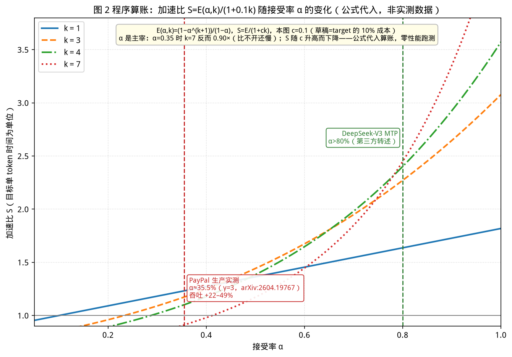
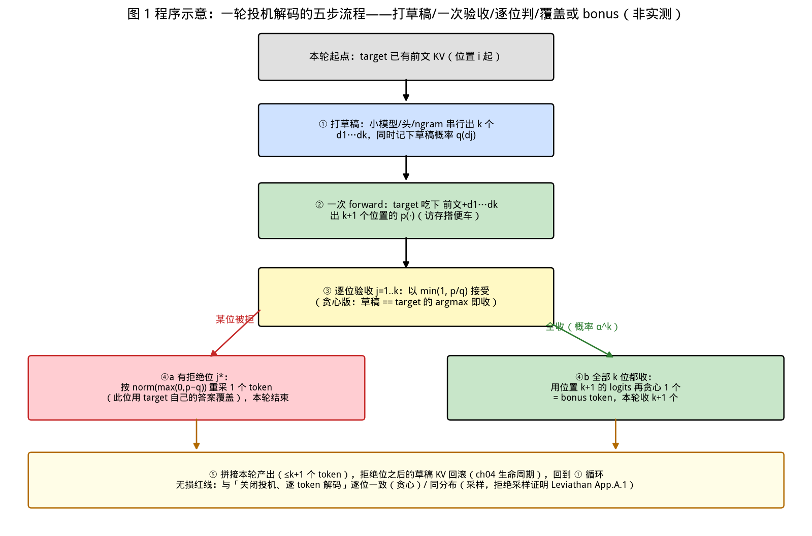

# 第 20 章｜投机解码：小模型打草稿，大模型批量验收（Day 48–49）

> **这章讲什么**：投机解码（speculative decoding）的完整图景——**为什么它能在不损失任何输出质量的前提下把 decode 提速 1.6–2.8×**：两篇开山论文与"无损"的数学保证（拒绝采样为什么能保证输出分布与大模型逐位一致）；加速比的期望账公式（接受率 α、草稿长度 k、草稿成本 c 三个旋钮如何决定收益）；四条技术路线的谱系（独立小模型 / Medusa 多头 / MTP 多 token 预测 / EAGLE 谱系）与 vLLM 2026 年官方支持现状；最后是动手任务——**实现一个极简投机解码并测出你自己的接受率**。
>
> **为什么重要**：第 3/4 章算过账——decode 是访存 bound，每生成一个 token 都要把全部权重从显存搬一遍，**token 一个个出是推理最贵的动作**。投机解码是"用便宜的草稿换昂贵的正步"，是 2024–2026 年所有主流引擎的标配功能（vLLM 官方文档把它列为独立 feature，第 18 章横评表里它出现在每个引擎的"高阶特性"栏），也是面试里"怎么在不换卡的情况下提高吞吐"这道题的标准答案之一。更重要的是：它是全书唯一一个**你能用纯 PyTorch 在 100 行内实现并严格验证"无损"的技术**——这是比调 API 更硬的项目素材。
>
> **学完能干什么**：① 用大白话讲清"打草稿-验收"的全流程，包括那个容易漏讲的 **bonus token（多送的 1 个）**；② 写出加速比期望账公式，给定接受率能现场算出加速比，反过来能解释"为什么生产环境接受率 35.5% 只换来约 20–50% 提升"；③ 说清四条路线各自"草稿从哪来"的本质区别与适用档位；④ 手写极简投机解码并测出分位接受率，验证贪心下逐位一致；⑤ 回答"批大小多大时投机解码没用"这类追问。
>
> **本章数字纪律**：零性能跑测。论文数字（2–3×、2.2×、2.7–3.5×、80% 等）标注**论文原文与 arXiv 编号**；生产案例与引擎现状标注来源与检索日期（2026-10-16）；加速比公式代入账为**零成本算术**（脚本登记于 [code/ch20/RESULTS.md](../code/ch20/RESULTS.md)）；接受率实测留给动手任务回填。

---

## 0. 大白话开场：一个学生答十道题的两种方式

先用一个类比把整件事说完，后面所有数学都是在给这个类比算账。

**笨办法（现在的自回归 decode）**：学生（大模型）答 10 道题，每答一道都要把整本教材在脑子里过一遍（访存 bound，第 3 章的账）。答第 1 道花了全部力气，答第 2 道又是全部力气——**教材越厚越亏，而且 10 道题是串行的**。

**聪明办法（投机解码）**：让一个背过同一本教材缩印本的小学生（草稿模型）**先把 4 道题的答案草稿写好**；然后大模型**一口气把 4 道题一起批改**——注意，批改 4 道题和批改 1 道题花的力气**几乎一样**，因为大模型的成本主要在"翻教材"（访存），翻一次书顺手批 1 道还是批 4 道差别不大（第 3 章：decode 阶段算术强度极低，多算几个 token 的边际成本极低）。批改结果：

- 4 道全对 → **4 道全收**，而且大模型批改时顺手把自己对第 5 题的判断也写出来了——**白送 1 个 token（bonus token）**。这一步收 5 个。
- 第 3 道错了 → 前 2 道照收，第 3 道**用大模型自己的答案覆盖**（按概率重新采样），后面的草稿作废——**保证最终答案和"没请过小学生"一模一样**。

这就是全部。三个关键词：**草稿（draft）**便宜、**验收（verify）**一次批多个、**无损（lossless）**——输出与不用投机时严格一致。Google 官方博客解释 Gemma 4 的 MTP 时也是这么表述的："如果目标模型同意草稿，就一次 forward 接受整段序列——甚至顺带多生成它自己的 1 个 token……你的应用可以在原本生成 1 个 token 的时间里拿到整段草稿加 1 个 token"（来源：blog.google《Multi-token-prediction in Gemma 4》，检索 2026-10-16，**官方口径**）。

**本章验收题**（学完应能张口回答）：

> ① 为什么"批改 4 道题"比"做 4 道题"便宜得多？（答：decode 访存 bound，见第 3/4 章）② 草稿第 3 个 token 被拒后发生了什么？为什么这保证了无损？（答：拒绝处按目标分布重采，见第 1 节）③ 接受率 0.8、草稿 4 个、草稿成本为目标的 10%，加速比约多少？（答：约 2.4×，见第 2 节现场算）

---

## 1. 无损的保证：拒绝采样为什么能"逐位一致"

### 1.1 两篇开山论文，同一个想法

2023 年两拨人独立提出同一件事（这本身就是"想法有多对"的证据）：

- **Leviathan et al.**《Fast Inference from Transformers via Speculative Decoding》（arXiv:2211.17192，ICML 2023）：原文摘要口径——"accelerate existing off-the-shelf models **without retraining or architecture changes**……on T5-XXL……**2X-3X acceleration** compared to the standard T5X implementation, **with identical outputs**"（检索 2026-10-16，论文原文）。**"identical outputs"是本章的定盘星**：不是"质量差不多"，是"输出完全一样"。
- **Chen et al.**（DeepMind）《Accelerating Large Language Model Decoding with Speculative Sampling》（arXiv:2302.01318，2023）：同一思路的"投机采样"版本，把保证从贪心（greedy）推广到任意采样分布。

两篇的核心都不是"草稿模型多聪明"，而是一套**验收时的数学技巧**。

### 1.2 验收规则：一次前向，逐位比对

设目标模型在位置 i 的分布为 p、草稿模型的为 q，草稿提出 token x̃。验收规则（survey arXiv:2401.07851 记录的原始形式，检索 2026-10-16）：

> 以概率 **min(1, p(x̃)/q(x̃))** 接受 x̃；拒绝则从修正分布 **norm(max(0, p−q))** 中重采一个 token。

直觉版：**大模型觉得草稿"比它自己还会编"的部分，压根不采信**——接受概率被 p/q 的比值卡死。数学上能证明（Leviathan 论文 Appendix A.1 给出证明；2026 年的实证论文 arXiv:2607.17283 也给出 Proposition 1："For any context, the token emitted by one round of Algorithm 1 is distributed exactly as p(·|s)"，检索 2026-10-16）：

> **无论草稿模型多烂，最终输出的分布与目标模型单独解码的分布完全相同。**

两个口径别混（面试常挖的坑）：

| 采样方式 | "无损"的准确含义 |
|---|---|
| **贪心（temp=0）** | 逐位**完全一致**——草稿对就收，错就用目标模型 argmax 覆盖，输出 bit-identical |
| **采样（temp>0）** | **分布一致**（lossless in distribution）——同分布但随机数不同，两次运行文本可以不同 |

这和第 6 章的对齐方法是同一件事的两面：ch06 你用 maxdiff 0.00 逐位对齐手写 generate 与 HF；本章你用同样的"逐位比对"验证投机解码不改输出。**无损验证是纯本地、零成本、可以严格做的**——这就是第 5 节动手任务的验收核心。

### 1.3 一个反直觉结论：草稿越烂，只是越不赚，绝不会更糟

草稿模型接受率为 0 时，每轮验收立刻在第 1 位拒绝——你只损失了"跑了一次小模型"的开销，输出依然正确。**投机解码的风险有下界没上界**：最差是白跑草稿（小幅变慢），最好是 2–3×。这个"亏损有限、盈利可观"的不对称性，是它能在生产环境默认开启的根本原因。

【化学家视角】这像色谱分析里的**内标法**：草稿模型是"预测的保留时间"，目标模型是"标准品"——预测不准只是峰对不上要重采（损失一点时间），但**最终报出的每个峰位都以标准品为准**，所以定量结果（输出分布）不受预测质量影响。方法的正确性与预测器的质量解耦，这是它在数学上优雅的地方，也是你在方法学上应该追求的结构：**优化器可以很糙，校准器必须严格**。

---

## 2. 加速比的账：三个旋钮定收益

"2–3×"不是魔法数字，是一条公式的取值。这一节把账算透，你就能在白板上现场推导。

### 2.1 第一本账：一轮平均收下多少 token

设：草稿长度 k（一次打 k 个 token 的草稿）、每个位置被接受的概率 α（接受率，假设各位置独立同分布）。一轮的结局只有两种：

- 第 i 位被拒（i 从 1 到 k）：收到 i 个 token（i−1 个草稿 + 1 个重采），概率 α^(i−1)(1−α)；
- k 位全收（概率 α^k）：收到 **k+1** 个——k 个草稿 + 1 个 bonus token（第 0 节那个"白送的"）。

于是**一轮的期望产出**：

**E(α, k) = (1 − α^(k+1)) / (1 − α)**

三个检查点验证公式没写错（零成本算术，登记于 RESULTS）：

| α | k | E（每轮期望收 token） | 直觉解释 |
|---|---|---|---|
| 1（草稿全对） | 4 | 5 = k+1 | 全收 + bonus |
| 0（草稿全错） | 4 | 1 | 只剩重采的 1 个，不亏 token 只亏草稿时间 |
| 0.8 | 4 | 3.36 | 每轮平均收 3.36 个 ≈ 白赚 2.36 个 |

### 2.2 第二本账：一轮花多少时间 → 加速比

一轮的成本 = k 次小模型前向 + 1 次目标模型前向。设草稿单 token 成本是目标前向的 c 倍（第 3 章的账：小模型权重少、也访存 bound，c 通常远小于 1；ngram 这类"无模型"草稿 c≈0），以"目标模型单 token 时间"为单位：

**一轮成本 = 1 + c·k，一轮产出 = E(α, k)**

**加速比 S = E(α, k) / (1 + c·k)**

这就是 Leviathan/Chen 论文的期望加速账（公式形式与论文一致，代入值为本章算术）。现场代入验收题：**α=0.8、k=4、c=0.1**：

> E = (1−0.8⁵)/(1−0.8) = 0.672/0.2 = **3.36**；成本 = 1+0.1×4 = **1.4**；**S = 3.36/1.4 ≈ 2.4×** ✓

### 2.3 一张表看三个旋钮（c 固定 0.1）

| α \ k | k=1 | k=3 | k=4 | k=7 |
|---|---|---|---|---|
| 0.35 | 1.23× | 1.17× | 1.09× | **0.90×** |
| 0.5 | 1.36× | 1.44× | 1.38× | 1.17× |
| 0.7 | 1.55× | 1.95× | 1.98× | 1.85× |
| 0.8 | 1.64× | 2.27× | 2.40× | 2.45× |
| 0.9 | 1.73× | 2.65× | 2.93× | 3.35× |

（每格 = E/(1+0.1k)，精确到小数点后两位，脚本登记 RESULTS）

下图把这张表画成曲线：横轴接受率、纵轴加速比、四条曲线是四个 k，并把两个有出处的生产坐标（PayPal 35.5%、DeepSeek-V3 80%）标了上去。



> **看图要点**：公式代入算账，**非实测数据**（图题已注明）。红线是 PayPal 生产实测的 α≈35.5% 处——此处四条曲线挤在 1.1–1.23×，即生产 22–49% 吞吐提升的量级来源；绿线 α>80% 处曲线才散开到 1.6–2.4×，k 越大越划算。注意左下角：α=0.35 时 k=7 的曲线跌破 1.0——**草稿又长又不准时，比不开还慢**。

表读出三个结论：

1. **α 是主宰**。α=0.35 时全场最高只有 1.23×（还必须 k=1）；α=0.9 才有资格谈 3×+。**选草稿模型的第一指标是接受率，不是草稿模型的绝对速度。**
2. **k 与 α 强耦合，低 α 下加 k 反而变慢**：α=0.35 时 k 从 1 加到 7，S 从 1.23× 一路**跌到 0.90×——比不开投机还慢**（草稿后半段本来就活不到被验收，纯付草稿钱）；α=0.9 时 k 从 1 加到 7 才从 1.73× 涨到 3.35×。**先测 α，再定 k。**
3. **c 是地板**：把 c 从 0.1 降到 0.01，α=0.8/k=4 的 S 从 2.40× 升到 3.23×；c 升到 0.3 则跌到 1.53×。**草稿越"薄"越好**——这就是 ngram/后缀这类零成本草稿在高 QPS 场景仍有价值的原因（vLLM 官方文档原话：n-gram 和 suffix "can provide modest speedups without increasing workload during peak traffic"，来源：docs.vllm.ai/features/speculative_decoding，检索 2026-10-16，**官方口径**）。

### 2.4 生产环境的真实坐标（第三方/官方口径，非本书实测）

- **PayPal 案例**：γ=3、**接受率 ~35.5%**（跨并发档与温度稳定），吞吐提升 **22–49%**、延迟降低 18–33%、"zero additional hardware cost"（来源：arXiv:2604.19767《Accelerating PayPal's Commerce Agent with Speculative Decoding》，检索 2026-10-16，**论文口径**）。用你的公式对账：α=0.355、k=3、c=0.1 → S≈1.17×（+17%）；c=0.05 → 1.33×（+33%）——**落在实测 22–49% 区间内**，说明"该案例草稿很薄"，算账与实测方向吻合。
- **DeepSeek-V3 的 MTP**：第三方转述"开箱接受率 >80%、生成吞吐约 1.8×"（来源：SyncSoft 2026 博客引 DeepSeek-V3 Technical Report，检索 2026-10-16，**第三方转述口径，建议以技术报告原文为准**）。80% 代入 k=1（MTP 单头单步）：E=1.8、成本 1.1 → 1.64×，与"约 1.8×"同量级。

【落地视角】**面试场景题的标准推导就这四行**：写 E 公式 → 写 S 公式 → 代 α/k/c → 得 S。追问"什么情况该关投机解码"时用表 2.3 反向回答：α 低（草稿与目标不匹配）时不值得开；**大 batch 高吞吐场景要重算**——batch 大时目标前向的权重搬运被 batch 均摊（第 3 章：batch 聚合吞吐 ×29 的账），单 token 边际成本变小，而验证 k 个 token 的计算量是实打实的，c 相对变大 → S 趋近 1。所以 vLLM 官方把方法按"Low QPS（侧重延迟）/ High QPS（侧重吞吐）"分档推荐（docs.vllm.ai，检索 2026-10-16）——**投机解码本质是给低并发低延迟场景的红利**，这也解释了它在 ch19 那种高并发压测里为什么通常不加。

---

## 3. 四条路线：草稿从哪里来

所有路线共享第 1/2 节的验收机制，**唯一区别是"那 k 个草稿 token 是谁写的"**。一张表定谱系：

| 路线 | 草稿来源 | 训练成本 | 额外显存 | 代表数字（口径） | 适用 |
|---|---|---|---|---|---|
| **① 独立小模型** | 另训/现成的小模型，串行自回归打 k 个 | 低（选型即可） | 一个完整小模型 | Leviathan 2–3×（T5-XXL，论文原文）；训练-推理解耦 | 有现成同族小模型时的默认选择 |
| **② Medusa 多头** | **目标模型上加 k 个轻量解码头**，一次 forward 并行出 k 个 | 中（训头，可冻干 backbone） | k 个头（极小） | Medusa-1 **>2.2×**、Medusa-2 **2.3–2.8×**（arXiv:2401.10774 摘要原文，检索 2026-10-16） | 不想维护第二个模型 |
| **③ MTP 原生多 token** | 模型**自带**的下一 token 预测头（训练时就加进去） | 0（训练期已付） | 共享 embedding 的 MTP 模块 | DeepSeek-V3/R1 检查点带 1 个 MTP 模块，开箱即用（TensorRT-LLM 官方博客口径，检索 2026-10-16） | 模型本身支持时**首选**（零额外训练） |
| **④ EAGLE 谱系** | 从目标模型的**隐状态**外推下一个隐状态，草稿质量高 | 中（训一个轻量外推模块） | 轻量模块 | EAGLE-1：LLaMA2-70B 延迟 **2.7–3.5×**、吞吐翻倍（arXiv:2401.15077 原文，检索 2026-10-16） | 延迟敏感场景的当前最优档之一 |

**EAGLE 为什么强**：普通草稿模型"从 token 猜 token"，EAGLE"从隐状态猜隐状态"——拿到的是目标模型自己算出的中间表示，草稿与目标的分布天然更接近 → α 更高（回扣第 2 节：α 是主宰）。EAGLE-2 加动态树、EAGLE-3 进一步用多层特征，谱系在持续迭代（vLLM/Ascend 文档将 eagle/eagle3 列为独立方法，检索 2026-10-16）。

**vLLM 2026 年官方方法清单**（docs.vllm.ai/features/speculative_decoding，检索 2026-10-16，**官方口径**）：

- 模型系（延迟收益最大）：**EAGLE / EAGLE-3、MTP、draft models、PARD、MLP**；
- 轻量系（高 QPS 不加负担）：**n-gram、suffix decoding**；
- 中间档：**Medusa**（Ascend 版文档还列 suffix 需 Arctic Inference、mtp 为共享 embedding 头——方法矩阵各家实现有差异，以你装的版本 `--help` 为准）。

第 18 章横评表里"投机解码"每家都有，但**路线支持宽窄不同**——这就是横评价值与实测价值的分界：横评知道"谁支持"，你的动手任务测"你这条路上 α 到底多少"。

### 3.1 draft 与 target 的匹配条件与四类失效场景

α 不是模型固有属性，是**配对属性**。四类经典失效：

1. **域错配**：代码草稿配聊天目标——分布差 → α 崩。换同域草稿或改用 ngram（域内复用强）。
2. **贪心/采样错配**：训练时目标模型用的采样策略与服务时不同 → 训出来的草稿和线上目标对不上。PayPal 案例特别报告"接受率跨温度稳定在 35.5%"正是在打这个疑点（arXiv:2604.19767，论文口径）。
3. **EOS 与重复倾向不一致**：草稿话痨（不爱收尾）或目标爱复读，α 在长序列尾部衰减——**按位置分桶测 α**（第 5 节动手任务）才能看见。
4. **贪心下的"分数劣势"**：greedy 验收中，草稿 token 只要不是目标 argmax 就被拒——目标模型稍有"自信漂移"就拒。所以采样模式的拒收反而更宽容（按 p/q 比例接受），**贪心验收常比采样验收 α 更低**，这是实测时最容易意外的点。

【落地视角】**选路线的决策顺序**：模型自带 MTP → 直接开（③，零成本）；有同域小模型 → ①；要最省显存且接受率优先 → ④EAGLE-3（有现成 speculator 权重就用）；只想零训练试水 → ngram（②④都要训练）。**上线前只测一个数：α 分位数**（第 5 节）。α < 0.3 就别折腾模型系方法了，ngram 或干脆关掉。

---

## 4. 一次验收的全流程：把第 0 节升级成工程图

按工程视角把一轮拆成五步（这也是第 5 节代码的伪代码骨架）：

```
一轮投机解码（目标模型上下文已有前文，位置 i 起）
┌─────────────────────────────────────────────────────────┐
│ ① 打草稿：小模型（或头/ngram）自回归生成 k 个 token      │
│     x̃₁, x̃₂, …, x̃ₖ，同时留下草稿概率 q(x̃ⱼ)             │
│ ② 并行验证：目标模型【一次 forward】吃下                │
│     前文 + x̃₁…x̃ₖ，得到每个位置的 p(·)                  │
│    （一次 forward 出 k+1 个位置的 logits，第 3 章：       │
│     这些位置的访存/计算搭了一次前向的便车）              │
│ ③ 逐位验收：j=1..k 按 min(1, p/q) 接受；                 │
│    首个拒绝位 j*：按 norm(max(0,p−q)) 重采 → 结束本轮    │
│ ④ 全收分支：k 个全过 → 用位置 k+1 的 logits 自回归        │
│    采 1 个 token = bonus（这就是"多送的 1 个"）          │
│ ⑤ 拼接本轮产出（≤k+1 个 token），回到 ①                 │
└─────────────────────────────────────────────────────────┘
关键性质：③④ 保证输出与「关闭投机、逐 token 解码」完全一致
```

三个实现层的工程细节（面试追问点）：

- **验证是"一次 forward 出 k+1 个位置"**：第 j 个位置的 logits 用来验收第 j 位草稿（teacher-forcing 形式——目标模型看到的上文是"到 j−1 位为止的**已接受**内容"，与逐 token 解码视角等价）。这就是无损证明能成立的前提：**验证时目标模型的信息条件与正常解码完全相同**。
- **KV Cache 怎么办**：草稿写进去的 k 个 token 的 KV，被拒的部分要**截掉/回滚**（第 4 章 KV 生命周期的"释放"分支）；接受的保留。实现投机解码必然要处理"按位提交与回滚"，这是它和朴素 generate 循环最大的结构差异。
- **树状草稿**：把 k 个串行 token 升级为一棵候选树（每步保留 top-m 分支），一次 forward 验证树上所有分支（Medusa/EAGLE-2 的标配）。树的规模受验收算力预算约束——第 2 节的 c 变成"树节点数 × 草稿成本"，账的结构不变。

下面这张流程图把五步与两个分支画在一起（与上面的 ASCII 骨架同构）：



> **看图要点**：③ 是全图的岔路口——有拒绝位走左支（红框）：拒绝位按目标分布重采，本轮结束；全收走右支（绿框）：拿位置 k+1 的 logits 多贪心 1 个 token，即 bonus。⑤ 框里的红线是验收标准 L1：无论走哪支，输出必须与"关掉投机逐 token 解码"一致。

【落地视角】**"批改 4 道题比做 4 道题便宜"有一个定量边界**，要能说出来：decode 是访存 bound（第 3 章算术强度推导），一次前向搬一遍权重是固定成本，多算 k 个 token 的边际 FLOPs 很小——**batch=1 时成立**；当 batch 已经很大（比如 32+），权重成本已被均摊，验证 k 个 token 的边际计算不再免费（甚至验证还要算 k 倍 attention），S 会明显衰减（第 2.4 节）。所以低 QPS 谈投机解码，高 QPS 谈 chunked prefill 与并行（第 14/15 章）——**优化手段要按工作区选**（回扣第 3 章全书优化地图）。

---

## 5. 动手任务（Day 48–49）：极简投机解码 + 接受率实测

第 6 章你手写了朴素 generate；第 17 章你搭了 mini-vLLM 的骨架——现在在 ch06 的 100 行基础上**加 60 行**，实现一个严格可验证的投机解码。只用贪心（greedy）模式，因为贪心下无损 = 逐位一致，验收可以做成单元测试级的硬标准。

### 5.1 代码结构（基于 ch06 的手写循环）

```python
# 投机解码主循环（贪心版，接在 ch06 手写 generate 之上）
def spec_greedy(target, draft, prompt_ids, k=4):
    ids = list(prompt_ids)
    while not 生成满:
        # ① 打草稿：小模型贪心出 k 个（串行）
        drafts, qs = [], []
        ctx = ids.copy()
        for _ in range(k):
            x = draft.greedy_next(ctx)      # q(x) = 草稿 softmax 的最大值概率
            drafts.append(x); qs.append(q); ctx.append(x)
        # ② 一次前向：把 前文+drafts 整段喂 target，拿每个位置 logits
        logits = target.forward(ids + drafts)          # 形状 [k+1, V]
        # ③ 逐位验收（贪心版：比 argmax 即可，p/q 采样版见下）
        accepted = 0
        for j in range(k):
            p_x = softmax(logits[j])[drafts[j]]        # 目标对草稿 token 的概率
            p_star = argmax(logits[j])                 # 目标的贪心选择
            if drafts[j] == p_star:
                accepted += 1
            else:
                ids.append(p_star)                     # 拒绝位：用目标覆盖
                return ids, accepted                   # 本轮止于此
            # （采样版：以 min(1, p_x/q_j) 接受，拒绝则从 max(0,p−q) 重采）
        # ④ 全收：bonus token 用 logits[k] 贪心
        ids.append(argmax(logits[k]))
        return ids, accepted
```

**采样版**只需把 ③ 换成 min(1, p/q) 判据 + 修正分布重采（第 1.2 节规则原文）。草稿模型可以就用第 6 章训过/用过的同族小模型，甚至先用**目标模型自己**当草稿（接受率必为 1，先跑通流程、验正确性，再换小模型测真 α——两步走，别一上来就调模型）。

### 5.2 三个验收标准（全部零成本、可自动化）

**L1（正确性）——无损硬验证**：同一 prompt、贪心模式下，`spec_greedy` 输出与 `ch06` 朴素 generate 输出**逐 token 完全一致**（复用 ch06 的比对函数；ch06 锚点 maxdiff 0.00）。这是本任务的红线：不一致就先查验收逻辑，再查 KV 回滚，**不许调参掩盖**。

**L2（接受率画像）**——记录 ③ 的统计：
- 总接受率 ᾱ = 接收草稿总数 / 提出草稿总数；
- **按轮次与按位置分桶**（第 1 位/第 2 位/…/第 k 位的条件接受率）——看第 3.1 节失效场景 3；
- **按内容类型分桶**（如代码 vs 闲聊 prompt）——看失效场景 1。

**L3（加速账对账）**——用第 2 节公式自证：拿实测的 ᾱ 与 k 代入 E/(1+ck) 得**预期加速**，与墙钟计时的**实测加速**对比。两者同量级（允许 c 估计有偏差）→ 公式、实现、测量三方互证；差得远 → 大概率是 c 没算对（草稿串行 k 次的开销被低估，**这是新手最常踩的坑：草稿本身很慢时收益被吃光**）。

### 5.3 数据回填

实测 ᾱ、分桶接受率、预期 vs 实测加速比，登记于 [code/ch20/RESULTS.md](../code/ch20/RESULTS.md) 的回填区。

【落地视角】**这 60 行是"比调 API 更硬"的证据**：面试问"投机解码怎么验证无损"，你能现场写出验收判据（L1 逐位一致）并解释贪心 vs 采样两种口径（第 1.2 节表）；问"怎么选草稿模型"，你能给出 L2 的分桶方法与 α 阈值（0.3）。**作品集包装**：把 L1 的单测 + L2 的 α 分布图 + L3 的公式对账放进第 17 章 mini-vLLM 仓库的 `speculative/` 目录——两个项目互相印证，简历上是同一段深度的两处佐证。

---

## 6. 【坑】七连 + 【应急方案】

### 【坑 1】无损 ≠ "文本两次相同"（采样模式）
采样下同分布但不同随机数，两次运行文本不同，你若用"输出 diff 为空"当验收会误判。**应急**：无损验证固定用贪心（逐位一致）；采样模式改验"分布性质"（如大量样本的 n-gram 频率近似），或固定 seed 逐位比。

### 【坑 2】只报平均接受率
ᾱ=0.5 可能是"前几位 0.9、第 4 位 0.1"（k 大没用）或"全体 0.5"（k=3 就够）——两者最优 k 差一倍。**应急**：必须按位置分桶（5.2 L2），用分桶 α 逐位算 E 而不是平均值直接代（第 2.1 节公式假设各位置同 α，分桶后改用连乘期望即可）。

### 【坑 3】把验证的显存账忘了
草稿模型与目标模型**同时驻留显存**——目标 90% + 草稿 10% 正好顶满就 OOM。**应急**：给草稿留预算（vLLM 的 `gpu-memory-utilization` 要同时够两者），或用 ngram/Medusa 这类无独立权重路线（回扣第 10 章显存账方法）。

### 【坑 4】高温采样下拿贪心验收的 α 去估收益
验收规则随温度变（第 3.1 节失效场景 2、第 1.2 节两种口径），贪心测出的 α 不能外推到 temp=0.7 的服务。**应急**：在**服务实际采样配置**下测 L2；PayPal 案例"跨温度稳定"是个好目标但不是默认性质（arXiv:2604.19767，论文口径）。

### 【坑 5】KV 不回滚
拒绝位之后草稿的 KV 残留在 cache 里，后续生成被污染——比性能问题严重得多，是正确性 bug。**应急**：L1 用"长输出 + 强制早期拒绝"的用例专门打这个（如给草稿喂故意错的上下文），逐位比对立即暴露。

### 【坑 6】草稿比预期慢（c 被低估）
串行 k 次小模型前向的启动开销、显存换入换出，可能让 c 大到抵消全部收益。**应急**：L3 对账失败先测 c（单独计时草稿 100 次的均值），c>0.5 就换更小的草稿或改 ngram；记住第 1.3 节：**最差也只是回到原速加草稿开销，不会更差太多**——但"不太差"和"没收益"是两回事，别拿前者当后者交差。

### 【坑 7】在高并发压测里开投机解码，然后得出"没用"的结论
第 2.4 节的机制：大 batch 下 S 衰减，ch19 式高并发场景本来就不是它的主场。**应急**：在低 QPS（并发 1–4）延迟场景测它；结论带上"低 QPS、batch≤X、temp=Y"的前提（第 19 章纪律的迁移）。

【应急方案·总则】投机解码的一切异常都先回到 **L1（无损）**：L1 过了说明实现对，问题在 α 与 c 的账（L2/L3）；L1 不过一切都免谈——**先正确后快，与第 6 章"先对齐后提速"是同一条纪律。**

---

## 7. 动手任务汇总与验收标准

| 任务 | 内容 | 验收标准 |
|---|---|---|
| **A 极简投机解码** | 基于 ch06 循环加 ~60 行，贪心版 + 采样版验收判据 | L1：与 ch06 输出逐 token 一致（0 差异）；含 KV 回滚用例 |
| **B 接受率画像** | ᾱ、按位置分桶、按内容分桶，各 ≥100 轮 | 分桶数据登记 RESULTS；至少指出一个失效场景的证据 |
| **C 加速账对账** | 实测 α 代公式得预期 S，与墙钟 S 对比；算 c 实测值 | 两者同量级并在 RESULTS 写明偏差解释；同时给出"何时该关"的条件 |
| **D（选）引擎验证** | vLLM 开 ngram 或 MTP，低 QPS 下 TTFT/TPOT 对比 | 标注方法/参数/并发档/采样配置（第 19 章纪律），不做高并发结论 |

---

## 8. 自检三问

1. 写出一轮期望产出公式，并解释分子上"α 的 k+1 次方"里的那个 +1 是什么。（答：bonus token——全收时目标模型顺手多出 1 个。）
2. 草稿模型接受率 0.35、目标服务是 temp=0.7 的采样解码——你测 α 时必须满足什么条件？（答：同一温度/同一目标采样配置下测，且用 min(1,p/q) 规则而非贪心比对。）
3. 为什么大 batch 时投机解码收益缩水？（答：权重访存被 batch 均摊，验证 k 个 token 的边际计算不再免费，c 相对变大 → S→1。）

---

## 9. 面试话术（3 条）

**话术 1（原理·必会）**："投机解码 = 小模型打 k 个草稿，目标模型一次 forward 并行验收 k 个位置——因为 decode 是访存 bound，批改 k 个和批改 1 个几乎同价，这是收益来源。无损靠拒绝采样：接受概率 min(1, p/q)，拒绝位按修正分布重采，数学上保证输出与目标模型单独解码**分布一致**；贪心模式更强，是逐位一致，我用它做了 0 差异单测。全收还有 bonus：多送目标自己的 1 个 token。"

**话术 2（算账）**："期望产出 E=(1−α^(k+1))/(1−α)，一轮成本 1+ck，加速比 S=E/(1+ck)。代入生产实测：PayPal 案例接受率 35.5%、γ=3，论文报 22–49% 吞吐提升——用我的公式，草稿成本 c 在 0.05–0.1 之间正好落进这个区间。结论：**α 是主宰**，0.35 的接受率只能挤出两三成，80%（DeepSeek-V3 MTP）才能谈到 1.8×。选草稿模型看接受率，不看草稿绝对速度。"

**话术 3（边界与场景）**："它不是万金油：大 batch 下权重访存被均摊、验证边际成本变贵，S 趋近 1——所以 vLLM 官方把方法分成低 QPS 延迟档和高 QPS 吞吐档，投机解码是低并发延迟敏感场景的红利。我实测过接受率的按位置分桶，发现第 3 位之后条件接受率明显衰减，所以草稿长度从 4 加到 7 没收益——这类结论只有自己测过分桶数据才说得出来。"

---

## 参考与版本说明

- 开山论文（检索 2026-10-16）：Leviathan et al. arXiv:2211.17192（ICML 2023，T5-XXL **2×–3×**、identical outputs、拒绝采样证明 Appendix A.1）；Chen et al. arXiv:2302.01318（DeepMind speculative sampling）。
- 路线论文：Medusa arXiv:2401.10774（Medusa-1 **>2.2×**、Medusa-2 **2.3–2.8×**，摘要原文）；EAGLE arXiv:2401.15077（LLaMA2-70B 延迟 **2.7–3.5×**、吞吐翻倍）；survey arXiv:2401.07851（验收规则原文）；arXiv:2607.17283（无损命题 Proposition 1）。
- 生产与现状（检索 2026-10-16）：PayPal 案例 arXiv:2604.19767（γ=3、α≈35.5%、吞吐 22–49%、延迟 −18~33%）；docs.vllm.ai Speculative Decoding feature（方法矩阵与低/高 QPS 分档）；TensorRT-LLM DeepSeek R1 MTP 官方博客（MTP Eagle、单 MTP 模块）；blog.google Gemma 4 MTP 解释（bonus token 口径）；DeepSeek-V3 ">80% 接受率、~1.8×" 为第三方转述，建议核对技术报告原文。
- 算账脚本：[code/ch20/make_figures.py](../code/ch20/make_figures.py) 与 [code/ch20/RESULTS.md](../code/ch20/RESULTS.md)（E/S 公式代入表、PayPal 反推账均为零成本算术）。
- 本书内锚点：ch03 decode 访存 bound 与算术强度；ch04 KV 生命周期与回滚；ch06 手写 generate 与 maxdiff 0.00 对齐方法；ch10 显存账；ch14/ch15 优化手段按工作区选；ch18 横评特性栏；ch19 低 QPS 测试纪律。
- **版本**：v0.21（第 1–20 章已完成）；本章零性能跑测，接受率实测留给动手任务回填。
- **下一章预告**：第 21 章《PD 分离、分层 KV Cache 与 MoE 推理》——prefill/decode 为什么该分家、KV 跨节点传输的收益代价、GPU→CPU→SSD 三级缓存、MoE 路由与负载均衡为什么成了新战场。
