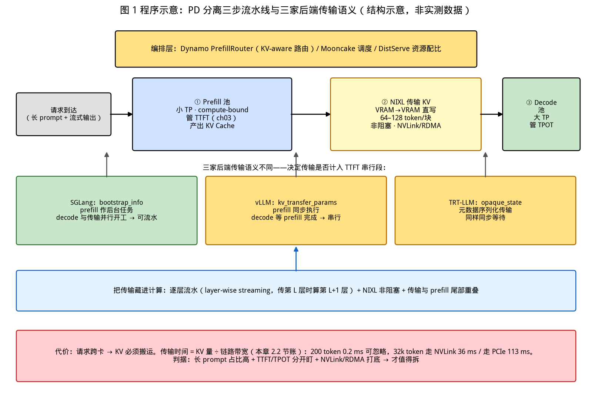
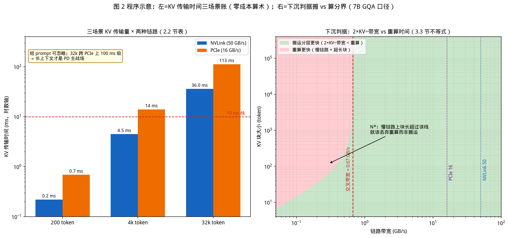

# 第 21 章｜PD 分离、分层 KV Cache 与 MoE 推理（Day 50–51）

> **这章讲什么**：推理系统在"单机单引擎"之外的三件大事——**① PD 分离**：prefill 与 decode 为什么该拆到不同 GPU 上、拆完 KV Cache 怎么搬（DistServe/Mooncake/NVIDIA Dynamo 官方三步与 NIXL 传输）；**② 分层 KV Cache**：显存→内存→SSD 三级（甚至 G1–G4 四级）怎么像 CPU 缓存一样调度、什么时候该往下沉；**③ MoE 推理**：专家路由的 all-to-all 之后，负载不均这个"第三堵墙"怎么破（DeepSeek-V3 无辅助损失负载均衡、vLLM EPLB 冗余专家）。三件事共享同一条主线：**当单张卡的算力/显存/带宽不再是唯一约束，系统工程就从"卡内优化"升级为"卡间调度"**。
>
> **为什么重要**：第 3–20 章你把单机推理的账算穿了：Roofline（ch03）、KV 显存（ch04）、并发崩塌（ch05）、并行四把刀（ch15）、投机解码（ch20）。但 2026 年的真实大模型服务（DeepSeek-R1、Kimi、GPT 级别）全是**多机系统**：prefill 和 decode 抢同一张卡、一个 128k 上下文的 KV 比权重还大、千亿 MoE 的专家摆满几十张卡。**这三件事就是 JD 里"大规模推理服务架构"的实体**（回扣 ch02 黑话表）。而且它们恰好是 NVIDIA Dynamo 把 vLLM/SGLang/TRT-LLM 收编为"可插拔后端"的原因（ch18）——引擎之上的编排层，正是这章的主角。
>
> **学完能干什么**：① 画出 PD 分离的请求三步流水线，并算出"一次 KV 传输要多久"（NVLink vs PCIe 两个数字现场算）；② 说清分层 KV 的下沉判据——一条不等式判断"该重算还是该搬运"；③ 解释 MoE 负载不均的三类解法与各自的代价（辅助损失伤精度 / 冗余专家烧显存 / 重路由加通信）；④ 在面试里回答"什么规模才值得上 PD 分离"这道系统设计题。
>
> **本章数字纪律**：零性能跑测。论文数字标 arXiv/会议与原文口径（DistServe 7.4×/12.6× 沿用 ch14 已核验口径）；Dynamo/HiCache/EPLB 等标**官方文档**与检索日期（2026-10-16）；KV 传输账为**零成本算术**（输入全部来自本书 ch04/ch07/ch08/ch15 的实测登记值）；第三方转述单独标注。数据登记于 [code/ch21/RESULTS.md](../code/ch21/RESULTS.md)。

---

## 0. 大白话开场：一间厨房撑不起两种客人

回忆第 3 章的两个世界：**prefill 是吞吐 bound**（一次性把几千个输入 token 并行算完，像后厨一口气备好一桌菜），**decode 是延迟 bound**（一个一个 token 地挤，像服务员一趟趟上菜）。第 14 章的 chunked prefill 是"别让备菜堵住上菜"的**时间片调度**——但那是在同一张卡上腾挪。

这章问一个更狠的问题：**为什么非要在同一张卡上腾挪？**

答案藏在一个事实里：一个请求的两半对硬件的"胃口"完全相反，且互相干扰——一个 4096 token 的长 prompt prefill 进来，正在流式输出的 32 个请求的 TTFT/TPOT 全部抖一下（ch05 你实测过这种抖动的形态）。DistServe（OSDI'24，arXiv:2401.09670）的原话：把 prefill 和 decode 分到不同 GPU，**"eliminating prefill-decoding interferences"**，并按各自的 SLO（TTFT 归 prefill 管、TPOT 归 decode 管）分别配并行策略与资源（检索 2026-10-16，论文原文）。效果沿用 ch14 已核验的论文口径：**满足 SLO 的请求吞吐最高 7.4×、SLO 收紧 12.6×**。

于是三件事接踵而至——**拆了，KV 怎么办？（第 1–2 节）KV 太大装不下怎么办？（第 3 节）模型本身越来越大还是个 MoE 怎么办？（第 4 节）**

**本章验收题**（学完应能张口回答）：

> ① PD 分离的官方三步是什么，SGLang 与 vLLM 在"传 KV 时 decode 能不能先开工"上的差别是什么？② 一个 7B 模型 200 token 的 prompt KV 有多大、走 NVLink 和走 PCIe 各要多久？（现场算）③ "该把 KV 下沉到内存还是直接重算"的判据不等式是什么？

答案分别在第 2.2/2.1、2.3、3.3 节。

---

## 1. PD 分离：把两种胃口的活分给两种卡

### 1.1 为什么"分开"比"调度"更彻底

ch14 的 chunked prefill 在**同一引擎内**切时间片，解决"长 prefill 堵门"；PD 分离则把两者变成**两组独立的 GPU 池**，各自解决：

| 维度 | prefill 池 | decode 池 |
|---|---|---|
| 瓶颈 | 算力（compute-bound，ch03） | 显存带宽（memory-bound，ch03） |
| 适合的并行 | 小 TP（计算并行，通信少） | 大 TP（权重搬运并行，或大 batch） |
| 管的 SLO | TTFT | TPOT |
| 负载形态 | 突发（prompt 到达） | 持续（流式吐 token） |

NVIDIA Dynamo 官方文档把这个动机写得很直白："using a larger TP for the memory-bound decoding phase while a smaller TP for the computation-bound prefill phase allows both phases to be computed efficiently"，且长 prompt 的 prefill 拿到专用引擎后，"ongoing decoding requests … efficiently processed without being blocked"（来源：docs.nvidia.com/dynamo《Disaggregated Serving》，检索 2026-10-16，**官方口径**）。

拆分的代价也很直白：**请求跨卡了，prefill 算出的 KV Cache 必须搬到 decode 卡上**——这就是下一节的全部内容。Dynamo 的官方三步（同上文档）：

```
1. Prefill 引擎算 prefill，产出 KV Cache
2. Prefill 引擎把 KV Cache 传给 decode 引擎
3. Decode 引擎在此 KV 上开始 decode
```

【落地视角】**判断"要不要 PD 分离"的第一问不是性能，是负载形态**：你的服务里有没有"长 prompt + 流式输出 + 对 TTFT/TPOT 分别有要求"的混合负载？纯短问答、低并发场景（比如内部小工具），合并部署 + chunked prefill（ch14）就够了——PD 分离引入了网络传输、两套扩缩容、跨池调度三个新的故障面（第 6 节坑会逐个拆）。**它是规模的产物，不是技术先进性的产物。**

### 1.2 传输机制：NIXL、以及"SGLang 能流水、vLLM 要等"的细节

分离后性能的生死线是 **KV 传输**。Dynamo 的官方设计（docs.nvidia.com，检索 2026-10-16）：

- **传输路径**：NIXL（NVIDIA Interchange Library）让 KV **从 prefill 引擎显存直写 decode 引擎显存**（VRAM→VRAM），按块传输（block-based，**64–128 token 一块**），走最优可用传输层（NVLink、InfiniBand/UCX）；**传输非阻塞**——传输期间 prefill 的 forward 可以继续服务其他请求。
- **路由**：`PrefillRouter` 先选 prefill worker（KV-aware：按缓存重叠打分 + 负载），再把 `disaggregated_params`（各家后端格式不同）注入 decode 请求路由过去。
- **三家后端的传输语义不同**（这是面试级细节）：
  - **SGLang**：`bootstrap_info`（host/port/room_id）做 RDMA 握手——prefill 可作为**后台任务**，**decode 与 KV 传输并行开工**；
  - **vLLM**：`kv_transfer_params`（块 ID + 远端连接信息）——prefill **同步**，decode **等 prefill 完成**再开始；
  - **TRT-LLM**：`opaque_state` 序列化元数据——同样同步等待。

为什么这个差别重要？**它决定了"传输是否计入 TTFT 的串行段"**：SGLang 路径下传输与 prefill 尾部/decode 准备重叠，vLLM 路径下传输是显式的串行等待（当然传输本身也与 prefill 的尾部有重叠空间，见 2.3 的账）。同理，Mooncake 的第三方技术解读指出：长 prompt 无缓存命中时传输是 TTFT 的硬增量，缓解手段是**逐层流水（layer-wise streaming）**——传第 L 层时模型在算第 L+1 层（来源：zhongzhuzhou.org Mooncake 技术评论，2026-05-28，检索 2026-10-16，**第三方口径**）。

【化学家视角】这与**连续流动化学**的思路同构：传统釜式反应"一批进料→反应→出料"是时间上的串行；流动化学把混合、反应、分离拆成**串联的模块**，物料在模块间管道流动，前段还在反应时后段已经出料——PD 分离就是把"一锅烩"拆成 prefill 反应器 + decode 分离器，**中间的管道（KV 传输）必须足够细且不停流**，否则拆分反而多付了管道压降（传输延迟）。工程上任何"拆"的决策，都是在赌"管道成本 < 耦合收益"。

---

## 2. 搬 KV 的账：传输要多久，值不值

### 2.1 传输量：一个 prompt 的 KV 到底多大

先复习 ch04 的公式再算三笔账。每 token 的 KV：

**KV/token/seq = 2（K 和 V）× 层数 L × 每层头维 d_head × n_heads × 每元素字节数**

（GQA 时 K/V 的 kv_heads 少于 q_heads，按 kv_heads 算，更省。）用本书 ch04 登记过的 7B（Llama-2-7B 规格：L=32、4096 维 32 头、bf16=2B）：

- KV/token ≈ 2 × 32 × 4096 × 2 B = **512 KiB/token/seq** 量级（ch04 的 7B 账为 56 KiB/token 是 **GQA 后**的值——Llama-2-7B dense 无 GQA 时按上式 512 KiB；带 GQA 的同级模型按 kv_heads 折算后回到几十 KiB。**本章两种口径都给出，实际按你模型的 GQA 配置算**）。

三个典型传输量（按 56 KiB/token 的 GQA 口径）：

| 场景 | prompt 长度 | KV 传输量 |
|---|---|---|
| 短问答 | 200 token | 56 KiB × 200 ≈ **11 MB** |
| 文档摘要 | 4k token | 56 KiB × 4096 ≈ **224 MB** |
| 长上下文 | 32k token | 56 KiB × 32768 ≈ **1.8 GB** |

下图是本章第 1–2 节的全景：顶部编排层调度，中部是 Dynamo 官方三步流水线（prefill 池 → NIXL 传输 → decode 池），下方三块是三家后端的传输语义差异，底部红条是传输代价与拆分判据。



### 2.2 传输时间：NVLink 与 PCIe 的差距是 20 倍

用 ch08 登记的带宽（NVLink ~**50 GB/s** 有效、PCIe 4.0 ~**16 GB/s** 有效——本书 ch07/ch08 实测与规格口径）代入：

| 场景 | KV 量 | 走 NVLink（50 GB/s） | 走 PCIe（16 GB/s） |
|---|---|---|---|
| 200 token | 11 MB | **0.2 ms** | **0.7 ms** |
| 4k token | 224 MB | **4.5 ms** | **14 ms** |
| 32k token | 1.8 GB | **36 ms** | **113 ms** |

（零成本算术：时间=量/带宽，登记 RESULTS；与 Mooncake 第三方解读的"200 token ≈ 64 MB、~1 ms"同量级，交叉印证。）

这张表直接给出三条工程结论：

1. **短 prompt 的传输可忽略**（亚毫秒级）——所以 PD 分离对短问答场景几乎没有传输成本，但收益（消除干扰）也小；
2. **长上下文才是 PD 分离的主战场**，而**跨机房/走 PCIe 会把 1.8 GB 拖到 100 ms 级**——这就是为什么 Dynamo 用 NIXL 直连 VRAM、Mooncake 用 Transfer Engine 走 RDMA——**传输介质决定了 PD 分离的生死**（回扣 ch08：TP 必须 NVLink，PD 可以走网络但要 RDMA 打底）；
3. **传输可与计算重叠**（layer-wise streaming / 非阻塞 NIXL）——重叠做满的话，只有"无法重叠的尾部"计入 TTFT。

下图把两笔账画在一起：左图是 2.2 节的传输时间柱状账（注意对数轴，32k 跨 PCIe 比 200 token 跨 NVLink 差三个数量级）；右图是 3.3 节下沉判据的分界曲线——横轴链路带宽、纵轴 KV 块大小，绿色区搬运更划算、红色区重算更快，分界线由"2×KV÷带宽 = 重算时间"解出（参数与建模假设登记于 [code/ch21/RESULTS.md](../code/ch21/RESULTS.md)）。



### 2.3 三个编排层的取舍（全是官方口径，2026-10-16 检索）

| 系统 | 分离方式 | KV 传输 | 额外机制 |
|---|---|---|---|
| **DistServe**（论文） | prefill/decode 不同 GPU 池，按 TTFT/TPOT 各配并行与资源，按集群带宽摆位 | 带宽感知摆位 | 7.4×/12.6×（ch14 已核验论文口径） |
| **Mooncake**（Kimi 生产，arXiv:2407.00079） | **KVCache-centric**：调度器以 KV 池为中心配对 prefill/decode 实例 | Transfer Engine（RDMA/多网卡聚合） | **预测式提前拒绝**（decode 过载时 HTTP 429 拒在 prefill 之前）；长上下文见长（论文摘要口径：对比基线最高 …x，原文数字以论文为准） |
| **NVIDIA Dynamo**（编排层） | PrefillRouter + 可运行时伸缩的 x prefill/y decode（**xPyD**） | NIXL VRAM→VRAM 直写、64–128 token/块、非阻塞 | KV-aware 路由（缓存重叠打分）；K8s/裸机双模式服务发现；Planner 自动扩缩 |

三者的递进关系值得记住：**DistServe 证明了分离的收益（学术），Mooncake 解决了分离后的过载与 KV 池化（生产），Dynamo 把它做成了可插拔的基础设施（生态）**。Mooncake 的"预测式提前拒绝"是其中最巧的一笔：朴素的"满了就拒"会震荡（prefill 完时 decode 池可能早已变脸），所以**按"这个请求将来会在 decode 池制造多少负载"来预判拒收**——与其让所有请求一起超 SLO，不如让一部分在门口就拿到 429（来源：docs.aiwiki 与论文摘要转述，检索 2026-10-16，**第三方转述 + 论文口径**）。

【落地视角】**PD 分离的选型三问**：① KV 走什么？（同 NVLink 基本免费，跨机必须 RDMA，走 PCIe 公网/以太网会死）② 过载了拒谁？（Mooncake 式按 decode 负载预判，别用 FIFO 硬扛）③ 谁来编排？（单引擎内 vLLM/SGLang 自带的 disaggregated 模式起步，多引擎/多池才上 Dynamo 这类编排层——回扣 ch18 决策树，**引擎之上还有编排层**）。规模线的粗略判据：当你的长 prompt（>4k）流量占比明显、且 TTFT/TPOT 有人分开盯时才考虑；纯吞吐场景优先 ch15 的 TP/PP。

---

## 3. 分层 KV Cache：显存装不下，往哪儿沉

### 3.1 为什么 KV 总是"不够"——第四堵墙

第 12 章给 llama.cpp 画过并发的三道墙（KV 显存/SLO/引擎自身），那是单机小模型的账。放到长上下文时代，KV 变成了**第四堵墙的主体**：32k 上下文的单请求 KV 就是 GB 级（2.1 节的表），并发 32 个就是几十上百 GB——**权重是固定的，KV 随上下文×并发线性长**（ch04 的三巨头账）。第 13 章的 PagedAttention 解决了"碎片浪费"（有效率 20.4%→接近 100%），但**没有解决"总量超过显存"**——超了只能拒、只能挤、或分层。

### 3.2 四级分层：照抄 CPU 缓存的作业

2026 年业界的分层 KV 已经非常规整，直接对标 CPU 的 L1/L2/L3：

| 层 | 介质 | 容量量级 | 延迟量级 | 谁在用 |
|---|---|---|---|---|
| **G1 / L1** | GPU HBM | 10–50 GB 级（受 `gpu-memory-utilization` 约束） | ~µs | vLLM/SGLang 的 prefix cache（ch16） |
| **G2 / L2** | 主机内存（CPU DRAM） | 50–500 GB 级 | **50–200 µs**（第三方表，见下） | LMCache、Mooncake、SGLang **HiCache** |
| **G3 / L3** | 分布式存储 / SSD 池 | TB 级 | ms–数十 ms | Mooncake Store、分布式 KV 池 |
| **G4**（部分框架） | 远端/交换内存（CXL 等） | 更大 | 更高 | 前沿（arXiv:2607.18141 CXL memory rack，检索 2026-10-16） |

- **Mooncake × SGLang HiCache 官方原话**："受现代 CPU 经典三级缓存设计的启发，HiCache 将 GPU 显存组织为 L1，主机内存（Host Memory）组织为 L2，分布式存储组织为 L3"——它把 RadixAttention（原只在 GPU 显存内）扩展到分层并接分布式后端（来源：docs.kvcache.com.cn / kvcache-ai.github.io Mooncake 官方设计文档，检索 2026-10-16，**官方口径**）。
- **G1–G4 的命名**来自 NVIDIA 的 context hierarchy，LMCache 与 Mooncake 都按 G2=系统 DRAM 落位（来源：arXiv:2607.18141 引用框架，检索 2026-10-16，**论文口径**）。
- 三级延迟与容量量级（GPU 热 10–50 GB / CPU 暖 50–500 GB、50–200 µs）来自第三方知识库汇总表（hivebook，检索 2026-10-16，**第三方口径，量级参考**）。

【落地视角】**分层 KV 的商业本质是"把最贵的介质留给最热的数据"**——和 ch16 前缀缓存是同一个思想在**容量维度**的延伸：ch16 解决"要不要算第二遍"（命中率），本节解决"算过的放哪儿"（驻留层级）。两者的配合是 2026 年长上下文服务的标配：**高频复用的 system prompt/文档块钉在 G1，最近用过的沉 G2，历史会话压 G3**。

### 3.3 下沉判据：重算 vs 搬运的一元不等式

分层的核心调度决策是：**一个 KV 块被挤出显存后，是把它搬下去（预取回来更便宜），还是下次直接重算？** 判据是一条不等式：

> **搬下去再搬回来的时间 < 重算它的时间**  → 选分层驻留；
> 反之 → 选丢弃 + 下次重算。

两边都是可以现场算的量：

- **搬运时间 = 2 × KV 大小 ÷ 链路带宽**（下去再上来各一次）。1 GB 的 KV 走 NVLink(50 GB/s) 是 40 ms，走 PCIe(16 GB/s) 是 125 ms，走网络另算（2.2 节的账）。
- **重算时间 = 它被算一遍的时间**，prefill 阶段 ≈ token 数 × 每 token 的 prefill 时延（ch03 的实测量级：prefill 有几 ms 到几十 ms 的吞吐能力）。

于是有一个漂亮的直觉：**短块 + 快链路 → 分层划算；超长块 + 慢链路 → 重算更快**。而"重算 ≤ 20%"正是第 13 章 v1 弃 swap 用 recompute 的论文口径——**swap（搬运）与 recompute（重算）的选择，PagedAttention 论文里做过，分层 KV 在更大尺度上重做了一遍**（ch13 锚点：v1 无 swap 路径，grep=0；生产级分层又把 swap 请回来，因为池子够大、链路够快时搬运更划算——两者不矛盾，是判据两侧的取舍）。

【落地视角】**面试问"KV 分层怎么调度"，先写这条不等式再谈系统**：能算出"搬 vs 算"的交叉点，说明你理解这是一道 I/O vs compute 的老题（操作系统 page-in vs recompute，ch13 的 OS 对照表又+1 行）。工程上还有两个实务旋钮：**分层的粒度**（Dynamo 用 64–128 token 块，太细=元数据开销、太粗=拷贝浪费）与**预取方向**（按前缀树/路由预测下一个要哪块，别等 miss 才搬——CPU cache 的硬件预取思路）。
---

## 4. MoE 推理：专家分完之后，第三堵墙是负载不均

### 4.1 MoE 把"卡内账"变成"卡间账"

混合专家（MoE）层的公式你见过无数次：门控选 top-k 专家、每个 token 只过少数专家——**推理时的 FLOPs 远小于等参数的 dense 模型**，这是 DeepSeek-V3/Qwen3-MoE 这批旗舰模型的立身之本。但**显存不打折**：几百个专家的权重全都要摆着，于是单卡放不下 → 必须**专家并行 EP**（第 15 章的第四把刀）。EP 一开，第 15 章算过的账就回来了：

> **每层每步一次 all-to-all**：token 发到它被路由的专家所在卡，算完再收回来——通信次数 = EP 规模，消息大小 = 每卡 token 数 × hidden。

第 15 章的结论照搬：all-to-all 是 EP 的形态瓶颈，且它**被负载不均放大**——如果某个专家爆热，它所在的那张卡就是整组 all-to-all 的慢节点，**全组为它等路**（第 15 章引 Speculative MoE 的批评口径）。这就是 MoE 推理的第三堵墙：**权重放下了、通信算清了，还是可能被一个过热专家拖死。**

### 4.2 负载不均的三类解法与代价

| 解法 | 机制 | 代价 | 谁在用 |
|---|---|---|---|
| **① 辅助损失（训练期）** | 加 aux loss 强行拉平各专家负载 | **伤模型精度**（为均衡牺牲质量） | 经典做法，被 DeepSeek-V3 明确列为要克服的问题 |
| **② 无辅助损失负载均衡（推理/训练）** | DeepSeek-V3：**auxiliary-loss-free strategy**——不改 loss，用偏置项调门控，只在训练时"鼓励"均衡而不扰动梯度 | 实现复杂、偏置需调 | DeepSeek-V3 技术报告（arXiv:2412.19437）原话："we pioneer an auxiliary-loss-free strategy for load balancing, which minimizes the performance degradation that arises from encouraging load balancing"（检索 2026-10-16，**论文原文**） |
| **③ 冗余专家 + 重路由（推理期）** | **EPLB**：识别热专家，**复制（redundant experts）**到多张卡，再启发式打包分配；token 可路由到副本 | **多烧显存**（存副本）+ 重路由的决策开销 | DeepSeek 官方 EPLB 开源仓库 + **vLLM `--enable-eplb`**（docs.vllm.ai Expert Parallel Deployment，检索 2026-10-16，**官方口径**） |

DeepSeek EPLB 官方 README 的机制描述（检索 2026-10-16）："As described in the DeepSeek-V3 paper, we adopt a **redundant experts** strategy that duplicates heavy-loaded experts. Then, we heuristically pack the duplicated experts to GPUs … thanks to the **group-limited expert routing**"——**复制热专家 + 分组受限路由**，两件事配合才既均衡又不把通信打散。

vLLM 官方文档补了另一个视角（docs.vllm.ai，检索 2026-10-16）："MoE models are typically trained so that each expert receives a similar number of tokens, **in practice the distribution … can be highly skewed**"——**训练时的均衡不等于推理时的均衡**（推理分布、批大小、上下文都变了），所以推理期的 EPLB 是必需品而非可选项。

三类解法本质是**一个三选二**：均衡、精度、显存——①换精度、③换显存、②用工程复杂度换（把代价从前两者挪走）。**没有免费的均衡**，这句话就是 MoE 落地的核心认知。

【落地视角】**MoE 推理的排障顺序**：先看 all-to-all 有没有热点（第 15 章通信账：理论值 vs 实际值差在哪张卡），热点明确后按顺序试——开 EPLB（③，纯推理期、最便宜）、调 group-limited routing、最后才动模型（②需要训练侧配合）。①辅助损失是训练期的事，推理 Infra 工程师只改不了它，但要能解释"为什么我们模型的专家负载本来就不均"。

---

## 5. 三件事怎么合流：2026 长上下文 MoE 服务的全景

三节分开讲，落地时它们是**一套系统的三个平面**：

```
请求 → [编排层] Dynamo/Mooncake 调度（第 2.3 节）
           ├─ KV-aware 路由：这个 prompt 在哪张卡有前缀？（ch16 APC + 本章分层）
           ├─ PD 分离配对：prefill 池算 KV（第 1 节）
           │      └─ NIXL 把 KV 直写 decode 池（第 2.2 节的传输账）
           ├─ decode 池（模型是 MoE）：EP all-to-all + EPLB 均衡（第 4 节）
           └─ KV 分层：G1 显存 ←→ G2 内存 ←→ G3 分布式池（第 3 节）
                  └─ 前缀树命中 → 直接省掉整个 prefill（ch16 与本章合流）
```

三个合流点值得单独点出：

1. **分层 KV 喂饱 PD 分离**：Mooncake 的 KV 池让"同一段前缀的 KV"跨请求、跨实例复用——prefill 池算一次，decode 池按需取，甚至某些请求的 prefill 直接从池里命中而跳过（这正是 Dynamo 的 KV-aware 路由在做的事）。
2. **MoE 决定 PD 配比**：MoE 的 decode 更省 FLOPs 但 all-to-all 更敏感（4.1），所以 decode 池的 TP/EP 拓扑与 prefill 池几乎必然不同（1.1 表的"各自的胃口"在 MoE 上更极端）。
3. **三者共同的成本单位是"传输字节"**：PD 传 KV、分层搬 KV、EP 传 token——**推理系统的下半场，瓶颈从"算得快"变成"搬得快"**（第 3 章算术强度的终极回声：memory-bound 与 network-bound 是同一个约束在不同尺度的显形）。

【落地视角】**这三件事合起来就是 ch02 JD 里"大规模推理服务架构"的实体**。面试系统设计题（如"设计一个 10 万 DAU 的长上下文对话服务"）的答题骨架直接用本章四节：负载形态判 PD（1.1）→ KV 传输账定介质（2.2）→ 分层定驻留（3.2）→ 若是 MoE 讲均衡（4.2）→ 收尾用不等式说清取舍（3.3）。**每一步都有数字可算，这是 Infra 面试的差异化打法。**

---

## 6. 【坑】七连 + 【应急方案】

### 【坑 1】跨机走 PCIe/普通以太网，KV 传输吃掉全部收益
2.2 节：32k 的 1.8 GB 走 16 GB/s 要 113 ms，还没算网络协议开销。**应急**：同 NVLink 域最佳；跨机必须 RDMA（NIXL/Mooncake Transfer Engine 都走这条）；做不到就退回合并部署 + chunked prefill（ch14），别硬拆。

### 【坑 2】PD 配比拍脑袋
prefill 池过多=decode 排队（TPOT 超），decode 池过多=prefill 堵（TTFT 超）。**应急**：按实测的"每请求 prefill 时延:decode 时延"比例配初始 x:y（Dynamo 的 xPyD 可运行时伸缩），用 Plannner/监控盯两个 SLO 各自的分位数，分别扩对应的池——**两个池的 SLO 是两套独立的告警线**（ch05 口径迁移）。

### 【坑 3】传输没做重叠，串行进 TTFT
同步等待式实现（如 1.2 节 vLLM 后端语义）会把传输整段计入 TTFT。**应急**：启用逐层流水/非阻塞传输（layer-wise streaming、NIXL non-blocking）；用 2.2 节的账算出"本该隐藏的传输预算"，实测 TTFT 对不上先查重叠有没有生效。

### 【坑 4】分层把"暖数据"当"冷数据"沉，命中率暴跌
分层策略与前缀结构不匹配（按 LRU 沉但业务是按会话复用），G2 里全是没人要的块。**应急**：按前缀树/会话维度定驻留策略（HiCache 的 L1/L2/L3 与 RadixAttention 同构就是为了这个），监控各层命中率——**G1 命中率掉 = 该层策略问题，不是分层没用**。

### 【坑 5】下沉/预取无节制，CPU 内存与 PCIe 被打满
分层不设预算，host 内存 OOM、PCIe 被 KV 拷贝占满反而拖慢 decode。**应急**：给每层设硬预算（对应 `gpu-memory-utilization` 的 host 版本），并把 3.3 的不等式做成准入——搬不划算的块干脆重算。

### 【坑 6】开 EPLB 就以为负载均衡了
EPLB 有决策周期，突发热点（如某个热词触发）在周期内照样堵；且副本烧的显存会挤 KV 空间（4.2 表的代价）。**应急**：监控 per-expert token 分布的分位差（不只看均值），副本预算与 KV 预算联动调；记住先查 15 章的通信账再开均衡器——**热点在专家还是在网络拓扑，症状长得一样**。

### 【坑 7】短平快场景硬上 PD 分离
2.2 节第一行：200 token 传输 0.2 ms、收益（消除干扰）也最小，却引入两套池的运维与故障面。**应急**：回到 1.1 的判据——长 prompt 占比 + 分离 SLO 两个条件都满足才拆；否则单引擎 + chunked prefill 收工。

【应急方案·总则】这三件事的**共同失效模式是"搬运"**：PD 搬 KV、分层搬 KV、EP 搬 token。任何拆分/分层/并行决策前，先把**要搬的字节量 × 链路带宽**算成毫秒（2.2/3.3/第 15 章三处用的是同一把尺），再决定拆不拆——**算不清搬运账就上分布式架构，是 Infra 新手最贵的学费。**

---

## 7. 动手任务（Day 50–51）与验收标准

### 任务 A：传输账工作表（零成本，本章核心）
写一个 `kv_transfer_account.py`：输入模型规格（L、头维、GQA kv_heads、精度）+ prompt 长度 + 链路带宽档（NVLink/PCIe/RDMA），输出 KV 大小与三档传输时间；覆盖 200/4k/32k 三个场景。
**验收标准**：与 2.2 节表格数字一致（零成本算术核对）；GQA 与 dense 两种口径都能算（2.1 节）；输出"该链路是否适合 PD 分离"的判定（<10 ms 适合、>50 ms 需重叠/换介质）。

### 任务 B：下沉判据核算
用任务 A 的输出 + ch03 的 prefill 时延，代入 3.3 不等式：对某个具体块（如 512 token 的文档块），算出"搬两次 vs 重算"的交叉带宽与交叉块大小。
**验收标准**：给出一条曲线或一张表（块大小 × 链路带宽 → 该搬该算的分界），结论能解释为什么短块走分层、超长块走重算（并引用 ch13 的 recompute≤20% 论文口径作为"重算派"的依据）。

### 任务 C（选）：合并 vs 分离的负载判据
读自家或任一公开服务的负载特征（长 prompt 占比、TTFT/TPOT SLO 是否分开），给出"该不该 PD 分离"的结论与依据；若做实测，遵守 ch19 七条控制变量，且只在低 QPS 场景测（回扣 ch20 的场景纪律）。
**验收标准**：结论带前提；若实测，标注引擎版本/配比/传输介质三要素。

---

## 8. 自检三问

1. PD 分离官方三步是什么？SGLang 与 vLLM 的传输语义差别为何影响 TTFT？（答：三步见 1.1；SGLang prefill 可后台+decode 并行开工，vLLM 同步等待——传输的串行段不同。）
2. 现场算：7B（GQA 口径 56 KiB/token）4k prompt，NVLink 50 GB/s 下传输多久？（答：224 MB ÷ 50 GB/s ≈ 4.5 ms。）
3. MoE 负载均衡三类解法分别用什么换均衡？（答：辅助损失换精度、冗余专家换显存、无辅助损失策略换训练工程复杂度——没有免费的均衡。）

---

## 9. 面试话术（3 条）

**话术 1（PD 分离）**："prefill 是 compute-bound、decode 是 memory-bound，混在一张卡上互相干扰（ch03/ch14）。分离后按 SLO 分治：prefill 管 TTFT 配小 TP，decode 管 TPOT 配大 TP。代价是 KV 要跨卡搬——我算过账：7B 模型 4k prompt 约 224 MB，NVLink 下 4.5 ms 可忽略，PCIe 下 14 ms 就要靠逐层流水重叠隐藏，跨机必须 RDMA（NIXL 直写 VRAM、64–128 token/块）。所以我的判据是：长 prompt 占比高 + 两条 SLO 分开盯 + 有 NVLink/RDMA，三者齐才拆；否则 chunked prefill 收工。"

**话术 2（分层 KV）**："KV 随上下文×并发线性涨，显存装不下就分层——照抄 CPU 缓存：G1 显存（µs 级，前缀缓存）、G2 内存（50–200 µs，LMCache/HiCache）、G3 分布式池（TB 级，Mooncake Store）。调度判据是一条不等式：搬下去再回来的时间（2×大小÷带宽）小于重算时间就分层，否则重算——本质是 I/O vs compute 的老题。PagedAttention 论文弃 swap 用 recompute（≤20%）是这条判据在单机的取舍，生产级池子够大、RDMA 够快时搬运又变划算，两者不矛盾。"

**话术 3（MoE 负载）**："EP 把几百个专家摊到多卡，每层一次 all-to-all，负载不均会让热专家卡变成全组慢节点。三类解法：辅助损失（伤精度）、冗余专家 EPLB（烧显存，vLLM --enable-eplb 官方支持，复制热专家+分组受限路由）、DeepSeek-V3 的无辅助损失策略（训练期偏置，把代价挪到工程复杂度）。我的排障顺序：先用通信账定位热点在专家还是拓扑，再开 EPLB 这种纯推理期手段——没有免费的均衡，先算清付哪种代价。"

---

## 参考与版本说明

- PD 分离论文（检索 2026-10-16）：DistServe arXiv:2401.09670 / OSDI'24（eliminating interferences；7.4×/12.6× 为 ch14 已核验论文口径）；Mooncake arXiv:2407.00079（KVCache-centric 调度、预测式 early rejection、长上下文见长，摘要口径）。
- 编排层官方文档（检索 2026-10-16）：docs.nvidia.com/dynamo《Disaggregated Serving》与 Architecture Flow（官方三步、NIXL VRAM→VRAM、64–128 token/块、非阻塞、PrefillRouter、xPyD、三家后端传输语义 bootstrap_info/kv_transfer_params/opaque_state）；kvcache-ai.github.io / docs.kvcache.com.cn Mooncake×SGLang HiCache（L1 显存/L2 内存/L3 分布式，官方原话）；arXiv:2607.18141（NVIDIA G1–G4 框架引用）；hivebook 第三方三级延迟容量表（第三方口径量级）；zhongzhuzhou.org Mooncake 技术评论（layer-wise streaming，2026-05-28，第三方口径）。
- MoE（检索 2026-10-16）：DeepSeek-V3 arXiv:2412.19437（auxiliary-loss-free 原文）；DeepSeek 官方 EPLB README（redundant experts + group-limited routing）；docs.vllm.ai Expert Parallel Deployment（--enable-eplb、推理分布高度偏斜的官方表述）；SGLang EP 文档。
- 传输账输入（本书锚点）：ch04 KV 显存公式与 7B 账；ch07/ch08 带宽实测与规格（NVLink ~50 GB/s、PCIe ~16 GB/s 口径）；ch15 all-to-all 形态与 Speculative MoE 批评；ch13 recompute≤20% 论文口径；ch16 APC/RadixAttention；ch19 控制变量。
- 算账与回填：[code/ch21/RESULTS.md](../code/ch21/RESULTS.md)（2.2 节传输表、3.3 不等式交叉点为零成本算术）；配图 2 张由 [code/ch21/make_figures.py](../code/ch21/make_figures.py) 生成（零外部图片，无 CREDITS 需求）。
- **版本**：v0.22（第 1–21 章已完成）；本章零性能跑测。
- **下一章预告**：第 22 章《Strata 双案精讲：窗口与边界》——斯坦福+英伟达的分层缓存论文与开源消费级 MoE 引擎两个"Strata"如何澄清、专家三层调度、以及它的诚实局限（单模型/新项目/匿名/AMD 超时/启动 OOM——当窗口不当地基）。
