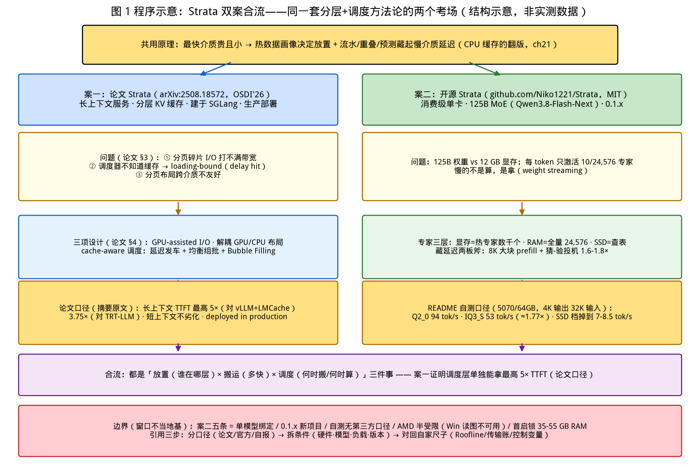

# 第 22 章｜Strata 双案精讲：窗口与边界（Day 52）

> **这章讲什么**：两个同名的 "Strata"——**案一：论文 Strata**（arXiv:2508.18572，斯坦福等，OSDI'26）：长上下文服务的分层 KV 缓存框架，把"分层 KV 从概念做成生产系统"（回扣 ch21 第 3 节）；**案二：开源 Strata**（github.com/Niko1221/Strata，MIT）：消费级单卡跑 125B MoE 的本地推理引擎，把"专家分层调度"从数据中心搬到游戏机（回扣 ch21 第 4 节）。两个 Strata 名字撞车，主题却惊人地一致：**当整块数据/权重塞不进最快的介质，就用"分层 + 调度"把它摊到慢介质上，并把搬运藏进计算**——这正是第 21 章三件事在两个极端场景（生产集群 / 单台 PC）的落地。
>
> **为什么重要**：这章是阶段 7 的收官，定位是**窗口不是地基**——通过两个真实案例看"分层"如何被做成产品，同时学会用本书前 21 章建立的尺子去**审读一个外部项目的宣称数字**（哪些可信、哪些是自报口径、哪些是特定条件的最优值）。"会不会给别人的系统挑毛病"是 Infra 面试的高阶考点，也是防"买家秀"的第一能力（ch19 全章都在讲这件事）。
>
> **学完能干什么**：① 说清案一的三个瓶颈与三项设计（GPU-assisted I/O、解耦布局、cache-aware 调度），并引用其论文原文数字（5×/3.75×）；② 说清案二的专家三层调度（GPU 热缓存/RAM 全量/SSD 查表）与官方实测表（5070：94 tok/s @Q2_0），并解释它为什么是"MoE 版 llama.cpp"；③ 用五条边界（单模型/新项目/匿名/AMD 受限/启动锁内存）完成一次"诚实评审"，给出"当窗口不当地基"的具体判据；④ 在面试里把双案讲成方法论：**分层不是免费的，买慢介质容量的钱要用调度和重叠赚回来**。
>
> **本章数字纪律**：零性能跑测。案一全部数字标 **arXiv:2508.18572 原文/摘要口径**（2026-10-16 检索）；案二全部数字标 **GitHub README 官方口径**（检索 2026-10-16，作者自测，第三方不可复现的标注"自报口径"）；两案的对照与推论标注"本书分析"。数据登记于 [code/ch22/RESULTS.md](../code/ch22/RESULTS.md)。

---

## 0. 大白话开场：两个 Strata，一套生存策略

先解开一个容易混淆的事实。2026 年搜 "Strata LLM" 会同时冒出两个东西：

- **一个是论文**：《Strata: Hierarchical Context Caching for Long Context Language Model Serving》（arXiv:2508.18572，2025-08-26 提交，OSDI'26 版本见 usenix.org），斯坦福大学 + 密歇根大学团队，**建在 SGLang 上、已生产部署**。它解决的是：长上下文的 KV 缓存大到显存装不下，只能往内存/SSD 沉，**搬回来的时候系统反而卡在"I/O bound"而不是"compute bound"**。
- **一个是软件**：github.com/Niko1221/Strata，MIT 协议的 C++/CUDA 本地推理引擎，让 **125B 参数的 MoE 模型在 12 GB 游戏显卡上跑起来**（官方 README 口径，检索 2026-10-16）。它解决的是：模型权重（哪怕每 token 只激活 10 个专家）远大于显存，只能把"热专家"留显存、全量放内存、超了从 SSD 拿。

把两者放在一起，你会看到同一个公式在两个尺度上出现（ch21 3.3 节的判据换了主角）：

> **最快的介质贵且小，最便宜的介质慢且大 → 用一个"热数据画像"决定谁放哪里，再用流水/重叠/预测把慢介质的延迟藏起来。**

案一藏的是 **KV 搬运**（分层缓存的 page-in），案二藏的是 **专家权重搬运**（MoE 的 weight streaming）。CPU 缓存是这个思想的祖师爷（ch21 3.2 节），案一给它加了"调度器知道缓存"，案二给它加了"投机解码和大块 prefill 帮你摊薄"。

**本章验收题**（学完应能张口回答）：

> ① 案一论文原文的两个评测数字是什么（对谁、什么口径）？② 案二的专家三层各放什么、官方 5070 表里 Q2_0 与 IQ3_S 的速度差多少倍？③ "当窗口不当地基"的五条边界具体指什么？

答案分别在第 1.3、2.2、4 节。

---

## 1. 案一：论文 Strata——把分层 KV 从概念做成生产系统

### 1.1 它面对的问题：分层之后，系统变成了 loading-bound

ch21 第 3 节讲了"该下沉还是该重算"的判据，但那是单块的账。论文 Strata 站在**系统层**看到两个更麻烦的问题（arXiv:2508.18572 §3，检索 2026-10-16，论文口径）：

1. **碎片化 I/O 打不满带宽**：PagedAttention 把 KV 切成小块（ch13），块在显存/内存里的布局是**碎片化**的——用标准 `cudaMemcpy` 一段段搬小碎片，带宽利用率极低（论文 3.1 节标题即 "Low Bandwidth Utilization in KV Cache Transfers"）。**分页解决了显存浪费，却制造了搬运低效**——这是 ch13 没讲到的副作用。
2. **调度器不知道缓存的存在**：请求调度只看计算资源（ch14 的调度器管的是 token 预算），完全不考虑"这个请求的 KV 还在不在内存里、搬回来要多久"。结果系统 **loading-bound 而非 compute-bound**——瓶颈从 ch03 的 Roofline 顶点漂到了 I/O 侧，延迟里一大截是"等缓存"（delay hit）。

一句话总结：**分层 KV 的坑不在"放不放得下"，在"搬得快不快、调度知不知道"**。

### 1.2 三项设计（论文 §4 原文口径）

| 设计 | 机制 | 打哪个问题 |
|---|---|---|
| **① GPU-assisted I/O** | 不用标准 `cudaMemcpy` 逐段搬碎片，改用 GPU 自己参与的数据搬运（论文注明灵感来自体系结构社区 Min et al. 2020、Qureshi et al. 2023 的做法），对"小而碎"的数据实现低延迟 I/O | 碎片 I/O 打不满带宽 |
| **② 解耦 GPU 与 CPU 内存布局** | GPU 侧布局与 CPU/其他介质侧布局**独立**——各自按自己最优的方式排，中间做布局转换，而不是让两端共享同一套分页布局 | 分页布局在慢介质上不友好 |
| **③ cache-aware 请求调度** | 三件套：**Delay Hit 上延迟发车**（缓存没搬完的请求先等等，别插队进来制造气泡）、**均衡组批**（把命中缓存的和没命中的搭配组批）、**Bubble Filling**（把不可避免的加载空洞用互补任务填上） | 调度器不知道缓存、delay hit |

其中 ③ 最有工程味道：它承认**有些延迟藏不掉**（Bubble Filling 只填"不可避免的 stall"），于是退而求其次——**别让一个慢请求毁掉整批**（延迟发车 + 均衡组批）。这与 ch14 的 chunked prefill 是同一个哲学：不是消灭等待，是**不让等待传染**。

【化学家视角】这和**色谱-质谱联用**的思路一致：检测器（GPU）很贵，样品前处理（KV 加载）很慢，联用系统的精髓是让前处理与上一针的检测**并行**，并且排针顺序要"快慢搭配"，避免连续几个大体积样品把流路堵死。案一的调度三件套就是给 KV 加载排针序。

### 1.3 评测：论文原文数字（唯一可信口径）

摘要原文（arXiv:2508.18572 Abstract，检索 2026-10-16）：

> "Built on SGLang and deployed in production, Strata achieves **up to 5× lower Time-To-First-Token (TTFT) compared to vLLM + LMCache** and **3.75× speedup over NVIDIA TensorRT-LLM** on long-context benchmarks, **without degrading short-context performance**."

拆三句话的口径纪律（ch19 学过的读法）：

1. **"up to 5×"是最优档峰值**，不是平均值——对比对象是 vLLM+LMCache 组合（同样带分层缓存），不是裸 vLLM；
2. **3.75× 对 TRT-LLM** 同样只在 long-context 基准上——短上下文它明说"不劣化"（这也防了"用长上下文特化换短上下文崩掉"的常见交换）；
3. **"deployed in production"** 是这篇最硬的背书——不是实验室 demo，是 SGLang 上的生产部署（与 Mooncake 的生产叙事同类，ch21 2.3 节）。

【落地视角】这组数字对你的直接用途：**写进"分层 KV 有没有用"的论证里时，必须连对比对象一起引**——"Strata 论文在长上下文基准上把 TTFT 相对 vLLM+LMCache 最高降到 1/5（论文口径，检索 2026-10-16）"是合格引用；"分层缓存能快 5 倍"是失真转述。面试官追问的第二句永远是"对谁快"。

---

## 2. 案二：开源 Strata——把专家分层调度搬进游戏机

### 2.1 它面对的问题：125B 权重 vs 12 GB 显存

案二的模型是 **Qwen3.8-Flash-Next（125B MoE）**（README 口径，检索 2026-10-16）。MoE 的两个特性（ch21 4.1 节）在这里变成了一对矛盾的有利条件：

- **显存账不利**：125B 参数哪怕按 4-bit 量化也有几十 GB，12–24 GB 的消费卡根本放不下"全量权重"；
- **计算账有利**：**24,576 个专家，每个 token 只用其中 10 个**（README 原文口径）——推理 FLOPs 只是等参数 dense 模型的一小部分，**慢的不是算，是拿**。

于是案二的答案和 ch21 4.2 表的第③类解法同源，但方向反过来：数据中心的 EPLB 是"把热专家复制到多卡"，案二是"**把热专家钉在单卡显存，全量摊到内存，SSD 当仓库**"——三层放置 + 按需换入：

| 层 | 介质 | 放什么（README 口径） |
|---|---|---|
| **热** | GPU 显存（12–24 GB） | 用得最多的几千个专家（arena mode 下热缓存） |
| **全量** | 系统 RAM（官方要求 ≥32 GB，64 GB 可放全尺寸） | **全部 24,576 个专家**；CPU 同时处理"轮到它算"的其余部分 |
| **仓库** | SSD（约 80 GB 空闲） | 大查表（lookup table）；部分量级在 RAM 不够时直接从 SSD 边读边答 |

两个配合机制（README "How does it work?" 原文口径）：

- **猜-验投机解码**："a small helper guesses the next few words. The big model checks them all at once. You get the same answer, **1.6–1.8× sooner**"——把 ch20 的投机解码嵌进了引擎默认路径（同一份输出，1.6–1.8×）；
- **大块 prefill**："Long texts are read in big pieces (up to **8,192 tokens** at a time), at over **1,000 tokens per second**"——大 chunk 让 prefill 的算术强度拉高（ch03），把专家换入的开销摊进高吞吐段。

【落地视角】**案二的本质是"单机版 EP"**：ch15 的第四把刀把专家切到多卡用 all-to-all 搬 token，案二把"卡"换成"介质层级"，搬运介质从 NVLink 换成 PCIe/内存总线。**同一道题，换了两个尺度的考场**——这就是为什么说第 21 章三件事是"卡间调度"通用框架。

### 2.2 官方实测表（README 自报口径，检索 2026-10-16）

README "How fast is it?" 表（作者自测，**自报口径，社区有复现页但本章未逐条核验**）：

| NVIDIA RTX 5070 (12 GB) + Ryzen 5 7600 + 64 GB RAM | 生成速度 | 读 prompt 速度（32K 输入） |
|---|---|---|
| **Q2_0** | **94 tok/s** | 2,650 tok/s |
| IQ2_XS | 79 tok/s | 2,090 tok/s |
| IQ3_XXS | 62 tok/s | 1,750 tok/s |
| **IQ3_S** | **53 tok/s** | 1,620 tok/s |
| Coder（去掉一半专家） | 55 tok/s | 2,180 tok/s |

AMD RX 9070 XT (16 GB) 一行：Q2_0 **60 tok/s** 生成 / 1,160 tok/s 读取（47 GB RAM；README 注明该卡 Windows 上读图不可用）。

口径细节（README 脚注，必须一起引）：Q2_0 行用引擎 **0.1.36**、其余行用 **0.1.26**，测的是 **4K 输出 / 32K 输入**；README 还给了量级参考："RTX 3090 (24 GB) should write about **100–140 tokens per second**"（should——预测口径不是实测）。另有 RAM 不足时从 SSD 边读边答的代价自报值：UD-Q4_K_XL 在 64 GB 机器上掉到 **7–8.5 tok/s**——**这行数字就是 ch21 3.3 节不等式在案二里的显形：慢链路（SSD）换入打不过计算时，速度掉一个数量级**。

自己怎么复现：README 说装完跑 `BENCH.bat`/`./bench.sh`（约 5–10 分钟，测 chat、4K/16K prompt、agent 会话，出报告可分享）——这是**把 ch16 压测纪律产品化**的低配版，作品集里可以引用"工具自带可复现压测"作为该工程的优点。

### 2.3 案二与投机解码、量化两章的合流

案二是本书技术栈的"会师点"，三个回扣：

1. **量化（ch09/10）**：Q2_0 比 IQ3_S 快 94/53 ≈ **1.77×**，代价是精度档更低——**速度是买来的**（ch10 三本账：体积/质量/速度）。Coder 版"去掉一半专家"达到全模型 SWE-bench Verified 的 **91%**（作者自测口径）——这是"结构稀疏换容量"的又一例。
2. **投机解码（ch20）**：1.6–1.8× 与 ch20 谱系表（独立草稿/医学/拒绝采样）同量级，且案二把它做成**默认同答案路径**——验证了 ch20 的核心论点：低 QPS 单流场景投机解码收益实在。
3. **offload 悬崖（ch12）**：案二的 7–8.5 tok/s（SSD 直读档）与 ch12 "14B 83% 上卡仅 29% 吞吐"是同一现象的两次显形——**换入链路跟不上计算时，掉速是悬崖不是斜坡**。

---

## 3. 双案对照：一套方法论的两个考场

| 维度 | 案一（论文 Strata） | 案二（开源 Strata） |
|---|---|---|
| 搬运对象 | KV Cache（长上下文的**激活缓存**） | 专家权重（模型的**参数**） |
| 分层 | GPU HBM ← 内存 ← 存储（ch21 G1–G3） | 显存 ← RAM ← SSD（同一谱系的单机版） |
| 谁决定放哪 | 调度器 + 前缀命中（cache-aware scheduling） | 热度画像（热缓存）+ 量化档决定总量 |
| 藏延迟的手段 | GPU-assisted I/O + 解耦布局 + 延迟发车/组批/填泡 | 大块 prefill（8K chunk）+ 投机解码 1.6–1.8× + CPU 并行 |
| 优化的 SLO | TTFT（长上下文首 token） | 生成速度 tok/s（单流为主） |
| 验证方式 | 论文评测（对 vLLM+LMCache 5×、对 TRT-LLM 3.75×，up to 口径） | 官方 README 自测表（5070：94→53 tok/s 按量化档） |
| 成熟度 | 生产部署（SGLang），OSDI'26 | MIT 开源、个人/社区驱动、版本号 0.1.x |

三个合流点：

1. **分层是手段，调度才是灵魂**：案一最有价值的不是分层本身（HiCache/Mooncake 都有），而是**调度器终于知道缓存的存在**（delay hit 延迟发车）；案二最有价值的不是"能跑"，而是**把换入开销藏进大块 prefill 和投机解码**。只分层不调度 = ch21 坑 5（无节制下沉把链路打满）。
2. **同一个不等式，两个考场**：案一的 Bubble Filling 是"搬运时间藏不掉就填别的活"，案二的 7–8.5 tok/s 是"搬不动就认输掉速"——都是 ch21 3.3 判据（搬 vs 算）的工程化表达。
3. **可信度分级**：案一是同行评审 + 生产部署的论文口径，案二是自报口径 + 社区复现页——**引用价值不同，但都不能直接跨场景外推**（5070 的 94 tok/s 不代表你的卡，5× 不代表你的负载）。

【落地视角】**把双案连起来讲，就是一场 10 分钟的系统设计陈述**："长上下文和大 MoE 的共同约束是最快介质装不下热数据，解法分三层——放置（谁在哪）、搬运（多快）、调度（何时搬/何时算）；生产案例 Strata 论文证明了调度层能带来最高 5× TTFT 收益（对 vLLM+LMCache，论文口径），单机案例证明了同样思想能在 12 GB 卡上跑 125B（94 tok/s @Q2_0，自报口径）。"——这段话把 ch15/ch20/ch21/ch22 串成了一条线。

---

## 4. 边界与诚实局限：为什么说"窗口不当地基"

第 18 章决策树教过"先删后选"，这章对两个 Strata 各自用一次。**案一的边界**（本书分析）：它是 SGLang 生态的生产系统，评估它≈评估"长上下文分层缓存路线"；单机/短上下文场景收益有限（论文自己声明短上下文不劣化——言外之意是**收益集中在长上下文**）。

**案二的五条边界**（README/仓库可见事实 + 本书分析，检索 2026-10-16）：

1. **单模型绑定**：官方路径只服务 Qwen3.8-Flash-Next（及其量化变体），不是通用引擎——它是一个"模型的专用播放器"，不是 llama.cpp/vLLM 那种模型无关框架；
2. **新项目**：版本号 **0.1.x**、个人/社区维护（无机构背书）、文档多语言但工程成熟度按 0.1.x 理解——API 稳定性、边界 case 修复都要按早期项目预期；
3. **作者匿名/不可审计**：README 列了贡献者机制但无明确机构身份，自测数字**第三方口径缺失**——benchmark 表是作者自报（有 `COMMUNITY_BENCHMARKS.md` 社区页但本章未逐条核验），引用时必须带"自报口径"；
4. **AMD 半受限**：AMD 卡能跑，但 Windows 上读图不可用（README 原文 "on Windows they can't yet"），多卡、老卡路径标 experimental（P40/V100/Intel Arc 等均为社区实验文档）；
5. **启动锁内存**：首次加载 **35–55 GB 进 RAM 并锁定部分给显卡**，期间"PC 可能卡 1–3 分钟"（README 原文口径）——它是为"这台机器专门跑它"设计的，不是为"和浏览器共存"设计的。

**"当窗口不当地基"的三条具体判据**：

- ✅ 当窗口用：它是观察"专家分层调度怎么被产品化"的最好标本——三层放置、猜-验默认化、BENCH 可复现压测，都是可以抄进面试答案的工程决策；
- ⚠️ 别当地基：把 94 tok/s 写进自己服务的容量规划（口径不同：单流、特定卡、特定量化）；
- ⚠️ 别当地基：把它当作"MoE 推理的标准架构"引用（单模型、0.1.x、无生产背书——对比案一的 "deployed in production" 与 Mooncake 的 Kimi 生产叙事）。

【化学家视角】这五条边界相当于**试剂的纯度标签**：分析纯可以做定量，工业纯只能看趋势。审读外部系统时先看"标签"（谁做的、验证到什么程度、适用条件），再决定你的结论要标到什么置信度——**把自报数据当基准数据用，等于拿工业纯当分析纯写报告**。

---

## 5. 两案合流图

下图把双案放进同一张"分层生存策略"全景：左侧案一（KV 分层 + 调度三件套 → TTFT），右侧案二（专家三层 + 藏延迟两板斧 → tok/s），底部是共用的判据与边界清单。

---

## 6. 【坑】七连 + 【应急方案】

### 【坑 1】把论文 "up to 5×" 当平均值转述
5× 是对 vLLM+LMCache 的最优档峰值，且仅长上下文基准。**应急**：引用时三件套齐全——数值 + 对比对象 + 基准类型（论文口径）；写进简历的句式是"长上下文 TTFT 相对 vLLM+LMCache 最高 5×（Strata 论文口径）"。

### 【坑 2】把案二自测表当可移植基准
94 tok/s 绑定 5070 + 64 GB + Q2_0 + 引擎 0.1.36 + 4K/32K 口径，缺一项都不成立。**应急**：跑自己的 `BENCH.bat`（ch16 五条控制变量精神）；引用必带硬件三要素 + 量化档 + "作者自测口径"。

### 【坑 3】只抄"分层"不抄"调度"
案一真正的增量是调度器知道缓存（delay hit/组批/填泡），不是分层本身。**应急**：落地分层 KV 时先问"我的调度器看得见命中率吗"——看不见就先接埋点（ch05 口径），否则重蹈 ch21 坑 4/5。

### 【坑 4】消费卡场景套用数据中心结论
案二是单请求串行为主的本地场景（默认一次答一个，`"parallel": 2` 反而变慢，README 口径），与 ch14/16 的连续批处理前提完全不同。**应急**：分清"单流延迟优化"与"并发吞吐优化"两个赛道——案二的两板斧（投机、大块）属于前者，别拿去论证服务端吞吐。

### 【坑 5】忽略"启动态"成本
案二首启锁 35–55 GB RAM、卡 1–3 分钟；案一的分层也有冷启动（G2/G3 未预热时首请求全 miss）。**应急**：容量规划算"稳态"也要算"冷态"——服务上线前先跑一轮冷启动压测（ch16 的 `--flush-cache` 思路）。

### 【坑 6】新项目当依赖背书
0.1.x 项目断供、API 变更风险高。**应急**：作品集引用可以（工程思想），生产依赖不行；选型按 ch18 决策树先看维护状态与生态位（对比：LMDeploy 有机构背书、TGI 进 maintenance mode 的教训）。

### 【坑 7】双名混淆导致张冠李戴
面试里说"Strata 论文实现了 125B 单卡"或"Strata 引擎拿到了 OSDI'26"都是事故。**应急**：记锚点——**论文=长上下文 KV+5×+生产；引擎=125B+12 GB+MIT**；开口前先说"哪一个是 Strata"。

【应急方案·总则】审读一切外部宣称的三步：**① 分口径**（论文/官方/自报/第三方）、**② 拆条件**（硬件、模型、负载、版本）、**③ 对回自家尺子**（ch03 Roofline、ch21 传输账、ch19 控制变量）——三步做完再决定引用还是丢弃。

---

## 7. 动手任务（Day 52）与验收标准

### 任务 A：双案数字核验卡（零成本，本章核心）
建一张 2×2 卡片：案一论文摘要三数字（5×/3.75×/不劣化短上下文）+ 对比对象；案二 README 表两行（5070 Q2_0 94 tok/s 与 IQ3_S 53 tok/s）+ 引擎版本与输出/输入口径。每个数字标注：来源 URL、口径类型（论文/自报）、检索日期。
**验收标准**：任一数字能在 30 秒内答出"对谁、什么条件、什么口径"；能指出"哪个数字最经不起追问"并说明原因。

### 任务 B：边界清单与判据演练
用第 4 节五条边界给案二写一份 200 字"诚实评审"，并写一句"什么情况下我会把它引入自己的项目"。
**验收标准**：结论带前提；"引入判据"必须落在具体条件上（如：单机本地工具、单模型、可接受 0.1.x 风险），不出现"看情况"这类空话。

### 任务 C（选）：单机复现或纸上算账
有 12 GB+ 卡与 64 GB RAM 的条件时，克隆案二仓库跑 `BENCH.bat`，把自测数字与 README 表对照；无条件时改为**纸上算账**：用 ch21 3.3 不等式估算"32K 上下文的 KV 从内存搬回显存（PCIe 16 GB/s）要多久"，对照案一"loading-bound"的问题陈述，写 100 字解释为什么调度器必须知道缓存。
**验收标准**：实测则标注硬件/版本/量化三要素（ch19 纪律）；算账则数字与 ch21 公式一致、结论回扣 delay hit。

---

## 8. 自检三问

1. 案一的三个瓶颈与三项设计各是什么？（答：碎片 I/O 低带宽→GPU-assisted I/O；分页布局跨介质不友好→解耦布局；调度不知道缓存→delay hit 延迟发车+均衡组批+Bubble Filling。）
2. 案二的专家三层各放什么？官方 5070 表 Q2_0 与 IQ3_S 差多少？（答：显存放热专家几千个、RAM 放全量 24,576 个、SSD 放查表；94 vs 53 tok/s ≈ 1.77×，代价是量化档精度。）
3. "窗口不当地基"怎么操作化？（答：案二五条边界（单模型/0.1.x/自报口径/AMD 受限/启动锁内存）+ 三条判据：可抄工程思想、不可移植数字、不可当标准架构引用。）

---

## 9. 面试话术（3 条）

**话术 1（双案开场）**："两个 Strata 恰好是同一个方法论的两个考场：分层 + 调度。论文 Strata（arXiv:2508.18572，OSDI'26）管长上下文的 KV 搬运——分页布局导致碎片 I/O 打不满带宽、调度器不知道缓存，它用 GPU-assisted I/O、解耦 GPU/CPU 布局、cache-aware 调度（延迟发车/均衡组批/填泡）解决，原文口径是长上下文 TTFT 相对 vLLM+LMCache 最高 5×、对 TRT-LLM 3.75×，且不劣化短上下文，已生产部署在 SGLang 上。开源 Strata 管 125B MoE 的专家搬运——24,576 个专家每 token 用 10 个，热的进显存、全的进 RAM、SSD 当仓库，再用 8K 大块 prefill 和默认投机解码（1.6–1.8×）把换入藏掉。"

**话术 2（审读数字）**："我引用外部数字前过三道手续：分口径、拆条件、对回自家尺子。比如案二 README 的 94 tok/s——口径是作者自测，条件是 RTX 5070 + 64 GB RAM + Q2_0 + 引擎 0.1.36 + 4K 输出/32K 输入；尺子是 ch03 的 Roofline 和 ch21 的传输账，我判断它是'单流延迟优化'而非'并发吞吐'结论，所以不会拿它做容量规划。反例是把论文的 up to 5× 当平均值——对比对象是 vLLM+LMCache 组合、且仅长上下文基准，这两个条件丢了结论就假了。"

**话术 3（方法论升华）**："这两案验证了我做推理系统的一个框架：任何'塞不下'的问题都拆成三件事——放置（谁在哪层介质）、搬运（多快、多少字节）、调度（何时搬、何时算、藏不掉怎么办）。放置和搬运是物理账（带宽、容量），调度是纯工程（案一证明调度层单独就能拿到最高 5× TTFT 收益，论文口径）。所以我的排障顺序永远是先算搬运账再谈调度优化——账算不清，调度怎么调都是在掩盖瓶颈。"

---

## 参考与版本说明

- 案一论文（检索 2026-10-16）：arXiv:2508.18572《Strata: Hierarchical Context Caching for Long Context Language Model Serving》（2025-08-26 提交，摘要与 §3/§4 目录核验；5×/3.75×/不劣化短上下文为摘要原文口径）；OSDI'26 版本 PDF 见 usenix.org/system/files/osdi26-xie-zhiqiang.pdf。
- 案二仓库（检索 2026-10-16）：github.com/Niko1221/Strata README（MIT；5070/9070 XT 实测表、24,576 专家×每 token 10 个、猜-验 1.6–1.8×、8K 大块 prefill >1,000 tok/s、Coder 91% SWE-bench Verified 作者自测、首启锁 35–55 GB RAM、BENCH.bat、AMD Windows 读图受限、0.1.36/0.1.26 版本脚注、SSD 档 7–8.5 tok/s）。
- 本书锚点：ch03 算术强度与 prefill 口径；ch09/10 量化三本账；ch12 offload 悬崖；ch13 PagedAttention 碎片问题；ch14 调度器与 chunked prefill；ch15 EP；ch16 压测纪律；ch19 控制变量与口径读法；ch20 投机解码谱系；ch21 分层 KV 判据不等式与 MoE 三类解法。
- 算账与回填：[code/ch22/RESULTS.md](../code/ch22/RESULTS.md)（双案数字总表、口径分级、实测回填区）；配图 1 张由 [code/ch22/make_figures.py](../code/ch22/make_figures.py) 生成（零外部图片，无 CREDITS 需求）。
- **版本**：v0.23（第 1–22 章已完成，阶段 7 前沿方向收官）；本章零性能跑测。
- **下一章预告**：第 23 章《从引擎到服务：API/K8S/可观测/容量/稳定性》——从"跑得快"到"服务得住"：OpenAI 兼容 API、排队限流熔断、K8s GPU 调度、Prometheus 监控告警与三级降级预案。
