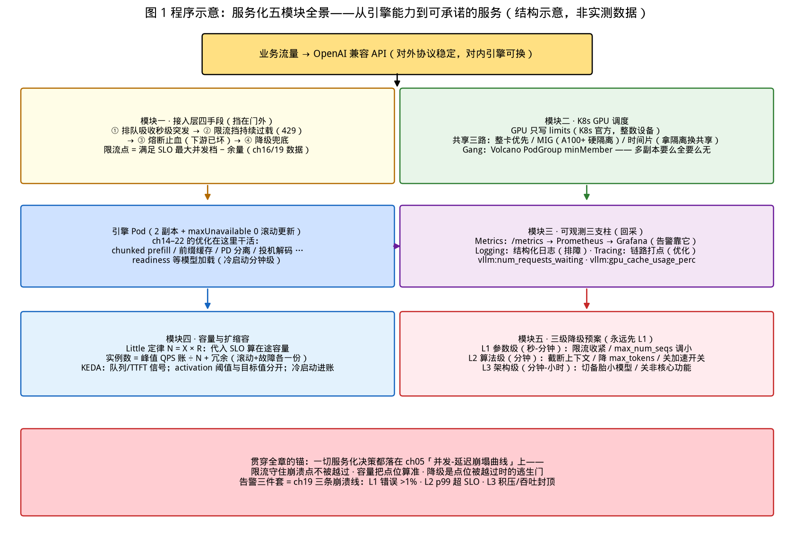

# 第 23 章｜从引擎到服务：API/K8S/可观测/容量/稳定性（Day 53–55）

> **这章讲什么**：把前 22 章的"引擎能力"组装成"能对外承诺的服务"——五个模块：**① OpenAI 兼容 API 与接入层**（排队/限流/熔断/降级）、**② K8s GPU 调度**（Device Plugin/GPU Operator/MIG/时间片/Volcano/Gang）、**③ 可观测三支柱**（Metrics/Logging/Tracing + vLLM 官方指标 + Prometheus/Grafana）、**④ 容量规划与在离线混部**（Little 定律、Burst、分时复用）、**⑤ 三级降级预案**。一句话：**引擎回答"怎么算得快"，服务回答"怎么不挂、挂了怎么办、挂了也不赔钱"**。
>
> **为什么重要**：这是阶段 8 工程化的主线章（直接托底项目三"生产级部署"）。前 22 章所有优化——chunked prefill、前缀缓存、PD 分离、投机解码——最终都要装进一个"有 SLO、有告警、有降级、能被 K8s 调度"的盒子，才能变成工资单上的能力。面试中"你上过生产吗"的追问，问的正是这五件事（第 25 章会展开）。
>
> **学完能干什么**：① 说清 OpenAI 兼容 API 的四类接入层手段（排队/限流/熔断/降级）各挡什么；② 写出合规的 GPU Pod YAML 并解释"GPU 只写 limits"与三种共享模式的取舍；③ 列出 vLLM 官方核心指标并把它们映射到 ch05 的四大指标；④ 用 Little 定律算一个并发档的容量账并给出扩缩容信号；⑤ 给关键服务写三级降级预案（参数级→算法级→架构级）。
>
> **本章数字纪律**：零性能跑测。K8s/NVIDIA/vLLM/Volcano/KEDA 等标注**官方文档口径 + 检索日期（2026-10-17）**；本书锚点（ch05 指标口径、ch14 调度预算、ch16 压测）只引用登记值；算账区全部为代入登记值的零成本算术，登记于 [code/ch23/RESULTS.md](../code/ch23/RESULTS.md)。

---

## 0. 大白话开场：引擎是厨房，服务是餐厅

前 22 章你一直在厨房里练刀工：调优引擎、压测到崩、算通信账。但顾客（业务方）不关心你的刀工，他关心的是：

- **进门有人接待吗**（API 网关：鉴权、限流）——队伍排到门外会不会挤踩（过载保护）？
- **餐厅怎么排座位**（K8s 调度）——一张桌子能坐几拨人（GPU 共享）？包间（MIG）和大堂（整卡）怎么选？
- **后厨有没有监控探头**（可观测）——上菜慢了，是洗菜慢还是炒菜慢（瓶颈定位）？
- **备多少菜**（容量规划）——按今天的客流量备，还是按周末峰值备（利用率 vs SLO 的权衡）？
- **断电断菜怎么办**（降级预案）——先卖库存菜（参数级），再改菜单（算法级），最后关大堂开外卖（架构级）？

本章就是把这五问的答案装进一个盒子。**一个不变的锚**（回扣 ch05）：你做的所有服务化决策，最终都体现在那条"并发-延迟崩塌曲线"上——限流是守住崩溃点不被越过，容量是把点位算准，降级是点位被越过时的逃生门。

**本章验收题**（学完应能张口回答）：

> ① "GPU 只写 limits 不写 requests"是 K8s 官方文档的哪条规定、为什么？② vLLM 的 `vllm:num_requests_waiting` 和 `vllm:gpu_cache_usage_perc` 分别预警哪一面墙？③ 三级降级分别在什么时间尺度生效、各要提前准备什么？

答案分别在第 2.1、3.2、5 节。

---

## 1. 模块一：OpenAI 兼容 API 与接入层四手段

### 1.1 为什么"OpenAI 兼容"是战略而非功能

vLLM/SGLang/TRT-LLM/LMDeploy 全部提供 OpenAI 兼容端点（第 16/18 章已核验 vLLM 的 `/v1/chat/completions` 等路由），意味着：**客户端零改造、生态工具（LangChain/各种压测器）即插即用、换引擎不换调用方**。这正是第 18 章决策树里"引擎可替换性"的接口层保障。服务化的第一原则：**对外协议稳定，对内引擎可换**——接口层（网关）必须比引擎活得久。

### 1.2 接入层四手段：各挡什么

| 手段 | 挡什么 | 实现层 | 失败时用户看到什么 | 关键参数 |
|---|---|---|---|---|
| **排队** | 瞬时突发（秒级） | 引擎内队列（ch14 scheduler 的 waiting 队列）/ 网关队列 | 等待变长（TTFT 变大），但**不失败** | 队列上限、排队超时 |
| **限流** | 持续过载（分钟级） | 网关（令牌桶/QPS 上限）| `429 Too Many Requests`，**明确拒绝** | rate、burst、并发上限 |
| **熔断** | 下游已坏（保护性放弃） | 网关/客户端 SDK | 快速失败 + 降级响应 | 错误率阈值、恢复探测窗口 |
| **降级** | 兜底（保住核心体验） | 全栈（参数→算法→架构） | 变慢/变短/换小模型，**核心链路可用** | 见第 5 节三级预案 |

四者的协作时序（与 ch14 调度预算天然同构）：**队列先吸收抖动 → 队列打不满就限流挡在门外 → 下游真坏就熔断止血 → 全线吃紧就降级保命**。

两个别踩的坑：

1. **限流阈值不是拍的**：上限应该定在 ch16 压测出的"崩溃点左侧"——回扣 ch19 崩溃点三判定线（L1 错误 >1%、L2 p99 超 SLO、L3 吞吐封顶），**限流点 = 满足 SLO 的最大并发档 − 安全余量**。没有 ch16/19 的数据，限流值就是拍脑袋。
2. **流式不能被网关缓冲**：SSE（`stream: true`）的价值是首 token 尽快到达（TTFT 口径），网关/代理的缓冲配置会把流式退化成整包返回，TTFT 优化全白做（ch03 的 prefill 优化、ch20 的投机解码收益都体现在首 token）。

【落地视角】**接入层是"唯一可以不改引擎就扛住流量"的地方**。业务方半夜打爆服务时，你能在 5 分钟内用网关限流止血，比重启引擎调 `max-num-seqs` 快一个数量级——这是 SRE 值班的第一课。

【化学家视角】四手段像**实验室安全链**：通风橱（限流）挡住挥发、缓冲瓶（排队）吸收压力波动、单向阀（熔断）防止倒灌、备用试剂（降级）保证实验不中断。**先有预案后有事故**，服务化和做实验安全规范是同一思维。

---

## 2. 模块二：K8s 上的 GPU 调度

### 2.1 Device Plugin 与那条"只写 limits"的官方规定

K8s 调度器原本只懂 CPU/内存，**GPU 靠 Device Plugin 框架接入**：厂商实现插件、以 DaemonSet 部署，向 kubelet 上报可调度资源，于是集群里出现了 `nvidia.com/gpu`（AMD 则是 `amd.com/gpu`）这种资源名（kubernetes.io《Device Plugins》官方文档，检索 2026-10-17）。

K8s 官方《Schedule GPUs》文档的硬规定（检索 2026-10-17，官方口径）：

> **"GPUs are only supposed to be specified in the `limits` section."**（GPU 只应写在 limits 里）
> ——只写 limit 时 Kubernetes 会自动把 limit 当作 request（即 GPU 不支持 request ≠ limit 的超卖语义）。

为什么？因为 **GPU 不像 CPU 能给 0.5 核**——device plugin 按整数个分配设备，request/limit 分离带来的"申请少、用得多"超卖语义对整数设备无意义，反而会让调度器误判节点真实占用。**记忆点：CPU 写 request/limit 两行，GPU 只写 limits 一行。**

```yaml
# 合规的 GPU 推理 Pod 片段（官方文档口径，检索 2026-10-17）
resources:
  limits:
    nvidia.com/gpu: 1        # ← 只写 limits，整数
    memory: "64Gi"
  requests:
    cpu: "8"
    memory: "64Gi"           # ← CPU/内存照常写 request/limit
nodeSelector:
  accelerator: nvidia-geforce-rtx-4090   # 按卡型选节点（示例）
```

**一张卡被多个 Pod 分掉的三条路**（NVIDIA GPU Operator 官方文档，检索 2026-10-17）：

| 模式 | 机制 | 隔离性 | 适用 |
|---|---|---|---|
| **整卡**（默认） | 1 Pod = 1 GPU | 显存与故障完全隔离 | **推理服务首选**（第 18/21 章的引擎默认假设） |
| **MIG** | Ampere+ 数据中心卡（A100/H100）硬件切分成多个 mini-GPU 实例 | **硬件级**显存+故障隔离 | 多个小模型/多租户共卡 |
| **时间片 / MPS** | 软件分时共享，可开 `replicas` 让多 Pod 共用一卡 | **无显存与故障隔离**——一个 OOM 全连坐 | 老卡（不支持 MIG）或纯利用率榨取 |

NVIDIA 官方原话（GPU Operator《Time-Slicing》文档，检索 2026-10-17）："**time-slicing trades the memory and fault-isolation that is provided by MIG for the ability to share a GPU by a larger number of users**"——**时间片是拿隔离换共享**，这句就是面试标准答案。

【落地视角】推理服务的选型很简单：**能整卡就整卡**（引擎按独占假设调优，ch14 的调度预算、ch16 的压测都是独占前提）；多租户且卡是 A100/H100 才考虑 MIG；**时间片跑推理服务几乎必翻车**——一个租户 OOM 把全卡拉下水，而推理服务最怕的恰恰是集体失败（第 5 节降级的反面教材）。

### 2.2 GPU Operator、Gang 调度与 Volcano

- **GPU Operator**（NVIDIA，官方文档检索 2026-10-17）：把驱动、容器运行时、device plugin、MIG Manager、时间片配置全打包成一个 Operator 一键部署运维——上生产不用手工装驱动的标准化方案。
- **Gang（成组）调度**：多副本/多 Pod 必须**同时**调度成功，否则一起等——否则会出现"5 卡任务只调度到 3 卡、占着 3 卡死等剩下 2 卡"的活锁。这与 ch15 的 PP/TP 多卡任务是同一类需求（TP=8 少 1 张卡就是浪费）。
- **Volcano**（volcano.sh，检索 2026-10-17）：CNCF 官方**唯一**的容器批量调度项目，提供 PodGroup/Gang（`minMember` 定义最少成员）、多级队列、异构设备（GPU/NPU）、网络拓扑感知；官方在离线混部能力："动态资源超卖、CPU Burst、资源隔离……保障在线业务 QoS"——**这正是第 4 节混部的调度底座**。其 2026 年新项目 Kthena（Volcano 官方博客）更进一步：为 LLM 推理做的云原生调度，支持 **Prefill/Decode 独立扩缩容与比例调整、ServingGroup Gang 调度防死锁、拓扑感知放 Pod**——**把 ch21 的 PD 分离搬进了调度器**。

【化学家视角】Gang 调度像**手套箱/联用系统的成套装配**：色谱+质谱少一台就整套没用，宁可全部到位再开机，也不让半套设备空转——资源的"要么全要么无"原则在实验系统和调度器里是同一条。

### 2.3 一个可落地的推理 Deployment 骨架

```yaml
apiVersion: apps/v1
kind: Deployment
metadata: { name: vllm-infer }
spec:
  replicas: 2                        # 至少 2：滚动更新不断服 + 故障冗余
  strategy:
    type: RollingUpdate
    rollingUpdate: { maxUnavailable: 0, maxSurge: 1 }   # 零中断更新
  template:
    spec:
      containers:
      - name: vllm
        image: vllm/vllm-openai:latest   # 镜像按 ch09 格式与版本钉死 tag
        args: ["--model", "/models/xxx", "--max-model-len", "8192",
               "--gpu-memory-utilization", "0.92", "--max-num-seqs", "64"]
        ports: [{ containerPort: 8000 }]
        resources:
          limits: { nvidia.com/gpu: 1, memory: "64Gi" }
          requests: { cpu: "8", memory: "64Gi" }
        readinessProbe:              # ← 模型加载完才接流量（冷启动 1–5 分钟，第 4 节）
          httpGet: { path: /health, port: 8000 }
          initialDelaySeconds: 300
          periodSeconds: 10
        livenessProbe:               # ← 活着就别重启，避免 OOM 重启风暴
          httpGet: { path: /health, port: 8000 }
          initialDelaySeconds: 600
          periodSeconds: 30
---
# 弹性：KEDA 按队列/TTFT 信号扩缩（官方示例口径，检索 2026-10-17）
# vLLM production-stack 的 KEDA 用法：minReplicaCount: 0 支持缩到零、
# prometheus trigger 用 /metrics 队列深度触发；NVIDIA Dynamo 官方 KEDA 示例
# 为 decode 端点用 **TTFT 信号**做 ScaledObject
```

读这段 YAML 的三个要点：① `maxUnavailable: 0` 保证更新期间服务不断（2 副本以上才成立）；② readiness 要等模型加载（300 s 是冷启动经验值，见第 4 节）；③ 扩缩容信号来自 `/metrics`——这就接到了下一模块。

---

## 3. 模块三：可观测三支柱与 vLLM 官方指标

### 3.1 三支柱分工

| 支柱 | 回答什么 | 在推理服务的形态 |
|---|---|---|
| **Metrics**（指标） | 现在健康吗？**告警靠它** | Prometheus 抓 `/metrics`，Grafana 出图（第 24 章项目三出面板） |
| **Logging**（日志） | 发生了什么？**排障靠它** | 结构化日志：请求 id、排队时长、抢占事件（ch14 `vllm:num_preemptions`） |
| **Tracing**（链路） | 慢在哪一段？**优化靠它** | 一个请求 = 网关→排队→prefill→传输→decode→返回，span 打点定位 |

**Metrics 是本章的硬通货**（可告警、可扩缩容、可进面试），Logging/Tracing 在第 24 章项目三落地。

### 3.2 vLLM 官方指标到 ch05 四大指标的映射

vLLM 通过 OpenAI 兼容 API server 的 **`/metrics` 端点**暴露 Prometheus 指标（docs.vllm.ai《Production Metrics》/ v1《Metrics》，检索 2026-10-17，官方口径）。核心指标与本书口径的映射：

| vLLM 指标（官方名） | 类型 | 映射到 ch05 指标 / 预警对象 |
|---|---|---|
| `vllm:num_requests_waiting` | Gauge | **排队深度**——waiting 队列涨 = 逼近崩溃点左墙（ch05 TTFT 崩塌的先行指标） |
| `vllm:gpu_cache_usage_perc` | Gauge | **KV 显存水位**——逼近 1.0 会触发抢占（ch13/14），预警第三面墙 |
| `vllm:cpu_cache_usage_perc` | Gauge | 分层/swap 侧水位（v1 分页口径） |
| `vllm:num_requests_swapped` | Gauge | 换出中的请求数（v0.8.5 文档列有；v1 无 swap 路径——**ch13 已核验 v1 改为 free+重算**，故 v1 上此值恒 0 属正常） |
| `vllm:request_success_total{finished_reason}` | Counter | 成功率（ch05 分母口径），finish_reason 分桶看提前截断 |
| TTFT/TPOT/itl 分位（histogram 系列） | Histogram | **直接对应 ch05 TTFT/TPOT/E2E**，p99 出 SLO 告警 |
| 吞吐（prompt/generation token 计数） | Counter | ch05 吞吐口径，rate() 求 tok/s |

**告警三件套**（把 ch05 四大指标变成值班手机的震动）：

1. **SLO 告警**：`p99 TTFT > SLO` 持续 2 分钟（L2 判定线，ch19）；
2. **积压告警**：`num_requests_waiting > 阈值` 或 `gpu_cache_usage_perc > 0.9`（撞墙先行量）；
3. **存活告警**：`request_success_total` 错误率 >1%（L1 判定线）——**ch19 的三条崩溃线，就是你的三条告警线**。

【落地视角】**监控指标从压测报告里来，不是从仪表盘模板里抄的**。你在 ch16/19 压出来的崩溃点和 SLO 拐点，直接翻译成 3.2 的告警阈值——这样每次压测都在为生产告警校准。反过来，抄来的告警阈值没有拐点依据，要么天天误报要么永远不响。

---

## 4. 模块四：容量规划与在离线混部

### 4.1 Little 定律：把并发档变成"要几张卡"

ch05 登记的 Little 定律 `N = X × R`（并发 = 吞吐 × 响应时间）在服务化里的标准用法（代入值为本书登记口径，算账见 RESULTS）：

> **单实例并发容量**：`N_slo = 吞吐(在满足 SLO 的并发档下) × p99 响应时间(SLO 限值)`
> **实例数** = 峰值 QPS × 平均每请求 token 账 / N_slo，**再加安全余量与副本冗余**。

例（零成本算账，数字用 ch05 登记值演示方法）：假设 SLO 规定 p99 E2E ≤ 10 s、压测得满足此 SLO 的单实例吞吐为 8 req/s，则单实例可承载 `8 × 10 = 80` 个在途请求；业务峰值 40 req/s → 至少 `40/8 = 5` 实例起步，**滚动更新 +1、故障冗余 +1，取 7 实例**（脚本 print_capacity() 实算一致）。**公式随你自家压测数据回填**——这正是项目三要产出的表。

### 4.2 冷启动成本必须进账

模型加载是**分钟级**（strata 案例首启 1–3 分钟锁内存是同族现象，ch22；vLLM 大模型加载常见 60–300 s，经验值以自家模型实测为准）。后果：

- **readiness 探针必须等加载完**（第 2.3 节的 `initialDelaySeconds`），否则扩容出的 Pod 没起来就接流量 → 雪崩；
- **KEDA 的 activation threshold**（激活阈值，EKS 官方文档口径，检索 2026-10-17）："separates the threshold that activates scaling from the target threshold used to determine replica count"——**分开"叫醒 GPU 的门槛"和"算副本数的目标值"**，避免为一两个请求唤醒一个要 3 分钟才 ready 的实例；
- 缩到零（`minReplicaCount: 0`，vLLM production-stack KEDA 官方示例）省的是钱，付的是冷启动 TTFT——**离线批处理/低峰夜间才缩零，在线服务至少保 1 个热副本**。

### 4.3 在离线混部：同一张卡的两班倒

GPU 是最贵的资源，闲着就是烧钱。Volcano 官方能力（检索 2026-10-17）："在离线混部——通过统一调度，动态资源超卖，CPU Burst，资源隔离等能力，提升资源利用率的同时**保障在线业务 QoS**"。落地模式：

| 时段 | 在线（用户流量） | 离线（批任务） |
|---|---|---|
| 白天高峰 | 全量副本，SLO 优先 | 暂停或降到后台任务队列 |
| 夜间低谷 | 保底 1–2 副本 | 启动批量压测/评测/日批推理（ch19 的 benchmark、第 24 章的故障演练都塞这里） |

**隔离是混部的前提**：靠 K8s 资源限额 + 引擎自身的 `gpu-memory-utilization` 水位（防离线任务把在线 KV 挤爆）+ 队列优先级（Volcano 多级队列）。**没有隔离的混部等于把在线 SLO 赌给离线任务**——这是坑 6 的正解。

---

## 5. 模块五：三级降级预案

降级不是出事再想，是**提前写好、演练过、能一键执行**的三级响应（按生效时间尺度从快到慢）：

| 级别 | 手段 | 生效时间 | 要提前准备什么 | 用户感知 |
|---|---|---|---|---|
| **L1 参数级** | 限流收紧（网关改阈值）、`max_num_seqs` 调小、关前缀缓存以外的花活 | **秒–分钟**（网关热改） | 压测出的"安全档"参数表 | 变慢，可用 |
| **L2 算法级** | 降上下文长度（`max-model-len` 挡板/截断 prompt）、输出 `max_tokens` 降档、关投机解码等加速开关省显存 | **分钟**（需重启或动态配置） | 各档位的显存/质量账（ch09/10 量化三本账的思路） | 回答变短/变粗，核心可用 |
| **L3 架构级** | 切小模型（7B 顶 70B）、只读流量走缓存、非核心功能关闸（如关闭图片理解、离线导出任务全停） | **分钟–小时**（模型切换/路由改写） | 小模型备胎 + 路由开关 + 模型预热池 | 明显降智，**但主链路不死** |

**三级的编排逻辑**：L1 止血（不牺牲体验换时间）→ L2 换体验（牺牲质量换可用）→ L3 换能力（牺牲能力换存在）。**永远先 L1 再 L2 再 L3**——反过来（直接切小模型）等于一发烧就开刀。

【落地视角】**演练进第 24 章项目三**：故障演练（杀 Pod、断网卡、灌满显存）时逐级执行 L1→L3，记录每级"多久恢复、用户看到什么"——这份记录就是简历上的"三级降级预案落地"，比写在文档里的预案值钱十倍。

---

## 6. 五模块全景图

下图把五个模块装进一个盒子：左起接入层（四手段挡在门外）→ K8s 调度（Pod/YAML/共享三路/ Gang）→ 引擎 Pod 内部（ch14–22 的优化在这里干活）→ 可观测（三支柱回采）→ 容量与降级（Little 定律算副本、三级预案兜底），底部红条是贯穿全章的锚：一切决策都落在 ch05 并发-延迟崩塌曲线上。



---

## 7. 【坑】七连 + 【应急方案】

### 【坑 1】GPU 写了 request≠limit，或写了 requests 没写 limits
违反 K8s 官方规定（只写 limits），调度器资源语义混乱，可能超卖后整节点 Pod 起不来。**应急**：`grep -A3 "limits" your.yaml` 核对——GPU 整数、只在 limits；CPU/内存照常双写。

### 【坑 2】时间片共享跑推理服务
无显存/故障隔离，一个 OOM 全连坐（NVIDIA 官方"拿隔离换共享"警告）。**应急**：整卡优先；A100/H100 多租户用 MIG；已用时间片的，立刻把在线推理与离线任务**按节点分开**（nodeSelector 分池）。

### 【坑 3】readiness 没等模型加载
扩容/滚动更新期间 Pod "Running 但没 ready"就接流量 → 连环 502。**应急**：readiness 探针对 `/health` 设 `initialDelaySeconds ≥ 实测加载时长`；把"冷启动秒数"记进 RESULTS（项目三实测回填）。

### 【坑 4】抄来的告警阈值
没有 ch16/19 压测拐点依据的阈值，要么误报疲劳要么永不触发。**应急**：三条告警直接绑定崩溃线 L1/L2/L3（错误 >1%、p99 超 SLO、积压超阈）——**每次压测后重校一次阈值**。

### 【坑 5】限流值拍脑袋 / 网关缓冲吃掉流式
限流点没对齐压测崩溃点；SSE 被代理缓冲 → TTFT 优化全废。**应急**：限流值 = 满足 SLO 最大并发档 − 余量（ch16/19 数据）；网关关缓冲（`proxy_buffering off` 类配置，按所用网关文档核对）。

### 【坑 6】无隔离的在离线混部
离线任务挤爆在线 KV/算力，在线 SLO 被赌掉。**应急**：三层隔离——K8s 资源限额分池 + 引擎 `gpu-memory-utilization` 水位 + Volcano 多级队列优先级；混部前先跑 ch16 压测验证"有邻居"时的 SLO 余量。

### 【坑 7】降级预案只写在文档里
出事时没人记得开关在哪、没演练过不敢动。**应急**：L1 网关阈值做成一键/热改；L2 档位表贴在值班手册；L3 备胎模型常驻预热；**每季度演练一次并记录恢复时间**（进第 24 章故障演练清单）。

【应急方案·总则】服务化的所有坑共享一个体检法：**拿 ch05 四指标 + ch16/19 崩溃线当听诊器**——先问"这坑会把哪面墙先撞穿"（TTFT 积压墙 / KV 水位墙 / 错误率墙），答案会直接告诉你排查顺序。

---

## 8. 动手任务（Day 53–55）与验收标准

### 任务 A：合规 YAML 体检（零成本，本章核心）
把第 2.3 节 Deployment 骨架扩成完整清单（Service + KEDA ScaledObject 骨架），逐条自查五项：GPU 只写 limits、readiness 等加载、2 副本 + maxUnavailable 0、探针时长有依据、扩缩容信号来自 `/metrics`。
**验收标准**：五项全勾；任一项能说出违反的官方口径（如 limits-only 出自 K8s《Schedule GPUs》）。

### 任务 B：容量账与告警阈值表（零成本算账）
用 Little 定律做三档表：给定自家 SLO（如 p99 E2E ≤ 10 s），代入压测吞吐档（无实测则引用 ch05 登记值 4090D 数据并标注"演示口径"），算单实例在途容量与实例数；再把 L1/L2/L3 三条崩溃线翻译成三条告警表达式（PromQL 骨架）。
**验收标准**：算式与 RESULTS 算账区一致；三条告警各自绑定一条崩溃线，无"经验阈值"。

### 任务 C（选，进项目三预演）：三级降级桌面演练
对一个本地 vLLM 服务按 L1→L2→L3 顺序执行：L1 网关/限流收紧看 TTFT 变化，L2 截断 `max-model-len` 看显存水位（`gpu_cache_usage_perc`）回落，L3 切小模型看错误率恢复；每级记录生效时间与用户感知。
**验收标准**：三级各有一条实测记录（时间、指标变化）；说明哪一级最快、哪一级代价最大——并回扣"为什么永远先 L1"。

---

## 9. 自检三问

1. "GPU 只写 limits"的官方规定与理由？（答：K8s《Schedule GPUs》：GPU 只应写在 limits，写 limit 自动当 request；因为 GPU 是整数设备、不支持超卖语义。）
2. `vllm:num_requests_waiting` 与 `vllm:gpu_cache_usage_perc` 各预警什么？（答：前者预警排队积压/TTFT 崩塌先行（ch05 左墙），后者预警 KV 显存水位将触发抢占（ch13/14 第三面墙）。）
3. 三级降级的时间尺度与准备物？（答：L1 参数级秒–分钟，准备安全档参数表；L2 算法级分钟，准备截断/降档配置与质量账；L3 架构级分钟–小时，备胎模型+路由开关+预热池；核心是先 L1 后 L3。）

---

## 10. 面试话术（3 条）

**话术 1（服务化框架）**："我把服务化拆成五模块：接入层四手段（排队吸收突发、限流挡持续过载、熔断止血、降级兜底，时序是队列→限流→熔断→降级）、K8s GPU 调度（K8s 官方规定 GPU 只写 limits——整数设备不支持超卖；共享三路里推理服务要整卡或 MIG，时间片拿隔离换共享不能上在线业务；多副本用 Volcano Gang 防半套资源死锁）、可观测（vLLM `/metrics` 的 num_requests_waiting/gpu_cache_usage_perc 对应 ch05 四指标，三条告警直接绑定 ch19 崩溃线）、容量（Little 定律 N=X×R 代 SLO 算实例数，冷启动与 KEDA activation threshold 单独进账）、三级降级（参数→算法→架构，先 L1 后 L3）。"

**话术 2（容量规划）**："容量不是拍个 QPS 除一除：先用 ch16 压测找到'满足 SLO 的最大并发档'，再用 Little 定律 N=X×R 算单实例在途容量——比如 SLO 限 p99 10 秒、单实例在 SLO 内吞吐 8 req/s，单实例就是 80 在途；峰值 40 req/s 就是 5 实例起步，再加滚动更新和故障冗余各一份余量取 7。扩缩容信号用 `/metrics` 的队列深度和 TTFT 分位（KEDA prometheus trigger），同时把模型加载的分钟级冷启动算进去——activation threshold 分开'叫醒 GPU'和'算副本'的门槛，避免为一两个请求唤醒一个 3 分钟才 ready 的实例。"

**话术 3（稳定性）**："我做稳定性的方法是'压测校准告警、演练校准预案'：三条告警直接来自 ch19 的三条崩溃线——错误率 >1%、p99 超 SLO、积压超阈，每次压测后重校阈值，所以告警不误报也不哑火；降级预案分三级——L1 网关限流（秒级、零体验损失）、L2 截断上下文/降档（分钟级、换质量）、L3 切备胎小模型（架构级、换能力），每季度演练并记录恢复时间。核心思想：**监控指标从压测报告里来，预案从演练记录里来，都不从模板里抄**。"

---

## 参考与版本说明

- K8s 官方（检索 2026-10-17）：《Schedule GPUs》（GPU 只写 limits、limit 自动作 request）、《Device Plugins》（DaemonSet 上报 nvidia.com/gpu / amd.com/gpu）。
- NVIDIA 官方（检索 2026-10-17）：GPU Operator《Time-Slicing》（"拿 MIG 的显存与故障隔离换共享"原话）、《MIG》文档（Ampere+ 硬件切分）。
- Volcano 官方（检索 2026-10-17）：volcano.sh 首页（在离线混部/超卖/CPU Burst/保 QoS 原话）、v1.12.0 发布说明（PodGroup `minMember` Gang）、Kthena 官方博客（PD 独立扩缩容+ServingGroup Gang+拓扑感知）。
- vLLM 官方（检索 2026-10-17）：docs.vllm.ai Production Metrics/v1 Metrics（`/metrics` 端点；`vllm:num_requests_waiting`、`vllm:gpu_cache_usage_perc`、`vllm:cpu_cache_usage_perc`、`vllm:num_requests_swapped` 等官方指标名）。
- 扩缩容（检索 2026-10-17）：vLLM production-stack《Autoscaling with KEDA》（prometheus trigger、minReplicaCount 0）、AWS EKS《Autoscale AI inference with HPA and KEDA》（scale-to-zero、activation threshold 原话）、NVIDIA Dynamo K8s 文档（decode 用 TTFT 信号的 KEDA ScaledObject 示例）。
- 本书锚点：ch05 四大指标与崩塌曲线、ch14 调度预算、ch16 压测五条控制变量、ch19 崩溃点三判定线、ch22 冷启动锁内存对照。
- 算账与回填：[code/ch23/RESULTS.md](../code/ch23/RESULTS.md)（Little 定律算账区、指标映射表、实测回填区）；配图 1 张由 [code/ch23/make_figures.py](../code/ch23/make_figures.py) 生成（零外部图片，无 CREDITS 需求）。
- **版本**：v0.24（第 1–23 章已完成，阶段 8 工程化主线完成）；本章零性能跑测。
- **下一章预告**：第 24 章（**项目三：生产级部署与调优实战**，projects/p3-production-serving.md）——TP 部署、前缀缓存+Chunked Prefill 前后对比、压测到崩溃点并用 nsys/ncu 取证、调优报告、断网/OOM/掉卡故障演练、Grafana 面板截图（求职二号作品）。
