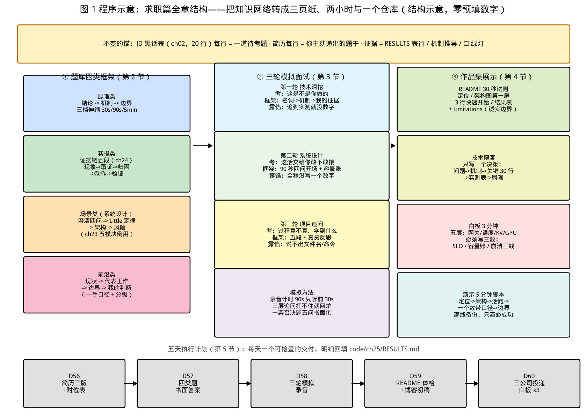

# 第 25 章｜求职篇：简历、题库、模拟面试、作品集（Day 56–60）

> **这章讲什么**：把前 24 章沉淀的全部能力，转换成面试现场的三种证据——**① 简历**：5 组措辞对照，把"我会"改写成"我证明过"；**② 题库**：原理/实操/场景/前沿四类高频题，每类一套答题框架（分别复用你学过的机制推导、证据链五段、服务化五模块、边界判据）；**③ 模拟面试**：技术深挖/系统设计/项目追问三轮的参考答案框架与露馅点；外加**作品集展示**（README 30 秒法则、博客只写一个决策、白板架构图 3 分钟画法、5 分钟演示脚本）。一句话：**这章不教你新知识，教你把已有的知识在 90 秒内兑现**。
>
> **为什么重要**：能力不等于证据。同样会 prefill/decode，有人能用"算术强度 + 实测落点"讲到对方无从追问，有人只会背"一个是算力瓶颈一个是带宽瓶颈"——中间隔着第 3 章的推导和第 7 章那张"M=1 只跑到峰值 0.7%"的表。招聘本质是**信息不对称下的判断**：面试官用 45 分钟评估你 60 天的底子，你唯一能做的，是把可验证的证据（实测数字、CI 绿灯、架构图、诚实的边界）按对方的提问顺序摆上桌。这一章就是 README 里阶段 9（Day 56–60）的实体，也是三大实战项目（量化实验、mini-vLLM、生产级部署）的最终出口。
>
> **学完能干什么**：① 用 5 组对照把自己的每条项目经历改写成"可被追问三层"的简历行；② 对四类高频题各说出一套答题框架，每类至少备出两道骨架答案；③ 说出三轮面试各自的考察目标与危险信号，并完成一次带录音的模拟面试；④ 现场 3 分钟画出白板架构图、5 分钟完成作品演示、30 秒让人看懂你的 README。
>
> **本章数字纪律**：零性能跑测。外部内容仅 ch02 的 JD 原文（检索 2026-10-15）与书内已登记值（ch03/05/06/07/13/17，各自核验日期沿用原章）；简历正例与话术中的性能数字一律留"回填位"指向你自己的 RESULTS——**面试里报出的每个数字都必须是你跑出来的，本章不提供任何可背的性能数字**。数据与回填登记于 [code/ch25/RESULTS.md](../code/ch25/RESULTS.md)。

---

## 0. 大白话开场：24 章的本事，要换成三页纸和两小时

前 24 章你一直在"练"：算过账、写过引擎、压到崩、演练过故障。但面试官不认识你，他只认识三样东西：

- **一张纸**（简历）：决定你有没有那 45 分钟；
- **一段对话**（面试）：决定那 45 分钟里你的 60 天值多少钱；
- **一个仓库**（作品集）：决定对话结束后他要不要回去复查你。

这三样东西的共同敌人是**信息不对称**：你脑子里是一张完整的知识网络（第 3 章到第 24 章互为因果），对方手里只有碎片化的提问时间。求职篇的全部方法论压成一句话就是：**把网络的"节点"变成可验证的"证据"，再把证据按对方的提问顺序排好**。

一个不变的锚（回扣 ch02 第 2.3 节）：**JD 黑话表的每一行，都是面试官打算问你的一道题；你简历的每一行，都是你主动递过去的一道题的题干**。简历写得虚，等于自己出题自己埋雷；简历写得实，等于把战场引到你准备过的地方。

**本章验收题**（学完应能张口回答）：

> ① 一条合格简历行的四要素是什么？② 实操类题和系统设计题各自的答题框架是什么？③ 白板 3 分钟画什么、最后必须写哪三个数？

答案分别在第 1.1、2.2/2.3、4.3 节。

---

## 1. 简历：5 组措辞对照（把"会"写成"证明过"）

### 1.1 合格简历行的四要素：动作 → 对象 → 方法 → 结果（数字带口径）

- 没有**动作+对象**，别人不知道你干了什么——"参与了推理服务性能优化"是最致命的句式，它同时缺失三要素；
- 没有**方法**，深挖时讲不出过程——而面试官最爱挖的恰恰是过程（"具体怎么对照的？怎么锁变量的？"）；
- 没有**带口径的结果**，数字一追问就塌——"吞吐提升 3 倍"后面永远跟着三连问：什么硬件？什么负载？对什么基线？

**一条简历行 = 你替面试官出的一道题，而你要保证自己答得上三层追问。** 改写方法看下面五组对照——每组左栏都是真实简历里高频出现的原句，右栏的数字全部留空，等你用自己的 RESULTS 回填（禁止借用任何别人的数据）。

### 1.2 五组措辞对照

| # | 反例（空泛 / 注水） | 正例（可追问 / 带口径，数字回填） | 修的是什么 |
|---|---|---|---|
| 1 | 负责大模型推理服务的性能优化工作 | 对 7B 模型 vLLM 服务做四档 A/B（前缀缓存 × Chunked Prefill，负载 md5 锁定），TTFT p99 由 __ 降至 __（4090D 单卡、并发 __ 档口径，见仓库 RESULTS.md） | **职责 → 成果**：动作+对象+方法+带口径数字 |
| 2 | 熟悉 PagedAttention、Continuous Batching、PD 分离 | 分页 KV 管理：像 OS 虚拟内存管 KV，碎片上界 = block_size−1 token（ch13）；亲手实现块池+调度循环，与 HF `generate` 逐 token 对齐 maxdiff = 0.00（ch06 方法） | **名词堆砌 → 机制+证据**：每个名词配一句"怎么工作"和一个"我做过什么" |
| 3 | 推理吞吐提升 3 倍 | 在 4090D 单卡、7B bf16、并发 __ 档、输出 token 总数相同的受控口径下，相对 HF `generate` 吞吐 ×__（实测登记仓库 RESULTS.md） | **裸倍数 → 三限定词**：谁测的 / 什么硬件负载 / 对什么基线（ch17 坑 6 的纪律） |
| 4 | 业余时间研究了大模型推理引擎 | 从零实现 ~800 行推理引擎（分页 KV + Continuous Batching），CI 对齐测试常绿，README 含架构图与三组受控 benchmark：github.com/你的用户名/mini-vllm | **含糊 → 作品锚点**：链接 + 可执行验收（CI 绿灯是会说话的证据） |
| 5 | 熟悉 PyTorch、CUDA、Docker、Kubernetes | 按目标 JD 逐条对位：JD 写"会用 Nsight 取证"→我有 nsys/ncu 取证的调优报告（证据链五段）；JD 写"P99/SLO"→我按三条崩溃线定过限流档 | **技术栈罗列 → JD 对位**：一条黑话配一条证据（ch02 黑话表反查） |

【落地视角】投递前 10 分钟的"黑话对位"流程：把目标 JD 逐词对 ch02 的 20 行黑话表，每行黑话标注"我的证据（章节 / 作品 / 实测数字）"。**对不上的黑话别硬写进简历**——写了就是给面试官递追问的把手。三家公司的对位表存进投递跟踪表（第 5 节 D60）。

【化学家视角】简历之于工程师，等于**实验记录**之于化学家：同行复现不了的记录等于没做。项目章反复强调的三要素口径（硬件/模型/负载 + md5 + RESULTS 链接）就是你实验记录的"可复现声明"——面试官问"这个数怎么来的"，你能给出一条复现路径，这是纸面上最强的一句话；反之，只报一个百分比而不报口径，在学术和工程圈里都会被视为不可信。

---

## 2. 题库：四类高频题与答题框架

面试题看似无穷，按"要什么证据"只有四类。**每类一套框架，框架比题目重要**——题是抽的，框架是你自己的。

### 2.1 原理类：结论 → 机制 → 边界（按 30 秒 / 90 秒 / 5 分钟三档伸缩）

**框架**：先给一句话结论（不许开口就是"这个概念是……"），再给两层机制（为什么需要 + 怎么工作 + 代价），最后主动交出边界（什么情况下不成立）。**主动交边界是原理题的加分项**——它证明你懂的是系统而不是名词。

例题五道（括号里是你的弹药章节）：

1. **prefill 和 decode 的区别？**（ch03）结论：一个算力 bound、一个带宽 bound；机制：算术强度与 Roofline 落点；边界：batch 小、算子碎片化时 decode 落不到带宽墙附近（ch07 的 M=1 实测就是这个边界的第一手证据）。
2. **PagedAttention 到底优化了什么？**（ch13）结论：消除 KV 碎片、把利用率从 20.4% 拉到接近 100%；机制：块池 + block table 间接寻址；边界：末块浪费上界 block_size−1，块太小索引开销回潮（ch17 坑 2）。
3. **为什么需要 Chunked Prefill？预算怎么定？**（ch14）结论：长 prefill 堵门，切块插队；机制：token 预算 = prefill 块 + decode_batch_size（两笔都记，ch17 坑 4）；代价：多几次 forward，少量吞吐损耗换 TTFT 稳定。
4. **投机解码为什么"无损"？**（ch20）结论：拒绝采样保证输出分布不变；机制：双口径——贪心时逐位一致、采样时同分布（Leviathan App.A.1 口径）；边界：接受率低时加速比跌破 1×（ch20 实算 α=0.35/k=7 → 0.90× 的反证）。
5. **TP 的通信为什么是那个公式？**（ch15）结论：8bsh(t−1)/t；机制：每层 2 次 all-reduce、切 t 份后每份搬 (t−1)/t；边界：小 batch 时通信占比升高，PCIe 上直接不值得跑（ch08 拓扑及格线）。

**三档伸缩**：30 秒版只说结论+一句机制；90 秒版加代价；5 分钟版才允许从推导讲起。**先问清对方要多深，再决定讲哪档**——自顾自讲满 5 分钟是原理题最常见的死法。

### 2.2 实操类：证据链五段（直接复用 ch24）

例题："线上 p99 突然涨了你怎么查？""压到崩溃点，怎么判断是哪面墙？""给我一次你调优的完整过程。"

**框架就是项目三的五段**：**现象**（档位 + 指标数值）→ **取证**（nsys NVTX / ncu 指标 / `/metrics` 快照）→ **归因**（排队墙 / 算力墙 / 显存墙，每种有对应的指标签名：waiting 积压 / GPU util 打满 / `gpu_cache_usage_perc` 高位 + `num_preemptions`）→ **动作**（限流档、开关、参数，引用你的 A/B 表数据）→ **验证**（同负载重跑 3 次，报 p99 与极差）。

两个要点：① **每段必须有文件名或截图**（"我当时存了个快照叫 xxx.json"比"我看了看监控"可信十倍）；② **动作必须引用自己做过的对照表**（限流档 = 满足 SLO 最大档 − 余量，数据来自哪次压测，说得出）。

### 2.3 场景类（系统设计）：澄清 → 容量 → 架构 → 风险

**框架**（ch23 五模块倒过来用）：

1. **澄清（前 10 分钟，只许问不许画）**：SLO 是什么（TTFT/TPOT 各多少）？峰值 QPS 和在途并发？模型与上下文长度（含长 prompt 占比）？硬件预算？——四个问题问完，方案的自由度就收敛掉 80%。
2. **容量**：Little 定律 N=X×R 代入 SLO 算单实例在途档，峰值除一除得实例数，加滚动更新与故障冗余（ch23 的 5+2 账）。
3. **架构**：接入层四手段（排队/限流/熔断/降级）→ 引擎选型（ch18 决策树一句话）→ 按负载挂优化（长 prompt 多 → chunked prefill；共享前缀多 → 前缀缓存；TTFT/TPOT 分开盯 → PD 分离）→ K8s 骨架（GPU 只写 limits）。
4. **风险**：三条告警绑定三条崩溃线 + 三级降级（L1 参数/L2 算法/L3 架构）+ 冷启动进账。

**评分真相**：系统设计的多数分数在**澄清与容量账**上，不在图画得多漂亮。开口三分钟内没问任何问题、直接画框的候选人，方案再华也是"假设驱动"。

### 2.4 前沿类：现状 → 代表工作 → 边界 → 判断

例题："PD 分离什么规模才值得上？""MoE 负载不均怎么解？""你怎么看分层 KV / cache-aware 调度？"

**框架**：现状（这个问题为什么现在变热）→ 代表工作（论文/系统名 + 一手口径，如 DistServe 7.4×/12.6× 是"对什么基线、什么口径"）→ 边界（代价与失效条件，如 PD 分离引入的三个新故障面）→ 你的判断（回到自己的负载：值得/不值得 + 判据）。

**四类题与本书弹药总表**：

| 类型 | 框架 | 本书弹药 | 危险信号（露馅点） |
|---|---|---|---|
| 原理 | 结论→机制→边界 | ch03–15 的推导与实测落点 | 只会背定义，说不出代价与失效条件 |
| 实操 | 证据链五段 | ch19 崩溃线 + ch24 五段与取证文件 | 只有结论没有过程，数字说不出口径 |
| 场景 | 澄清→容量→架构→风险 | ch23 五模块 + ch18 决策树 | 不问需求直接画图；容量靠拍脑袋 |
| 前沿 | 现状→代表→边界→判断 | ch20–22 论文一手口径 | 引数字不带出处；把 up-to 当平均 |

---

## 3. 三轮模拟面试：每轮考什么、怎么答、在哪露馅

三轮面试考的是三种不同的东西，用同一套准备策略必然顾此失彼。下图是本章全章结构：左列是四类题的答题框架（第 2 节），中列是三轮考察目标与露馅点（第 3 节），右列是作品集四件展示物（第 4 节），底部是五天执行计划（第 5 节）——你从左往右走一遍，就完成了从"会"到"面得过"的转换。

### 3.1 第一轮：技术深挖（考"这是不是你做的"）

**考察目标**：验证简历真实性与知识纵深——每个名词追问三层：**是什么 → 为什么这么设计 → 你的实现/实测里它在哪、代价是什么**。

**参考答案框架**：用"名词 → 机制 → 我的证据"三拍走。例（"讲讲 Continuous Batching"）：① 是什么：请求不凑批、谁完谁走、新人按 token 预算插队；② 为什么：static batching 要么等长尾要么浪费算力（Orca 论文的 36.9× 是对 static 基线的论文口径）；③ 我的证据：我在 mini-vLLM 里实现了迭代级调度循环，每步五件事——收请求/算预算/调度/forward/回收（ch17），并在批量不变性测试里抓到过一个"贪心对不齐但不报错"的 KV 索引错位 bug（ch17 坑 3）。

**露馅点与危险信号**：
- 追问到"你的实测"时开始讲故事没有数字——立刻降档为"我没测过这个维度"，比编数字强一百倍；
- 对自己简历上的词反向沉默：**面试官问的第 10 个问题往往就是你简历里你自己写的第 1 个词**；
- 把论文数字说成自己的（ch22 教的四级口径 A/B/C/D 在这里救命：主动分清"论文口径"和"我实测"）。

### 3.2 第二轮：系统设计（考"这活交给你敢不敢接"）

**考察目标**：需求澄清习惯、容量与成本意识、风险兜底——**不考你画的框多先进**。

**参考答案框架**：即 2.3 节的四步。给一个 90 秒开场模板（可直接背，数字用你自己的回填）：

> "我先确认四个条件再设计：SLO（TTFT/TPOT 各多少）、峰值 QPS 与在途并发、模型与上下文长度分布、硬件预算。假设长 prompt 占比明显、SLO 是 p99 TTFT __ 秒：我先用 Little 定律算单实例在途档 ×__ = __ 在途，峰值 __ req/s 需要 __ 实例起步，加滚动更新和故障冗余取 __（ch23 的算法）。架构上接入层四手段挡过载，引擎按负载挂优化——长 prompt 上 chunked prefill、共享前缀上前缀缓存，TTFT/TPOT 分别有硬要求才上 PD 分离。最后三条告警绑崩溃线、三级降级兜底，模型加载分钟级冷启动单独进账。"

**露馅点**：全程没写一个数字（容量、SLO、阈值全是形容词）；只画不问；把 PD 分离当默认答案（ch21 边界：负载形态不匹配时它只是新故障面）。

### 3.3 第三轮：项目追问（考"过程是不是真的、你学到什么"）

**考察目标**：项目三段论的真实度——**背景（为什么做）→ 过程（怎么做，越具体越好）→ 反思（哪错了、怎么改）**。深挖工具链（nsys/ncu 你真用过吗？）、深挖对照设计（变量怎么锁的？）、深挖失败（最难的 bug、最尴尬的翻车）。

**参考答案框架**：全程按证据链五段讲，**反思段必须有真货**。三个"最值钱的失败"素材（全来自你做过的）：
- 一次**对照没锁干净**的教训（ch19 七条控制变量里哪条你真漏过——缓存没显式开关、采样参数没固定，都行）；
- 一次**归因归错墙**的教训（把排队墙当算力墙，后来 `/metrics` 的 waiting 曲线推翻了自己）；
- 一次**注水被拆穿前的自我修正**（某个数字没带口径，你在投递前从简历里删了它——第 6 节坑 3 的亲历版）。

**露馅点**：反思全是"没时间做更多优化"这类假反思；过程里说不出任何一个文件名/命令行/截图；对"这个数是你测的还是论文的"含糊其辞。

### 3.4 模拟方法：三轮怎么练才算练过

1. **录音 + 计时**：每题 90 秒版本，回放只听一件事——**前 30 秒有没有结论**（多数人 30 秒还在铺垫）；
2. **追问人**：找朋友按"是什么→为什么→你测的哪"三连问，或自己录音后再追问自己；扛不住三连的条目回炉重写；
3. **一票否决题清单**（每题必须有书面答案才准上场）：你简历上**每一个数字**的口径；**最难的 bug**（现象→定位→修法→验证）；**为什么选这个方案**（至少一条放弃过的备选）；**失败复盘**（真货）；**为什么离职/为什么转岗**。

---

## 4. 作品集展示：README、博客、白板、演示

作品集的三个项目（ch10 量化实验、ch17 mini-vLLM、ch24 生产级部署）已经做完，本节只管**怎么让人看懂**。铁律一句：**面试官平均只给你 30 秒到 5 分钟**，展示设计必须按秒预算倒推。

### 4.1 README 的 30 秒法则

30 秒内看不到这四样，仓库等于白传（ch17 7.2 的展开版）：
1. **一句话定位**（这个项目是什么、解决什么）；
2. **架构图**（第一屏，不点任何链接）；
3. **3 行快速开始**（真能跑通的命令）；
4. **结果表 + Limitations**（有数字、有诚实的边界）。

**反例**：README 只有安装说明和特性清单、图在三屏之下、数字藏在 issues 里。**Limitations 不是减分项**：敢写"我用 gather 替代了 kernel、差距在哪"（ch17 的诚实对比），比吹"与 vLLM 持平"可信得多——对方会拿你的边界反过来验证你的深度。

### 4.2 技术博客：只写一个决策

按 ch17 7.3 的规格：**问题（300 字）→ 机制（带出处）→ 我的实现（贴关键 30 行）→ 实测对照（表）→ 诚实局限**。三选一（来自项目二），或用项目三的同款结构写《我把 p99 涨幅钉在了哪面墙：一次证据链五段的完整复盘》。**不要写学习总结流水账**——"我 60 天学了 25 章"是打卡记录，不是技术内容；一篇讲透一个决策的博客，胜过十篇周记。

### 4.3 白板架构图：3 分钟画法

**目标图**（3 分钟画完的五层）：客户端 → 网关（排队/限流/熔断/降级四手段）→ 调度器（continuous batching + token 预算）→ KV 层（块池 + 前缀缓存 + 分层驻留）→ GPU（attention + GEMM + 权重）。每一层配一行"为什么"（不配就是装饰画）。

**画完必须写三个数**（缺一个，白板就退化成背诵）：
1. **SLO**（p99 TTFT/TPOT，你定的口径）；
2. **容量**（Little 定律账：N=X×R → 实例数）；
3. **崩溃线**（L1 错误 >1% / L2 p99 超 SLO / L3 吞吐环比 <5%，限流档设在哪）。

**加分项**：主动在图边补两条——"长 prompt 走 chunked prefill，预算 = prefill 块 + decode batch"（ch14）、"扩缩容信号是 `/metrics` 的队列与 TTFT 分位，冷启动分钟级要提前"（ch23）。**主动交边界 = 高一档评分**（同 2.1 的原理）。

### 4.4 现场演示：5 分钟脚本

| 秒段 | 内容 | 证据形式 |
|---|---|---|
| 0–30 | 一句话定位 + 为什么做 | 口述 |
| 30–90 | 架构图（4.3 的五层缩略） | 仓库 README 第一屏 |
| 90–180 | 跑一个活的：CI 绿灯 / 对齐测试 / 一次压测报告 | 终端或截图 |
| 180–270 | 一个数字 + 它的口径 + 取证文件 | RESULTS.md 表行 |
| 270–300 | 诚实的边界 + 下一步 | Limitations 段 |

**演示纪律**：永远离线备份（网络、依赖、模型下载任何一个都能杀死现场）；只演"必成功路径"；每个数字能点到 RESULTS 的行（**口径行就是你的信任状**）。

---

## 5. 五天计划：Day 56–60 每天一个交付

前四节的方法必须在五天内落成实物，否则就是"看完等于会了"的错觉。每天一个可检查的交付，格式与项目章每日一表一致（细节回填进 [code/ch25/RESULTS.md](../code/ch25/RESULTS.md) 的回填区）：

| 天 | 主交付 | 副交付 | 验收（可检查） |
|---|---|---|---|
| D56 | 简历三版初稿（通用版 / 定向版 / 一页版） | 投递跟踪表表头 | 每条经历过四要素检查；黑话对位 ≥10 行 |
| D57 | 四类题各 5 题的书面答案 | 一票否决题清单 | 每答案符合本类框架；录音 90 秒 ×4 通过 |
| D58 | 三轮模拟面试各 1 次（录音） | 露馅点清单 | 追问三层不塌的条目记 ✅，塌的回炉 |
| D59 | README 四件套体检 + 博客初稿 | 演示离线包 | 30 秒法则四件齐；博客=一个决策 |
| D60 | 三家目标公司定制投递 + 白板 3 分钟 ×3 | 五天复盘 | 定向版简历与 JD 对位表成对归档 |

---

## 6. 【坑】七连 + 【应急方案】

### 【坑 1】简历堆名词不给证据
"熟悉 A/B/C/D" 列一屏，每个词都是一道你没准备的题。**应急**：名词必须配"机制一句 + 我的证据一条"，配不出的从简历删掉（宁可短而密）。

### 【坑 2】性能数字不写口径
裸数字被三连问（什么硬件/什么负载/什么基线）打穿，信任瞬间清零。**应急**：任何数字后紧跟括号口径；不确定的数字当场降级为量级描述并注明"以我仓库实测为准"，或直接删。

### 【坑 3】把论文/官方数字说成自己的
四级口径（ch22：A 论文原文/B 官方文档/C 自报实测/D 预测量级）在面试里同样适用——**主动分层是加分，被拆穿是红线**。**应急**：引用时前缀化——"这是 DistServe 论文口径，我自己的对照在另一个场景"。

### 【坑 4】系统设计不问需求直接画图
评分大头在澄清与容量，不在图。**应急**：开场白固定为 2.3 的四问；被打断问 SLO 时立刻记下来，画图时标在框旁边。

### 【坑 5】项目数字撑不起三层追问
第一层"多少"、第二层"怎么测的"、第三层"为什么这么测"——多数人死在第三层。**应急**：上场前把项目章每个结论的"对照设计"重讲一遍给自己听（变量怎么锁、为什么用这条崩溃线）；讲不出对照设计的结论，不上简历。

### 【坑 6】作品集注水：README 吹的比跑的大
面试官真会点开仓库——CI 挂着、benchmark 表是空的、图和正文对不上，比没有作品更糟（ch17：**诚实的半成品 > 注水的完成品**）。**应急**：投递前用 4.1 四件套逐项自查；没做完的写进 Roadmap 而不是藏起来。

### 【坑 7】只投不练 / 只练不投
只投不练：前几场面试变成免费陪练，烧掉最宝贵的机会窗口；只练不投：自我感觉良好与市场反馈脱节（ch02 第 2.6 节警告过"等学完再投"）。**应急**：投练比 1:3——每周投 3 家之前，必须已完成 9 次模拟题录音；每场真面试后 24 小时内写"被问倒清单"，回填题库。

【应急方案·总则】求职篇所有坑共享一个体检法：**"这条信息，我拿得出什么证据？"**——简历行的证据是 RESULTS 表行，话术的证据是机制推导，演示的证据是 CI 与截图。答不出证据的句子，删掉比留着安全；**你的 60 天不是靠形容词证明的，是靠可复现的路径证明的**（与项目章"每个数字必须来自你的一次运行"同一条纪律，只是换到了求职场景）。

---

## 7. 动手任务（Day 56–60）与验收标准

### 任务 A：简历改写与黑话对位（D56，核心任务）
从你已完成的三个项目里各抽一条经历，按 1.2 的五组对照逐条改写（四要素 + 口径括号 + RESULTS 链接）；再取一份目标 JD，逐词对 ch02 黑话表建"黑话 → 我的证据"对位表（≥10 行）。
**验收标准**：三条改写后简历行全部通过四要素检查；对位表每行都指向具体章节/作品/实测数字，无"暂无证据"项进入简历。

### 任务 B：四类题书面答案 + 录音（D57–D58）
四类题各写 5 题答案（严格按 2.1–2.4 框架）；从每类抽 1 题做 90 秒录音；一票否决题清单五题全部书面化。
**验收标准**：30 份书面答案框架齐全；4 段录音回放前 30 秒均有结论；一票否决五题每题 ≥1 个文件名/表格/命令级证据。

### 任务 C：作品集四件套体检 + 演示彩排（D59–D60）
按 4.1 四件套逐项体检三个仓库的 README（缺项补写，含 Limitations）；博客定稿（一个决策，非流水账）；按 4.4 脚本完成一次 5 分钟计时彩排（离线可跑）；白板 3 分钟画 3 次（录音计时）。
**验收标准**：三仓库 README 四件齐；离线包断网可演示；白板三次均在 3 分钟内且三个数写全；任意一次彩排能被连续追问三层而不塌。

---

## 8. 自检三问

1. 一条合格简历行的四要素？（答：动作 + 对象 + 方法 + 结果（带口径的数字）——四者缺一，简历行就从"证据"退化为"声明"。）
2. 实操题与系统设计题的答题框架？（答：实操 = 证据链五段（现象→取证→归因→动作→验证），每段带文件；系统设计 = 澄清（SLO/峰值/模型/硬件四问）→ Little 定律容量 → 架构（接入四手段+引擎选型+按负载挂优化）→ 风险（三告警绑崩溃线+三级降级）。）
3. 白板 3 分钟画什么、必须写哪三个数？（答：画五层——客户端/网关四手段/调度器+token 预算/KV 层块池与分层/GPU；写三个数——SLO、容量账（N=X×R→实例数）、崩溃三线与限流档。）

---

## 9. 面试话术（3 条）

**话术 1（自我介绍 90 秒·黄金结构：我是谁 → 三个证据 → 为什么来）**："我做过信号处理工程，系统补了推理 Infra 的完整链路并用三个可验证的项目落了地。证据一：从零实现约 800 行推理引擎——分页 KV 管理加 continuous batching，验收是与 HF `generate` 逐 token 对齐 maxdiff 0.00，CI 常绿；证据二：生产级部署调优——双卡 TP 对照、前缀缓存 × chunked prefill 四档 A/B（负载 md5 锁定），压测扫到崩溃线后用 nsys/ncu 取证，产出限流档与证据链五段报告（具体数字在我的仓库 RESULTS，口径是 4090D、__ 模型、__ 并发档）；证据三：读透了引擎内核——PagedAttention、PD 分离、投机解码都能从论文口径讲到实现代价。我看重贵司这个岗位，是因为 JD 里'__'（黑话对位表挑一行）与我证据二的工作同构。"

**话术 2（原理题示范：prefill/decode 三档伸缩）**："一句话：prefill 是算力 bound、decode 是显存带宽 bound——同一套权重，读一遍要算几千个 token，读一遍只产出一个 token，算术强度差了三个数量级。机制上用 Roofline 看：我实测过 4090D 上一个 M=1 的 GEMM 只跑到峰值的 0.7%（4090D 实测登记口径），而饱和矩阵能顶到 bf16 张量核量级——落点完全不同，所以优化也完全不同：prefill 要喂饱算子、拼大 batch，decode 要抠带宽、控 batch。边界：batch 小且算子碎片化时 decode 落不到带宽墙附近，这时候瓶颈会滑回调度与内核开销；反过来 batch 很大时 prefill 也会被拖成混部问题。如果要 5 分钟版本，我从算术强度 bh/(b+h) 的推导讲起。"

**话术 3（项目追问·证据链完整版）**："最能代表我水平的一次分析是把 p99 涨幅钉在显存墙上。现象：并发推到 __ 档，p99 突破 SLO 而吞吐不再涨；取证：`/metrics` 快照 + nsys NVTX 时间线（文件都在仓库）；归因：`gpu_cache_usage_perc` 长期高位、`num_preemptions` 开始计数、而 GPU util 没打满——是显存墙不是算力墙，排队积压是连带的；动作：把限流档压到满足 SLO 最大档减余量，同时按 A/B 表数据调整 KV 水位，依据是我自己那张四档对照表；验证：同负载重跑 3 次，p99 回到 SLO 内、极差 __。复盘：我第一版把归因写成了算力墙，是 waiting 曲线推翻的——所以我的规矩是**每个结论必须先有指标签名再有结论**，这条写进了我的调优报告模板。"

---

## 参考与版本说明

- JD 原文与黑话表：ch02 第 2.2/2.3 节（清昴智能、智象未来等 JD，检索 2026-10-15）；岗位薪资与门槛时效性提醒沿用 ch02。
- 书内已登记锚点（各自核验日期沿用原章）：ch03 实测 Roofline 与 prefill/decode 落点、ch05 崩塌曲线、ch06 对齐方法（maxdiff 0.00）、ch07 M=1 实测（峰值 0.7%）、ch13 PagedAttention 利用率账、ch15 TP 通信公式、ch17 nano-vllm 官方口径与作品集三件套、ch19 崩溃三线、ch20 投机解码双口径、ch21 DistServe 7.4×/12.6×、ch22 四级口径分级、ch23 五模块与容量账、ch24 证据链五段。
- 本章零性能跑测、零外部图片；**正文所有性能数字均为"回填位 + 章节引用"，不提供任何可背的外部性能数字**；简历正例与话术中的空格由你用自己 RESULTS 的实测值填写。
- 算账、黑话对位表与回填登记：[code/ch25/RESULTS.md](../code/ch25/RESULTS.md)；配图 1 张由 [code/ch25/make_figures.py](../code/ch25/make_figures.py) 生成（零外部图片，无 CREDITS 需求）。
- **版本**：v0.26（第 1–25 章已完成，**全书 25 章主体收官**）。
- **下一章预告**：正文到此完结；后续按目录补齐 8 个附录（A 心智模型总表、B 显存速查、C 引擎横评表、D 硬件成本表、E 工具清单、F 论文路线、G 60 天打卡表、H 自检题库 100 题）。
