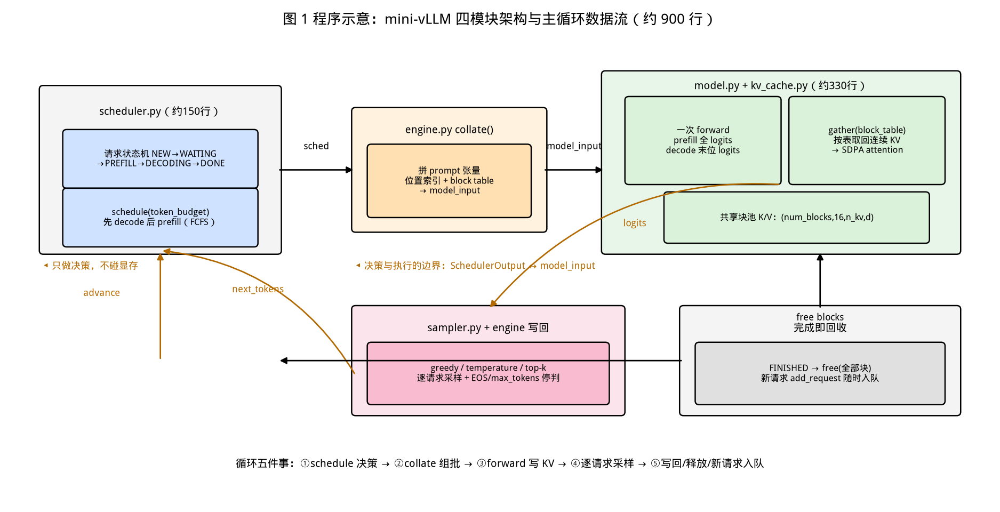
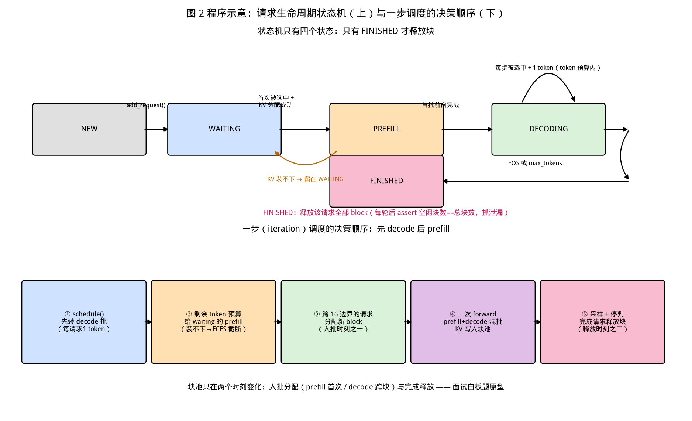
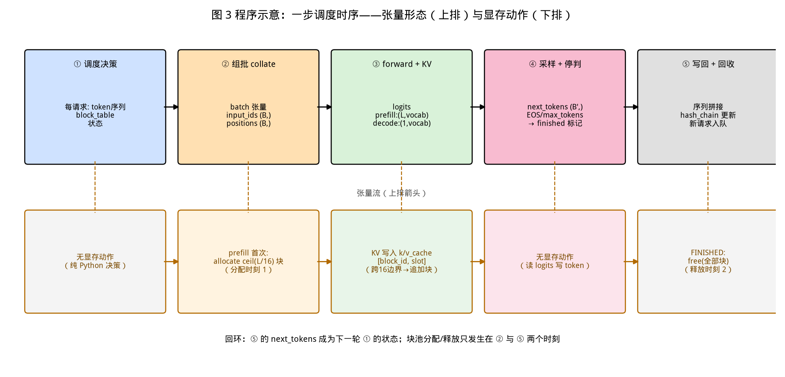

# 第 17 章｜核心项目：mini-vLLM 从零实现（Day 33–42 贯穿）

> **这章讲什么**：这是全书的**求职一号作品**——用 500–1000 行 PyTorch，从零写一个具备三样核心能力的推理引擎：**分页 KV 管理**（第 13 章）、**Continuous Batching 调度**（第 14 章）、**简单调度器与前缀复用**（第 16 章）。本章给出完整的架构设计、模块行数预算、十天里程碑、正确性对齐方法、benchmark 设计与作品集包装（GitHub 仓库 + README + 技术博客）。
>
> **为什么重要**：面试官见惯了"我会调 vLLM 参数"的候选人，稀缺的是"**我改过引擎内核**"的人。而证明懂引擎的唯一硬通货，是**亲手把它的三大机制各实现一遍，再证明你的实现是对的、快在哪、慢在哪**。第 11–16 章读的是别人的源码；这一章把读过的全部知识**收敛成一个能跑、能测、能展示的作品**——这也是为什么阶段 5 的 12 天里，项目占了 10 天（Day 33–42 贯穿）。
>
> **学完能干什么**：① 画出 mini-vLLM 的四模块架构并逐块讲清数据流；② 亲手实现块分配/释放、链式前缀 hash、迭代级调度循环，并通过与 HF `generate` 的**逐 token 零误差对齐**验收；③ 设计三组受控 benchmark，报出"你的引擎 vs HF generate"的吞吐倍数并解释差距来源；④ 把项目包装成 GitHub 仓库 + README 架构图 + 一篇技术博客，简历上写出可被追问三轮的项目经历。
>
> **本章数字纪律**：零性能跑测。外部数字（nano-vllm 官方 benchmark、Orca 论文数字等）标注来源与检索日期（2026-10-16）；源码行号来自 vLLM commit `642c18d`，逐一 grep 核验；本机数字只引用**前 8 章已实测并登记**的结果（ch06 的 maxdiff 0.00、×15.5 等）；对你的实现的性能预期一律写"**以你机器实测为准**"。算账登记于 [code/ch17/RESULTS.md](../code/ch17/RESULTS.md)。

---

## 0. 大白话开场：为什么"从零写一个引擎"是作品集的天花板

假设面试官看了你的简历，问："你说你懂推理引擎，证明给我看。"

三种回答，含金量完全不同：

1. **"我部署过 vLLM，压测过 QPS"** → 部署工程师，合格，但候选人里一抓一大把。
2. **"我读过 vLLM 源码，PagedAttention 是分块管理显存"** → 多数人到这里就复述论文了，深问一句"block table 在哪一步被消费"就露馅。
3. **"我自己写了一个 800 行的引擎：块池怎么设计、调度循环每一步做什么、为什么我选择 gather 而不是写 CUDA kernel、实测比 HF generate 快多少、慢在哪些地方"** → **第三种**。你能回答任何一个"为什么"，因为每个决策都是你做的，每行代码都是你调试过的。

这就是本章要交付的东西。三个心理准备先说清楚：

- **不写 CUDA kernel**。真 vLLM 的 paged attention 是 Triton/CUDA kernel 内寻址（第 13 章）；你的实现用"分页管理 + 每步 gather"换取纯 PyTorch 可实现性，**砍掉什么、为什么砍，本身就是面试考点**（第 7 节会展开）。
- **500–1000 行是纪律不是目标**。写少了机制不全，写多了说明没做抽象。业界已有先例：nano-vllm（GeeeekExplorer/nano-vllm）用**约 1,200 行 Python** 实现了含前缀缓存、Tensor Parallel、CUDA graph 的完整引擎，官方 README 报告其吞吐与 vLLM 持平甚至略高（检索 2026-10-16，见 1.2 节）——**行数少不等于性能差，性能差通常是因为机制没做全**。
- **验收标准必须客观**。"跑起来看看"不是验收；**与 HF `generate` 逐 token 对齐 maxdiff = 0.00**（ch06 已经证明这招可行）才是验收。

**本章验收题**（学完应能张口回答）：

> ① 你的引擎每一步调度循环做哪五件事？② 分页 KV 在你的实现里"分页"分在哪、gather 用在哪、和真 vLLM 差在哪？③ 你的 benchmark 三组对照分别控制了什么变量，倍数怎么解读？

答案分别在第 2.2、3/5、6 节。

---

## 1. 项目总览：要写什么、不写什么、十天怎么走

### 1.1 核心三件套与"不做清单"

README 目录表对本项目的定义是：**分页 KV 管理 + Continuous Batching + 简单调度器**，外加 benchmark 与作品集包装。展开成清单：

**必做（核心交付）**：

| # | 模块 | 必须做到什么 | 对应章节 |
|---|---|---|---|
| 1 | **分页 KV 管理器** | 固定大小 block 的分配/释放/复用，block table，块池容量受显存约束 | 第 13 章 |
| 2 | **Continuous Batching 调度器** | 迭代级调度：每步重新组批，新请求随时进、完成请求随时出；token 预算 | 第 14 章 |
| 3 | **引擎主循环** | prefill/decode 两阶段在一个循环里共存，KV 写入分页块池，逐请求采样与停判 | 第 3/6 章 |
| 4 | **正确性对齐** | greedy 下与 HF `generate` 逐 token 零误差；批量=单条的一致性 | 第 6 章 |
| 5 | **benchmark** | 三组受控对照，报吞吐倍数 + 解释差距 | 第 5/14 章 |
| 6 | **作品集包装** | GitHub 仓库 + README 架构图 + 技术博客 | 第 25 章 |

**选做（加分项，时间不够就砍）**：链式前缀 hash 的最小版前缀缓存（强烈建议做，只有 ~40 行，是第 16 章知识的落地）；采样参数支持（temperature/top-k，直接搬 ch06 采样器）；流式输出回调。

**明确不做（写进 README 的 "Limitations"，这是成熟度的体现）**：

- ❌ CUDA/Triton kernel —— attention 用 PyTorch 原生算子 + gather 实现
- ❌ Tensor/Pipeline 并行 —— 单卡（第 15 章内容不在本项目范围）
- ❌ chunked prefill、抢占重算、投机解码 —— 调度器留出扩展点即可
- ❌ OpenAI 兼容 HTTP 服务 —— 离线 `generate` 接口就够（服务化是项目三的地盘）

【落地视角】**"不做清单"比"做清单"更能体现工程判断**。面试点：面试官问"为什么不做 X"，你要能答出"因为 X 的收益依赖 Y 前提，我的场景/行数预算下不成立"——这和你在岗位上评估"要不要引入某中间件"是同一种能力。

### 1.2 业界对标：nano-vllm 的 1,200 行做到了什么

你的项目不是孤例，业界已有明确对标物，引用它可以让评审快速理解你的定位：

**nano-vllm（github.com/GeeeekExplorer/nano-vllm）官方 README 数据（检索 2026-10-16）**：

- 规模：**约 1,200 行 Python**；特性：前缀缓存、Tensor Parallel、torch.compile、CUDA graph
- 官方 benchmark（**RTX 4070 Laptop 8GB + Qwen3-0.6B，256 条请求，输入/输出长度随机 100–1024 token**）：

| 引擎 | 输出 token 总数 | 耗时 (s) | 吞吐 (token/s) |
|---|---|---|---|
| vLLM | 133,966 | 98.37 | 1,361.84 |
| nano-vllm | 133,966 | 93.41 | **1,434.13** |

两个要点：

1. **输出 token 总数完全相同（133,966）** → 这是一组受控对比：同负载、同输出量，只比时间。这正是你 benchmark 要抄的方法（第 6 节）。
2. 吞吐比 = 1434.13 / 1361.84 ≈ **1.05×**（算账 1，[code/ch17/RESULTS.md](../code/ch17/RESULTS.md)）——**极简实现不仅不慢，还可能略快**。原因不神秘：小引擎没有 vLLM 的通用性包袱（多架构、多硬件、多后端的抽象层），你的场景只服务一种模型时，抽象税可以不交。但**这不意味着你的 800 行能打平 vLLM**——nano-vllm 有 CUDA graph、Triton KV kernel、torch.compile，你要诚实地在 README 里列出自己没有的东西（第 7 节）。

**写作/引用纪律**：这组数字是** nano-vllm 作者在自己机器上的自测**，引用时必须带上"官方自测、4070 Laptop、0.6B 模型"三个限定词，不能当成"极简引擎普遍快于 vLLM"的结论（【坑】8.1 第 6 条）。

### 1.3 十天里程碑（Day 33–42，与阶段 5 章节学习并行）

项目贯穿 Day 33–42，与第 13–16 章（PagedAttention / 调度器 / 并行 / 前缀与压测）的阅读并行推进——**读完一章，落地一块**：

| 天 | 里程碑 | 读什么（并行） | 交付/验收 |
|---|---|---|---|
| D33 | **M0：朴素单请求**：HF 模型 forward + 手写循环（搬 ch06），贪心对齐 | ch13 前半 | 与 HF `generate` greedy 逐 token maxdiff = 0.00 |
| D34 | M0 收尾：采样器（temperature/top-k）、停判、多请求顺序跑通 | ch13 后半 | N 条请求串行结果 = N 次单条结果 |
| D35 | **M1：块池 + block table**：分配/释放/复用，KV 写入分页布局 | ch14 前半 | 显存占用不随请求数线性泄漏（重复跑 100 轮块池水位归零） |
| D36 | M1 收尾：gather 路径——按 block table 从块池取回连续 KV 喂 attention | ch14 后半 | 集成进 M0 后仍与 HF 对齐（**这是最难的一步，坑 3**） |
| D37 | **M2：调度器**——请求状态机、每步重新组批、token 预算 | ch15 | 一批请求里第 k 个完成时其余不中断（观察日志） |
| D38 | M2 收尾：prefill/decode 混批、完成即释放块、新请求随时插入 | ch16 前半 | 100 条请求跑完块池水位归零，无泄漏 |
| D39 | 选做：**链式前缀 hash**（ch16 的 40 行落地版） | ch16 后半 | 相同前缀请求第二次进入时 prefill token 数显著变少（结构观察） |
| D40 | **M3：benchmark 三组对照**（6 节） | — | 三组成表数据，全部标注本机配置 |
| D41 | 打磨：错误处理、README、架构图、Limitations | — | 仓库自述完整，陌生人 10 分钟能跑起来 |
| D42 | **作品集包装**：GitHub + 技术博客 + 简历条目 | — | 第 7 节三件套交付 |

**每天的读-写配比**：读 40%（当天对应章节 + vLLM 源码），写 60%。**禁止连读三天不动手**——第 11–16 章的教训是"看源码不算会"（README 学习心法第 2 条）。

---

## 2. 架构设计：四个模块、一条主循环

### 2.1 模块划分与行数预算

```
mini-vllm/
├── engine.py        # 引擎主循环：组批→forward→采样→写回→释放   （约 250 行）
├── scheduler.py     # 调度器：请求状态机、每步 schedule()、预算     （约 150 行）
├── kv_cache.py      # 块池：block 分配/释放/block table/链式 hash   （约 180 行）
├── model.py         # 模型适配层：HF 权重 + 支持外置 KV 的 forward  （约 150 行）
├── sampler.py       # 采样：greedy/temperature/top-k（搬 ch06）      （约 80 行）
└── bench.py         # 对照 HF generate 的 benchmark                 （约 100 行）
```

合计约 **910 行**，落在 500–1000 行区间（算账 2，行数为预算值，实际以你的 `cloc` 输出为准）。**每个文件一个职责，面试时可以按文件逐个讲**——这比一个 900 行的 `main.py` 好讲十倍。

与 vLLM v1 的组件对照（便于面试官把你的心智模型映射到真引擎）：

| 你的模块 | vLLM v1 对应物 | 行号（commit 642c18d，grep 核验） |
|---|---|---|
| `kv_cache.py` 块池 | `KVCacheManager.allocate_slots` + `BlockPool` | `v1/core/kv_cache_manager.py:371`、`v1/core/block_pool.py:811` |
| `kv_cache.py` 前缀 hash | `hash_block_tokens` + `find_longest_cache_hit` | `v1/core/kv_cache_utils.py:707`、`v1/core/kv_cache_coordinator.py:460` |
| `scheduler.py` 每步调度 | `Scheduler.schedule` | `v1/core/sched/scheduler.py:621`（类定义 `:84`） |
| `engine.py` 执行一步 | `GPUModelRunner.execute_model` | `v1/worker/gpu_model_runner.py:3935` |
| `sampler.py` | `Sampler.sample` → `sample_tokens` | `v1/sample/sampler.py:308`、`gpu_model_runner.py:4299` |
| 请求入队 | `Scheduler.add_request` | `v1/core/sched/scheduler.py:2700` |

（**vLLM 那头没有独立的 "engine 主循环" 文件**——v1 里引擎循环在 `vllm/v1/engine/core.py` 的 `_engine_core_cv_loop` 一族，调度与执行的分工靠 `schedule()` 返回的 `SchedulerOutput` 衔接；你的 `engine.py` 把这层胶水也收进来，这正是"极简"的意义：**你能看到全链路的每一根线**。）

### 2.2 主循环：每一步调度循环的五件事

整个引擎的心脏是一个 `while` 循环，每一轮（一个 **iteration**）做五件事：

```python
while not all_done:
    # ① 调度：决定这一步算谁、算多少
    sched = scheduler.schedule(token_budget=BUDGET)   # 返回 prefill_batch + decode_batch

    # ② 组批：把调度结果变成张量
    #    prefill: 拼 prompt token、记每个请求的起始 block
    #    decode: 每请求取"上一个 token"与"它要写入的 block 槽位"
    model_input = collate(sched)

    # ③ 前向：一次 forward 覆盖两阶段（prefill 出全部 logits，decode 出末位 logits）
    logits = model(model_input, kv_pool)             # KV 写入 block table 指定的位置

    # ④ 采样：逐请求采一个 token，检查停条件
    next_tokens = sample(logits, sched)              # EOS 或达到 max_tokens → 标记完成

    # ⑤ 写回与回收：token 拼进序列，完成的请求释放其全部 block，新请求入队
    scheduler.advance(next_tokens, finished)         # 完成即释放（坑 5），新请求随时进
```

五个要点，每个都有前文出处：

1. **①②之间是"迭代级调度"**：不是"组一批、跑完、再组一批"（static batching），而是**每步都重新决策**（第 14 章 Orca 的迭代级调度）。这就是第 k 个请求完成时其余请求不受影响的原因。
2. **③里两阶段共存**：prefill 请求一次性吃进整段 prompt（算力 bound，第 3 章），decode 请求每步只进 1 个 token（带宽 bound）——同一步里两者混批，用 token 预算限制 prefill 的体量（第 14 章双预算的极简版：一个 `BUDGET` 数字）。
3. **⑤的"完成即释放"** 是 continuous batching 的收益来源也是泄漏高发地：块不释放 = 显存慢性死亡；释放早了 = 下一步 forward 还在读它的 KV（坑 5）。
4. **每步的"状态"只有三样**：每个请求的 token 序列、它的 block table、调度队列。没有全局隐藏状态——**能用这三个数据结构讲清楚整个引擎，就说明架构是干净的**。
5. **与 vLLM 的边界**：vLLM 的 `schedule()` 返回 `SchedulerOutput`，`execute_model()` 消费它（`:621` → `:3935`）；你的 `schedule()` 返回 `sched`，`collate()` 消费它。**结构同构，规模差三个量级**——面试时这句对比很值钱。



**看图要点**：左侧调度器只做决策（纯 Python/轻量张量），中间组批层把决策翻译成张量，右侧引擎 forward + 分页 KV 块池（块池是**所有请求共享的一块预分配显存**，回扣第 4 章"显存三巨头"里 KV Cache 的地位），下方采样与写回构成闭环。**注意箭头方向：调度器不碰显存，块池不碰决策**——这条边界就是你和 vLLM 共享的架构思想。

### 2.3 请求生命周期：状态机只有四个状态

```
        add_request()              schedule() 首次选中            每步被选中
  NEW ─────────────────► WAITING ─────────────────► PREFILL ─────► DECODING
   │                        ▲                          │             │
   │                        │  被抢占(选做，可不实现)     │             │ EOS / max_tokens
   └────────────────────────┘                          └──────┬──────┘
                                                              ▼
                                                           FINISHED
                                                    （释放全部 block，出队）
```

四个状态覆盖一切；**只有 FINISHED 才释放块**；WAITING→PREFILL 的那一刻分配 prompt 所需的块（块不够就留在 WAITING——这就是第 14 章"KV 显存是调度的硬通货"的最小实现）。



**看图要点**：上半是状态机（每个箭头标注触发函数，直接对应你代码里的方法名），下半是一步调度的决策顺序——**先 decode 后 prefill**（decode 步数固定、必须尽早出 token 保 TPOT；prefill 用剩余预算，第 14 章"选择性批处理"的极简规则）。

---

## 3. 模块一：分页 KV 管理器——"分页"分在哪，gather 用在哪

### 3.1 数据结构：三张表讲完全部状态

```python
class KVPool:
    # 一块预分配的连续显存，切成 num_blocks 个固定大小的块
    k_cache: Tensor   # (num_blocks, block_size, num_kv_heads, head_dim)
    v_cache: Tensor   # 同上
    free_blocks: deque          # 空闲块队列（vLLM free_block_queue 的极简版）
    # 每请求持有：
    #   block_table: list[int]   逻辑 KV 位置 → 物理块号
    #   hash_chain:  list[int]   选做：链式前缀 hash（ch16 的 40 行版）
```

四条设计决策，每条都对应第 13/16 章的一个机制：

1. **块大小固定（block_size=16）**：与 vLLM 默认一致（第 13 章消融口径）。取 16 的原因：太小则 block table 本身开销大、attention 索引碎；太大则内部碎片回潮（第 13 章算过：块越大，最后一个半满块浪费越多）。
2. **KV 按块物理分散、按表逻辑连续**：这是 PagedAttention 的**本体**——物理上请求 A 的 KV 可能横跨块 7、3、19，但 block table 保证"逻辑第 t 个 token 的 KV 在块 table[t//16] 的槽 t%16"。
3. **attention 用 gather 实现**：每步 decode 前按 block table 把该请求的 KV 从块池**取回成连续张量**再走 PyTorch `scaled_dot_product_attention`。这是与真 vLLM 的**根本差异**（见 3.3）。
4. **块池容量 = 显存算出来的**（第 4 章公式）：

```
num_blocks = floor( 可用KV显存 / (2 × block_size × num_kv_heads × head_dim × dtype_size) )
```

算账 3（零成本代入）：**Qwen2.5-7B（GQA，8 个 KV head，head_dim=128，bf16）**，单块 K+V = 2 × 16 × 8 × 128 × 2 B = **64 KiB**（第 4 章 7B 模型 56 KiB/token 是 70 层模型的每 token 全层账，本算账是**每层每块**口径，二者不可混用）。若留 2 GiB 给 KV → 32,768 块；`block_size=16` 下可容纳 **524,288 token 的 KV** ≈ 32 个 16k 请求。**这就是"分页"买回来的容量**——对比第 13 章的三个浪费源，你的实现同样可以被要求算出"有效率"。

### 3.2 分配/释放：三行核心逻辑

```python
def allocate(self, n):                 # 从 free_blocks 弹 n 个，空了就抛"KV 耗尽"
def free(self, blocks):                # 归还；支持 fork 共享（选做：引用计数）
def gather(self, block_table, length): # 按表取回 (length, kv_heads, head_dim) 连续 KV
```

三个必须自己踩一遍的坑（先剧透，实操时你会回来对号入座）：

- **释放顺序**：请求 FINISHED 那一刻释放**全部**块——但注意同一块不能释放两次（重试逻辑、fork 共享都会踩）。选做引用计数时：`ref_count[block] -= 1`，归零才回 free queue。
- **分配失败即调度约束**：`allocate` 抛错是**设计的一部分**——调度器在 `schedule()` 里先估算"这个 prompt 要几个块"（`ceil(prompt_len/16)` 个，decode 阶段每步可能追加 1 个），**装不下就不放行**（请求留在 WAITING）。这就是第 14 章"KV 显存是硬通货"落到代码上的样子。
- **块池水位自检**：每次全量跑完后 `len(free_blocks) == num_blocks` 必须成立——一行 assert 抓住绝大多数泄漏（M1/M2 的验收标准就用它）。

### 3.3 与真 PagedAttention 的差异：gather vs kernel 内寻址

这是全项目**最重要的一段诚实陈述**，README 与面试都要讲：

| 维度 | 真 vLLM（第 13 章） | 你的 mini-vLLM |
|---|---|---|
| KV 存储 | 分页块池（block table） | 同（**管理方式一样**） |
| attention 读取 | **kernel 内寻址**：Triton/CUDA kernel 拿 block table 逐块读，**KV 从不离开块池** | **gather 路径**：每步把 KV 取回成连续张量再算 attention |
| 每步额外开销 | 0（寻址是 kernel 的本职） | 一次 O(KV 长度) 的 gather 拷贝 |
| 节省了什么 | — | 省掉 90%+ 的自定义 kernel 工作量 |
| 代价 | 要写/调 kernel | 长上下文、大 batch 下 gather 成本占比上升 |

**为什么这个差异不致命**：decode 阶段本来就是带宽 bound（第 3 章）——gather 读的字节数和 attention 读的 KV 字节数**同量级**，所以你多付的是一次线性拷贝，不是数量级变化；真正的数量级优化（paged attention kernel 不做连续化）留给"想继续往上写"的选做方向。**面试话术 2 给了这段的标准说法。**

【落地视角】**这个"砍一刀"的决策过程就是缩微版的技术选型**：收益（可实现性、可读性、10 天内交付）> 代价（gather 拷贝、上限低于 kernel 方案）→ 做。面试官追问"如果上下文涨到 128k 你会改哪里"，答案是：gather 换成 paged attention kernel（或改用 xformers/FlashAttention 的变体），**代码里 gather 是唯一热点，接口不变只换实现**——这叫"设计留好了刀口"。

---

## 4. 模块二：调度器与主循环——Continuous Batching 的最小实现

### 4.1 调度规则：一套极简但正确的规则

```python
class Scheduler:
    def schedule(self, token_budget):
        # ① 先跑完在途 decode（每请求固定 1 token，保 TPOT）
        decode_batch = [r for r in self.decoding]
        # ② 剩余预算给 waiting 的 prefill（一次吃进整段 prompt，不切 chunk）
        prefill_batch, used = [], 0
        for r in self.waiting:
            need = len(r.prompt)                      # 极简：整段进，不 chunk
            if used + need <= token_budget and kv_pool.can_allocate(...):
                prefill_batch.append(r); used += need
            else:
                break                                 # FCFS，装不下就停（不回头挑小的）
        # ③ 刚转 PREFILL 的先在下一轮 decode（防同一步重复算）
        ...
```

四条规则与 vLLM v1 的对应关系（行号 commit `642c18d`，grep 核验）：

| 你的规则 | vLLM v1 的对应机制 | 行号 |
|---|---|---|
| 先 decode 后 prefill | `schedule()` 内先处理 decode 再装 prefill（函数入口 `:621`） | `v1/core/sched/scheduler.py:621` |
| token 预算 | `max_num_batched_tokens` 双预算闸门（第 14 章） | 按硬件档默认 2048/8192/16384，`engine/arg_utils.py:2952-2980` |
| KV 装不下就不放行 | `allocate_slots` 返回可用量、不足则不调度 | `v1/core/kv_cache_manager.py:371` |
| 请求入队 | `add_request` | `v1/core/sched/scheduler.py:2700` |

**你主动不做的两件事**（第 14 章学过，README Limitations 里写明）：chunked prefill（把长 prompt 切片插进 decode 之间，Sarathi 的 2.6×/3.7×/5.6× 收益，留作扩展点）、抢占重算（`_preempt_request`，`scheduler.py:1649`）。

### 4.2 一步调度的完整时序

把 2.2 的五件事按数据流展开，写代码前先画这张图（**面试白板题原型**）：



**看图要点**：上排是五个阶段的**张量形态变化**（token 序列 → batch 张量 → logits → next_tokens → 状态更新），下排标注每阶段的**显存动作**——注意只有两个时刻块池发生变化：**入批时分配（prefill 首次）、完成时释放**；decode 中途只追加 block（序列跨过 16 边界时）。**面试官最爱问"什么时候分配"，答案就是这两个时刻。**

### 4.3 prefill/decode 混批的两个实现细节

1. **一次 forward 出两批 logits**：prefill 请求产出 `seq_len × vocab` 的 logits（只要最后一个位置），decode 请求产出 `1 × vocab`——用**拼接 + 位置索引**而不是跑两次 forward。ch06 的批量生成代码是现成底子（左 padding + 位置索引那套）。
2. **KV 写入位置由 block table 决定**：给模型的 forward 传 `(block_table, 起始逻辑位置)`，KV store 写 `k_cache[block_id, slot]` 而不是拼接连续缓存。**这一步是 M1 的成败点**：写进去的和 gather 出来的索引必须同构，差一位就是隐性错位（错位的表现是"贪心也对不齐"，比对齐失败更难查——坑 3 的排查线索）。

---

## 5. 正确性验收：与 HF 逐 token 零误差对齐

**没有对齐的引擎 = 没有验收的引擎。** 这一节是整个项目的质量闸门，方法在 ch06 已被证明（96 token + 93 步 logits **maxdiff = 0.00e+00**）。

### 5.1 三级对齐阶梯（一关比一关狠）

| 级 | 对照什么 | 做法 | 通过标准 |
|---|---|---|---|
| **L1** | HF `generate`（无 KV 优化） | 同 prompt、greedy（temperature=0）、同 max_new_tokens | **逐 token id 完全相等**，maxdiff = 0.00 |
| **L2** | HF `generate` **带 KV Cache**（`StaticCache`） | 同上 + 手动复现 ch04 的官方 cache 路径 | 逐 token 相等（排除"无 cache 路径"干扰） |
| **L3** | **批量 = 单条** | 同一请求：单条跑 vs 混在 batch=8 里跑 | 输出逐 token 相等（**这是 continuous batching 独有的坑**） |

L3 为什么单独一关：decode 混批时 padding、位置索引、gather 索引任何一处错，都会让"同一条请求在不同 batch 里出不同的 token"——**贪心都对不齐时，先跑 L3 定位**。

### 5.2 对齐脚本骨架（~60 行，直接抄）

```python
# tests/test_align.py
def test_l1_greedy_matches_hf():
    prompts = ["解释 PagedAttention。", "1+1=?", ...]      # 固定 8 条，含长/短 prompt
    ref = hf_generate(prompts, max_new_tokens=64, do_sample=False)   # HF 官方路径
    mine = engine.generate(prompts, max_new_tokens=64, temperature=0) # 你的引擎
    for a, b in zip(ref, mine):
        assert a.tolist() == b.tolist(), "贪心输出不一致"           # 逐 token 相等
    # 进阶（可选，ch06 做过）：比对每步 logits 的 maxdiff 是否 = 0.00e+00

def test_l3_batch_invariance():
    single = [engine.generate([p], max_new_tokens=64, temperature=0)[0] for p in prompts]
    batched = engine.generate(prompts, max_new_tokens=64, temperature=0)
    assert all(s.tolist() == b.tolist() for s, b in zip(single, batched))
```

三个对齐纪律（ch06 的教训直接搬）：

1. **关掉一切随机性**：temperature=0、greedy、固定 prompt 集；注意 HF 的 `eos_token_id`、`pad_token_id` 默认值与你的实现是否一致——**对齐失败 80% 是参数口径不一致，不是算错**（ch06 实测踩过 0.00 之前的几次假阴性）。
2. **同精度同模型**：bf16 对 bf16；别拿 fp32 的 HF 对 bf16 的你（第 9/10 章数值格式的坑在对齐场景重现）。
3. **先 L1 单请求，再 L3 批量**：单请求都不对就别调试批量（搜索空间爆炸）。

【应急方案】**对齐卡死超过半天怎么办**（按命中率排序）：① **先打 logits 差**——选一步比两边 logits argmax，若 argmax 相同但采样输出不同 → 采样器口径问题（EOS/pad/温度），若 argmax 就不同 → 计算路径问题；② 计算路径问题先查**位置索引与 block table 索引**（4.3 的写/gather 同构性，坑 3）；③ 再查 **attention mask**（decode 混批时的左 padding，ch06 讲过）；④ 最后才怀疑数值（换 float64 小模型复现，如果 float64 下一致而 bf16 不一致，是**边界容差**而非错误——L1 可放宽为 argmax 相等率 ≥ 99% 并写进 README）。**每一步都有日志可看，禁止推倒重写。**

---

## 6. Benchmark：三组受控对照，报出"吞吐倍数"

### 6.1 设计原则：先抄 ch16 的五条控制变量

第 16 章压测五条控制变量（模型精度、采样参数、负载分布、到达过程、服务端配置）在**引擎对打场景**的翻译版——本节全部对照都锁死：**同模型同精度（如 Qwen2.5-7B bf16 或更小的 0.5B/1.5B 便于复现）、greedy 或固定 seed 的 temperature、同一批 prompt（固定 128 条，ISL/OSL 固定）、同机同卡、warmup 一轮后再计时**。**唯一变量是引擎。**

### 6.2 三组对照与倍数的解读规则

| 组 | 对照 | 变量 | 报什么数 | 说明什么 |
|---|---|---|---|---|
| **B1** | 你的引擎 vs **HF `generate` 无 cache** | 引擎 | 吞吐倍数 | KV Cache 的价值（ch06 实测过同构数字：2048 上下文 4.2×——你的引擎应复现同量级） |
| **B2** | 你的引擎 vs **HF `generate` + StaticCache** | 引擎 | 吞吐倍数 | **你的 batch/调度层净贡献**（这是最诚实的一组，倍数通常 < B1） |
| **B3** | 你的引擎 batch 1 → batch 16 | 批大小 | 聚合吞吐倍数 | Continuous Batching 的价值（ch06 ×15.5 是同构锚点） |

解读纪律（**防自嗨三条**）：

1. **B1 的大倍数别当功劳**：对手是"无 cache 重算"（第 4 章算过 142× 计算量的理论上限），赢了只证明你实现了 KV Cache。**B2 才是引擎水平的度量**——对手已经有 cache 和单请求优化，你赢的部分是"批量 + 调度"，输的部分是"没有 CUDA graph / kernel 优化"（nano-vllm 就是在 B2 这类对照里靠 CUDA graph 追平 vLLM 的）。
2. **每个倍数必须带口径**：模型、卡、ISL/OSL、batch、warmup、代码 commit——否则数字无意义（ch16 五条控制变量的复述）。
3. **只比同机**：跨机器、跨卡的倍数是假的（第 8 章互联账讲过为什么）。

### 6.3 bench.py 结构与结果表模板

```python
# bench.py：三组对照共用一个计时器
def run(engine, prompts, **kw):        # warmup 1 轮 → 计时 1 轮 → 返回 (总输出token, 秒)
    ...
# 输出表格（结果回填，禁止预填数字）
# | 对照 | 输出 token | 耗时 s | 吞吐 tok/s | 倍数 | 口径备注 |
```

**你的结果表模板**（照 1.2 的 nano-vllm 表风格，字段顺序都一样）：

| 对照 | 输出 token 总数 | 耗时 (s) | 吞吐 (token/s) | 倍数 |
|---|---|---|---|---|
| HF generate（无 cache） | 由实测填 | 由实测填 | 由实测填 | — |
| HF generate（StaticCache） | **必须与上行相同** | 由实测填 | 由实测填 | B2 分母 |
| mini-vLLM（B2 同负载） | **必须与上行相同** | 由实测填 | 由实测填 | = 本行/StaticCache 行 |

**"输出 token 总数必须相同"是这张表的灵魂**（nano-vllm 官方表同款纪律：133,966 = 133,966）——greedy 同 prompt 下三行必然产出相同 token 数，**不同 = 你的对齐没过，表格作废**。这张表把第 5 节的正确性和第 6 节的性能**焊在同一组数字上**：token 数相同证明"算得对"，耗时不同证明"算得快/慢在哪"。

**本章零跑测纪律声明**：表中耗时与倍数由**你在你机器上实测回填**（脚本随仓库提供），本章不预填任何性能数字；对齐验收（maxdiff=0.00、token 数相同）是**结构正确性标准**，与机器无关，必须通过。预期量级可参照的既有锚点：ch06 本机实测 batch 1→16 聚合吞吐 ×15.5、手写 KV 比 HF 快 10%（同一方法论，不同实现）；外部参照 nano-vllm 官方自测 1,434.13 vs 1,361.84 tok/s（1.2 节，4070L/0.6B 口径）。

【落地视角】**benchmark 报告的三句话结构**（第 16 章压测结论的复用）：① 配置（模型/卡/负载/commit）；② 关键倍数（B1/B2/B3 各一个数，带口径）；③ 差距归因（"B2 < 1 的部分来自无 CUDA graph 和 gather 开销，占位在 engine.py 第 X 行"）。**能归因的慢，比不能解释的快更值钱。**

---

## 7. 作品集包装：GitHub 仓库 + README 架构图 + 技术博客

README 目录表的原话是"**求职一号作品**"——代码只占作品的一半，**可展示性是另一半**。第 25 章会讲多项目包装，这里给出本项目的三件套规格。

### 7.1 GitHub 仓库清单

- [ ] 仓库名：`mini-vllm`（或 `xx-vllm` 加前缀防重名）；**公开**；License（MIT/Apache-2.0）
- [ ] `README.md`（英文或中英双语）：一段话定位 + 架构图（2.1 那张）+ 快速开始（3 行命令跑通）+ 三组 benchmark 结果表（6.3）+ **Limitations**（1.1 的不做清单 + gather vs kernel 的诚实对比 3.3）
- [ ] `tests/`：第 5 节两个对齐测试，**CI 里跑**（GitHub Actions，一个 CPU/GPU runner 即可）——"PR 页面上绿色对勾"是会说话的作品集
- [ ] 代码内注释引用本书对应章节号（如 `# 迭代级调度：见 ch14 Orca`）
- [ ] `RESULTS.md`：本机配置 + 实测表 + commit hash（可复现性）

### 7.2 README 架构图

用 2.1/2.2 的两张图（或合并成一张），**放在 README 第一屏**。要求：读者不点开任何链接、不读任何代码，**30 秒内知道这个引擎由哪几块组成、每步循环做什么**。这也是面试官 30 秒定生死的地方。

### 7.3 技术博客：一篇讲透一个决策

**不要写"我实现了 mini-vLLM"的流水账**，写**一个决策的深度剖析**，三选一（都源自本章）：

1. **《我用 gather 实现了分页 KV，和真 PagedAttention 差在哪》**（3.3 展开）——砍掉了什么、代价是什么、刀口留在哪；
2. **《为什么我的引擎必须通过"批量不变性"测试》**（5.1 L3 展开）——一个只在 continuous batching 里出现的 bug 类型与排查路径；
3. **《从 HF generate 到 800 行引擎：三组 benchmark 怎么设计才诚实》**（第 6 节展开）——"输出 token 总数必须相同"的纪律。

博客结构固定：**问题（300 字）→ 机制（带本书/源码出处）→ 我的实现（贴关键 30 行）→ 实测对照（表）→ 诚实局限**。投递时仓库 + 博客 + 简历条目三处互链（第 25 章给简历条目的措辞模板）。

---

## 8. 【坑】清单 + 动手任务 + 自检 + 面试话术

【化学家视角】**从零写引擎像手搭一套微型实验装置**：每个模块（块池、调度循环、采样链）都是自己焊的管件，任何一段堵了你都知道堵在哪一节——这就是它比"调一个黑盒参数"学到得多的原因。对照真装置（vLLM）时你也能说清自己省了哪些阀件（CUDA kernel、CUDA graph）：**手搭装置的价值不在跑赢原厂，而在你从此看懂了原厂的管路图**。

### 8.1 七条坑（按项目时序排列）

1. **第一天就写调度器**（1.3）：没有 M0 对齐做底，你调度器里的每个 bug 都会和计算 bug 缠在一起。**严格按 M0→M1→M2 顺序，每关对齐通过才进下一关。**
2. **block_size 拍脑袋**（3.1）：块太小（如 4）→ block table 与索引开销占比高；太大（如 128）→ 内部碎片回潮（第 13 章：末块浪费上界 = block_size−1 token）。**用 16（vLLM 默认口径），别发明新数。**
3. **写入与 gather 索引错位**（4.3）：最阴的 bug——**贪心对不齐但不报错**。排查顺序：确认 `k_cache[block_id, slot]` 的 slot 与 gather 端完全同构；打印同一请求两种路径的 KV 张量比 maxdiff（ch06 的方法复用）。
4. **token 预算忘算 decode**（4.1）：预算只给 prefill，decode 请求数 ×1 被漏掉——batch 大时一步实际计算量超预算。**预算 = prefill_tokens + decode_batch_size**，两个都记。
5. **块泄漏或双重释放**（3.2/2.2）：跑 100 轮后块池水位不归零 = 泄漏；同一块进 free queue 两次 = 双重释放（会静默污染别的请求）。**每轮 assert `len(free_blocks)==num_blocks`（选做 fork 时改为引用计数和为零）**，让泄漏在开发期就爆炸，而不是上线后 OOM。
6. **引用外部 benchmark 不带口径**（1.2/6.2）：nano-vllm 的 1,434 vs 1,361 是"作者自测、4070 Laptop、Qwen3-0.6B"；Orca 的 36.9×（第 14 章）是对 static batching 的**论文特定负载**数字。**任何外部倍数都带三个限定词：谁测的、什么硬件什么负载、对什么基线。**
7. **把"跑通了"当验收**（5/6）：没有 L1–L3 对齐的引擎不可信；没有"输出 token 总数相同"的 benchmark 表不可信。**验收标准必须是可执行的 assert，不是目测。**

【应急方案】**10 天到期项目没完成怎么办**（按保命优先级）：① 砍选做（前缀缓存、采样参数退化为 greedy），保住 M0–M2 三件套——**核心三件套 + 对齐通过 = 作品成立**；② M2 来不及就先交"M1 + static 跑通"但 README 如实写进度与计划（**诚实的半成品 > 注水的完成品**，第 25 章讲为什么面试官会追问到露馅）；③ 压测/benchmark 最不可砍——没有 6.3 那张表，作品集少一半说服力；④ 求助顺序：vLLM GitHub issue/讨论区、nano-vllm 的实现（对标不是抄袭，**在 README 里注明"结构参考 nano-vllm"是加分的学术诚实**）。

### 8.2 动手任务

**任务 A：模块骨架与行数预算（D33，2 小时）**

按 2.1 建六个文件，每个文件先写函数签名与 docstring（中文），再逐个填实现。

*验收标准*：`cloc` 总行数 ≤ 1000；M0 骨架下与 HF greedy 对齐（L1 通过）；每个文件能独立讲出职责一句话。

**任务 B：块池水位自检（D36/D38，30 分钟）**

```python
# 每轮全量生成后：
assert len(pool.free_blocks) == pool.num_blocks, f"块泄漏：差 {pool.num_blocks - len(pool.free_blocks)} 块"
```

*验收标准*：连续 100 轮生成（每轮 8 条、随机长度 64–1024），断言全程不炸；人为制造泄漏（注释掉 free）确认断言能炸——**先证明检测器有效，再信检测器的绿灯**。

**任务 C：三组 benchmark 跑表 + 回填（D40，半天）**

按 6.1 锁变量、6.2 跑三组、6.3 填表；结果与本机配置写入 `code/ch17/RESULTS.md` 的"你的实测回填区"。

*验收标准*：表中三行**输出 token 总数完全相同**（不同 = 先回第 5 节补对齐）；每个倍数附口径；B2 的差距能在代码里指出归因位置（哪一行缺什么优化）。

### 8.3 自检三问（闭卷作答）

1. 你的调度循环每一步做哪五件事？块池只在哪个时刻发生分配和释放？
2. 你的"分页 KV"和真 PagedAttention 的分页，**相同在哪、不同在哪**？gather 的代价为什么不是数量级的？
3. B1/B2/B3 三组倍数分别度量什么？为什么 B1 的大倍数不能写进简历当主战绩？

（答案线索：1 → 2.2 与 4.2 图；2 → 3.1/3.3，管理方式相同、读取方式不同，decode 带宽 bound 下 gather 与 attention 同量级；3 → 6.2，B1 是"对无 cache"的水分倍数，B2 是调度净贡献，B3 是 continuous batching 的价值。）

### 8.4 面试话术（可直接背）

**话术 1：被问"介绍一下你写的 mini-vLLM"**

> "一个约 900 行的 PyTorch 推理引擎，四模块：分页 KV 块池、迭代级调度器、prefill/decode 混批主循环、采样与对齐测试。核心机制对应 vLLM 的三大件——块池是 allocate_slots 的极简版（16 token 固定块 + block table + 空闲队列），调度器是每步重决策的 continuous batching（先 decode 后 prefill、token 预算约束、KV 装不下就让请求留在等待队列）。正确性靠三级对齐验收：和 HF generate 贪心逐 token 相等（maxdiff 0.00 的方法沿用手写 generate 那一章），外加一个 continuous batching 特有的'批量不变性'测试——同一条请求单跑和混批跑必须出同一串 token。性能用三组受控对照报倍数，输出 token 总数必须相同，只比同机同卡同负载。"

**话术 2：被问"你的分页 KV 和真 PagedAttention 差在哪？"**

> "存储管理完全一样：固定 16 token 的块、block table 做逻辑到物理的映射、空闲块队列复用，所以显存浪费的三个来源（外部碎片、预留过大、完全浪费）在我的实现里同样被消掉，容量也能按'可用显存除以单块大小'算出来。差别在读取：真 vLLM 是 Triton kernel 拿 block table 在块池里原地寻址，KV 从不离开块池；我实现的是每步按 block table gather 成连续张量再走 PyTorch attention。代价是每步多一次 O(KV 长度) 的拷贝——但 decode 本来就是带宽 bound，gather 和 attention 读的是同一批字节，同量级不是数量级。这是有意的取舍：省掉自定义 kernel 的工作量，把刀口留在 gather 这一个热点上，后续可以只换实现不改接口。"

**话术 3：被问"怎么证明你的引擎是对的、是快的？"**

> "对和快分开证明。对：三级对齐——L1 和 HF generate 贪心逐 token 相等；L2 和 HF 的 StaticCache 路径对齐排除 cache 干扰；L3 批量不变性，同请求单跑与 batch=8 混跑逐 token 相等，这条专门抓 continuous batching 的 padding 和索引错位。快：三组受控对照，同模型同精度同 prompt 集同采样参数同机器，只变引擎——B1 对无 cache 的 HF，B2 对带 StaticCache 的 HF（调度层净贡献，最诚实的一组），B3 自己 batch 1 到 16 的聚合吞吐。验收纪律是三组的输出 token 总数必须完全相同，greedy 下不同就说明对齐没过、表格作废。报告里每个倍数都带口径，并且 B2 输给真引擎的部分我能归因到缺 CUDA graph 和 gather 开销的具体位置。"

---

## 参考与版本说明

- **nano-vllm**：GeeeekExplorer/nano-vllm（GitHub，Apache-2.0）；约 1,200 行 Python、含前缀缓存/TP/CUDA graph；官方 benchmark（RTX 4070 Laptop 8GB、Qwen3-0.6B、256 请求、ISL/OSL 随机 100–1024）：vLLM 1361.84 vs nano-vllm 1434.13 tok/s，输出 token 同为 133,966（检索 2026-10-16，算账 1：1434.13/1361.84≈1.05×）。相关解读文章：Dong Wang, *Understanding LLM Inference Through Nano-vLLM*（dongwang218.github.io，2026-04-11）。
- **vLLM 源码**：commit `642c18d`（2026-10-15 clone，Apache-2.0），行号 grep 核验：`v1/core/sched/scheduler.py:84/621/2700/1649`、`v1/core/kv_cache_manager.py:371`、`v1/core/block_pool.py:811`、`v1/core/kv_cache_utils.py:707`、`v1/core/kv_cache_coordinator.py:460`、`v1/worker/gpu_model_runner.py:3935/4299`、`v1/sample/sampler.py:308`、`engine/arg_utils.py:2952-2980`。
- **本书内引用**：手写 generate 与零误差对齐、batch16 ×15.5、手写比 HF 快 10%（第 6 章本机实测）；prefill/decode 两阶段属性（第 3 章）；KV 显存账与 StaticCache（第 4 章）；并发崩塌曲线与压测口径（第 5 章）；数值格式与对齐干扰（第 9/10 章）；PagedAttention 三种浪费与 block=16 消融（第 13 章）；迭代级调度、双预算、Sarathi 2.6×/3.7×/5.6×、Orca 36.9×（第 14 章）；并行策略不做的理由（第 15 章）；前缀缓存链式 hash 与五条控制变量（第 16 章）。
- **本章配图**：3 张程序生成（`code/ch17/make_figures.py`，零外部图片）；数字与算账登记见 [code/ch17/RESULTS.md](../code/ch17/RESULTS.md)。
- **下一章**：第 18 章《七大引擎横评与选型决策树》——项目做完，视角从"我写的引擎"切回"业界的引擎"，横评 vLLM/SGLang/TensorRT-LLM 等七家并给出选型决策树。
