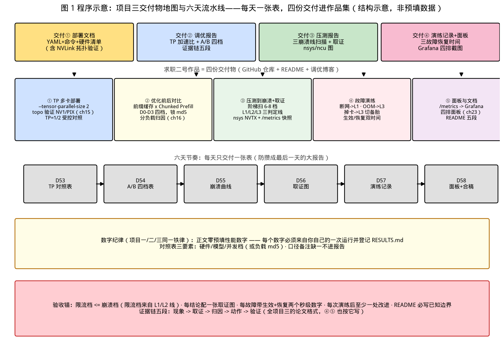

# 第 24 章｜项目三：生产级部署与调优实战（Day 53–58 贯穿）

> **这章讲什么**：前 23 章学的所有东西，在六天里组装成**求职二号作品**：一套可对外服务的 vLLM 部署 + 一份用数据说话的调优报告 + 一份故障演练记录 + Grafana 面板截图。五个模块：**① TP 多卡部署、② 前缀缓存+Chunked Prefill 前后对比、③ 压测到崩溃点并用 nsys/ncu 取证、④ 断网/OOM/掉卡三级故障演练、⑤ 监控面板与部署文档**。
>
> **为什么重要**：面试官问"你上过生产吗"，本质是问四件事——**你部署过吗（模块①）、你调过优吗（②）、你压过崩吗（③）、你救过火吗（④）**。项目二证明你懂引擎内部，项目三证明你懂"引擎之外的一切"：这就是简历上"部署+调优+稳定性"的完整证据链（第 25 章会把它们翻译成简历措辞）。
>
> **本章数字纪律**：与项目一/二同一铁律——**所有性能数字由你自己跑出后回填，正文与模板严禁预填任何非登记值数字**（书内引用的 ch05/ch16/ch19 登记值仅作参照列，标注"本书登记值"）。本章给出的全部是：命令骨架、受控对照设计、报告模板、验收标准。回填区在 [code/ch24/RESULTS.md](../code/ch24/RESULTS.md)。

---

## 0. 大白话开场：老板问"扛得住吗"，你要能甩出四份文件

想象入职第三周，业务方把服务切到你负责的推理集群，然后问了一句："**扛得住吗？出事怎么办？**"你不能答"应该可以"，你要能当场甩出四份文件：

1. **部署文档**（Deployment YAML + 启动命令 + 硬件清单）——证明你能把它搭起来；
2. **调优报告**（开关前后的受控对照表 + nsys/ncu 取证图）——证明你知道快在哪、为什么快；
3. **压测报告**（崩溃点三判定线的完整扫描 + 崩溃时刻的 profile）——证明你知道边界在哪；
4. **演练记录**（三类故障 × 三级降级，每级恢复时间）——证明你救过火，而不是只会写预案。

这四份文件就是本项目的全部交付物。**它们全是你前 23 章学过的工具的复用**：ch15 的 TP、ch16 的五条控制变量、ch19 的三条崩溃线、ch07 的 ncu 口径、ch23 的三级降级与告警三件套——**项目三不是新知识，是把旧知识第一次全部用上**。

**本章验收题**（学完应能张口回答）：

> ① 项目三的五个模块、四份交付文件分别是什么？② "前后对比"为什么必须同 prompt 集同参数、只动一个开关？③ 断网/OOM/掉卡三类故障分别对应哪级降级、演练记录要写什么？

答案分别在第 1、3、5 节。

---

## 1. 项目总览：五个模块、四份交付、六天怎么走

### 1.1 五个模块与四份交付物

| 模块 | 干什么 | 依赖章节 | 交付物 |
|---|---|---|---|
| ① TP 多卡部署 | `--tensor-parallel-size` 起多卡服务，验证加速比 | ch15 刀口、ch23 YAML | 部署文档（YAML+命令+硬件清单） |
| ② 优化前后对比 | 前缀缓存+Chunked Prefill 开/关 A/B | ch16 控制变量 | 调优报告（对照表） |
| ③ 压测到崩溃 + 取证 | 阶梯压到三条线，nsys/ncu 抓崩溃前后 | ch16/19、ch07 | 压测报告（曲线+profile 结论） |
| ④ 故障演练 | 断网/OOM/掉卡 × 三级降级 | ch23 第 5 节 | 演练记录（恢复时间表） |
| ⑤ 面板与文档 | /metrics → Grafana 四排面板 | ch23 第 3 节 | 面板截图 + README |

四份交付 = 部署文档 +（②③合并的）调优报告 + 演练记录 + 面板截图；全部进 GitHub 仓库，构成**求职二号作品**。

### 1.2 不做清单（防跑偏）

- ❌ 不追求"测出最快引擎"（那是 ch18/19 的事，本项目锁死 vLLM 单引擎）；
- ❌ 不手写 kernel 调优（超出服务化范畴，ncu 只做**取证与解释**，不改 kernel）；
- ❌ 不上真实 K8s 集群硬门槛——**单机双卡 + docker-compose/systemd 也算生产形态**，K8s 部分用 ch23 的 YAML 做到"可迁移的文档"级别即可（有集群则实做，没有不卡进度）；
- ❌ 不预填任何性能数字——每个数字必须来自你自己的一次运行并登记。

### 1.3 六天里程碑（Day 53–58，与第 23 章并行）

| 天 | 里程碑 | 当天验收 |
|---|---|---|
| D53 | 模块①：TP=2 起服务 + 加速比受控对照 | 多卡服务健康、对照表回填 |
| D54 | 模块②：前缀缓存+Chunked Prefill A/B | 四档对照表回填、差异归因一句话 |
| D55 | 模块③上半：阶梯压测到崩溃点 | 三判定线数据 + 崩溃档位标定 |
| D56 | 模块③下半：nsys/ncu 取证 | 每个结论配一张图（见第 4.3 节看什么） |
| D57 | 模块④：三故障 × 三级降级演练 | 演练记录表回填、恢复时间 |
| D58 | 模块⑤：面板 + 部署文档 + 调优报告合稿 | 四交付物齐、仓库可复现 |

【落地视角】**六天的正确姿势是"每天只交付一张表"**：D53 交付对照表、D54 交付 A/B 表、D55 交付崩溃曲线……绝不把六天攒成最后一天的"大报告"。这既是项目管理（每天有可验收产物），也是面试素材的生产方式——**第 25 章的简历条目，就是这六张表**。

【化学家视角】这套流程和**方法验证（method validation）**一模一样：专属性（同 prompt 集只动一个开关=固定一切 except 自变量）、检测限（三条崩溃线=方法的可测范围上限）、耐用性（故障演练=故意把仪器弄出常见故障看方法还稳不稳）。**一份能过审的分析方法报告，和一份能过面的调优报告，结构是同构的。**

---

## 2. 模块①：TP 多卡部署——把第四把刀真正握在手里

### 2.1 部署骨架（命令级，参数按你机器回填）

```bash
# 双卡 TP 部署（ch15：TP 刀口是矩阵切分，每层 2 次 all-reduce）
vllm serve <MODEL_PATH> \
  --tensor-parallel-size 2 \
  --dtype bfloat16 --max-model-len 8192 \
  --gpu-memory-utilization 0.90 \
  --max-num-seqs 64

# 部署前体检（ch07/ch08 工具复用）
nvidia-smi topo -m          # 两卡间必须 NVLink/PIX（非 SYS，SYS 走 PCIe 会伤 TP）
nvidia-smi                  # 记录卡型、显存、驱动版本进部署文档
```

**验收硬线**：`nvidia-smi topo -m` 中两卡关系为 `NV1`/`PIX`（回扣 ch15：TP 的 all-reduce 走 NVLink 是及格线，走 SYS 直接查机箱拓扑）。

### 2.2 加速比受控对照表（受控纪律：同模型/同 prompt 集/同参数，只动 `--tensor-parallel-size`）

| 对照 | TP | TTFT p99 | TPOT p99 | 吞吐 tok/s | 加速比 | 口径备注（硬件/模型/并发档） |
|---|---|---|---|---|---|---|
| A | 1 | （回填） | （回填） | （回填） | 1.00× | 基线 |
| B | 2 | （回填） | （回填） | （回填） | （回填） | 只动 TP，其余全同 |

**解读规则（预期先讲清，防止误读）**：TP 加速比**永远小于卡数**——ch15 的 8bsh(t−1)/t 通信账告诉你每步有 all-reduce 税；短 prompt/小并发下加速比更差（计算量不够摊通信）。所以这张表的正确问法不是"为什么不到 2×"，而是"**在我们的并发档下，通信税吃掉了多少**"——写报告时把并发档和 prompt 长度标进备注。

### 2.3 单卡不可行时的降级方案

模型太大单卡放不下、又只有单卡机器：TP 无法起 → 用 ch12 的混合推理（`-ngl` 分层，llama.cpp 路线）或量化（ch10）把权重压进单卡，**在报告里如实写"因硬件限制 TP 实验改为量化档对照"**——诚实的边界说明比硬凑一个假 TP 表可信（ch22 的口径纪律）。

---

## 3. 模块②：前缀缓存 + Chunked Prefill 前后对比

### 3.1 为什么这两个开关放在一起测

ch16 验证过前缀缓存的收益来自**共享前缀命中率**，ch14 验证过 Chunked Prefill 消除的是**长 prompt 的 prefill 尖峰（stall）**——两者一个省"重复计算"、一个平"计算尖峰"，是生产环境最常用的两个"免费加速"开关（都默认开）。**测清它们的价值，就是回答"我关掉它们会损失什么"**——这正是调优报告最常被追问的场景。

### 3.2 A/B 设计（把 ch16 五条控制变量焊死）

- **prompt 集**：复用你 ch19 冻结的三组负载（A 无共享 / B 高共享 / C 混合），同一文件、同一 `md5sum`；
- **四档对照**（只动开关，其余全同）：

| 档 | 前缀缓存 | Chunked Prefill | 验证什么 |
|---|---|---|---|
| D0 | 关（`--no-enable-prefix-caching`） | 关（`--no-chunked-prefill` 或等价禁用，参数名按版本 `--help` 核对） | 全关基线 |
| D1 | **开** | 关 | 前缀缓存净贡献 |
| D2 | 关 | **开** | Chunked Prefill 净贡献 |
| D3 | 开 | 开 | 生产默认态（对比 D0 总收益） |

- **每档 × 每负载**记录：TTFT p99、TPOT p99、吞吐、命中率（`vllm:prefix_cache_hits` 类指标按你版本 `/metrics` 核对名）；
- **必须分负载解读**：预期 D1 只在负载 B（高共享前缀）显著、在负载 A（无共享）接近零——**若负载 A 上也有大收益，先怀疑缓存策略没显式控制**（ch19 控制变量⑥的经典假结果）。

**报告模板行**：

```
| 档 | 负载 | TTFT p99 | TPOT p99 | 吞吐 | 缓存命中率 | 归因一句话 |
```

归因一句话示例（填法）："D3 相对 D0 在负载 B 吞吐 +X%、TTFT −Y%，命中率 Z% —— 收益集中在共享前缀命中，与 ch16 论文口径方向一致（74.1% 命中为论文口径，非本次实测）"。

---

## 4. 模块③：压测到崩溃点 + nsys/ncu 取证

### 4.1 阶梯压测到三条线（复刻 ch19，但对象是"你自己这套部署"）

- 并发档从低到高扫 6–8 档（C = 1/4/8/16/32/48/64…，按你显存调），每档 `num-prompts ≥ 5 × C`（ch16 稳态规则）；
- 三判定线当场记录：**L1 错误率 >1%、L2 p99 TTFT 超 SLO、L3 吞吐环比增长 <5%（封顶）**；
- 产出：一张"并发-TTFT/吞吐"双轴曲线（模板见第 6 节配图说明），**标出三条线各自的触发档位**——这个档位就是你限流配置的依据（ch23 模块一：限流点 = 满足 SLO 最大并发档 − 余量）。

### 4.2 崩溃前后取证：抓什么、为什么

| 场景 | 工具 | 命令骨架 | 看什么（ch07 口径复用） |
|---|---|---|---|
| 吞吐封顶（L3） | **nsys** | `nsys profile -o crash --duration 20 -t cuda,nvtx vllm serve ...`（压测期间抓） | NVTX 区间里 scheduler 步耗时分布：decode 步变长→排队挤入；kernel 空隙→CPU 调度成瓶颈 |
| TTFT 爆炸（L2） | **ncu** | `ncu --set full -o prof --target-processes all python ...`（低并发单请求复刻） | attention/GEMM 的带宽与占用率：是否退化到 ch03 roofline 的 decode 低效区 |
| 显存打满（触发抢占） | 引擎指标 | `/metrics` 的 `vllm:gpu_cache_usage_perc`、`vllm:num_preemptions`（ch14 登记名） | 水位趋 1.0 与 preemption 计数抬头的先后关系 |

**取证纪律**：每个结论**配一张截图或一条指标曲线**——"崩溃时 decode 步耗时从 X 涨到 Y（nsys NVTX 区间）"优于"崩溃时变慢了"。

### 4.3 调优报告的"证据链"写法（本模块最终产出）

```
现象：C=32 时 p99 TTFT 突破 SLO（L2 触发档 = 32）
取证：nsys 显示 C=32 时排队请求挤入 decode 批，prefill 排队时长 +Z ms（NVTX 图见附录）
归因：SLO 墙来自排队而非算力——gpu_cache_usage_perc 峰值 0.9X、无 preemption（/metrics）
动作：把网关限流档定在 C=16（L1 线），并发余量给到 2×；同时开 chunked prefill 摊平 prefill 尖峰（D3 档数据 +X%）
验证：限流后同负载重跑 3 次，p99 全部回 SLO 内（三次极差 ≤Y%）
```

**这条"现象→取证→归因→动作→验证"五段链，就是整个项目三的论文格式**——④⑤ 两个模块也按它写。

---

## 5. 模块④：断网/OOM/掉卡三级故障演练

### 5.1 三类故障 × 对应降级（桌面预案的实操化）

| 故障 | 注入方法（安全版） | 触发的现象 | 执行的降级 | 记录什么 |
|---|---|---|---|---|
| **断网** | 客户端侧断开 upstream（iptables 拒绝测试端口/拔虚拟网卡），**不真拔生产网线** | 连接超时、队列积压 | L1 限流收紧 + 客户端重试（幂等） | 恢复时间、积压峰值、是否有请求丢失 |
| **OOM** | 起一个刻意超大 `max-model-len` 或灌满 KV 的压测档，逼引擎 OOM | 进程退出 / preemption 风暴 | L3 挡板（`max-model-len` 截断）+ K8s 重启副本 | 重启耗时（回填冷启动秒数，ch23 进账）、错误率尖峰 |
| **掉卡** | `nvidia-smi` 手动 kill 推理进程 / docker 容器内模拟 | CUDA error、副本不可用 | L3 切备胎（单卡小模型/另一副本） | 切换时间、期间错误率、恢复后水位 |

### 5.2 演练记录表（报告模板）

```
| 日期 | 故障 | 注入方法 | 现象（指标） | 执行级别 | 生效时间 | 用户感知 | 恢复时间 | 复盘动作 |
```

**三条验收硬线**：① 每类故障至少一次**实跑**（不是桌面推演）；② 每次演练有"生效时间"和"恢复时间"两个秒级数字；③ 至少一次演练后**改了东西**（补探针、调阈值、写 runbook 条目）——"演练后无改进"说明演练是表演。

【落地视角】**演练是唯一能把"预案"变成"肌肉记忆"的手段**。面试官问"你们演练过吗"，你答"断网那次记录到恢复 47 秒、后来把 readiness 初检从 300 秒调到 240 秒"——**带改进闭环的演练记录**比"我们有三级降级预案"高两个段位。

---

## 6. 模块⑤：Grafana 面板与部署文档

### 6.1 四排面板（把 ch23 指标可视化成"一眼看懂"）

| 排 | 面板内容 | 数据源 | 回答的问题 |
|---|---|---|---|
| 1 健康 | 请求成功率、错误率（L1 线） | `request_success_total` | 服务活着吗 |
| 2 SLO | TTFT/TPOT p50/p99（L2 线）、当前并发 | histogram 分位 | 达标吗 |
| 3 容量 | `gpu_cache_usage_perc`、`num_requests_waiting`、GPU 利用率（nvidia-exporter） | Gauge + node-exporter | 快满了吗 |
| 4 效率 | 吞吐 tok/s、缓存命中率、preemption 计数 | Counter rate | 钱花得值吗 |

**面板验收**：任选一排，指着图能用一句话回答右列问题；SLO 排的阈值线**标注来源**（ch19 崩溃线 / 业务 SLO）。

### 6.2 部署文档清单（README 必备五段）

1. **硬件与版本**：卡型、显存、驱动/CUDA、引擎版本（ch19 控制变量②③的可复现要求）；
2. **启动命令 + Deployment YAML**（ch23 第 2.3 节骨架，按实测回填探针时长）；
3. **四个对照表**（TP 加速比 / A/B 四档 / 崩溃点 / 演练记录）——全带口径备注；
4. **面板截图** + 关键指标解读；
5. **已知边界**：没做什么、什么条件下结论会变（ch22"窗口不当地基"的自我应用）。

---

## 7. 配图说明：本章程序图

下图为项目三的交付物地图与六天流水线：上排四份交付物、中排五模块与对应章节、下排每日一张表的节奏，底部红条是数字纪律与验收锚。



---

## 8. 【坑】七连 + 【应急方案】

### 【坑 1】前后对比偷懒：两个开关一起动
"开了以后快了 30%"无法归因（可能全来自一个开关）。**应急**：严格走 D0–D3 四档，每档只动一个开关（ch16 五条控制变量的直接应用）。

### 【坑 2】对比时换了 prompt 集或并发档
新生成一批 prompt 就换掉了对照基础，结论作废。**应急**：复用 ch19 冻结文件 + `md5sum` 登记；对照表脚注永远带"同 prompt 集（md5=…）"。

### 【坑 3】TP 加速比没到 2× 就慌
加速比 < 卡数是物理正常（ch15 通信税）。**应急**：先查 `nvidia-smi topo -m` 是不是走了 SYS；再用更高的并发档摊通信重测；报告里写清"通信税占比"而非道歉。

### 【坑 4】压测与 profile 不同步
nsys 抓的是健康时段，崩溃时刻没证据。**应急**：把 profile 包裹在**逼近崩溃的最后两档**（duration 短、开销可控）；崩溃档必须有指标侧证据（`/metrics` 快照）兜底。

### 【坑 5】故障演练真把环境搞坏
直接 iptables 全断/真拔卡，演练变事故。**应急**：所有注入**限在测试副本**（单副本窗口演练 + 2 副本保证服务）；先桌面推演再实跑；生产环境只做只读类故障（kill 测试进程）。

### 【坑 6】面板阈值抄默认
Grafana 模板的阈值线没有业务含义，看着忙实则无用。**应急**：每条阈值标注来源（ch19 崩溃线 / SLO 文档）；压测后重校一次（ch23 坑 4）。

### 【坑 7】交付物缺"边界说明"
只报喜不写"单卡没测/短上下文没覆盖"，面试被追问时露怯。**应急**：README 第五段必写已知边界——**主动划边界 = 你懂口径**（ch22 的自我应用）。

【应急方案·总则】项目三所有坑共用一条体检：**每个数字问三句——哪次运行产出的？对照组是什么？口径备注写了吗？**三问答不全的数字不进报告。

---

## 9. 动手任务与验收标准

### 任务 A：四表交付（核心）
按第 2.2 / 3.2 / 4.1 / 5.2 节模板回填四张表（TP 加速比、A/B 四档、崩溃点、演练记录），全部登记进 [code/ch24/RESULTS.md](../code/ch24/RESULTS.md)。
**验收标准**：每表带口径三要素（硬件/模型/并发档或负载文件 md5）；四表数字互相不矛盾（如限流档 ≤ 崩溃档、限流档来自 L1/L2 线）。

### 任务 B：证据链五段（选一条崩溃线写全）
按 4.3 节模板写一条"现象→取证→归因→动作→验证"完整链，配一张 nsys 图或一条 /metrics 曲线。
**验收标准**：五段齐全；取证段必须是**你自己抓的图**（引擎日志截图也算）；"动作"有重跑验证的数字。

### 任务 C（选）：K8s 迁移文档
把单机部署翻译成 ch23 第 2.3 节的 Deployment YAML（含探针、2 副本、GPU limits），逐条标注"实测/待集群验证"。
**验收标准**：五项自查（ch23 任务 A）全过；没有集群时如实标"待验证"而不冒充实跑。

---

## 10. 自检三问

1. 项目三的五模块、四交付是什么？（答：TP 部署/A-B 对比/压测取证/故障演练/面板文档 五模块；部署文档、调优报告、演练记录、面板截图 四交付。）
2. A/B 对比为什么锁死只动一个开关？（答：两个开关同时动无法归因，收益可能全来自其一——D0–D3 四档各测净贡献，锁 prompt 集 md5 与并发档。）
3. 断网/OOM/掉卡各对应哪级降级？记录的两个时间数字？（答：断网→L1 限流+重试；OOM→L3 挡板+重启；掉卡→L3 切备胎；记录生效时间与恢复时间，且至少一次演练后有改进。）

---

## 11. 面试话术（3 条）

**话术 1（项目开场）**："项目三我做了五个模块：双卡 TP 部署（先用 `nvidia-smi topo -m` 验证 NVLink 及格线，再跑 TP=1/2 受控对照，解读时把通信税和并发档一起报）；前缀缓存+Chunked Prefill 的 D0–D3 四档 A/B（锁死 prompt 集 md5 和并发档，只动开关，分负载归因）；阶梯压测到 ch19 三条崩溃线并用 nsys/ncu 取证（每个结论配 NVTX 图或 /metrics 曲线）；断网/OOM/掉卡三类故障演练（每类记录生效与恢复时间，演练后改了 readiness 初检时长）；最后把 /metrics 做成四排 Grafana 面板（阈值线标注 ch19 崩溃线来源）。"

**话术 2（调优报告怎么写）**："我的报告只用一条格式：现象→取证→归因→动作→验证。比如某次 C=32 p99 TTFT 破 SLO——nsys 显示排队请求挤入 decode 批使排队时长 +Z ms；/metrics 显示 gpu_cache_usage 峰值 0.9X 无 preemption，归因为排队墙而非算力墙；动作是限流档定 C=16 并开 chunked prefill 摊平尖峰；最后同负载重跑 3 次 p99 全回 SLO 内。**没有取证的归因我不写，没有验证的动作不算完成。**"

**话术 3（稳定性）**："稳定性我是演练出来的不是文档写出来的：三类故障都在测试副本实跑——断网限在测试端口、OOM 灌 max-model-len 逼进程退出、掉卡 kill 测试进程，每次记录生效/恢复两个秒级数字；最关键的是至少一次演练后有改进（比如把 readiness 从 300 秒调到实测加载+30 秒）。告警三件套直接绑定 ch19 崩溃线，每次压测后重校阈值——所以我的告警既不误报也不哑火。"

---

## 参考与版本说明

- 本章为**项目章**，与项目一/二同一数字铁律：正文零预填性能数字，全部由你运行后回填 [code/ch24/RESULTS.md](../code/ch24/RESULTS.md)；书内引用仅 ch05/ch14/ch16/ch19/ch23 登记值并标注。
- 工具与参数以官方文档为准（vLLM `--help`、`nvidia-smi`、nsys/ncu man page、Grafana 官方面板导入说明）；引用的 ch14 `vllm:num_preemptions`、ch23 `/metrics` 指标名均为本书已核验口径。
- 配图 1 张由 [code/ch24/make_figures.py](../code/ch24/make_figures.py) 生成（零外部图片，无 CREDITS 需求）。
- **版本**：v0.25（第 1–24 章已完成，项目三完成）；本章不新增性能跑测，但给出全部跑测的设计与回填模板。
- **下一章预告**：第 25 章《求职篇：简历、题库、模拟面试、作品集》——把项目一/二/三与 24 章知识翻译成简历措辞、四类高频题与三轮模拟面试。
